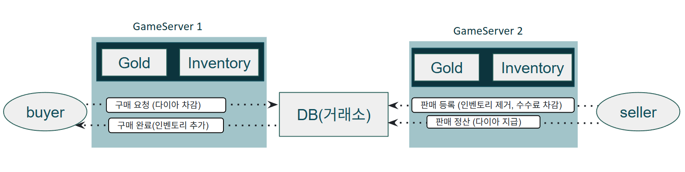

# 거래소 시스템 (Bazaar)

## 1. 개요

거래소 시스템은 플레이어 간 아이템 거래를 지원한다. 현재 구현은 다이아 재화와 거래 데이터를 하나의 Bazaar DB에서 트랜잭션으로 처리하는 구조다.
판매자가 아이템을 등록하면 구매자가 다이아(과금 재화)로 구매하고, 판매자가 정산을 청구하는 방식으로 동작한다.

### 도입 배경
MMORPG 플레이 경험상 소규모 서버에서는 거래소가 활발하지 않아 불편함을 느꼈다. 여러 서버의 거래를 모으면 거래 상대를 찾기 쉬워질 텐데, 통합 거래소를 지원하려면 어떤 제약을 해결해야 하는지 궁금해 직접 거래소를 구현했다.  
처음에는 중앙 DB에서 거래 데이터를 공유하는 방향으로 접근했다. 구매·정산과 아이템 배송을 구현하면서, 서버 간 거래를 확장할 때 재화의 저장 위치와 트랜잭션 경계가 중요한 제약이라는 점을 확인했다.  
현재 구현에서는 단일 DB의 구매 트랜잭션과 Outbox/Inbox 배송에 집중했고, **재화 DB와 거래소 DB를 독립적으로 샤딩하는 분산 통합 거래소까지 구현하지는 않았다.**  

### 통합 거래소 확장 시의 한계

다이아는 DB에서 직접 관리한다. 구매 프로시저(`sp_bazaar_buy`)는 구매자의 다이아 차감, 매물 상태 변경, 배송 Outbox 생성을 하나의 트랜잭션으로 묶는다. 현재는 관련 테이블이 같은 DB 인스턴스에 있어 이 원자성을 로컬 트랜잭션으로 유지할 수 있다.  
- **중앙 DB에 집중되는 부하**: 여러 GameServer가 같은 Bazaar DB를 공유할 수 있지만, 거래량이 증가하면 재화 갱신과 거래 트랜잭션이 한 DB에 집중되어 병목이 될 수 있다.
- **독립 샤딩 시 분산 커밋 필요**: 재화와 매물을 서로 다른 DB 인스턴스에 나누면 기존 프로시저의 트랜잭션 경계를 유지할 수 없다. 차감과 구매 확정을 계속 하나의 원자적 커밋으로 처리하려면, 별도 거래소 서버 등이 코디네이터 역할을 맡아 2PC 같은 분산 트랜잭션을 조율하는 구조를 고려해야 한다.
- **잠금 시간과 구현 복잡도 증가**: 2PC에서는 참여 DB가 prepare 이후 commit 또는 rollback 결정을 기다리는 동안 잠금을 유지한다. 서버 간 통신과 장애 복구 대기가 잠금 구간에 추가될 수 있고, 코디네이터의 결정 기록·재시도·장애 복구까지 구현해야 한다.
- 
2PC가 모든 통합 거래소의 필수 조건은 아니다. 재화를 예약하고 실패 시 보상하는 방식 등으로 트랜잭션 경계를 다시 설계할 수도 있다. 다만 그 경우에도 중간 상태와 복구 정책이 필요하다. 이 과정을 통해 DB 트랜잭션으로 정합성을 단순하게 유지한 선택이 독립 샤딩에서는 조율 비용으로 이어진다는 설계상의 한계를 확인했다.  

### 한계점
- 등록 수수료 gold는 best-effort 보상으로 처리한다 (수수료 특성상 유실 허용 — [DB.md](DB.md) 차등 durability 참조).
- 배송(Outbox → 인벤토리)은 exactly-once로 수렴하지만, 크래시 시점에 따라 수령이 지연될 수 있다 (재접속 시 수렴).
- 등록 중 서버가 죽으면 아이템이 유실될 수 있다. 차감은 WAL이나 DB에 남았는데 매물이 아직 생성되지 않은 경우다. 재기동 후 이 차감을 찾아 보상하는 처리는 아직 없다.
- BUY의 Outbox/Inbox처럼 인벤토리 blob에 pending listing 마커를 심어, 재기동 시 Bazaar DB와 대조 후 보상하는 구조가 필요하다.   
- 별도 DB 테이블로 차감 시도를 기록하는 방식은 그 기록과 캐시 차감이 서로 다른 시스템이라 원자적으로 묶이지 않아 동일한 문제를 재발시키므로 적합하지 않다.  

## 2. 핵심 설계 결정

### 2.1 데이터 특성 기반 저장 전략 분리

데이터별 갱신 빈도와 손실 허용 수준이 다르므로 저장 전략을 분리 적용했다.  

| 구분 | Gold (게임플레이 재화) | Item (인벤토리) | Diamond (과금 재화) |
|------|----------------------|----------------|-------------------|
| 갱신 빈도 | 고빈도 (몬스터 처치, 퀘스트 보상 등) | 고빈도 (획득·사용·거래) | 저빈도 (아이템 구매, 부활 등) |
| 손실 허용 | 제한적 손실 수용 가능 | 거래 구간은 불허 (유실·복제 모두 치명적) | 0 (실제 금전 환산 가능) |
| 저장 전략 | In-Process 캐시 (Write-Back) | In-Process 캐시 + WAL, 구매·취소 배송은 Outbox/Inbox | DB 직접 관리 + 트랜잭션 |
| 이유 | DB 부하 최소화, 저지연 처리 | 저지연을 유지하면서 cross-DB 배송 구간만 exactly-once 보장 | 완전한 ACID 보장, 감사 추적 필수 |

> 일반 인벤토리 변경에도 WAL을 남긴다. 다만 응답 전에 fflush/fsync를 기다리지 않아 마지막 변경은 유실될 수 있다. Gold에는 아직 WAL을 적용하지 않았다.
> 구매·취소 아이템은 Outbox가 남아 있어 재접속 후 다시 배송한다. 등록 중 유실은 위에 적은 별도 문제다.
> 다이아몬드 감사 로그는 현재 거래소 처리에만 남긴다. 유료 재화라면 거래소 외의 변동 이력도 별도 테이블에 남겨야 한다.

### 2.2 Diamond 트랜잭션 처리 구조

다이아 거래는 Stored Procedure 트랜잭션으로 처리하여 완전한 ACID를 보장한다.  

애플리케이션 레벨 트랜잭션은 쿼리마다 네트워크 홉을 오가며 lock 점유 시간이 홉 수만큼 늘어나는 구조라 성능상 부적절하다고 판단했다.  
트랜잭션이 필요한 로직은 Stored Procedure로 구현해 DB 내부에서 원자적으로 완결되도록 설계했다.  

### 2.3 아이템 배송: Outbox / Inbox 패턴  

구매·취소 아이템은 **Bazaar DB → 인벤토리(Game DB 캐시)** 로 옮긴다. 지금은 같은 MySQL 인스턴스라 하나의 DB 트랜잭션으로 묶을 수도 있다. 나중에 DB를 분리할 수 있도록 커넥션 풀과 트랜잭션을 나눴다.
배송은 Outbox로 재시도하고, Inbox로 같은 배송이 두 번 적용되는 것을 막는다.

- **Outbox (`buyer_outbox`)**: 구매·취소 트랜잭션 안에서 원자적으로 INSERT되는 "배송해야 할 사실"의 durable한 기록. `READY` 상태인 한 재배송이 반복된다 → **유실 없음**
- **Inbox (인벤토리 blob 내 dedup ring)**: 배송 시 event_id를 아이템과 같은 blob에 기록해 원자적으로 영속. 재배송이 와도 dedup으로 스킵 → **중복 없음**  
- Outbox의 `CLAIMED` 전환은 인벤토리 blob이 DB에 durable해진 이후에만 수행한다.  

상세 계약(복구 테이블, 배송 불변식)은 [DB.md](DB.md)에 정리했다.  

## 3. 거래 흐름

| 저장소 | 관리 데이터 | 전략 |
|--------|------------|------|
| Cache (In-Process) | Inventory(+dedup ring), Gold | Write-Back |   
| DB (Bazaar) | Diamond, bazaar, bazaar_log, bazaar_claim, buyer_outbox | 트랜잭션, 감사 추적, 배송 Write-ahead |  

## 4. BUY 처리 상세 (sp_bazaar_buy)

1. listing 행 잠금 + 조회 (`status = 'TRADING'`, FOR UPDATE — 롤백 낭비 방지)  
2. 구매자 diamond 차감 (`diamond >= price` 조건으로 원자적 처리)  
3. bazaar CAS: `TRADING → SOLD` (`ROW_COUNT() = 0`이면 rollback)  
4. bazaar_log INSERT (append-only 감사 로그)  
5. bazaar_claim INSERT (`READY` — seller 정산 대기)  
6. **buyer_outbox INSERT (`READY` — 배송 Write-ahead)**  
7. COMMIT  

아이템 지급은 트랜잭션에 포함되지 않는다. 클라이언트의 `CHECK_OUTBOX` 요청이 outbox의 `READY` event를 인벤토리로 배송(DeliverItem)하고,   
인벤토리 blob flush가 완료된 뒤 CacheFlush가 outbox를 `CLAIMED`로 전환한다.  

__Crash 시나리오별 수렴__ (검증: [BazaarTest.md](BazaarTest.md) Test 6)  

| 크래시 시점 | 크래시 직후 상태 | 복구 동작 |
|------|------|------|
| 배송 반영 후, flush 전 | 인벤토리 미반영 + outbox READY | 재접속 시 **재배송** → 정확히 1개 지급 (유실 없음) |  
| flush 후, CLAIM 전 | 인벤토리 반영 완료(durable) + outbox READY | dedup이 재배송을 스킵 → **수량 변화 없이 outbox만 READY → CLAIMED** (중복 없음) |

### CANCEL 처리 상세 (sp_bazaar_cancel)

취소는 `TRADING → CANCELLED` 전환과 판매자 앞으로의 반환 Outbox INSERT를 같은 Bazaar DB 트랜잭션에서 처리한다. 이후 서버가 즉시 `DeliverItem`을 시도하며, 캐시 미적재·인벤토리 또는 dedup ring 포화로 실패하면 Outbox를 `READY`로 남겨 `CHECK_OUTBOX`에서 재시도한다. 취소 성공 응답은 반환 이벤트가 durable하게 생성되었다는 뜻이며, 아이템이 즉시 인벤토리에 들어갔다는 뜻은 아니다.

같은 취소를 다시 요청하면 기존 event_id를 반환한다. 이미 `CLAIMED`인 이벤트는 즉시 배송도 다시 시도하지 않아, dedup ring에서 오래된 이벤트가 밀려난 뒤의 재취소로 재지급되는 것을 막는다. 인벤토리 blob 저장과 Outbox CLAIM 순서는 구매 배송과 동일하다. 구매와 취소가 경쟁하면 동일한 listing 행 잠금으로 직렬화되어 하나만 성공한다.

새 프로시저가 추가되었으므로 기존 DB에는 [procedure.sql](Resources/DB/procedure.sql)을 다시 적용해야 한다. 파일의 `DROP PROCEDURE IF EXISTS`는 해당 프로시저 정의만 교체하며 테이블 데이터는 삭제하지 않는다.

## 5. CLAIM 처리 상세 (sp_bazaar_claim)

1. listing 조회 (`status = 'SOLD'`, `seller_id` 조건)
2. bazaar_claim `claim_status` 업데이트 (`READY → CLAIMED`, CAS로 이중 정산 방지)  
3. seller diamond 지급 (`INSERT ... ON DUPLICATE KEY UPDATE` — 행 없으면 생성)  
4. COMMIT

CLAIM은 전부 단일 트랜잭션 내에서 처리되므로 데이터 유실이 발생하지 않는다.  

> bazaar_log는 append-only 감사 로그로 유지하고, mutable한 정산 상태는 bazaar_claim으로 분리하여 로그 테이블의 불변성을 보장한다.

## 6. 설계 실수 — buyer_prev_quantity 복구 방식의 오류

초기 구매 설계에서는 bazaar_log에 `buyer_prev_quantity`(구매 직전 구매자의 아이템 수량)를 기록하고, 크래시 시 이 값을 기준으로 인벤토리를 복구할 수 있다고 판단했다.   

**착각의 근원은 판매 등록의 Saga 패턴이었다.**   
등록은 먼저 인벤토리에서 아이템을 차감하고, DB 등록에 실패하면 차감한 만큼 되돌리는 구조다.   
보상이 "자신이 차감한 양을 다시 더하는" 상대 연산이라, 보상 시점까지 인벤토리가 어떻게 변하든 유효하다.  

**그러나 구매는 다르다.**  
`prev_quantity`가 기록되는 시점(BUY 트랜잭션)과 인벤토리에 반영되는 시점 사이에 시차가 있고, 그 사이 인벤토리는 다른 요청(아이템 사용·획득·추가 구매)으로 계속 변한다.  
인벤토리를 트랜잭션 동안 lock으로 묶지 않는 한 **`prev_quantity`는 복구 기준 스냅샷이 아니라 그냥 과거의 한 값**이며, 이 값으로 복구하면 그 사이에 일어난 정상 변경까지 되돌려버린다.  
lock으로 묶는 순간 캐시를 도입한 의미(저지연)가 사라지므로 그것도 답이 아니었다.  

 복구 기준을 상태값에서 event로 바꿨다.   
 Outbox는 "이 아이템을 이 구매자에게 전달해야 한다"는 사실만 기록하므로 시차나 동시 변경의 영향을 받지 않는다.  
 수령 쪽은 처리한 event id를 Inbox에 남겨 같은 event가 다시 와도 건너뛴다.  

이에 따라 `buyer_prev_quantity`는 현재 스키마에서 제거했고, bazaar_log는 복구 용도가 아닌 순수 감사 로그로만 유지한다.  

## 7. 향후 개선

- 현재는 모든 등급 거래 가능.  
- 전설급 이상은 `unique_item_id`를 부여해 `unique_items` 테이블로 소유권을 추적하고, 거래 이력을 별도 기록하면 개별 아이템 단위의 정확한 추적이 가능해진다.

## 8. 참고

- [DB.md](DB.md)
- [BazaarTest.md](BazaarTest.md) 
- [procedure.sql](Resources/DB/procedure.sql)
