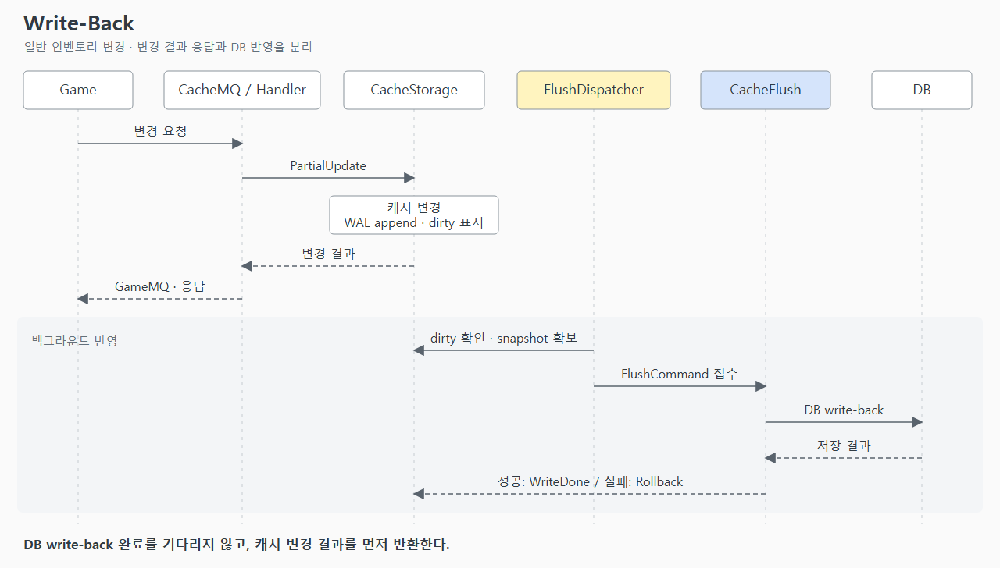
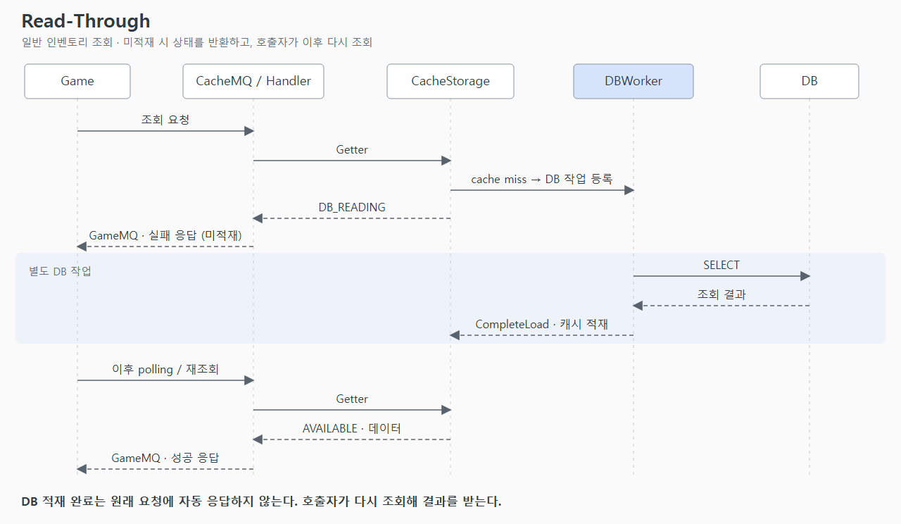
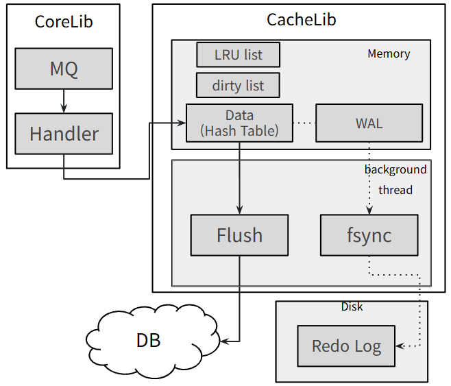

# CacheLib

## 1. 개요
본 문서는 CacheLib의 구조와 Cache 시스템과 DB와의 동작을 설명한다.  
캐시 동작 검증을 위해 Inventory 데이터를 기준으로 구체적인 캐시 동작을 설계하였다.


## 2. 캐시 배치 전략

캐시 서버를 별도 클러스터로 분리할지, 게임 서버에 직접 탑재할지는 데이터 특성에 따라 결정하였다.

__In-Process 캐시 (게임 서버 내 탑재)__

인벤토리와 같이 레이턴시에 민감한 데이터는 게임 서버에 직접 탑재한다.
- 별도 캐시 서버와의 네트워크 통신 비용 제거
- 현대 서버의 메모리 용량과 성능상 분리의 이점이 크지 않음

__External 캐시 (별도 캐시 서버)__

여러 서버 간에 공유되어야 하고 레이턴시에 민감하지 않은 데이터는 Redis 등 별도 캐시 서버에서 처리하는 것이 적합하다.

__vs Redis__

Redis는 캐시 안정성이 입증되었고 클러스터(샤드) 지원 등 
운영 측면에서 장점이 있다.

다만 Redis를 캐시로 사용하는 경우 게임 서버가 캐시 조회/업데이트와 
DB 조회/업데이트를 모두 직접 처리해야 하며, Redis에 맞는 형태로 
데이터를 파싱해야 한다.

```
[ 클라이언트 ] ──→ [ 게임 서버 ] ──→ [ Redis ]
                       ↑  ↓
                       [ DB ]
```

본 프로젝트에서는 Write-Back을 캐시 서버 내부에서 직접 처리하는 
구조가 필요했기 때문에 In-Process 캐시를 직접 구현하였다.


## 3. 목적

부하가 큰 DB IO를 줄여 게임 서버의 안정성을 높이기 위해 In-Process 메모리 캐시를 사용하여 DB write-back 구조를 설계하였다.  
Inventory 데이터를 기준으로 구체적인 캐시 동작을 설계하고 검증한다.

```
[ 클라이언트 ] ──→ [ 게임 서버 ] ──→ [ CacheLib (In-Memory) ]
                                              ↓ write-back
                                          [ DB ]
```


## 4. 구조
### 서버 동작 흐름

| 색상 | 구분 |
|---|---|
| 흰색 | 요청 처리·공유 저장소 |
| 노란색 | FlushDispatcher |
| 파란색 | DBWorker·CacheFlush |

__Write-Back__




update 요청이 CacheStorage에 반영된 후 일정 시간이 지나면 FlushDispatcher가 dirty 데이터를 감지하여 CacheFlush를 통해 DB에 write-back한다.

__Read-Through__




캐시 미스 발생 시 비동기 DB 적재를 요청하고, 현재 조회에는 `DB_READING`을 반환한다. DB 적재 완료 후 재조회하면 데이터를 얻을 수 있다. 완료 콜백을 받는 경로는 아래 사용자 접근 패턴에서 구분한다.
메시지 경로의 Handler는 `AVAILABLE`일 때만 성공 응답을 보내고, 미적재 상태에서는 실패 응답을 보낸다. DB 적재 완료가 원래 요청의 응답으로 이어지지 않으며, 호출자가 이후 polling으로 다시 조회한다.
CacheMQ는 수신 MQ, GameMQ는 캐시 서버 기준 응답 송신 MQ이다.


### 공용 템플릿 메서드

| 메서드 | 설명 |
|---|---|
| `TryGet` | 캐시에서 데이터 조회 시도 |
| `Rollback` | DB 쓰기 실패 시 재시도(재flush) 처리. 처음 2회는 즉시 재시도, 3회째부터는 `dirty_list` 재등록으로 백오프하여 무한정 재시도(데이터는 버리지 않음) |
| `WriteDone` | 발행 generation이 일치하는 완료만 적용하고 in-flight 해제. eviction 대상이면서 추가 dirty가 없는 항목만 제거한다 |
| `ForEachDirty` | dirty 상태의 캐시 항목 순회 |
| `TrySetReading` | DB 조회 중 상태 설정 (중복 조회 방지) |
| `Insert` | 캐시에 데이터 삽입 |
| `SetEmpty` | 캐시 항목을 빈 상태로 설정 |

> `dirty_list`는 snapshot 발행에 성공했을 때 제거한다. 같은 키의 flush는 하나만 in-flight로 허용하며, DB I/O 중 새 변경은 다시 dirty로 남긴다. snapshot의 generation을 완료·롤백 콜백과 비교해 과거 콜백이 새 작업을 지우지 못하게 한다. in-flight entry는 LRU에서도 즉시 제거하지 않는다. CLAIM 재시도가 필요하면 `WriteDone`이 dirty를 유지한다.

### 개별 캐시 메서드

| 메서드 | 설명 |
|---|---|
| `LoadFromDB` | DB에서 데이터를 읽어 캐시에 적재 |
| `Getter` | 캐시 데이터 반환 |
| `PartialUpdate` | 캐시 데이터 부분 업데이트 |
| `GetFlushCommand` | DB write-back용 FlushCommand 생성 |
| `ResultToString` | 캐시 데이터를 문자열로 변환 (로깅용) |

### 사용자 접근 패턴 (Inventory 기준)

__Read__
```
Getter → GetOrLoad → TryGet
    → cache hit  → 데이터 복사 반환
    → cache miss → LoadFromDB → 비동기 DB 작업 등록 → DB_READING 반환
        → DB 작업 완료 → 캐시 적재 → 이후 재조회 시 데이터 반환
```

- 조회 호출은 DB 적재 완료를 기다리지 않는다. `DB_READING`은 조회 실패가 아니라 적재 중 상태이며, DB 작업 등록이 거절되면 `EMPTY`를 반환한다.
- `LoadEquipmentState`는 완료 콜백을 등록해 캐시 적재 후 결과를 받는 별도 경로다.

__Zone 워커의 직접 접근__

- Zone 워커는 `IInventoryOperations`를 통해 장비 상태 조회·장비 변경·아이템 소비를 동기 호출한다. 이 경로는 Cache 요청 메시지 큐를 거치지 않는다.
- 캐시 내부의 샤드 mutex로 공유 상태를 보호하고, 조회 결과나 변경 결과를 반환한 뒤 Zone의 게임 상태 처리를 이어간다. 동기 호출이지만 DB 조회 완료까지 기다리는 방식은 아니며, 캐시가 준비되지 않으면 `Busy` 등의 상태를 반환한다.
- 인벤토리 변경은 WAL append 후 캐시에 반영하고 dirty로 표시한다. DB write-back은 별도 워커에서 처리한다.

__Update__
```
클라이언트 요청
    → TryGet
        → PartialUpdate → dirty 마킹 → 응답
            → FlushDispatcher → GetFlushCommand → DB write-back
                → 성공 → WriteDone
                → 실패 → Rollback
```

__종료 처리__

정상 종료 시 `CleanUp()`은 입력 큐를 중단·drain하고, DB 작업 워커의 처리 및 rollback을 마친 뒤 최종 dirty snapshot을 만든다. FlushDispatcher는 큐 용량을 넘는 dirty entry도 여러 batch로 발행하며, 배송 CLAIM 이후 변경된 Inbox head까지 추가 flush한다. 마지막으로 flush 워커를 종료하고 WAL을 fsync한다.

이 순서는 **DB 저장 성공 시** 마지막 변경이 누락되지 않도록 하는 계약이다. DB 저장이 반복 실패하면 dirty를 버리지 않고 재시도 상한에서 종료하며, 인벤토리는 남은 WAL로 복구해야 한다. Gold는 WAL이 없어 이 상황의 복구를 보장하지 않는다. 비정상 종료에서는 20ms 비동기 fflush/fsync 정책상 아직 기록되지 않은 tail이 유실될 수 있다. 상세는 [WAL.md](WAL.md) 참고.

### CacheLib 아키텍처


>CacheLib 아키텍처

## 5. 특징

- __샤드 기반 lock 분리__ — CacheStorage 내부적으로 샤드 단위로 mutex를 분리하여 lock 경합을 최소화
- __순환 의존 방지__ — 의존성 주입 대신 함수 객체(function object) 사용으로 구조적 순환 의존을 방지
- __TOCTOU 처리__ — 캐시 조회 후 lock 획득 시 상태를 다시 확인하는 구조로 Time-of-check to time-of-use 경쟁 상황을 방지하였다
- __LRU eviction__ — eviction 발생 시 데이터를 즉시 제거하지 않고 LRU 리스트에서만 제거 후 DB write-back 완료 후 최종 제거. 
- __ACID를 고려한 설계__ — 캐시 동작 전반에 걸쳐 ACID를 따르도록 설계. 자세한 내용은 [ACID 설계 문서](CacheLib_ACID.md) 참고  
- __WAL 기반 장애 복구__ — 인벤토리 변경과 WAL append를 하나의 shard 임계구역에서 처리하며, 장애 후 파일에 남은 유효 레코드로 Dirty 데이터를 복원한다. 비동기 fsync 이전 tail과 Gold는 보장 범위에서 구분한다. 상세 설계는 [WAL 설계 문서](WAL.md) 참고

## 6. 참고
- [CacheLib ACID 설계 문서](CacheLib_ACID.md)
- [CacheLib 단위 테스트 문서](CacheLib_Test.md)
- [WAL 설계 문서](WAL.md)
- [Cache Durability Test](CacheDurabilityTest.md)
