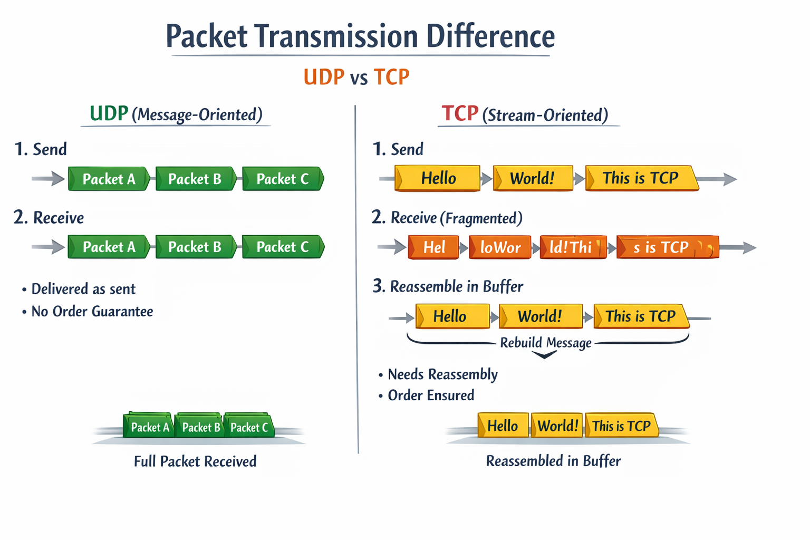

# ClientContext

## 1. 개요
TCP 수신 처리 시 누적버퍼 처리를 위해 사용되는 ClientContext를 설명하는 문서이다.

##  2. TCP vs UDP 메시지 처리

> TCP와 UDP 패킷 처리 차이  

UDP
- 메시지 단위 프로토콜
- 애플리케이션이 보낸 단위(데이터그램)가 그대로 전달됨
	- recv 호출 시 한 번에 보낸 단위 그대로 읽음
- MTU보다 큰 경우 IP 레벨에서 fragment → 수신 시 재조합됨
- 순서 보장 및 재전송 없음 → 손실 가능

TCP
- 스트림 단위 프로토콜
- 애플리케이션이 보낸 메시지 단위가 보장되지 않음
	- recv 호출로 읽는 데이터는 TCP가 결정한 스트림 조각 단위
- 수신 측에서 여러 send() 호출 데이터가 하나로 합쳐지거나,
- 하나의 send()가 여러 recv() 호출로 쪼개져 도착할 수 있음
- 따라서 TCP를 사용할 경우 애플리케이션 레벨에서 __수신 버퍼를 재조합하여 원래 메시지 단위의 패킷__을 만들어야 함

## 3. ClientContext 개념
`ClientContext` 클래스는 각 클라이언트 연결에 대한 TCP 수신 버퍼를 관리하며,
패킷 단위로 데이터를 분리하기 전까지의 누적 데이터를 처리하는 역할을 수행한다.

- 목적: 클라이언트별 TCP 수신 버퍼 관리
- 책임:
  - 수신된 데이터를 누적 버퍼에 저장
  - 패킷 단위로 분리할 수 있는 구조 제공 (RingBuffer + PacketView)
  - Zero-copy 전략 유지
  - Buffer Release 관리 (작업 완료 후 반환)

## 4. 구조
- 멤버 변수
	- `RingBuffer m_buffer` : TCP 수신 누적 버퍼
	- `uint64_t m_sessionID` : 연결된 세션 ID (캐시)
	- `std::atomic<int16_t> m_workingCnt` : 버퍼 점유 중인 작업 수
	- `std::atomic<int16_t> m_pendingIOCnt` : Context의 수신 버퍼를 참조하는 pending RECV 수
	- `std::vector<std::pair<uint16_t, uint16_t>> m_releaseQ` : 버퍼 반환 큐
- Mutex 사용
	- RingBuffer 사용 부분 직렬화
	- 수신은 소켓당 1개씩 체이닝 되기 때문에 경합은 낮음.

## 5. 동작
1. 수신 데이터는 `EnqueueRecvQ()` 호출로 누적
2. 패킷 분리가 완료되면 `PacketView`를 통해 외부로 전달
3. 처리 완료 후 `ReleaseBuffer()`로 RingBuffer 반환
4. 연결 종료 후 `ClientContextPool`에 반납한다. `workingCnt == 0`, `pendingIOCnt == 0`, 종료 통지 완료 조건을 모두 만족할 때만 flush에서 재사용한다.

### 수신 검증과 재사용 조건

- 헤더의 `length`는 wire 타입인 `uint32_t`로 유지한 채 공통 범위인 헤더 크기 이상·최대 4KB를 검사한다. 길이 0, 헤더보다 짧은 길이, 최대 길이 초과, 잘못된 magic·정의 범위 밖 opcode는 실패 처리한다.
- ClientContext는 공통 헤더 검증과 스트림 분리를 담당한다. opcode별 body 길이 표, 송신 방향 제한, flags 허용 목록과 가변 payload 검사를 이 계층에 추가하지 않는다.
- 정상적인 부분 수신은 다음 RECV를 기다린다. 성공한 파싱은 반드시 길이만큼 전진하므로, 잘못된 길이로 같은 입력을 반복 처리하지 않는다.
- 재접속을 위해 `Clear()`할 때 sequence뿐 아니라 release index, release queue, 마지막 acquire/release 상태를 함께 초기화한다.
- PONG의 RTT는 Context mutex 아래에서 계산하고 mutex를 해제한 뒤 SessionManager에 통지해 `Context → shard` 역순 잠금을 없앤다.
- 마지막 PacketView를 반납한 스레드가 종료 통지를 마치기 전까지 풀 재사용을 금지한다. 원자적 통지 상태를 사용해 종료 통지도 정확히 한 번 수행한다.
- 반납/종료 처리는 Context mutex 아래에서 완료한다. 풀의 `CanRecycle()`은 같은 mutex를 `try_lock`하여 아직 실행 중인 반납 스택을 건너뛰므로, 풀 mutex 아래에서 종료 통지를 기다리지 않는다.

### 회귀 테스트의 검증 범위

[NetworkRegression.cpp](UnitTests/NetLib/NetworkRegression.cpp)는 AI 보조로 작성한 회귀 테스트다. `NetworkRegressionTest` 12개와 `SessionStateRegressionTest` 3개로, 발견한 결함의 입력값과 지정한 실행 순서에서 기대 동작을 확인한다.

| 범주 | 개수 | 확인하는 동작 |
|---|---:|---|
| 입력 검증·파싱·전달 | 5 | 길이 0·정수 축소로 인한 잘못된 길이 거부, 분할 버퍼 누적, 인벤토리 요청의 대체 Dispatcher 전달, 링 경계 파싱 |
| Context 재사용·수명 조건 | 3 | 재사용 후 1개 링 이상의 반복 수신·반납, 종료 통지 중 재사용 불가·통지 1회, pending RECV 해제 전 재사용 불가 |
| PONG 락 순서 | 1 | shard를 다른 스레드가 점유한 동안 PONG 수신 경로가 Context mutex를 해제하는지 확인 |
| Ping 상태 | 4 | 미응답 누적·임계치·초기화, 마지막 허용 PONG 수용, 이전 세션 PONG 무시 |
| 수신 크기 정책 | 2 | 새 세션에서 누적 창 초기화, 판정 실패 상태 유지 |

실제 `ClientContext`, `RingBuffer`, `PacketView`, `NetPacketFilter`, `SessionManager`, `SessionState`를 사용한다. 소켓 값은 fixture의 조회 키이며, 버퍼를 `BeginRecvIO → memcpy → EnqueueRecvQ → CompleteRecvIO`로 직접 주입한다. Dispatcher는 대체 구현으로, 인증 상태를 정상으로 반환하고 RTT는 7로 고정한다.

실제 IOCP·WSARecv/WSASend·취소 completion, 실소켓 연결·재접속, ContextPool의 Acquire/Return, 인증·게임 핸들러, RTT 실측·계산 정확성, 부하·처리량은 검증 범위에 포함하지 않는다. 인벤토리 테스트도 실제 NonZoneHandler와 캐시 조회를 실행하지 않는다. 락 검사는 특정 역순 획득 조건에서 Context mutex 해제를 확인하며, 실제 Disconnect를 동시에 실행하거나 서버 전체의 교착·경쟁 조건 부재를 입증하는 시험은 아니다.

## 6. 설계 결정 및 트레이드오프
- 포인터로 외부에서 사용하도록 설계
  - ContextPool의 flush 정책이 PacketView 참조, pending RECV 참조, 종료 통지 상태를 모두 확인한 뒤 재사용
- Session 상태와 직접 연관시키지 않음
  - Session 관련 상태는 `SessionManager` 및 `SessionState`에서 관리

## 7. 참고
- [PacketView.h](NetLibrary/PacketView.h)
- [SessionManager.h](NetLibrary/SessionManager.h)
- [RingBuffer.h](NetLibrary/RingBuffer.h)