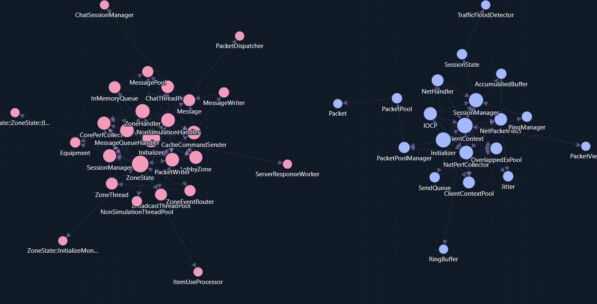
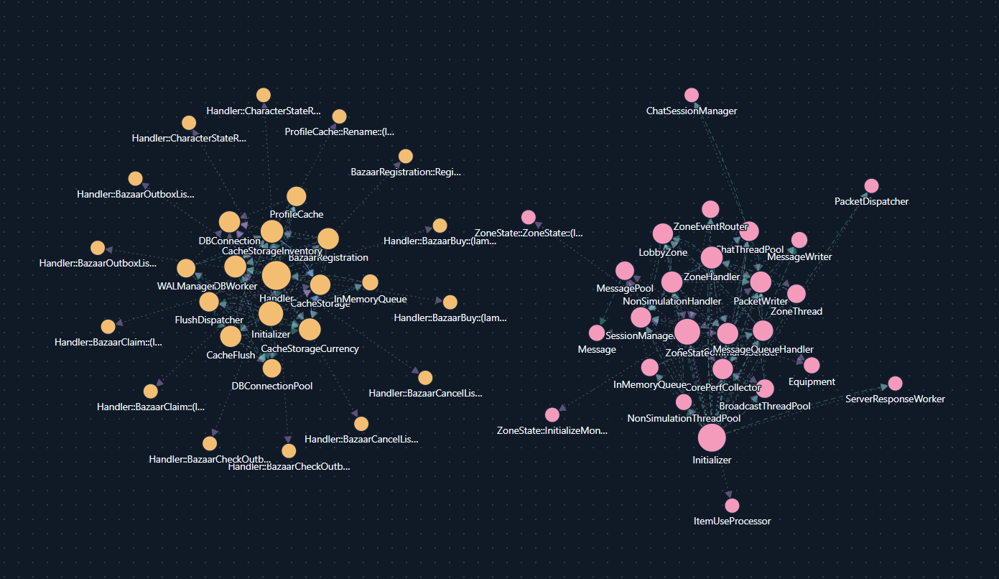
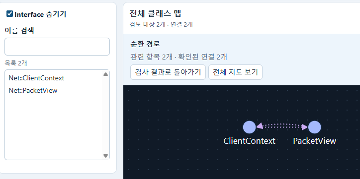

# 코드 구조 탐색기를 활용한 리팩터링

[CodeExplorer](Resources/CodeExplorer/README.md)로 의존 관계를 살펴보고, 실제 코드에서 변경할 부분을 찾아 수정한 사례를 정리한다.

## 1. Core–Cache 메시지·내구성 로그 구현 의존성 분리

### 발견

- **Interface 숨기기**를 추가해 인터페이스를 제외한 구현 클래스 사이의 직접 의존성을 살펴봤다. 숨김 기준은 AST의 추상 클래스 판정이다.
- Core–Cache는 구현 클래스들이 하나의 연결 영역으로 나타났다.

- 같은 조건에서 Core–Net은 구현 클래스들이 서로 분리된 영역으로 나타났다. 두 경계를 비교하며 Core–Cache의 직접 의존성을 추적했다.

### 원인

- 카드 보기와 코드 근거를 따라가니 Cache가 Core의 `Message`, `MessagePool`, `MessageWriter`, `DurableLogger`를 직접 사용하고 있었다.
- 기존 `IMessageQueue`도 구체 타입인 `Message*`를 받았다. 메시지 처리뿐 아니라 버퍼·풀·응답 작성·내구성 기록 구현까지 연결되어 있었다.

### 변경

| 직접 참조하던 구현 | 분리한 계약 | 역할 |
| --- | --- | --- |
| `Message` | `IMessage` | 메시지 버퍼·길이·용량 접근 |
| `MessagePool` | `IMessagePool` | 메시지 획득과 원래 풀로 반환 |
| `MessageWriter` | `ICacheResponseWriter` | Cache 응답 메시지 작성 |
| `DurableLogger` | `IDurableLog` | 내구성 기록 |

- `IMessageQueue`가 `IMessage`를 받도록 바꾸고, 비동기 작업에서도 공통 RAII 핸들로 원래 풀에 반환하도록 했다.
- Cache가 직접 소유하던 풀과 응답 Writer는 MainServer에서 생성해 인터페이스로 주입했다.
- 큐 진입 시 수신 측 풀로 복사하는 방식, 메시지 레이아웃, WAL 기록·동기화 성공 조건은 유지했다.

### 결과

- 수정 후 다시 분석하고 **Interface 숨기기**를 적용하니 Core–Cache의 구현 클래스들이 분리된 영역으로 나타났다.

## 2. ClientContext–PacketView 버퍼 반납 의존성 분리

### 발견

- 순환 의존 검사에서 `ClientContext → PacketView → ClientContext` 경로를 확인했다.
- `ClientContext`는 패킷 뷰를 구성하고 반납받으며, `PacketView::Release()`는 `ClientContext::ReleaseBuffer()`를 직접 호출했다.

### 변경

- 버퍼 반납 계약인 `IBufferRelease`를 분리하고 `ClientContext`가 구현하도록 했다.
- `PacketView`는 `ClientContext*` 대신 인터페이스를 주입받아 반납을 요청한다.
- 버퍼 반환 순서, 작업 수 감소, 패킷 뷰의 풀 반환과 접속 종료 통지는 기존 구현을 유지했다.

### 결과

- `PacketView`에서 구체 클래스인 `ClientContext`를 참조하는 의존성을 제거했다. 반납 요청은 `PacketView → IBufferRelease`로 연결된다.
- 패킷 뷰가 반납될 때까지 Context의 수명을 유지해야 하는 조건은 그대로다.

- 같은 순환 의존 검사로 확인한 `ClientContext → SessionManager`의 PONG 통지 의존성도 인터페이스로 분리했다.
