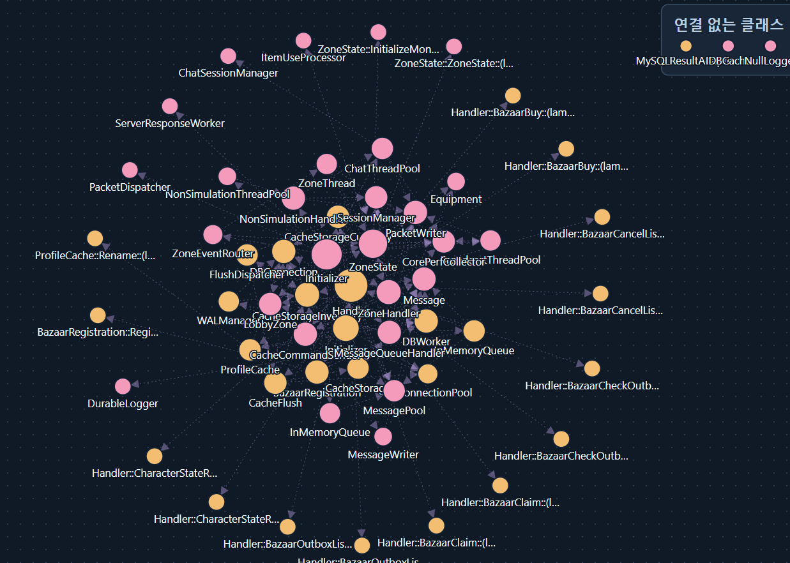
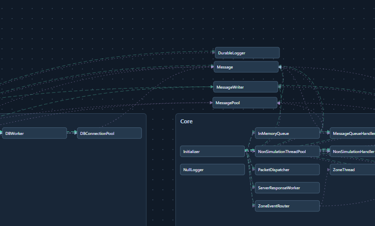
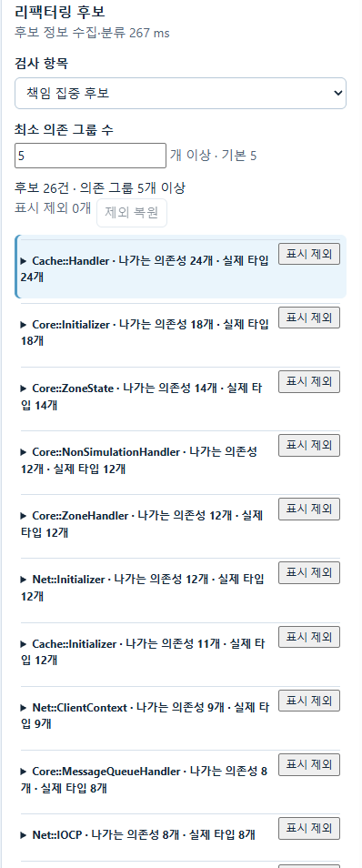
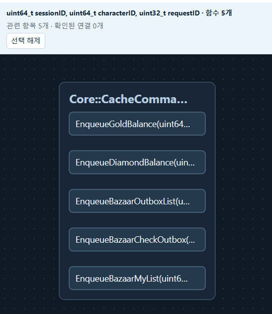
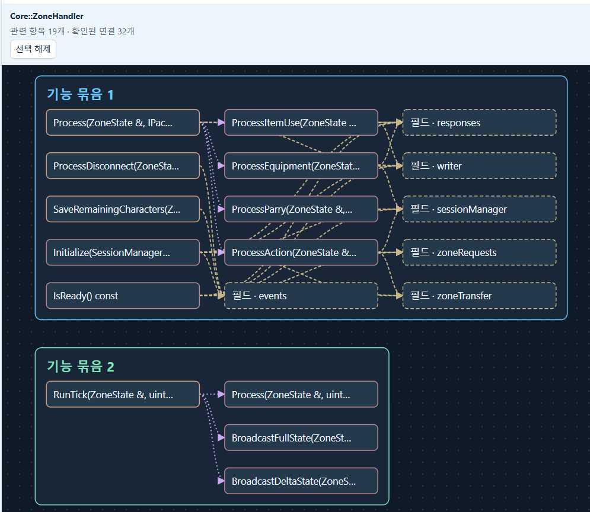

# 코드 구조 탐색기를 활용한 리팩터링

[CodeExplorer](Resources/CodeExplorer/README.md)로 의존 관계를 살펴보고, 실제 코드에서 변경할 부분을 찾아 수정한 사례를 정리한다.

화면은 당시 버전의 캡처다. 현재의 연결 중심 배치는 캡처에서 관계 지도, 계층 배치는 카드 보기로 표시된다.

## 1. Interface 숨기기를 통한 구현 의존성 검토

### Core–Cache 메시지·내구성 로그 구현 의존성 분리

#### 발견

- **Interface 숨기기**를 추가해 인터페이스를 제외한 구현 클래스 사이의 직접 의존성을 살펴봤다. 숨김 기준은 AST의 추상 클래스 판정이다.
- Core–Cache는 구현 클래스들이 하나의 연결 영역으로 나타났다.

- 같은 조건에서 Core–Net은 구현 클래스들이 서로 분리된 영역으로 나타났다. 두 경계를 비교하며 Core–Cache의 직접 의존성을 추적했다.

#### 원인

- 계층 배치와 코드 근거를 따라가니 Cache가 Core의 `Message`, `MessagePool`, `MessageWriter`, `DurableLogger`를 직접 사용하고 있었다.
- 기존 `IMessageQueue`도 구체 타입인 `Message*`를 받았다. 메시지 처리뿐 아니라 버퍼·풀·응답 작성·내구성 기록 구현까지 연결되어 있었다.

#### 변경

| 직접 참조하던 구현 | 분리한 계약 | 역할 |
| --- | --- | --- |
| `Message` | `IMessage` | 메시지 버퍼·길이·용량 접근 |
| `MessagePool` | `IMessagePool` | 메시지 획득과 원래 풀로 반환 |
| `MessageWriter` | `ICacheResponseWriter` | Cache 응답 메시지 작성 |
| `DurableLogger` | `IDurableLog` | 내구성 기록 |

- `IMessageQueue`가 `IMessage`를 받도록 바꾸고, 비동기 작업에서도 공통 RAII 핸들로 원래 풀에 반환하도록 했다.
- Cache가 직접 소유하던 풀과 응답 Writer는 MainServer에서 생성해 인터페이스로 주입했다.

#### 결과

- 수정 후 다시 분석하고 **Interface 숨기기**를 적용하니 Core–Cache의 구현 클래스들이 분리된 영역으로 나타났다.

## 2. 순환 의존 검사

### ClientContext–PacketView 버퍼 반납 의존성 분리

#### 발견

- 순환 의존 검사에서 `ClientContext → PacketView → ClientContext` 경로를 확인했다.
- `ClientContext`는 패킷 뷰를 구성하고 반납받으며, `PacketView::Release()`는 `ClientContext::ReleaseBuffer()`를 직접 호출했다.

#### 변경

- 버퍼 반납 계약인 `IBufferRelease`를 분리하고 `ClientContext`가 구현하도록 했다.
- `PacketView`는 `ClientContext*` 대신 인터페이스를 주입받아 반납을 요청한다.

#### 결과

- `PacketView`에서 구체 클래스인 `ClientContext`를 참조하는 의존성을 제거했다. 반납 요청은 `PacketView → IBufferRelease`로 연결된다.

### 추가 사례

- 같은 순환 의존 검사로 확인한 `ClientContext → SessionManager`의 PONG 통지 의존성도 인터페이스로 분리했다.
- `STOverlappedEx`의 `ClientContext` 직접 참조도 `IReceiveContext` 수신 계약으로 분리했다.

## 3. 책임 집중 후보 검토

### Cache Handler 책임 분리

#### 발견

- 책임 집중 후보에서 Cache의 `Handler`가 DB 워커, 저장소, 메시지 풀과 응답 작성까지 여러 의존성을 함께 가지고 있는 것을 확인했다.
- 거래소·통화·인벤토리 처리를 소스 파일로 나눴지만, 같은 클래스 안에 있어 기능마다 필요한 의존성과 변경 책임은 분리되지 않았다.

#### 변경

- 기존 `Handler`를 `MessageDispatcher`로 바꾸고 메시지 길이 검사·요청 본문 읽기·담당 Handler 호출을 맡겼다.
- 기능별 처리와 필요한 의존성을 다음 클래스로 옮겼다.

| 분리한 클래스 | 역할 |
| --- | --- |
| `BazaarHandler` | 거래소 조회·등록·구매·정산 요청 처리 |
| `CurrencyHandler`, `DiamondHandler` | 골드·다이아 조회와 입금 처리 |
| `InventoryHandler` | 인벤토리 조회·갱신 처리 |
| `CharacterHandler` | 캐릭터 목록·상태 조회와 저장, 이름 변경 처리 |
| `CacheResponseSender` | 응답 메시지 확보·작성·큐 등록·풀 반환 |

#### 결과

- `MessageDispatcher`는 DB 워커나 저장소를 직접 다루지 않고 기능별 Handler로 요청을 연결한다.
- 각 Handler는 담당 기능에 필요한 의존성만 가지며, 공통 응답 전송 절차는 한곳에서 관리한다.

### 추가 사례

- **비시뮬레이션 요청 처리**: `NonSimulationHandler`를 `NonSimulationDispatcher`로 바꾸고, 월드 진입·거래소·Zone 요청·플레이어 데이터·채팅 처리를 기능별 Handler로 분리했다. Dispatcher는 이벤트와 패킷을 담당 Handler로 연결한다.
- **Cache 응답 처리**: `MessageQueueHandler`를 `CacheResponseHandler`로 바꾸고, 응답 본문에서 `CharacterState`를 구성하는 로직을 함수로 추출했다.
- **Zone 이벤트 처리**: 패킷 외 이벤트와 종료 시 캐릭터 저장을 `ZoneEventHandler`로 분리했다. 틱 실행 책임은 내부 기능 묶음으로 확인한 뒤 별도로 추출했다.

## 4. 반복 파라미터 묶음 검토

반복 파라미터 검사로 찾은 Cache 요청의 공통 인자를 구조체로 묶었다.

### Cache 요청

- `CacheCommandSender`의 잔액 조회·거래소 목록 요청에서 `sessionID`, `characterID`, `requestID`가 반복된다.
- `CharacterRequestContext`로 세 값을 묶어 잔액 조회와 거래소 요청 메서드 9개에 적용했다. 구매·등록의 listing·가격·수량·슬롯은 개별 인자로 유지했다.

## 5. 내부 기능 묶음 검토

### ZoneHandler 틱 실행 책임

- ZoneHandler의 코드 규모를 고려해 패킷 외 이벤트는 ZoneEventHandler 하나로 분리했다. 이후 탐색기의 내부 기능 묶음에서 틱 실행과 요청 처리가 서로 다른 책임임을 확인했다.
- `RunTick`과 스냅샷 실행을 `ZoneTickRunner`로 추출했다. Zone마다 해당 ZoneState를 참조하는 Runner를 만들고 ZoneThread에 주입했다.
- 실행 순서는 쿨타임·이동 예산 갱신 → 이벤트 처리 → 스킬·몬스터 갱신 → Cheat 반영 → 스냅샷 발행이다.
- ZoneThread가 Runner를 호출하고, Runner는 큐에서 이벤트를 꺼내 ZoneHandler의 `ProcessEvent`로 전달한다. 스레드·대기·종료 처리는 ZoneThread에 유지했다.

