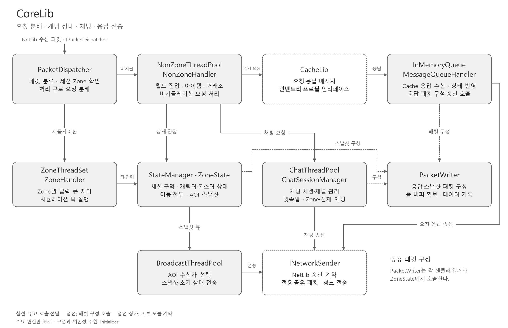

# MMORPG 서버 설계 결정

현재 서버 구조의 선택 근거와 보장 범위를 정리했다. 변경 사례는 [서버 리팩토링](ServerRefactoring.md)에 남겼다.

## 0. 출발점

- 한 유저의 시야에 수백 명이 들어올 수 있는 작은 맵을 가정했다.
- 지속되는 월드를 Zone으로 나눠 공간 내 상호작용을 처리하고 아이템·재화 상태를 보존한다.

## 1. 상태 전파

### 1.1 Cell 단위 직렬화

객체별 리플리케이션은 수신자마다 관심 영역과 baseline을 관리해 보낼 상태를 조립한다.  
여기서는 같은 Cell을 보는 유저에게 같은 상태를 보내므로, Cell당 한 번 만든 Chunk를 여러 세션이 공유하도록 했다.  
수신자별 조립을 줄이는 대신 커넥션별 baseline과 필드 맞춤 전송은 두지 않았다.  
새로 시야에 들어온 대상과 누락된 상태는 1초 주기의 Full Snapshot으로 맞춘다. 주기를 늘리면 전송량은 줄지만 대상이 보이기까지 더 기다리게 된다.  

### 1.2 밀집도와 전송량

직렬화 결과를 공유해도 실제 송신량은 수신자 수만큼 늘어난다.  
맵과 시야가 고정된 상태에서 밀집도가 높아지면 관측 대상과 수신자가 함께 늘어 전송량이 제곱에 가까워질 수 있다.  
주변 최대 9개 Cell로 전파 대상을 제한하고, Delta로 변경 필드만 보내며, 여러 Cell의 Chunk를 묶어서 송신한다.  
→ [Snapshot](Snapshot.md), [AOI](AOI.md), [송신 파이프라인](IOCPSendPipeline.md)  

## 2. 시뮬레이션과 스레드 경계

### 2.1 Zone별 틱

같은 공간의 이동·전투·몬스터 갱신을 함께 처리하도록 Zone마다 전용 틱 스레드를 뒀다.  
IOCP 워커가 받은 시뮬레이션 패킷과 진입·이동·리스폰·프로필 갱신·접속 종료 요청을 `ZoneEvent`로 전달한다.
`ZoneEventRouter`가 Zone별 상태와 워커를 소유하고, 워커는 `ZoneHandler`에 자기 `ZoneState`를 넘겨 처리한다. 아이템 사용·장비 변경과 종료 시 캐릭터 저장도 담당 워커에서 수행해 `ZoneState`의 mutex를 제거했다.
세션 인증·소속·`ownershipEpoch`는 `SessionManager`의 샤드 잠금으로, 로비의 대기 캐릭터는 `LobbyZone`의 mutex로 보호한다.

### 2.2 20Hz와 되감기

한 틱에 많은 엔티티를 처리할 수 있도록 50ms의 예산을 잡았다.  
현재 Unity 클라이언트는 내 캐릭터의 예측·보정과 원격 엔티티의 좌표 표본 보간으로 화면을 보완한다.
FPS의 히트스캔은 쏜 순간에 보였던 위치가 중요하지만, 이 서버의 전투는 스킬 범위·시전 단계·지속시간에 걸쳐 판정한다.  
보스 스킬도 여러 Phase에서 반복 판정하므로, 과거 좌표로 되감기보다 현재 틱의 월드 상태를 기준으로 처리했다.  
현재 로직과 캐릭터 Delta 전파는 모두 20Hz다. 판정 해상도를 높여야 한다면 로직 틱과 전파 주기를 분리할 수 있다.  
→ [Tick](Tick.md)

2,000명 벤치마크에서는 평균 0.399~1.010ms, p99 최대 6.346ms로 50ms 예산에 여유가 있었다.  
관측 최대는 42.750ms였고, 50ms를 넘긴 틱은 없었다.  
CPU 자원 사용은 따로 측정하지 않았으며, 실제 송신과 여러 Zone의 동시 실행도 측정에서 빠져 있다.  
→ [Zone Tick 벤치마크](Benchmark_ZoneTick.md)  

### 2.3 엔티티별 Actor 대신 Zone

광역 스킬 하나도 시전자·여러 대상·활성 스킬·주변 Cell의 상태를 함께 보고 갱신해야 한다.  
엔티티마다 독립된 Actor로 나누면 같은 틱의 상태를 모으고 판정 결과를 반영하는 순서를 별도로 조정해야 한다.  
자주 참조하는 상태를 Zone에 모아 한 실행 흐름에서 갱신하는 쪽을 택했다.  
Actor를 적용하더라도 이 상태 공유 범위에는 엔티티 하나보다 Zone이나 독립된 던전 인스턴스가 맞는다.  

### 2.4 작업 큐와 Triple Buffer

- **작업 전달.** Zone은 틱마다 `NonBlockingBackPressureQueue<ZoneEvent>`를 확인한다. 일반 이벤트·Transfer는 혼잡 시 거절하고, 프로필 갱신·접속 종료는 `EnqueueDeferred()`로 동적 보관한다. 동적 보관도 메모리 할당에 실패하면 접수를 거절한다. Transfer는 기존 실패 응답·출발 상태 유지 경로를 따른다.
- **송신 큐.** Broadcast는 워커별 큐를 사용하며 전체 대기 작업 예산을 넘으면 drop을 집계한다. 같은 Zone의 작업은 같은 워커로 보낸다.
- **송신 순서.** 같은 Zone의 작업은 같은 Broadcast 워커 큐에서 순서대로 송신한다. Delta는 변경 필드만 담으므로 오래된 패킷을 버리면 그 패킷에만 있던 변경이 누락될 수 있다.
- **초기 계획.** 클라이언트에서 seq로 오래된 패킷을 거를 계획이었으며, 당시 seq 처리와 순서 역전 검증은 구현에 반영되지 않았다. [DummyTest2](DummyTest2.md)
- **전송 대상.** Cell별 session ID 목록은 `ZoneState`가 Triple Buffer로 발행한다. Broadcast는 `ISessionSnapshotReader`를 통해 작업을 처리할 때 목록을 읽으며, `SessionManager`나 `ZoneState`를 직접 조회하지 않는다. 기존 읽기 참조가 모두 반환된 뒤 새 읽기에서 최신 목록으로 교체한다.

→ [작업 큐](WorkQueue.md), [Triple Buffer](TripleBuffer.md), [WorkerQueue 벤치마크](Benchmark_WorkerQueue.md)  

### 2.5 채팅과 DB 작업의 실행 경계

- **채팅 워커.** Zone과 별도로 최대 100개 이벤트를 처리하고, 월드·Zone 채팅은 대상별로 묶어 보낸다. 배치가 가득 차면 즉시 계속하고, 이벤트가 부족하면 15ms 대기한다.
- **채팅 큐 포화.** 일반 채팅은 버릴 수 있다. Zone 소속 변경은 지연 큐를 사용할 수 있고, 등록 실패 시 오류를 기록한다.
- **DB 워커.** Handler가 I/O를 넘기면 DB 워커가 mutex와 condition variable로 작업을 받는다. 호출부에서 등록 거절과 실행 실패를 구분한다.
- **캐시 미스.** 키에 `DB_READING`을 예약해 중복 조회를 막고, 결과를 기다리는 요청은 완료 콜백으로 이어간다. 조회 실패 시 예약을 해제한다.

[작업 큐](WorkQueue.md) · [캐시 설계](CacheLib.md)

### 2.6 컴포넌트 연결

- 서버 시작 지점과 각 라이브러리의 Initializer에서 컴포넌트를 만들고 의존성을 연결한다. 내부 전용 객체는 소유자가 관리한다.
- `PacketDispatcher`는 `IZonePacketQueue`·`INonSimulationQueue`로 요청을 보내고, `ISessionStatusReader`로 세션 상태를 읽는다. 역할별 인터페이스는 사용하는 기능의 범위에 맞췄다.
- 스레드를 넘는 작업은 생산자 → 큐 → 소비자 → 반납 지점을 따라간다.

### 2.7 Zone 이동과 초기 상태 전송

- **비동기 이동.** 출발 Zone은 세션에 이동 대기 정보를 등록하고 도착 Zone에 이벤트를 보낸다. 도착 Zone의 수락·거절도 이벤트로 처리하며 다른 Zone 워커를 동기 대기하지 않는다.
- **실패 복구.** 도착 이벤트 접수에 실패하면 출발 상태를 유지한다. 도착 후 진입에 실패하면 출발 Zone으로 복귀를 요청하고, 복귀를 접수하거나 처리할 수 없으면 로비 반환 경로를 사용한다.
- **소속 확정.** `SessionManager`가 이동 대기 정보와 epoch를 확인해 새 소속을 확정한다. 처리 중 접속 종료로 확정이 거절되면 도착 Zone에 임시 등록한 캐릭터를 제거한다.
- **ACK와 bootstrap.** `ServerResponseWorker`가 Zone 변경 ACK를 네트워크 계층에 넘긴 뒤 담당 Zone에 bootstrap을 요청한다. Zone에서 캡처한 bootstrap과 이후 Full·Delta는 같은 Broadcast 워커 큐로 보낸다. 이는 서버의 송신 요청 순서이며 클라이언트 수신 완료를 기다리는 절차는 아니다.

## 3. TCP와 종료 처리

### 3.1 TCP와 Delta Snapshot

위치는 다음 갱신으로 대체할 수 있지만 거래·인벤토리 요청은 전달과 처리 순서가 중요하다.  
이 서버는 두 종류를 하나의 연결로 처리하고, 전투도 순간 조준보다 범위·지속시간·스킬 단계에 비중을 두므로 TCP를 선택했다.  
상태를 매번 전부 보내지 않고 Delta·AOI로 전송량을 줄여 송신이 밀리는 부담을 낮췄다.  
패킷이 유실되면 재전송을 기다리는 동안 뒤의 데이터도 지연된다.  
스트림은 수신 버퍼에서 패킷으로 재조립하고, 응답 없는 세션은 Ping으로 탐지한다.  
→ [Snapshot](Snapshot.md), [ClientContext](ClientContext.md), [Ping](PingLoop.md)  

### 3.2 종료 순서

- **종료 순서.** 입력 중단 → 수락된 입력 정리 → 캐릭터 상태 저장 요청 등록 → Cache·DB 큐 처리 → 자원 해제.
- **실패 처리.** 위치·스탯 저장의 등록 거절과 DB 쓰기 실패는 자동 재시도하지 않는다. Cache 큐 포화 시 남기는 durable fallback 로그는 자동 재처리하지 않는다. 인벤토리 WAL은 별도 경로에서 재시작 시 복구한다.

→ [Graceful Shutdown](GracefulShutdown.md)  

### 3.3 소켓과 세션, 수신 버퍼

- **연결 종료.** 네트워크 계층에서 Ping 응답이 끊기면 IOCP에 소켓 종료를 요청한다.
- **세션 조회.** `SessionManager`는 소켓별 상태·수신 Context와 송신·Pong에 필요한 세션 ID 역방향 조회를 제공한다. 등록·해제 시 두 샤드의 mutex를 함께 잠근다.
- **버퍼 수명.** `ClientContext`는 TCP 수신 데이터를 누적해 패킷을 조립한다. 마지막 `PacketView` 반환, 미완료 I/O 정리, 종료 통지가 끝나면 Context를 재사용한다.

[Ping 처리](PingLoop.md) · [ClientContext](ClientContext.md) · [세션 데드락 디버깅](SessionManagerDeadLock.md)

## 4. 고정 객체풀

이전 부하 시험에서 I/O 병목과 풀 고갈이 함께 나타났다.  
그 순간 추가 할당까지 수행하지 않도록 패킷·Overlapped·Message 풀을 고정 크기로 바꿨다.  
예상 수요를 넘으면 할당이 실패하므로, 버려도 되는 작업은 drop하고 저장 작업은 해당 경로의 재시도·실패 정책을 따른다.  
객체를 스레드 사이에 넘길 때는 복사 비용을 줄이도록 소유권이나 참조를 전달한다. 풀 반환을 맡는 스마트 포인터는 중간 반환에서도 객체를 반납하며, 마지막 참조가 반환되기까지 풀이 살아 있어야 한다.
→ [ObjectPool](ObjectPool.md), [Back Pressure](BackPressure.md)  

## 5. 영속 데이터와 장애 복구

### 5.1 Write-Back과 WAL

잦은 인벤토리·골드 변경을 모아서 DB에 쓰기 위해 Write-Back 캐시를 사용했다.  
인벤토리는 변경 이미지를 WAL에 남겨 재기동 시 DB 미반영분을 복원한다.  
기본 fsync 주기는 20ms지만 응답 전에 완료를 기다리지 않아 미동기화 로그는 유실될 수 있다. 스케줄링·I/O 지연도 있어 20ms가 손실 구간의 상한은 아니다.  
골드는 일부 유실을 허용하고 DB Write-Back에 의존하는 정책으로, WAL을 적용하지 않는다.
장기 DB 장애 시 dirty 데이터 총량 제한은 남은 작업이다.

### 5.2 거래소 배송과 등록

구매·취소 트랜잭션에서 Outbox를 만들고, 아이템과 중복 확인용 Inbox를 같은 인벤토리 blob으로 DB에 저장한 뒤 배송을 완료 처리한다.  
저장 전에 죽으면 Outbox로 재배송하고, 저장 후 완료 처리 전에 죽으면 Inbox로 중복 지급을 막는다.  
등록은 아이템 차감 후 매물을 만드는 Saga다. 차감이 WAL이나 DB에 남은 뒤 매물 생성 전에 죽으면 보상할 기록이 없어 유실될 수 있다.  
→ [캐시](CacheLib.md), [WAL](WAL.md), [거래소](Bazaar.md), [복구 테스트](CacheDurabilityTest.md), [거래소 테스트](BazaarTest.md)  
