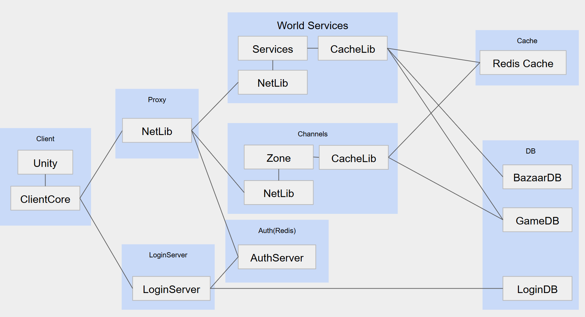

# MMORPG 서버 설계 결정

다수의 유저가 같은 월드를 공유하면, 상태를 나누고 전파하는 기준도 달라진다.  
이 프로젝트에서 소규모 세션 중심의 구조와 다르게 선택한 부분을 정리했다.  

## 0. 출발점

한 유저의 시야에 수백 명이 들어오는 작은 맵을 가정했다.  
방이나 매치가 끝나면 정리하는 구조와 달리, 월드는 계속 존재하고 유저는 그 안을 오간다.  
공간은 Zone으로 나누고, 같은 공간의 상호작용과 지속되는 아이템·재화 상태를 처리하는 데 초점을 뒀다.  

## 1. 상태 전파

### 1.1 Cell 단위 직렬화

객체별 리플리케이션은 수신자마다 관심 영역과 baseline을 관리해 보낼 상태를 조립한다.  
여기서는 같은 Cell을 보는 유저에게 같은 상태를 보내므로, Cell당 한 번 만든 Chunk를 여러 세션이 공유하도록 했다.  
수신자별 조립을 줄이는 대신 커넥션별 baseline과 필드 맞춤 전송은 두지 않았다.  
새로 시야에 들어온 대상과 누락된 상태는 1초 주기의 Full Snapshot으로 맞춘다. 주기를 늘리면 전송량은 줄지만 대상이 보이기까지 더 기다리게 된다.  

### 1.2 밀집도와 전송량

직렬화 결과를 공유해도 실제 송신량은 수신자 수만큼 늘어난다.  
맵과 시야가 고정된 상태에서 밀집도가 높아지면 관측 대상과 수신자가 함께 늘어 전송량이 제곱에 가까워질 수 있다.  
주변 최대 9개 Cell로 전파 대상을 제한하고, Delta로 변경 필드만 보내며, 여러 Cell의 Chunk를 묶어서 송신한다.  
→ [Snapshot](Snapshot.md), [AOI](AOI.md), [송신 파이프라인](IOCPSendPipeline.md)  

## 2. 시뮬레이션과 스레드 경계

### 2.1 Zone별 틱

같은 공간의 이동·전투·몬스터 갱신을 함께 처리하도록 Zone마다 전용 틱 스레드를 뒀다.  
IOCP 워커가 받은 시뮬레이션 작업은 해당 Zone의 큐로 넘긴다.  
진입·이탈·프로필 갱신은 아직 외부 스레드에서도 실행돼 관련 틱 로직에 mutex가 남아 있다.  
이를 이벤트 큐로 옮기려면 Zone 간 이동에서 연결과 상태를 넘기는 순서도 함께 정해야 한다.  

### 2.2 20Hz와 되감기

한 틱에 많은 엔티티를 처리할 수 있도록 50ms의 예산을 잡았다.  
내 캐릭터는 예측으로, 원격 엔티티는 마지막 수신 좌표를 따라가는 스무딩으로 화면을 보완한다.  
FPS의 히트스캔은 쏜 순간에 보였던 위치가 중요하지만, 이 서버의 전투는 스킬 범위·시전 단계·지속시간에 걸쳐 판정한다.  
보스 스킬도 여러 Phase에서 반복 판정하므로, 과거 좌표로 되감기보다 현재 틱의 월드 상태를 기준으로 처리했다.  
현재 로직과 캐릭터 Delta 전파는 모두 20Hz다. 판정 해상도를 높여야 한다면 로직 틱과 전파 주기를 분리할 수 있다.  
→ [Tick](Tick.md)

2,000명 벤치마크에서는 평균 0.399~1.010ms, p99 최대 6.346ms로 50ms 예산에 여유가 있었다.  
관측 최대는 42.750ms였고, 50ms를 넘긴 틱은 없었다.  
CPU 자원 사용은 따로 측정하지 않았으며, 실제 송신과 여러 Zone의 동시 실행도 측정에서 빠져 있다.  
→ [Zone Tick 벤치마크](Benchmark_ZoneTick.md)  

### 2.3 엔티티별 Actor 대신 Zone

광역 스킬 하나도 시전자·여러 대상·활성 스킬·주변 Cell의 상태를 함께 보고 갱신해야 한다.  
엔티티마다 독립된 Actor로 나누면 같은 틱의 상태를 모으고 판정 결과를 반영하는 순서를 별도로 조정해야 한다.  
자주 참조하는 상태를 Zone에 모아 한 실행 흐름에서 갱신하는 쪽을 택했다.  
Actor를 적용하더라도 이 상태 공유 범위에는 엔티티 하나보다 Zone이나 독립된 던전 인스턴스가 맞는다.  

### 2.4 작업 큐와 Triple Buffer

실행할 작업은 큐로 넘기고, 완료된 전송 대상 목록은 Triple Buffer로 공유한다.  
Zone은 Bounded MPMC Queue를 틱마다 확인하고, Broadcast 워커(리플리케이션 전송 담당)는 별도 큐에서 패킷 Chunk를 꺼내 송신한다. 두 큐는 full이면 drop을 집계한다.  
여러 Broadcast 워커가 같은 Zone의 패킷을 처리하면 송신 순서가 바뀔 수 있다는 제약은 인지하고 있었고, [DummyTest2](DummyTest2.md)에도 기록해 두었다. 클라이언트가 seq로 오래된 패킷을 버리도록 계획했으나, 이후 클라이언트 구현에서 seq 처리를 반영하고 순서 역전을 검증하는 과정을 놓쳤다.  
다시 검토하면서 변경 필드만 담는 Delta는 오래된 패킷을 버리면 다른 필드의 변경까지 누락될 수 있어, 서버에서 송신 순서를 유지하기로 했다. 같은 Zone의 작업은 같은 Broadcast 워커 큐에서 순서대로 송신한다.  
Broadcast가 참조하는 Cell별 session ID 목록은 기존 읽기 참조가 모두 반환된 뒤 새 읽기에서 최신 목록으로 교체한다.  
큐 포화·종료 정책과 두 자료구조의 진행 보장은 상세 문서에 정리했다.  
→ [작업 큐](WorkQueue.md), [Triple Buffer](TripleBuffer.md), [WorkerQueue 벤치마크](Benchmark_WorkerQueue.md)  

## 3. TCP와 종료 처리

### 3.1 TCP와 Delta Snapshot

위치는 다음 갱신으로 대체할 수 있지만 거래·인벤토리 요청은 전달과 처리 순서가 중요하다.  
이 서버는 두 종류를 하나의 연결로 처리하고, 전투도 순간 조준보다 범위·지속시간·스킬 단계에 비중을 두므로 TCP를 선택했다.  
상태를 매번 전부 보내지 않고 Delta·AOI로 전송량을 줄여 송신이 밀리는 부담을 낮췄다.  
패킷이 유실되면 재전송을 기다리는 동안 뒤의 데이터도 지연된다.  
스트림은 수신 버퍼에서 패킷으로 재조립하고, 응답 없는 세션은 Ping으로 탐지한다.  
→ [Snapshot](Snapshot.md), [ClientContext](ClientContext.md), [Ping](PingLoop.md)  

### 3.2 종료 순서

종료할 때도 메모리에 저장할 캐릭터 상태가 남아 있으므로, 작업을 만드는 쪽부터 멈춘다.  
저장에 필요한 큐를 비우고 캐릭터 상태를 반영한 뒤 DB와 로거 같은 자원을 해제한다.  
→ [Graceful Shutdown](GracefulShutdown.md)  

## 4. 고정 객체풀

이전 부하 시험에서 I/O 병목과 풀 고갈이 함께 나타났다.  
그 순간 추가 할당까지 수행하지 않도록 패킷·Overlapped·Message 풀을 고정 크기로 바꿨다.  
예상 수요를 넘으면 할당이 실패하므로, 버려도 되는 작업은 drop하고 저장 작업은 해당 경로의 재시도·실패 정책을 따른다.  
→ [ObjectPool](ObjectPool.md), [Back Pressure](BackPressure.md)  

## 5. 영속 데이터와 장애 복구

### 5.1 Write-Back과 WAL

잦은 인벤토리·골드 변경을 모아서 DB에 쓰기 위해 Write-Back 캐시를 사용했다.  
인벤토리는 변경 이미지를 WAL에 남겨 재기동 시 DB 미반영분을 복원한다.  
기본 fsync 주기는 20ms지만 응답 전에 완료를 기다리지 않아 미동기화 로그는 유실될 수 있다. 스케줄링·I/O 지연도 있어 20ms가 손실 구간의 상한은 아니다.  
골드의 WAL 적용과 장기 DB 장애 시 dirty 데이터 총량 제한은 남은 작업이다.  

### 5.2 거래소 배송과 등록

구매·취소 트랜잭션에서 Outbox를 만들고, 아이템과 중복 확인용 Inbox를 같은 인벤토리 blob으로 DB에 저장한 뒤 배송을 완료 처리한다.  
저장 전에 죽으면 Outbox로 재배송하고, 저장 후 완료 처리 전에 죽으면 Inbox로 중복 지급을 막는다.  
등록은 아이템 차감 후 매물을 만드는 Saga다. 차감이 WAL이나 DB에 남은 뒤 매물 생성 전에 죽으면 보상할 기록이 없어 유실될 수 있다.  
→ [캐시](CacheLib.md), [WAL](WAL.md), [거래소](Bazaar.md), [복구 테스트](CacheDurabilityTest.md), [거래소 테스트](BazaarTest.md)  

## 6. 분산 확장 구상 — 미구현

  
현재 단일 GameServer를 여러 프로세스로 나눈다면 다음 구성을 생각하고 있다.  
Proxy는 클라이언트 연결과 내부 라우팅을, Zone/Channel은 이동·전투와 실시간 상태를 맡는다.  
채팅·우편·길드는 World Services로 옮기고, 각 서버는 transport를 분리한 NetLibrary를 공통으로 사용한다.  

### 6.1 Redis로 세션 정보 공유

Redis로 각 세션을 가진 서버와 세션 상태를 서버 간에 공유한다.  
구체적인 관리 방식은 아직 정하지 않았다.  
