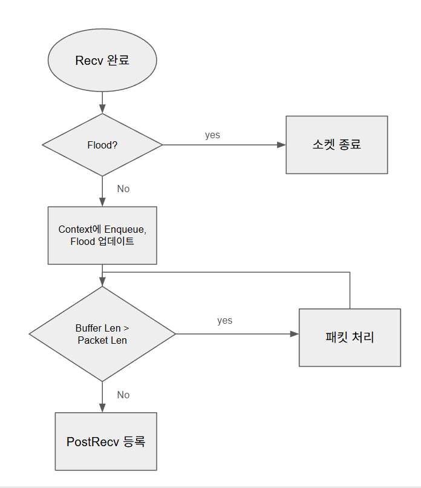
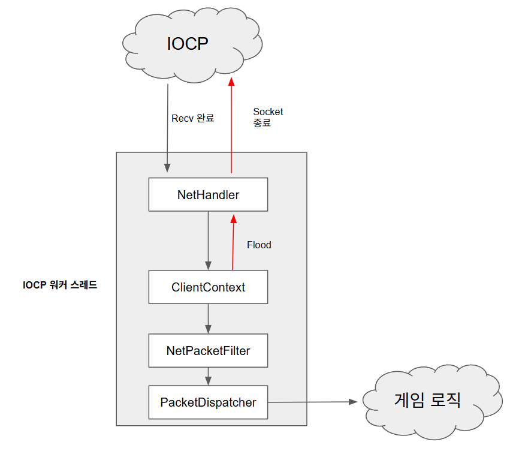

# Flood 탐지  
## 1. 개요
현재 `TrafficFloodDetector`는 **수신 바이트와 RECV 완료 횟수에 각각 토큰 버킷을 적용하여, 허용량을 초과한 세션을 차단하는 정책**이다. 패킷 조립 전에 검사하여 대량 데이터 유입과 작은 조각의 빈번한 수신으로 발생하는 후속 파싱 비용을 제한한다. 기존 Count 기반 수신 크기 검사의 결함을 확인하고, 시간당 보충량과 순간 허용량을 분리하는 방식으로 변경했다.

### 전제

대규모 DDoS와 대역폭 고갈은 서버 도달 이전의 외부 방어 장비·서비스에서 대응한다고 전제한다. 해당 인프라는 이 리포지토리의 구현 범위에 포함하지 않는다.

## 2. 목적
수신 바이트 제한: 받은 바이트만큼 토큰을 소비하여 세션별 지속 수신량과 순간적인 대량 유입을 제한한다.
RECV 횟수 제한: 데이터 크기와 별도로 수신 완료마다 토큰을 소비하여, 적은 바이트를 자주 보내는 경우에도 수신 처리 비용을 제한한다.

버킷 용량으로 정상적인 순간 몰림을 허용하고, 시간당 보충률로 지속 수신을 제한한다. RECV 횟수는 완성된 패킷 수가 아니며 TCP 분할·병합과 수신 버퍼 크기의 영향을 받는다. 따라서 정상 클라이언트의 송신 주기만으로 설정을 확정하지 않고, 실제 RECV 빈도와 오탐 여부를 확인해야 한다.

서버에 도달한 개별 세션의 수신량과 수신 완료 횟수에 제한을 적용한다. IP 공유 환경에서도 세션 단위로 제한할 수 있으며, 위반한 세션의 후속 수신 작업을 중단한다.

## 3. 요구사항
1. 매 RECV 완료 시 검사하고, 실패 시 NetHandler에서 연결을 종료하여 다음 수신 작업의 등록을 막는다.
2. 저비용 연산 (Hot Path): 매 수신마다 별도의 시계 조회나 타이머를 추가하지 않고 NetTimer의 캐시된 시간값과 정수 연산을 사용한다.


> iocp 수신완료 처리 work flow 


> IOCP 워커스레드 내부 동작 구조

### 왜 NetHandler에서 Flood를 처리해야하는가?  
*ClientContext는 TCP 스트림을 패킷 단위로 잘라내는 로직을 담당
1. 호출 스택 오염  
AbortSocket() 호출 시 ClientContext의 종료 처리 메서드를 수행하게 됨.
따라서 ClientContext 이후 로직에서 AbortSocket()을 호출하게 된다면,   
호출스택 상위에 ClientContext를 남겨둔 채 해당 인스턴스를 종료 상태로 만들게 된다.  
이는 코드의 실행 흐름을 예측하기 어렵게 만드는 주요 원인이 된다.   
-> 객체 지향 설계 관점에서도 제어권을 하위 레이어에 부여하는건 위험  
-> 상태값을 가지지 않고 전달자 역할만 하는 NetHandler에서 제어하는 것은 안전한 설계
2. DoS 방어의 효율성  
패킷 조립 전 NetHandler에서 차단하여 후속 파싱·요청 처리 비용을 제한한다.

## 4. 구현
아래 Sliding window, Fixed window, Count 방식은 기존 비교안과 변경 이력이다. 현재 구현은 마지막의 토큰 버킷 방식을 따른다. 앞선 시간 기반 예시들은 바이트량만 검사하므로 RECV 횟수 제한을 별도로 다루지 않는다.

### sliding window 방식  
* 개념 
	* 단위 시간당 수신 바이트의 정밀한 측정을 위해 Ring Queue와 누적합을 활용함.  
* 특징 
	* 누적합을 통해 구간합 연산 단순화.
	* Q_SIZE를 2의 거듭제곱으로 설정하고 비트 연산을 사용하여 인덱스 관리 효율을 높임.
* 한계
	* 매 수신마다 steady_clock::now()를 호출
	* Ring Queue 및 타임스탬프 관리를 위한 로직 복잡도 증가
	* 평균화 연산 특성상 순간적인 트래픽 변화 대응이 늦음
	* tiny packet 공격을 판단할 수 없다. -> 수신 간격이 큰 경우 매우 작은값으로 측정됨

```cpp  
constexpr uint8_t Q_SIZE = 16; // 2의 거듭제곱
static_assert((Q_SIZE != 0) && ((Q_SIZE& (Q_SIZE - 1)) == 0), "Q_SIZE must be a power of 2!");
constexpr double THRESHOLD = 4096; // bps 제한
class TrafficFloodDetector {
	std::vector<uint64_t> m_byte; // 누적합, ring queue
	std::vector<std::chrono::steady_clock::time_point> m_timeStamp; // ring queue
	uint8_t m_idx;
	uint8_t mask;
	public:
		TrafficFloodDetector()
			: m_byte(Q_SIZE, 0)
			, m_timeStamp(Q_SIZE, std::chrono::steady_clock::now())
			, mask(Q_SIZE - 1)
		{ }
		bool ByteReceived(uint32_t byte) {
			auto before = m_idx;
			m_idx = (m_idx + 1) & mask;
			auto next = (m_idx + 1) & mask; // 가장 오래된 데이터, 측정 기준
			m_timeStamp[m_idx] = std::chrono::steady_clock::now();
			m_byte[m_idx] = m_byte[before] + byte;
			auto byteSum = m_byte[m_idx] - m_byte[next];
			auto duration = m_timeStamp[m_idx] - m_timeStamp[next];
			auto sec = duration_cast<std::chrono::seconds>(duration).count();
			auto bps = byteSum / (double)sec;
			return bps < THRESHOLD;
		}
};
```  

### Fixed window 방식
* 개념 
	* 특정 시간 구간(Window)을 설정하고, 해당 구간 내 수신 합계만 체크하여 로직을 단순화함
* 특징 
	* 변수 두개만 사용하여 메모리 사용량이 적음
* 한계
	* 여전히 steady_clock::now() 연산이 필요함
	* tiny packet 공격을 판단할 수 없다. -> 새 윈도우에서 첫 패킷은 매우 작은 값으로 측정됨

```cpp
	class TrafficFloodDetector {
		std::chrono::steady_clock::time_point m_windowStart;
		uint32_t m_bytesInWindow;

	public:
		TrafficFloodDetector()
			: m_windowStart(std::chrono::steady_clock::now())
			, m_bytesInWindow(0)
		{ }
		bool ByteReceived(uint32_t byte) {
			auto now = std::chrono::steady_clock::now();

			if (now - m_windowStart > WINDOW) {
				m_windowStart = now;
				m_bytesInWindow = byte;
			}
			else {
				m_bytesInWindow += byte;
			}
			return m_bytesInWindow > BYTE_THRESHOLD;
		}
	}; 
```

### EWMA 
* 개념
	* 지수 가중 이동 평균을 이용하여 최근 데이터에 높은 가중치를 부여하여 트래픽 변화를 유연하게 대응하는 방식.
* 미도입 사유
	* 트래픽 변화의 관찰 방법으로 고려했지만, 평균값과 가중치만으로 지속 허용량과 순간 허용량을 직접 표현하기는 어려웠다.
	* 이번에는 세션이 소비할 수 있는 예산을 명시하는 것이 목적이므로 토큰 버킷을 선택했다. EWMA의 측정값을 이용한 방어 정책은 별도로 구현하지 않았다.

### Count 기반 수신 크기 검사(이전 구현)
* 개념 
	* 시간 기준을 제거하고, 수신 횟수(RECV_WINDOW)별 합계 바이트를 검사함.
* 특징 
	* 변수 두개만 사용하여 메모리 사용량이 적음
	* steady_clock::now() 같은 무거운 연산이 없어서 Hot path에 적용 가능
	* 임계 횟수 도달 시점에 즉시 판정하여 신속한 차단 가능.
	* 작은/큰 수신 조각이 연속되는 패턴을 찾을 수 있음. 전송 속도나 공격 여부는 판단하지 못함.
	* 세션에서 한 번 검사에 실패하면 종료까지 실패 상태를 유지하고, 새 세션 생성 시 누적값을 초기화함.
```cpp
	class TrafficFloodDetector {
		uint32_t m_bytes = 0;
		uint32_t m_recvCount = 0;

	public:
		bool ByteReceived(uint32_t byte) {
			m_recvCount++;
			m_bytes += byte;

			if (m_recvCount >= RECV_WINDOW) {
			// 1. 큰 수신 조각 
				if (m_bytes > BYTE_THRESHOLD) return true;
			// 2. 작은 수신 조각 
				if (m_bytes < MIN_BYTE_PER_WINDOW) return true;
				m_recvCount = 0;
				m_bytes = 0;
			}
			return false;
		}
	};
```

#### 기존 설계의 결함

- 단위 테스트 작성 중, 20회 RECV의 합계 바이트가 최대 `RECV_BUFFER_SIZE * 20`으로 제한된다는 점을 확인했다.
- 큰 수신을 탐지하는 `BYTE_THRESHOLD`를 이 최대치 이상으로 설정하면 상한 초과가 발생하지 않아 탐지할 수 없다.
- 임계값을 최대치보다 낮추면, 정상 데이터가 누적되어 뒤늦게 수신 처리되는 경우에도 버퍼가 연속으로 채워져 공격으로 오인할 수 있다.
- 시간축이 없어 느린 정상 수신과 빠른 반복 수신을 구분하지 못했다. 버퍼를 늘리면 최대치와 임계값만 함께 변하므로, 수신 조각 크기 대신 시간당 소비량을 제한하도록 변경했다.


### 토큰 버킷 방식(현재 구현)

```cpp
bool ByteReceived(uint32_t receivedBytes, uint64_t now = NetTimer::GetTimeMS()) {
    uint64_t elapsed = now - m_lastRefill;
    uint64_t elapsedForRefill = (std::min<uint64_t>)(elapsed, 5000);

    m_bytesTokens = (std::min)(BYTES_TOKEN_CAPACITY,
        m_bytesTokens + elapsedForRefill * BYTES_TOKEN_REFILL_RATE);
    m_recvTokens = (std::min)(RECV_TOKEN_CAPACITY,
        m_recvTokens + elapsedForRefill * RECV_TOKEN_REFILL_RATE);
    m_lastRefill = now;

    if (receivedBytes > m_bytesTokens || m_recvTokens < RECV_UNIT)
        return true;

    m_bytesTokens -= receivedBytes;
    m_recvTokens -= RECV_UNIT;
    return false;
}
```

- 수신 바이트와 RECV 횟수에 각각 토큰을 두고, 패킷 조립 전에 검사한다.
- 버킷 용량은 순간 허용량, 시간당 보충량은 지속 허용량을 결정한다. 둘 중 하나라도 부족하면 감지하고, 통과할 때만 차감한다.
- 시간은 `NetTimer` 캐시값을 사용하며, 큰 곱셈을 피하도록 보충 계산용 경과 시간만 최대 5초로 trim한다.
- 같은 ms 시각의 수신은 차감만 하고, 다음 시간값에서 경과분을 보충한다. 현재 정수 계산에는 소수점 절삭에 의한 누적 손실이 없다.
- 평균 소비량이 보충량 이하면 장기 접속에서도 회복된다. 지속 초과는 보충률, 정상적인 순간 몰림은 용량을 조정하며 주기적 초기화는 하지 않는다.
- 감지 상태는 세션 종료까지 유지하고 새 세션에서 초기화한다. TCP 분할·몰림에 따른 오탐은 실제 환경에서 확인한다.


[TrafficFloodDetector.h](NetLibrary/TrafficFloodDetector.h) · [Config.h](NetLibrary/Config.h)
