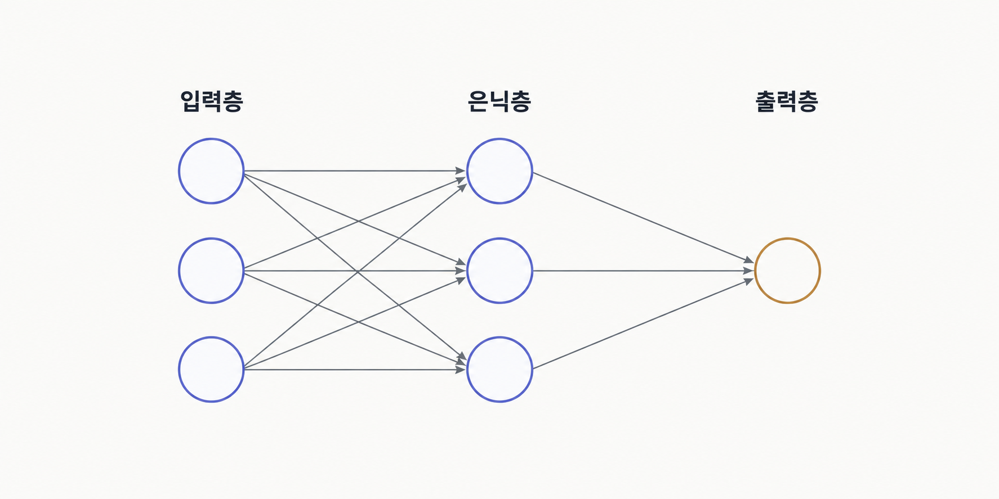
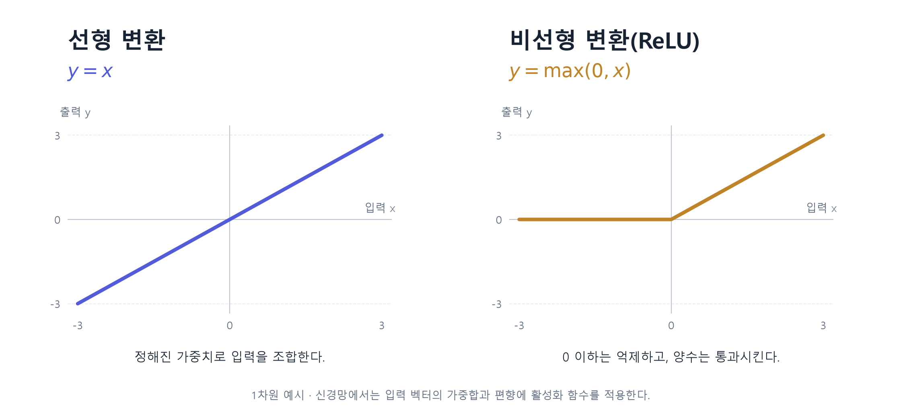
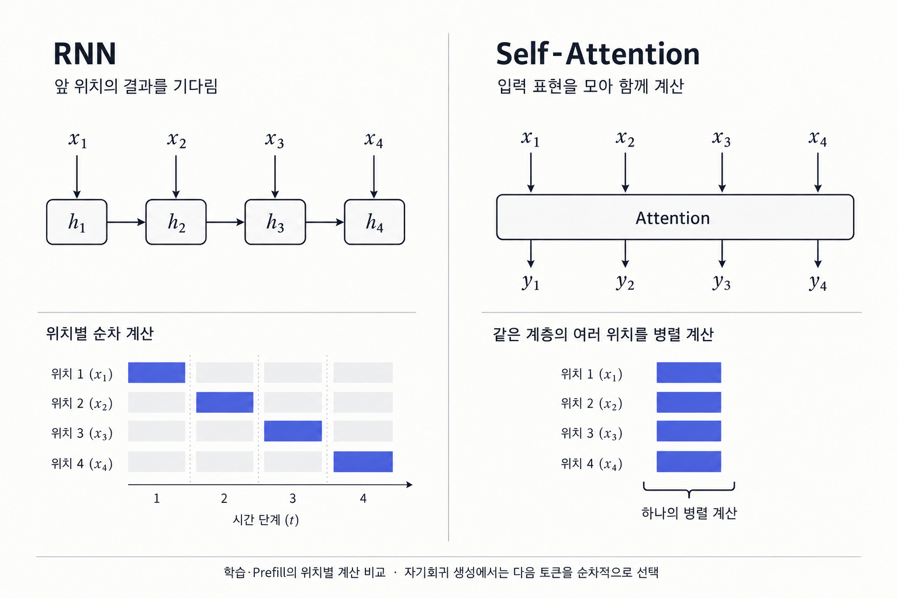
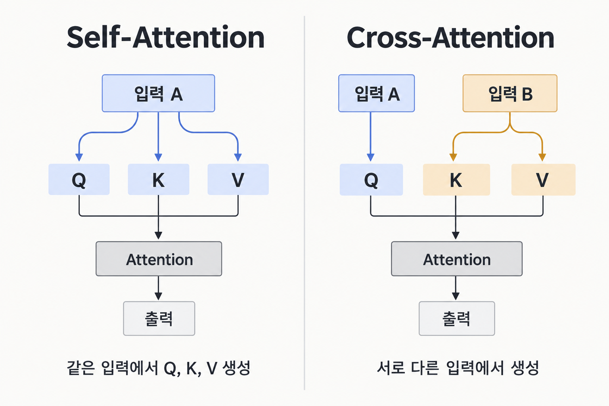
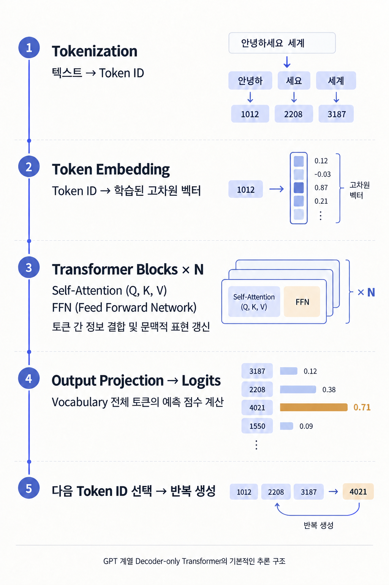

# 생성형 LLM 모델

『핸즈온 LLM』을 읽고 토큰화부터 프롬프트, 추론, 미세 튜닝까지 학습한 내용을 정리했다.  

## 1. 트랜스포머

### 1.1 토큰화

토크나이저는 입력 텍스트를 토큰으로 분리하고, Vocabulary(어휘집)에 등록된 Token ID로 변환한다. 토큰은 단어 전체, 단어의 일부(Subword), 문자 또는 바이트 단위로 구성할 수 있다.  
토큰화 단위에 따라 Vocabulary 크기와 입력 시퀀스 길이 사이에 Trade-off가 발생한다.  

- 큰 단위(Word-level): 하나의 토큰이 많은 정보를 표현하므로 같은 문장을 적은 토큰으로 처리할 수 있다. 하지만 다양한 단어를 등록해야 하므로 Vocabulary와 임베딩 테이블이 커지고, 등록되지 않은 단어를 처리하기 어렵다. 특히 한국어처럼 어미 변화가 다양한 언어에서는 단어 종류가 크게 늘어날 수 있다.
- 작은 단위(Character/Byte-level): 적은 종류의 토큰을 조합해 다양한 문자열을 표현할 수 있어 Vocabulary와 임베딩 테이블을 작게 유지할 수 있다. 새로운 단어에도 대응하기 쉽지만, 같은 문장을 표현하는 토큰 수가 늘어나 Transformer의 연산량과 메모리 부담이 증가할 수 있다.
- Subword: 자주 등장하는 문자열은 하나의 토큰으로 묶고, 드문 문자열은 더 작은 단위로 분리하여 두 방식의 장단점을 절충한다. BPE, WordPiece, Unigram 등이 대표적인 알고리즘이다.

이러한 차이가 중요한 이유는 임베딩 테이블의 크기가 Vocabulary 크기 × 임베딩 차원에 비례하는 반면, 일반적인 Self-Attention의 토큰 간 점수 계산량은 시퀀스 길이의 제곱에 비례하기 때문이다.  
-> 따라서 Vocabulary를 크게 하면 입력 시퀀스가 짧아질 수 있지만 모델 파라미터와 출력 계층의 계산 비용이 증가하고, Vocabulary를 작게 하면 반대 현상이 발생할 수 있다.  

결국 토크나이저는 단순히 텍스트를 분리하는 도구가 아니라, 모델의 메모리 사용량·학습 효율·추론 비용에 영향을 주는 설계 요소이다.

### 1.2 신경망

인공 신경망은 가중치를 가진 연산과 비선형 함수 등을 연결해 입력을 출력으로 변환하는 수학적 모델이다. **연산 구조를 설계하고, 데이터에서 가중치를 학습해 복잡한 관계를 표현한다.**  
LLM의 임베딩, Attention, FFN도 이 신경망을 구성한다. 각각 벡터 조회, 토큰 간 정보 결합, 특징 변환을 담당하며, 학습된 파라미터와 설계된 연산으로 데이터를 처리한다.

**학습은 목표에 맞게 가중치를 조정하는 과정이고, 추론(Inference)은 학습된 가중치로 입력에 대한 출력을 계산하는 과정이다.** 일반적인 추론에서는 가중치를 갱신하지 않는다.  
기본적인 신경망 계층은 입력 벡터를 가중치로 조합하고 편향을 더한 뒤, 활성화 함수(Activation Function)를 적용한다. 활성화 함수는 이 값에 따라 서로 다른 반응을 만들어 복잡한 관계를 표현할 수 있게 한다.  
학습 과정에서는 모델의 예측과 정답 사이의 오차를 계산하고, 역전파(Backpropagation) 로 각 파라미터에 대한 오차의 기울기를 구한다. 이후 옵티마이저가 이 기울기를 이용해 가중치를 조정한다.  
이를 반복하면서 **사람이 데이터의 특징을 일일이 정의하지 않아도, 문제 해결에 유용한 표현을 학습할 수 있다.**  

- 활성화 함수(Activation Function): 선형 변환만으로는 표현하기 어려운 복잡한 관계를 학습할 수 있도록 신경망에 비선형성을 추가하는 함수.
- 역전파(Backpropagation): 예측 오차를 바탕으로 각 파라미터의 기울기를 계산하는 알고리즘. 계산된 기울기를 이용해 옵티마이저가 가중치와 편향을 갱신한다.
- **선형 변환:** 벡터의 여러 차원을 일정한 가중치로 조합한다. 선형 변환만 여러 번 반복해도 하나의 선형 변환으로 합칠 수 있다.
- **비선형 변환:** 벡터의 값에 따라 서로 다른 반응을 만든다. 선형 변환과 결합해 특징들의 복잡한 조합과 조건부 관계를 표현할 수 있게 한다.

ReLU는 `max(0, x)`로, 입력이 0 이하이면 0을 출력하고 양수이면 그대로 전달한다. 신경망에서는 앞서 계산한 가중합과 편향에 이 함수를 적용한다.  
예를 들어 두 특징의 유무를 각각 0과 1로 나타내면, `ReLU(x₁ + x₂ - 1)`은 두 특징이 모두 1일 때만 1을 출력한다.

**선형 변환으로 특징을 조합하고, 비선형 활성화로 그 조합에 반응할 조건을 만든다.** 이를 여러 계층에서 반복하면서 복잡한 특징과 관계를 표현할 수 있다.

### 1.3 임베딩

토큰 ID는 어휘집의 번호일 뿐이라 숫자의 크기나 차이가 의미의 유사성을 나타내지는 않는다.  
**Token Embedding**은 이 ID를 모델이 계산에 사용할 수 있는 학습된 벡터로 바꾸는 것이다.

사람이 ‘과일인지’, ‘먹을 수 있는지’처럼 특징을 정해 벡터를 만들 수도 있다. 하지만 언어의 의미와 관계를 이런 항목으로 빠짐없이 표현하기는 어렵고, 작업이 바뀌면 필요한 특징도 달라진다.  
딥러닝에서는 **어떤 특징이 필요한지까지 데이터에서 학습하는 표현 학습**을 사용한다. 임베딩도 그 예로, 예측 오차를 줄이도록 벡터 값을 학습하며, 그 과정에서 의미적·문법적 관계를 표현할 수 있게 된다.

임베딩 테이블은 **어휘집 크기 × 임베딩 차원**의 행렬이다. 벡터의 길이인 차원 수는 모델을 설계할 때 정한다. 각 행이 토큰 하나의 벡터이며, 입력 ID에 해당하는 행을 꺼내 사용한다.

벡터 값은 보통 무작위로 초기화한 뒤, 다음 토큰 예측 등의 학습 목표에 맞춰 다른 신경망 가중치와 함께 갱신한다. 초기값에서 출발해 예측 오차를 줄이는 과정에서 표현을 만들어간다.  
이렇게 학습된 임베딩 벡터는 Transformer의 입력으로 사용되며, 여러 계층을 통과하면서 문맥 정보가 반영된 표현으로 변환된다.   

> 학습된 벡터의 각 차원에 사람이 읽을 수 있는 의미가 하나씩 붙어 있는 것은 아니다. 하나의 특징이 여러 성분에 걸쳐 표현되고, 같은 성분이 여러 특징에 관여할 수 있다. 그래서 벡터 값을 확인하는 것만으로 그 의미를 바로 해석하기는 어렵다.

### 1.4 RNN(순환 신경망)과 Attention 차이

RNN의 순환 처리와 Transformer의 Self-Attention을 비교했다. RNN에도 Attention을 결합할 수 있다.

- **RNN:** 앞에서 읽은 정보를 은닉 상태로 전달한다. 현재 위치를 계산하려면 이전 위치의 은닉 상태가 필요해 순서대로 처리해야 한다.
- **Self-Attention:** 각 위치가 참고할 다른 위치의 정보를 직접 결합한다. 같은 계층의 다른 위치가 내놓을 출력을 기다리지 않아, 입력이 주어진 여러 위치를 행렬 연산으로 함께 계산할 수 있다.

이 차이로 Transformer는 학습과 입력 처리에서 여러 토큰 위치를 병렬로 계산할 수 있다.  
다만 각 Transformer 블록은 이전 블록의 출력을 받아야 하므로 블록 간에는 순차적 의존성이 존재한다. 또한 자기회귀 생성(Autoregressive Generation) 은 이전에 생성한 토큰을 입력에 추가하고, 이를 바탕으로 다음 토큰을 하나씩 예측하는 방식이다. 따라서 Transformer 내부의 병렬 처리와 달리, 출력 토큰 생성에는 순차적 의존성이 존재한다

### 1.5 Self-Attention과 Cross-Attention

**Self-Attention**은 같은 입력에서 Q, K, V를 만든다.  
**Cross-Attention**은 Q를 가져오는 입력과 K·V를 가져오는 입력이 다르다.

- **Query(Q):** 현재 위치에서 참고할 정보를 찾는 기준
- **Key(K):** Q와의 관련성을 비교하는 표현
- **Value(V):** 계산한 비중에 따라 전달할 정보

예를 들어 번역 모델에서는 디코더의 현재 표현에서 Q를, 인코더가 읽은 원문의 표현에서 K·V를 만들어 원문을 참고할 수 있다.

Q와 K의 내적으로 관련도 점수를 계산하고, Softmax를 적용해 합이 1인 가중치로 변환한다. 이후 이 가중치로 V를 가중합해 문맥 정보를 결합한다.  
Softmax는 관련도가 높은 정보에 더 큰 비중을 부여하며, 하나의 토큰만 선택하는 것은 아니다.  

학습되는 것은 Q·K·V를 만드는 변환 가중치다. Q·K·V는 미리 저장된 벡터가 아니라, 입력이 들어올 때 마다 계산되는 값이다.   

### 1.6 Transformer 블록

Transformer는 Attention과 FFN(Feed Forward Network)을 포함한 블록을 반복한다.

- **Attention:** 토큰 사이의 정보를 결합해 문맥을 반영한다.
- **FFN:** 문맥이 반영된 각 토큰의 벡터를 학습된 가중치와 활성화 함수로 변환하여 복잡한 특징과 관계를 표현한다.
- **잔차 연결과 정규화:** 정보를 유지하고 깊은 신경망의 학습을 안정화한다.
- **위치 정보:** 토큰의 순서와 위치 관계를 Attention 계산에 반영한다.

FFN은 일반적으로 차원 확장 → 비선형 활성화 함수 → 원래 차원으로 축소하는 구조다. 차원을 확장해 중간 표현 공간에서 다양한 특징을 조합하고, 활성화 함수를 통해 단순한 선형 변환으로는 표현하기 어려운 관계를 학습할 수 있게 한다.

Attention은 다른 토큰의 정보를 결합하지만, FFN은 같은 블록 안에서 각 토큰 위치의 벡터를 독립적으로 처리한다. 이때 모든 위치에 동일한 FFN 가중치가 적용된다.

> Transformer 블록은 문장을 내용별로 나누는 단위가 아니다. 같은 토큰 위치들의 벡터를 여러 블록에 반복해서 통과시키며 문맥적 표현을 갱신하는 구조다.

### 1.7 인코더와 디코더

| 구분 | Encoder-only | Decoder-only |
|---|---|---|
| 대표 모델 | BERT | GPT |
| 참고하는 문맥 | 입력의 앞뒤 토큰 | 현재 위치와 이전 토큰 |
| 주요 활용 | 분류, 검색, 문맥적 표현 생성 | 다음 토큰 예측과 텍스트 생성 |

원래 Transformer는 인코더와 디코더를 함께 사용했다. 위 표는 각각을 중심으로 사용하는 모델의 차이다.  
Encoder–Decoder 구조에서는 인코더가 입력을 읽고, 디코더가 앞서 생성한 토큰과 인코더의 출력을 참고해 다음 토큰을 생성한다. 두 부분을 연결하는 데 Cross-Attention을 사용한다.

### 1.8 생성 흐름

그림의 토큰 ID와 벡터 값, 점수는 설명용 예시다.

마지막 토큰 위치의 은닉 상태를 어휘집 전체의 점수(Logits)로 바꾼다. 이 점수에 Softmax를 적용하면 다음 토큰의 확률 분포를 얻는다.  
확률이 가장 높은 토큰을 고르거나 분포에서 샘플링한 뒤, 선택한 토큰을 입력에 이어 붙여 생성을 반복한다. 종료 토큰이 나오거나 정해진 생성 길이에 도달하면 멈춘다.

**KV Cache**는 각 Attention 계층에서 이전 토큰의 K·V를 저장해 재사용한다.  
매번 과거 토큰의 표현을 전부 다시 계산하는 비용을 줄이는 대신, 문맥이 길어질수록 캐시 메모리와 읽어야 할 데이터도 늘어난다.

## 2. 프롬프트 엔지니어링

프롬프트에는 목표와 배경, 제약 조건, 작업에 필요한 데이터를 담는다.  
필요하면 역할, 출력 형식, 청중과 어투를 덧붙인다. 모든 작업을 같은 양식에 맞출 필요는 없다.

- **구체성:** 원하는 결과와 변경 범위, 완료 조건을 적는다.
- **문맥 내 학습(In-context Learning):** 예시를 넣어 작업 방식과 출력 규칙을 전달한다. 이때 모델 가중치가 갱신되는 것은 아니다.
- **프롬프트 체인:** 한 단계의 출력을 다음 단계의 입력으로 연결한다. 앞 단계의 오류도 이어질 수 있어 중간 결과를 확인해야 한다.
- **정보의 배치:** 긴 입력에서는 관련 정보의 위치에 따라 성능이 달라질 수 있다. 중요한 조건이 묻히지 않게 배치한다.

### 2.1 할루시네이션 줄이기

모델이 사실과 다르거나 제공한 자료와 맞지 않는 내용을 그럴듯하게 생성하는 현상을 **할루시네이션(환각)**이라고 한다. 이를 줄이기 위해 다음과 같이 지시할 수 있다.

- **불확실성 표현:** 정보가 부족하면 추측으로 채우지 않고 모른다고 답하도록 한다.
- **근거에 기반한 답변:** 제공한 자료에서 근거를 찾아 답하고, 출처나 관련 구절을 함께 제시하도록 한다.
- **답변 범위 제한:** 자료에서 확인할 수 있는 내용으로 답변 범위를 한정하고, 사실과 추정을 구분하도록 한다.

이 지시를 넣어도 오류는 생길 수 있으므로 출처와 실행 결과는 확인해야 한다.

### 2.2 RAG

RAG는 외부 자료를 검색한 뒤, 찾은 내용을 모델의 입력에 넣어 답변에 활용하는 방식이다.  
모델의 가중치를 바꾸지 않고도 작업에 필요한 자료를 제공할 수 있다.

## 3. 생성 모델을 사용한 추론

여기서는 학습된 모델을 실행하는 추론(Inference)이 아니라, 문제를 분석하고 해결하는 추론(Reasoning)을 뜻한다.

생성형 LLM은 이전에 생성한 토큰을 다음 생성 과정의 문맥으로 활용할 수 있다. 이를 이용해 중간 풀이를 생성하거나 여러 해결 방법을 탐색할 수 있다.  
- CoT(Chain-of-Thought): 중간 풀이 단계를 활용해 문제를 해결하는 방식이다. 단계별 풀이 예시나 지시를 통해 유도할 수 있으며, 모델이 생성한 중간 결과를 이후 추론에 활용한다.
- ToT(Tree of Thoughts): 여러 풀이 후보를 생성하고 평가하면서 탐색하는 방식이다. 하나의 경로만 따르지 않고 필요하면 다른 경로를 시도한다.

이러한 기법은 모델의 문제 해결 과정을 구성하는 방법이지, 신경망 자체의 추론 능력을 직접 향상시키는 학습 방법은 아니다. 최신 추론 특화 모델은 별도 학습을 통해 추론 능력을 강화하기도 하며, 사용자가 CoT를 명시적으로 지시하지 않아도 추가적인 추론 계산을 수행할 수 있다.

추론 단계가 많거나 풀이가 논리적으로 보인다고 해서 정답이 보장되는 것은 아니다. 실제 결과는 별도로 검증해야 한다.

### 3.1 출력 제어

생성형 LLM은 다음 토큰의 확률 분포를 계산하고, 선택된 토큰을 이어 붙여 출력을 생성한다. 이 과정에서 다음과 같은 방법으로 출력 형태와 다양성을 조절할 수 있다.

- **예시 제공:** 기대하는 출력 형식과 내용을 프롬프트에 제시해 비슷한 결과를 유도한다.
- **Temperature:** 다음 토큰의 확률 분포를 조절한다. 낮을수록 높은 확률의 토큰에 선택이 집중되고, 높을수록 다양한 토큰이 선택될 가능성이 커진다.
- **문법·스키마 제약:** 디코딩 과정에서 허용할 토큰을 제한해 JSON 등의 특정 형식을 따르도록 한다.

이러한 방법은 생성 과정의 동작이나 출력을 조절하지만, 모델의 학습된 가중치를 변경하지는 않는다. 또한 출력 형식이 올바르다고 해서 내용의 정확성까지 보장되는 것은 아니다.

## 4. 미세 튜닝

지시를 따르는 생성 모델을 만드는 대표적인 학습 흐름은 다음과 같다.

1. **사전학습:** 대규모 텍스트에서 다음 토큰 등을 예측하며 패턴을 학습한다.
2. **지도 미세 튜닝(SFT):** 지시와 바람직한 응답의 예시로 지시 수행 방식을 학습한다.
3. **선호도 튜닝:** 응답 간 선호 비교 등을 이용해 응답 성향을 조정한다.

대표적인 RLHF에서는 사람이 응답을 비교한 데이터로 보상 모델을 만들고, 그 보상을 추가 학습에 사용한다.

- **전체 미세 튜닝:** 모델의 모든 파라미터를 갱신한다.
- **LoRA:** 기존 가중치를 고정하고, 가중치에 더할 변화량을 작은 두 행렬의 곱으로 표현해 학습할 파라미터 수를 줄인다.

프롬프트 예시와 일반적인 RAG 활용은 입력을 바꾸고, 미세 튜닝은 모델 파라미터를 바꾼다.

## 5. 책을 읽고 느낀 점

**내가 정리한 딥러닝 기반 AI의 본질은 데이터로 학습한 가중치와 비선형 함수 등을 조합해 입력과 출력의 복잡한 관계를 표현하는 데 있다.** 인공 신경망은 이러한 연산의 연결 구조를 하나의 모델로 묶어 설명하는 개념이다.  
임베딩, Attention, FFN은 역할이 다르지만 이 모델을 구성하는 연산이다. 학습에서는 모델의 가중치를 조정하고, 추론에서는 그 가중치로 계산한다. 개별 구성 요소를 이해할 때도 이 공통 원리를 기준으로 보고 있다.

사람이 정한 개념과 벡터의 각 차원이 일대일로 대응하지 않고, 학습된 표현은 여러 계층을 거치며 변환되고 결합된다. **모델의 계산 구조를 아는 것과, 특정 입력에서 왜 그런 답을 했는지 설명하는 것은 별개의 문제**라고 이해했다.

프롬프트는 학습된 모델이 답변을 생성할 때 참고할 입력과 조건을 구성하는 일이라고 이해했다. 기존에는 형식적인 프롬프트 기법보다 배경과 목표, 제약 조건을 충분히 전달하는 것이 중요하다고 생각했다.  
이번 학습을 통해 필요한 맥락을 제공하는 것뿐 아니라, 정보가 부족할 때 임의로 추측하지 않도록 지시하고 결과를 검증하는 과정도 중요하다는 점을 알게 되었다.  

→ [게임 서버 개발에서 AI 활용에 대한 고찰](AI-REFLECTION.md)
