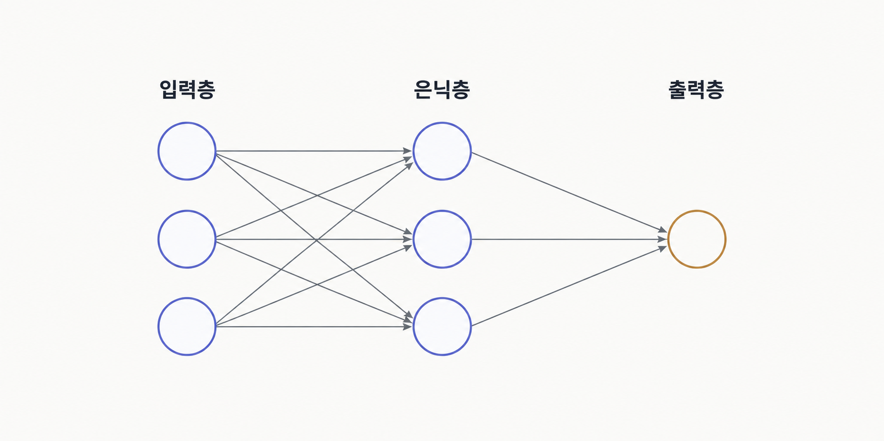
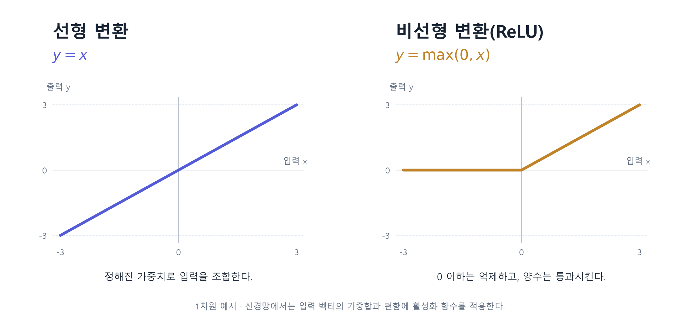
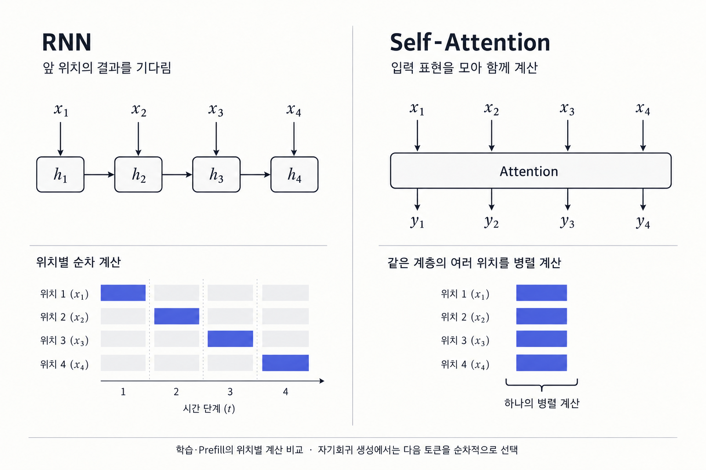
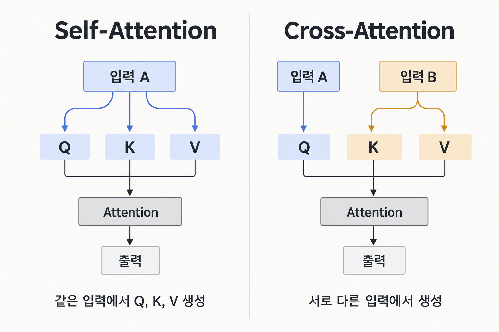
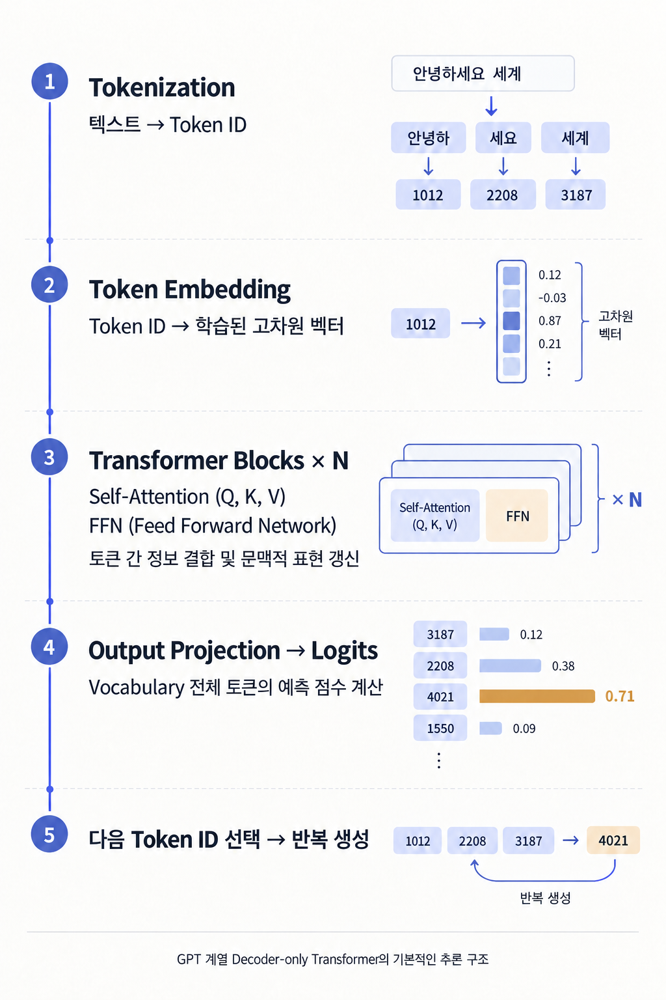

# 생성형 LLM

『핸즈온 LLM』을 읽고 신경망의 기본 원리부터 LLM의 구조와 생성 과정, 프롬프트와 미세 튜닝까지 학습한 내용을 정리했다.

## 1. 딥러닝과 인공 신경망

### 1.1 신경망의 구조

**딥러닝**은 여러 층의 신경망으로 데이터의 특징과 관계를 학습한다. Transformer는 생성형 LLM에 쓰이는 신경망 구조 중 하나다.

- **층의 역할.** 입력층은 숫자 데이터를 받고, 은닉층은 중간 표현을 만들며, 출력층은 이를 예측값으로 바꾼다.
- **기본 연산.** 입력 벡터에 가중치 행렬을 곱하고 편향을 더한 뒤 활성화 함수를 적용한다. 학습에서 조정하는 가중치와 편향을 **파라미터**라고 한다.
- **학습된 표현.** 설계할 때 차원 수를 정하고 각 차원의 값은 학습으로 얻는다. 한 특징이 여러 차원에 걸쳐 표현될 수 있다.

### 1.2 비선형 함수가 필요한 이유

`Wx`는 **선형 변환**, 편향을 더한 `Wx + b`는 **아핀 변환**이다. 아핀 변환만 여러 번 합성하면 하나의 아핀 변환이 되므로, 층 사이에 **비선형 활성화 함수**를 넣어 복잡한 관계를 표현한다.

**ReLU**는 `max(0, x)`다. 예를 들어 `x₁`, `x₂`가 각각 0 또는 1이면 `ReLU(x₁ + x₂ - 1)`은 두 특징이 모두 1일 때만 1이다.

### 1.3 학습과 추론

- **학습.** 예측과 정답의 차이를 손실로 계산한다. **역전파**로 파라미터별 기울기를 구하고, **옵티마이저**가 손실을 줄이는 방향으로 파라미터를 조정한다.
- **추론(Inference).** 학습된 파라미터를 고정하고 입력에 대한 출력을 계산한다.

## 2. 텍스트를 벡터로 표현하기

### 2.1 토큰화

**토크나이저**는 입력 텍스트를 토큰으로 분리하고, Vocabulary(어휘집)에 등록된 **토큰 ID**로 변환한다.

- **단어 단위:** 같은 문장을 적은 토큰으로 표현할 수 있지만, 어휘집이 커지고 등록되지 않은 단어를 처리하기 어렵다.
- **문자·바이트 단위:** 작은 단위를 조합해 다양한 문자열을 표현하지만, 같은 문장의 토큰 수가 많아진다.
- **Subword:** 자주 등장하는 문자열은 하나로 묶고, 드문 문자열은 더 작은 단위로 분리한다. BPE, WordPiece, Unigram 등이 대표적인 알고리즘이다.

### 2.2 임베딩

- **토큰 ID**는 어휘집의 인덱스다. **임베딩**은 이 ID에 대응하는 학습된 벡터다.
- **임베딩 테이블**은 어휘집 크기 × 임베딩 차원의 행렬이다. 토큰 ID로 행을 조회하고, 각 행의 값은 다른 모델 파라미터와 함께 학습한다.
- **은닉 상태**는 모델 내부에서 각 토큰 위치를 표현하는 중간 벡터다. 같은 ID로 시작해도 Transformer를 거치며 문맥에 따라 달라진다.

## 3. 문맥을 처리하는 Transformer

### 3.1 RNN과 Self-Attention

- **RNN(순환 신경망):** 앞에서 읽은 정보를 은닉 상태로 전달한다. 현재 위치를 계산하려면 이전 위치의 은닉 상태가 필요해 순서대로 처리한다.
- **Self-Attention:** 각 위치가 참고할 다른 위치의 정보를 직접 결합한다. 같은 계층의 다른 위치가 내놓을 출력을 기다리지 않아, 입력이 주어진 여러 위치를 함께 계산할 수 있다.

RNN에도 Attention을 결합할 수 있다. Transformer는 블록 안에서 여러 위치를 병렬로 처리할 수 있으며, 블록 간 처리와 **자기회귀 생성**은 순서대로 진행한다.

### 3.2 Attention의 작동 방식

Attention은 문맥에 따라 다른 위치의 정보를 서로 다른 비중으로 결합한다.

- **Query(Q):** 현재 위치에서 참고할 정보를 찾는 기준.
- **Key(K):** Q와의 관련성을 비교하는 표현.
- **Value(V):** 계산한 비중에 따라 전달할 정보.

- **Self-Attention**은 같은 입력에서 Q·K·V를 만든다. **Cross-Attention**은 다른 입력에서 Q와 K·V를 가져온다. 번역에서는 번역문이 Q, 원문이 K·V의 출처다.
- **결합 순서**는 Q·K 내적 → 벡터 차원에 따른 크기 조정 → Softmax로 합이 1인 가중치 계산 → V의 가중합이다.
- **학습 대상**은 Q·K·V를 만드는 변환 가중치다. Q·K·V는 매 입력에서 계산한다.

### 3.3 Transformer 블록

같은 토큰 위치의 벡터가 여러 블록을 통과하면서 문맥을 반영한다.

- **Attention**은 토큰 위치 사이의 정보를 결합한다.
- **FFN(Feed Forward Network)**은 각 위치에 같은 가중치를 독립적으로 적용한다. 기본 구조는 차원 확장 → 비선형 활성화 → 원래 차원으로 축소다.
- **잔차 연결과 정규화**는 입력을 변환 결과에 더하고 중간 값의 규모를 조절해 학습을 안정화한다.
- **위치 정보**는 입력 표현에 더하거나 Attention 계산에 반영한다.

### 3.4 인코더와 디코더

| 구분 | Encoder-only | Decoder-only |
|---|---|---|
| 대표 모델 | BERT | GPT |
| 참고하는 문맥 | 입력의 앞뒤 토큰 | 현재 위치와 이전 토큰 |
| 주요 활용 | 분류, 검색, 문맥적 표현 생성 | 다음 토큰 예측과 텍스트 생성 |

- **인과 마스크**는 디코더의 Self-Attention이 현재 위치와 이전 위치의 토큰만 참고하도록 제한한다.
- **Encoder–Decoder** 구조에서는 인코더가 입력을 읽고, 디코더가 Cross-Attention으로 인코더의 출력을 참고하면서 다음 토큰을 생성한다.

## 4. LLM의 학습과 텍스트 생성

### 4.1 다음 토큰 예측과 생성

**학습.** 앞선 토큰으로 다음 토큰을 예측한다. 텍스트에서 실제로 이어지는 토큰이 정답이며, 예측 오차로 임베딩·Attention·FFN 등의 파라미터를 조정한다.

그림의 토큰 ID와 벡터 값, 점수는 설명용 예시다.

- **생성.** 마지막 위치의 은닉 상태 → 어휘집 전체 점수(Logits) → Softmax로 확률 분포 계산 → 최댓값 선택 또는 샘플링. 고른 토큰을 입력에 붙이고 종료 토큰이나 길이 한도까지 반복한다.
- **KV Cache.** 각 Attention 계층에서 이전 토큰의 K·V를 재사용한다. 재계산 비용은 줄고, 문맥이 길수록 캐시 메모리는 늘어난다.
- **토큰화 비용.** 어휘집 크기는 임베딩·출력 계층 비용에, 토큰 수는 일반적인 Self-Attention의 위치 간 점수 계산량에 영향을 준다. 후자는 토큰 수의 제곱에 비례한다.

### 4.2 출력 제어

- **Temperature.** 낮추면 높은 확률의 토큰에 선택이 집중되고, 높이면 분포가 평평해진다.
- **문법·스키마 제약.** 선택 가능한 토큰을 제한해 JSON 등의 형식을 맞춘다. 내용의 정확성은 따로 확인한다.

### 4.3 LLM의 학습과 미세 튜닝

지시를 따르는 생성 모델을 만드는 대표적인 학습 흐름은 다음과 같다.

1. **사전학습:** 대규모 텍스트에서 다음 토큰 등을 예측하며 패턴을 학습한다.  
2. **지도 미세 튜닝(SFT):** 지시와 바람직한 응답의 예시로 지시 수행 방식을 학습한다.  
3. **선호도 튜닝:** 응답 간 선호 비교 등을 이용해 응답 성향을 조정한다.

미세 튜닝은 이미 학습된 모델의 파라미터를 추가로 조정하는 과정이다.

## 5. 학습된 LLM을 활용하는 방법

### 5.1 프롬프트와 RAG

- **프롬프트.** 목표·배경·필요한 자료를 제공하고, 변경 범위와 완료 조건을 명시한다. 필요에 따라 역할·출력 형식·청중과 어투를 덧붙인다.
- **문맥 내 학습(In-context Learning).** 입력에 예시를 넣어 작업 방식과 출력 규칙을 전달한다.
- **프롬프트 체인.** 한 단계의 출력을 다음 입력으로 연결한다. 오류도 이어질 수 있어 중간 결과를 확인한다.
- **정보 배치.** 긴 입력에서는 앞뒤의 정보가 가운데보다 많이 반영되는 경향이 있으며, 정도는 모델과 작업에 따라 다르다.
- **RAG.** 검색한 외부 자료를 입력에 추가해 답변에 활용한다. 프롬프트 예시와 RAG는 입력을, 미세 튜닝은 파라미터를 바꾼다.

### 5.2 추론을 유도하는 프롬프트

여기서 추론(Reasoning)은 문제를 분석하고 해결하는 과정을 뜻한다.

- **CoT(Chain-of-Thought).** 중간 풀이 단계를 다음 계산의 문맥으로 활용한다. 예를 들어 사과 수량의 변화를 단계별로 계산하도록 요청한다.
- **ToT(Tree of Thoughts).** 여러 풀이 후보를 만들고 평가하며 탐색한다. 프롬프트에서 서버 지연 가설과 검증 순서의 비교를 요청해 볼 수 있다. 탐색을 구현하면 후보·경로 관리와 여러 모델 호출이 필요할 수 있다.
- 두 접근 모두 문제 해결에 도움이 될 수 있으며, 결론은 근거와 대조해 확인한다.

### 5.3 할루시네이션과 결과 검증

**할루시네이션(환각)**은 사실이나 제공한 자료에 맞지 않는 내용을 그럴듯하게 생성하는 현상이다. 정보가 부족하면 그 사실을 밝히고, 근거와 추정을 구분하도록 요청한다. 결과는 출처나 실제 실행으로 확인한다.

## 6. 책을 읽고 느낀 점

- 임베딩·Attention·FFN을 읽을 때, **학습한 가중치와 비선형 연산이 입력과 출력의 관계를 표현한다**는 공통 원리로 이해했다.
- 특징 하나가 여러 차원과 층에 걸쳐 표현된다. 모델의 계산 구조를 알아도 특정 답변이 나온 이유를 설명하기는 어렵다고 봤다.
- 프롬프트에 배경·목표·제약을 충분히 주는 게 중요하다는 생각은 그대로다. 여기에 **정보 부족을 밝히게 하고 결과를 검증하는 과정**도 필요하다고 느꼈다.

→ [AI 활용](AI-REFLECTION.md)
