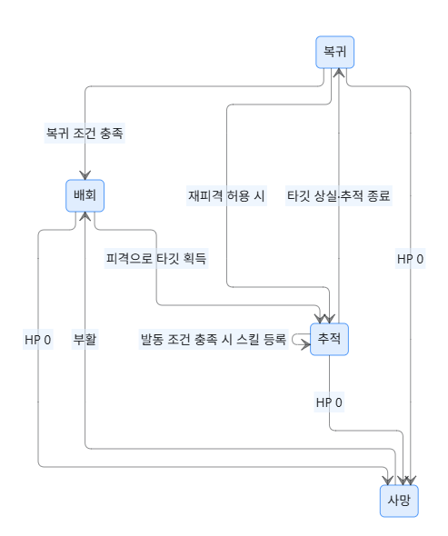

# Monster 구현

## 1. 개요

이 문서는 게임 로직 중 Monster 구현에 대해 설명한다.

## 2. 구현 범위  

### 몬스터 기능
- __피격 및 데미지 처리__  
	- 몬스터는 공격을 받으면 데미지를 계산하여 HP를 감소시키고, 필요 시 사망 처리한다.
- __이동__  
	- 스폰 주변에서 목표 지점을 골라 이동하고, 도착하면 잠시 멈춘다. Cell 경계를 넘으면 현재 위치의 Cell로 소속을 옮긴다.
- __Aggro 및 추격 / 공격__
	- 몬스터가 피격될 경우 공격자를 Aggro 대상으로 설정하고 해당 대상을 추적한다.
	- 교전을 시작한 피격 지점에서 최대 추격 거리를 넘으려 하거나, 대상이 사라지거나 사망하거나, 일정 시간 교전이 없으면 Aggro를 해제한다.
	- 공격 가능 범위에 도달하면 공격을 수행한다. 공격 주기는 틱기반으로 설정한다. 
- __Respawn__
	- 사망한 몬스터는 설정된 Respawn tick에 도달하면 원래 스폰 좌표와 Cell에서 다시 부활한다.

__서버 업데이트 주기__  
캐릭터는 20 FPS로 업데이트되지만,
몬스터는 부하를 줄이기 위해 **10 FPS**로 Delta 패킷을 전송하도록 구현하였다.
> 패킷 전송만 10FPS로 처리되고 내부 로직은 20FPS로 처리된다.
	
__몬스터 종류__  
현재 구현된 몬스터는 다음 세 종류이다.
* 일반 몬스터 (고양이 캐릭터)
* 강화형 일반 몬스터 (소 캐릭터)
* 보스 몬스터

__보스 몬스터 스킬 처리__  
보스 몬스터 스킬은 한 번의 시전으로 여러 Phase가 존재하며,
Phase마다 반복적으로 Hit 판정이 발생한다.

또한 보스 몬스터는 HP 구간(Phase) 에 따라 행동 패턴이 달라지며,
각 Phase별로 스킬 시전 간격, 반복 횟수, 공격 강도 등을 다르게 설정하여
난이도 및 전투 패턴이 변화하도록 구성하였다.

## 3. 상태 머신

`MonsterState::behavior`에 현재 행동을 저장하고, `ZoneState::UpdateMonster()`에서 전환 조건을 확인한 뒤 상태별 함수를 실행한다.  
HP에 따른 전투 Phase와 행동 상태는 별개다. Phase는 사용할 스킬 순서와 간격을 정하고, 행동 상태는 이번 틱의 이동·시전·부활 대기를 정한다.

| 상태 | 동작 | 전환 조건 |
| --- | --- | --- |
| `Wandering` | 스폰 주변의 목표 지점으로 이동하고 도착 후 대기 | 어그로가 생기면 추격 또는 공격 |
| `Returning` | 스폰 방향으로 이동 | 배회 반경에 들어오면 배회, 다시 피격되면 추격 또는 공격 |
| `Chasing` | 대상 쪽으로 상하좌우 이동 | 시전 간격과 사거리 조건을 만족하면 공격 |
| `Attacking` | 현재 Phase의 스킬을 등록하고 다음 스킬로 진행 | 다음 틱에 대상과 시전 조건을 다시 확인 |
| `Dead` | 부활 틱을 차감 | 부활 시 위치·전투 진행을 초기화하고 배회 |

- 사망을 먼저 확인한다. 살아 있는 몬스터는 어그로 타임아웃과 HP Phase 전환을 확인한 뒤 행동을 처리한다.
- 어그로가 풀리면 스폰 주변의 배회 반경까지 돌아온다. 정확한 스폰 좌표까지 복귀하거나 HP를 회복하는 동작은 없다.
- 추격 거리의 기준은 교전 시작 시 몬스터가 피격된 위치다. 교전 중 다시 맞거나 대상이 바뀌어도 기준점은 유지한다. 기본 최대 거리는 `MonsterData::chaseDistance`의 20이다.
- 배회 중 정지는 `Wandering` 내부의 대기 시간으로 처리한다. 이동 목표는 도착하거나 막힐 때까지 유지하며, 통과할 수 없는 목표는 다시 고른다.
- 이동·복귀·부활은 같은 위치 갱신 경로에서 Cell 목록도 바꾼다. Cell 이동이나 부활 이후에는 다음 몬스터 Snapshot을 Full로 보내 새 수신자가 몬스터를 생성할 수 있게 한다. 부활 위치는 추격 종료 위치와 관계없이 원래 스폰 좌표다.
- 공격 대기 중에도 추격하는 기존 동작을 유지한다. 보스는 사거리와 관계없이 시전 간격이 되면 공격한다.
- HP Phase가 바뀌는 틱에는 행동을 쉬고 스킬 순서와 타이머를 초기화한다. 등록된 스킬의 후속 판정은 기존 `ApplySkill()`에서 처리한다.
- 스킬의 각 Phase는 실행 시점의 몬스터 위치에서 판정하고 이펙트를 전송한다. 방향은 최초 시전 방향을 유지한다.
- 이동은 같은 Zone 안에서 좌표 기반으로 처리한다. Unity에서 내보낸 맵의 통행 가능 여부는 확인하지만, 장애물을 우회하는 길찾기는 하지 않는다.

## 4. 시연

## 5. 참고 

- [MonsterData.h](CoreLib/MonsterData.h)  
- [MonsterState.h](CoreLib/MonsterState.h)  
- [ZoneState_Monsters.cpp](CoreLib/ZoneState_Monsters.cpp)  
