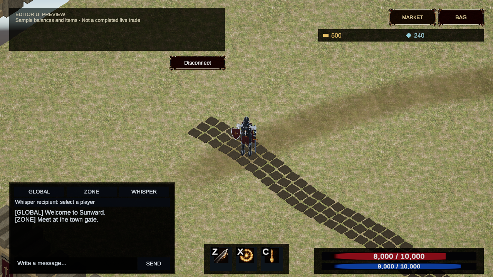
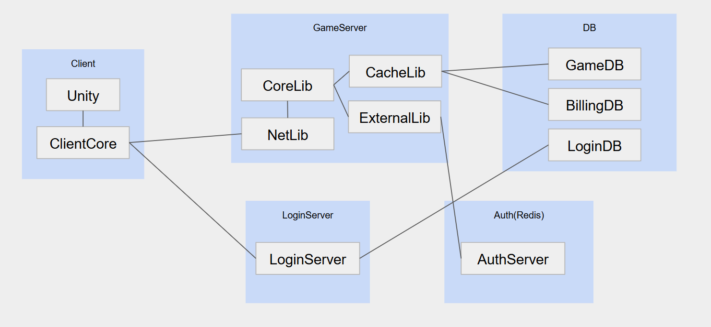

# C++ MMORPG 서버

C++20과 Windows IOCP로 만든 개인 프로젝트다. 이동, 스킬, 몬스터, 인벤토리, 거래소, 채팅을 구현했다.  
클라이언트의 요청을 서버에서 판정하는 Server Authoritative 구조로, 여러 사용자가 같은 월드 상태를 공유하는 MMORPG 서버를 만드는 것이 목표다.  
수천 명의 동시 접속과 한 유저의 시야에 수백 명이 들어오는 조건을 전제로, 상태 전파 비용·스레드 간 작업 전달·DB 저장 전 장애 복구를 중심으로 설계했다.  

[포트폴리오 PPT](https://docs.google.com/presentation/d/1Sz7WlzlE4qYqyXO43ad0i0CYAFvzJMR2/edit?usp=sharing&ouid=104250523129405797740&rtpof=true&sd=true) · [2,000명 접속 시연 영상](https://youtu.be/2q2kZwI3uSQ) · [빌드 및 실행](BUILD.md)

## AI 활용과 클라이언트 개발

**[AI AGENT 클라이언트 개발 작업](https://joeunil.github.io/MMORPG/)**  
실제 게임 화면과 개발 과정, 에이전트 활용 경험을 정리한 별도 웹사이트다. 개발하면서 계속 갱신하고 있다.

서버 개발에서는 AI를 설계 검토·코드 리뷰·일부 테스트 코드 작성에만 제한적으로 활용했다.  
새 Unity 클라이언트에서는 인벤토리·거래소 UI까지 포함해, AI 에이전트 워크플로우로 개발 전반을 맡기는 방식을 시도하고 있다.  
→ [AI 에이전트 클라이언트 개발](AI-AGENT.md) · [게임 서버 개발에서 AI 활용에 대한 고찰](AI-REFLECTION.md) · [생성형 LLM 학습 정리](LLM.md)

## 주요 설계

### 1. Cell 단위 스냅샷

시야에 들어오는 엔티티가 많으면 수신자마다 패킷을 조립하는 일도 부담이 된다. Cell별로 한 번 만든 Chunk를 그 Cell을 보는 세션들이 공유하도록 했다. 주변 3×3 Cell에만 전파하고, 평소에는 변경된 필드만 Delta로 보낸다.  
세션별 baseline이나 필드 필터링은 두지 않았다. 새로 시야에 들어온 대상이나 누락된 상태는 1초 주기의 Full Snapshot으로 맞춘다. 송신량은 여전히 시야 내 엔티티 수와 수신자 수에 따라 늘어난다.  

[설계 결정](DesignDecisions.md#1-상태-전파) · [AOI](AOI.md) · [Snapshot과 대역폭 계산](Snapshot.md)

### 2. Zone 스레드와 작업 전달

IOCP 워커가 받은 시뮬레이션 작업은 bounded MPMC Queue에 넣고, Zone 스레드가 틱마다 꺼내 처리한다. 같은 공간에서 이동·스킬·몬스터 갱신이 계속 일어나므로 Zone을 실행 단위로 잡았다.  
브로드캐스트(리플리케이션 전송)는 별도 워커에서 처리한다. 패킷 Chunk는 작업 큐로 넘기고, Cell별 전송 대상 목록은 Triple Buffer로 공유한다. 이 목록은 기존 읽기 참조가 모두 반환돼야 새 목록으로 바뀐다.  
Zone 안의 락은 아직 없애지 못했다. 진입·이탈·프로필 갱신이 외부 스레드에서도 실행돼, 이들과 상태를 공유하는 틱 로직에 mutex가 남아 있다. Zone과 브로드캐스트 큐가 가득 차면 작업을 버리고 drop을 집계한다.  

[설계 결정](DesignDecisions.md#2-시뮬레이션과-스레드-경계) · [작업 큐](WorkQueue.md) · [Triple Buffer](TripleBuffer.md)

### 3. Write-Back 캐시와 복구

인벤토리와 골드는 메모리에서 변경한 뒤 모아서 DB에 쓴다. 인벤토리는 WAL을 남겨 DB 저장 전 장애에 대비했다. 거래소 구매·취소 아이템은 Outbox로 재배송하고, 인벤토리에 함께 저장한 Inbox로 중복 적용을 막는다. 아이템과 Inbox의 DB 저장이 끝나야 Outbox도 완료 처리한다.  
WAL은 성공 응답 전에 fsync를 기다리지 않는다. 마지막으로 디스크에 동기화된 이후의 변경은 유실될 수 있다. 골드는 아직 WAL을 적용하지 않았고, 거래소 등록도 아이템 차감 후 매물을 만들기 전에 죽으면 아이템이 유실될 수 있다.  

[설계 결정](DesignDecisions.md#5-영속-데이터와-장애-복구) · [캐시](CacheLib.md) · [WAL](WAL.md) · [거래소](Bazaar.md)

## 테스트

자료구조의 경계 조건과 동시 접근, DB 연동, 서버를 강제 종료한 뒤의 복구를 나눠 테스트했다.  

| 검증 방식 | 확인한 내용과 기록 |
|---|---|
| 단위 테스트 (Google Test) | 큐·버퍼·객체풀의 경계 조건과 동시 접근, 큐 포화·종료 처리, WAL 손상 복구를 확인했다. [테스트 코드](UnitTests)와 [캐시 회귀 테스트](CacheLib_Test.md#db-없이-실행하는-회귀-테스트) |
| 마이크로 벤치마크 (Google Benchmark) | [작업 큐(WorkerQueue)](Benchmark_WorkerQueue.md)의 대기 방식, [Triple Buffer](Benchmark_TripleBuffer.md)의 spin/yield, [WAL](Benchmark_WAL.md)의 fsync 주기에 따른 처리량·경합을 비교해 정책을 정했다 |
| 크래시 주입 | [DB 저장 전 WAL 복구](CacheDurabilityTest.md), [아이템 배송 반영 후·DB 저장 후 복구](BazaarTest.md#42-crash-상황-테스트-test-6--exactly-once-배송-검증)를 확인했다. 지정한 지점에서 프로세스를 강제 종료하고, 재기동 후 아이템 수량과 중복 지급 여부를 검사했다 |
| 통합 테스트 | 실제 DB를 연결해 [캐시 조회·변경·flush·LRU 퇴출](CacheLib_Test.md), [거래소 구매·배송·정산과 동시 구매 경합](BazaarTest.md)을 검증했다 |

### 부하 테스트와 메모리 검사

| 테스트 | 결과와 조건 |
|---|---|
| [5,000명 더미 접속](DummyTest3.md) | i5-14400F, 게임 Zone 4개. 서버·DB·더미·모니터링을 같은 PC에서 실행한 loopback 시험이다. 접속·동작은 확인했지만 더미의 목표 액션 20Hz는 완전히 유지하지 못했다 |
| [Zone Tick](Benchmark_ZoneTick.md) | 2,000명, 분산/밀집과 이동량을 바꾼 8조건에서 각각 1,200틱 측정. 50ms 초과는 없었다. 입력 대기·실제 네트워크 전송·여러 Zone 동시 실행은 제외했다 |
| [ASan](ASAN.md) | 당시 2,000명 부하 시험과 단위 테스트에서 메모리 오류가 보고되지 않았다 |

## 디버깅 기록

- [SessionManager 데드락](SessionManagerDeadLock.md): SpinLock을 잡은 상태에서 같은 락을 다시 잡는 호출이 있었다. Context를 조회한 뒤 내부 작업은 NetHandler에서 처리하도록 옮겼다.
- [MPMC Queue 무한 대기](LockFreeQueueDebug.md): 스레드 상태와 호출 스택을 따라가며 pop 이후 슬롯 sequence를 잘못 갱신한 부분을 찾았다.
- [메모리 가시성 오류](MemoryOrderDebug.md): 두 atomic을 교차 확인하는 코드에서 acquire/release만으로는 필요한 순서를 보장하지 못했다. seq_cst로 수정했다.

## 구조

GameServer는 단일 프로세스로 실행한다. NetLibrary는 네트워크와 세션, CoreLib는 게임 로직, CacheLib는 캐시와 DB I/O, ExternalLib는 로그와 세션 인증을 담당한다. 로그인 서버는 Node.js, DB는 MySQL, 세션 저장소는 Redis를 사용한다.

서버 분리 구상은 [설계 결정](DesignDecisions.md#6-분산-확장-구상--미구현)에 적었다. 아직 구현하지 않았다. 위 Unity 시연과 동봉 실행 파일은 과거 버전이며, 최신 서버의 캐릭터 이름 정보(Profile) 패킷에 맞춰 클라이언트 갱신이 필요하다.

## 앞으로 할 일

- Zone 진입·이탈과 외부 상태 변경을 이벤트 큐로 옮겨 mutex를 줄인다.
- 골드 등 다른 캐시에도 WAL을 적용하고, DB 장애가 길어질 때 dirty 데이터가 계속 쌓이지 않도록 제한한다.
- 더미 클라이언트를 다른 PC로 분리해 action/s, 지연 분포, drop, 연결 종료를 함께 측정한다.

## 실행 및 문서

설치와 실행 순서는 [BUILD.md](BUILD.md)에 정리했다.

전체 기술 문서

### 개념
- [memory_order](memory_order.md)
- [Vyukov Bounded MPMC Queue](LockFreeQueue.md)
- [IOCP와 epoll](IOCP&epoll.md)
- [로그 구조화](StructuredLogging.md)
- [TripleBuffer](TripleBuffer.md)
- [Work Queue Policy](WorkQueue.md)
- [Back Pressure Queue](BackPressure.md)

### 컨텐츠 설계
- [Skill](Skill.md)
- [Monster](Monster.md)

### 시스템 설계
- [MMORPG 서버 설계 결정](DesignDecisions.md): 선택의 근거, 대안과 현재 한계
- [네트워크 Flood 탐지](FloodDetect.md)
- [Ping 처리](PingLoop.md)
- [ClientContext](ClientContext.md)
- [서버 클라이언트 동기화 처리 전략(Snapshot)](Snapshot.md)
- [서버, 클라이언트 틱 처리](Tick.md)
- [캐시 설계](CacheLib.md)
- [캐시 ACID 설계](CacheLib_ACID.md)
- [캐시 단위 테스트](CacheLib_Test.md)
- [WAL](WAL.md)
- [Cache Durability Test](CacheDurabilityTest.md)
- [DB 설계](DB.md)
- [IOCP Send 파이프라인](IOCPSendPipeline.md)
- [거래소 시스템](Bazaar.md)
- [거래소 시스템 테스트](BazaarTest.md)
- [Graceful Shutdown](GracefulShutdown.md)

### 리팩토링
- [채팅 기능 리팩토링](ChatRefactor.md)
- [ClientContext 리팩토링: God Object](ClientContextRefactor.md)
- [Ping 리팩토링](PingRefactor.md)
- [AOI 적용](AOI.md)
- [DB 전용 worker 스레드 분리](DBWorkerRefactor.md)
- [ObjectPool 리팩토링](ObjectPool.md)
- [Profile 분리](Profile.md)

### 트러블 슈팅
- [SessionManager 데드락](SessionManagerDeadLock.md)
- [Vyukov Bounded MPMC Queue 디버그](LockFreeQueueDebug.md)
- [ContextPool memory_order 디버그](MemoryOrderDebug.md)
- [DummyTest 디버그](DummyTestDebug.md)

### 테스트

- [WAL 성능 벤치마크](Benchmark_WAL.md)
- [Triple Buffer 성능 벤치마크](Benchmark_TripleBuffer.md)
- [ZoneTick 성능 벤치마크](Benchmark_ZoneTick.md)
- [WorkerQueue 성능 벤치마크](Benchmark_WorkerQueue.md)
- [모니터링](Monitoring.md)
- [더미 클라이언트 테스트](DummyTest.md)
- [더미 클라이언트 테스트2](DummyTest2.md)
- [더미 클라이언트 테스트3](DummyTest3.md)
- [ASAN 테스트 분석](ASAN.md)

