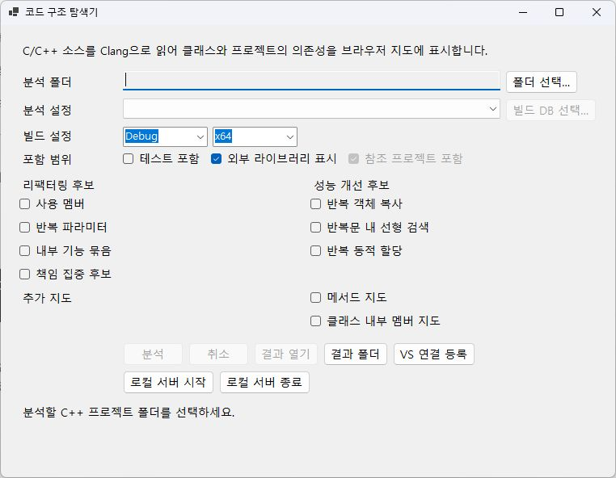
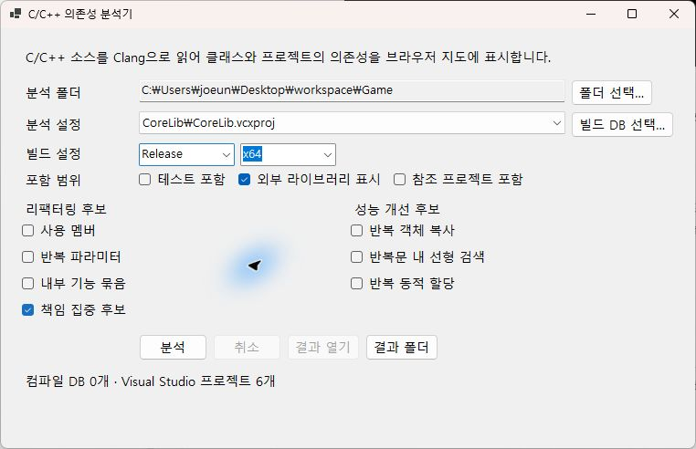
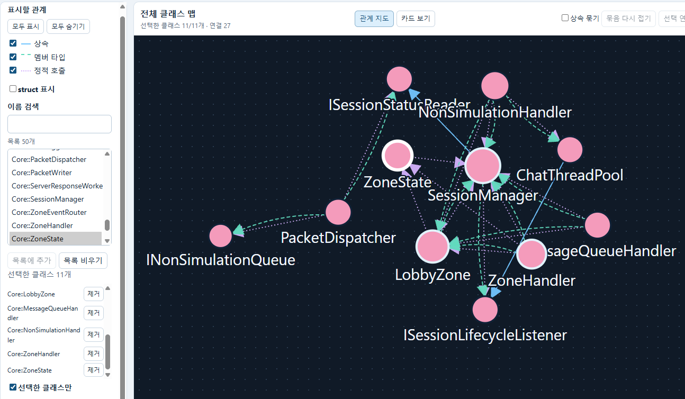
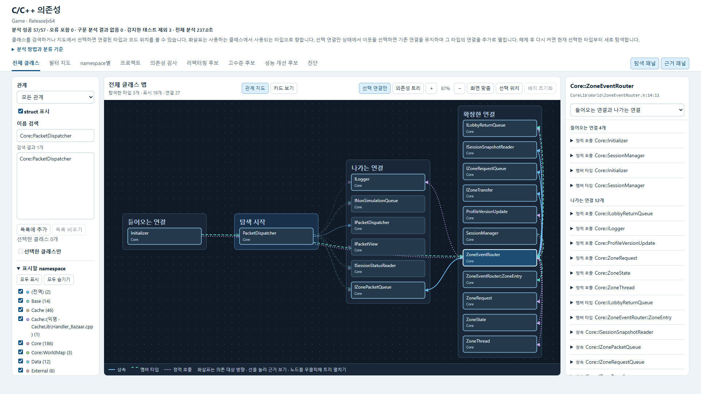
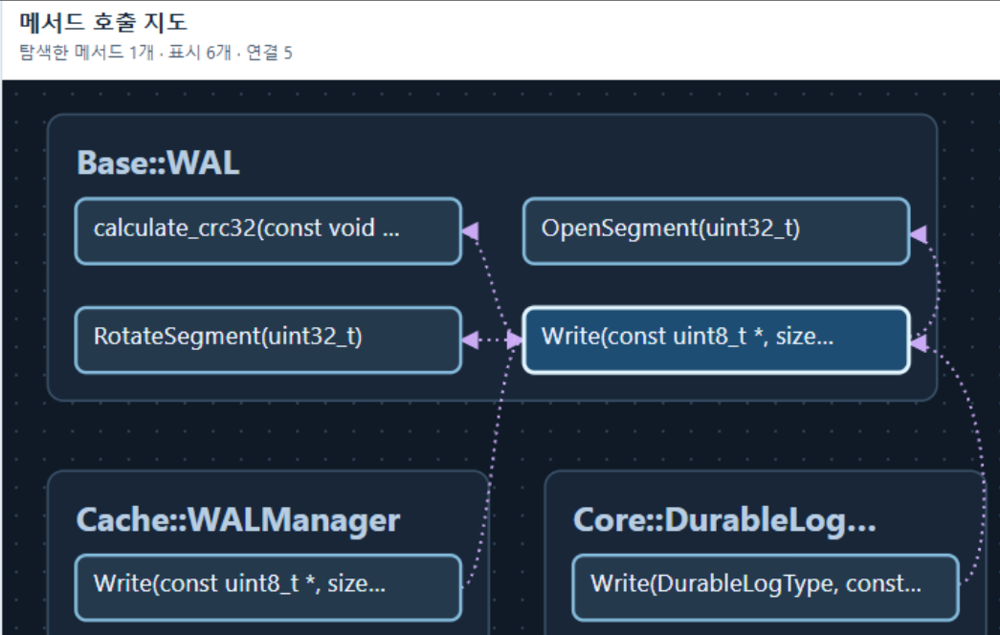
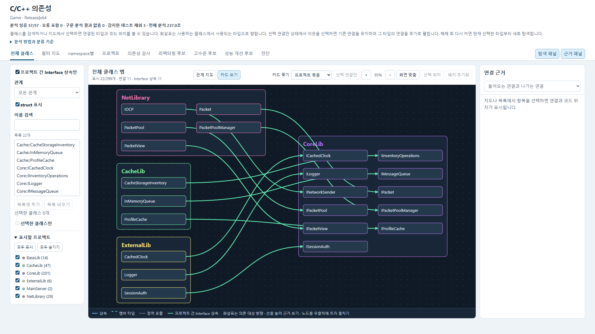
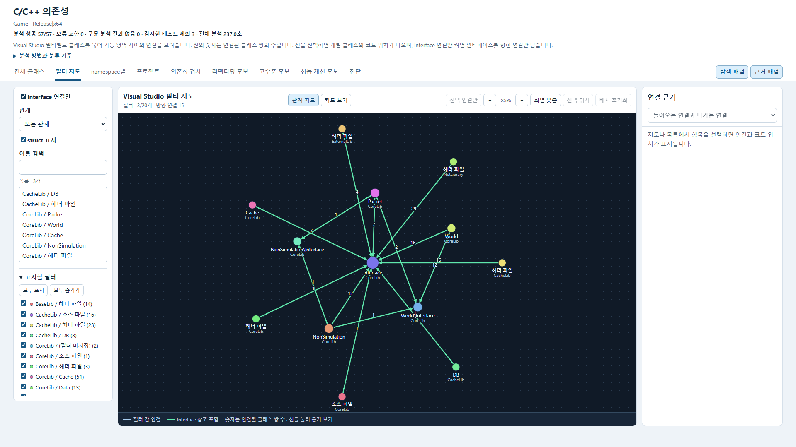
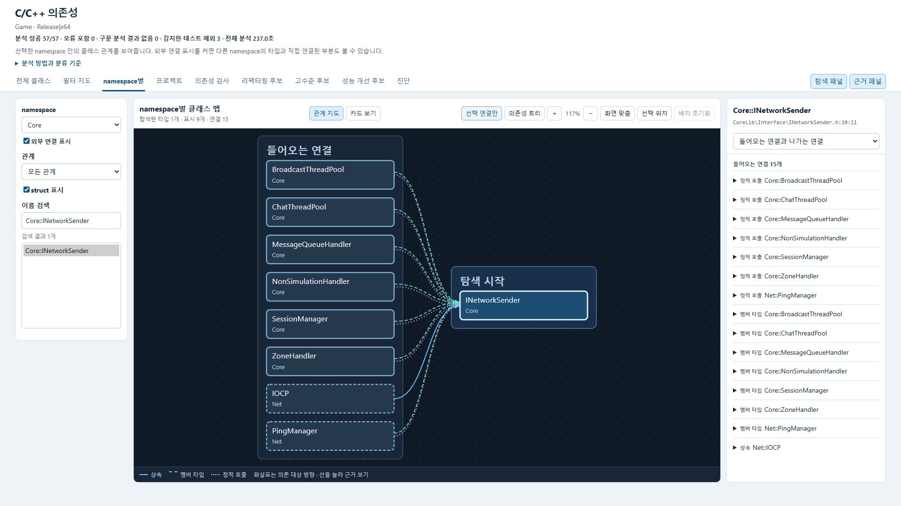
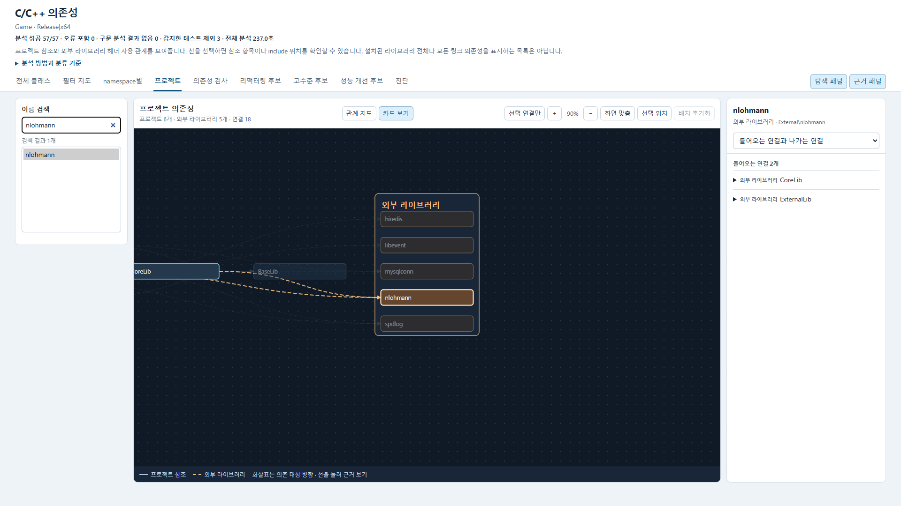
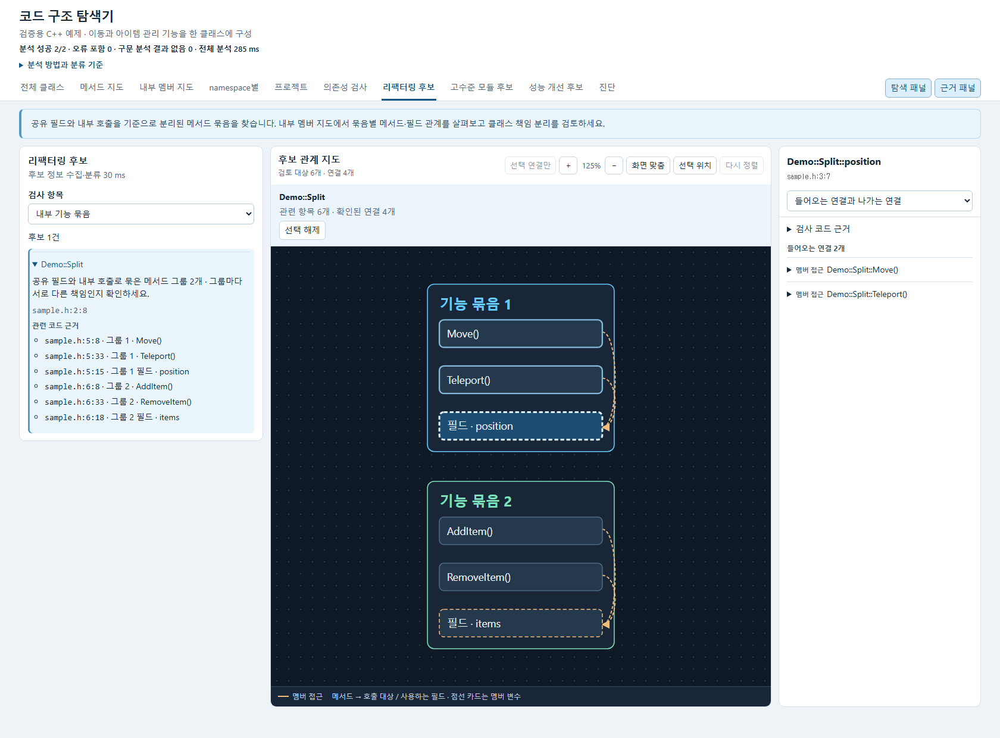

# 코드 구조 탐색기 사용 안내

[CodeExplorer — 코드 구조 탐색기 열기](https://joeunil.github.io/MMORPG/reports/server-project-map.html)

클래스와 메서드의 관계를 살펴보고 리팩터링할 부분을 찾는 도구다. 전체 지도보다 **필터로 범위를 좁히고 필요한 항목만 선택해서** 사용하면 편하다.

이 저장소에는 사용 안내와 화면 예시, 최신 서버 분석 보고서를 공개한다. 아래 실행 방법은 로컬 CodeExplorer 기준이다.

## 1. 분석 실행

1. CodeExplorer 폴더의 **CodeExplorer 실행** 바로가기를 연다.
2. **폴더 선택**으로 서버 소스 폴더를 지정하고, **분석 설정**에서 프로젝트를 고른다.
3. **구성·플랫폼**과 필요한 검사를 선택한다. 호출 관계는 **메서드 지도**, 필드 사용 관계는 **클래스 내부 멤버 지도**를 켠다.
4. **분석**을 누르면 완료 후 보고서가 브라우저에서 열린다.

저장된 서버 보고서는 **CodeExplorer 보고서** 바로가기로 열 수 있다.

### 특정 라이브러리만 분석

**분석 설정**에서 원하는 라이브러리를 고르고 **참조 프로젝트 포함**을 끈다. 전체 서버를 함께 보려면 참조 프로젝트를 포함한다.

### 재분석과 VS 파일 열기

분석 후 로컬 서버가 자동으로 시작되므로 **웹페이지 재분석과 새 보고서의 VS 파일 열기는 별도 설정 없이 사용**할 수 있다.

- **같은 설정으로 재분석**: 보고서 상단에서 실행한다. 진행 상태를 표시하고 완료하면 화면을 갱신한다. 설정 변경은 탐색기에서 한다.
- **VS에서 열기**: 코드 위치 옆 링크로 해당 파일을 연다.
- **로컬 서버 시작 / 종료**: 백그라운드 서버를 수동으로 켜고 끈다.
- **VS 연결 등록**: 기존 외부 앱 링크를 사용할 때 등록한다. 로컬 서버를 통한 파일 열기에는 필요하지 않다.

## 2. 보고서 보기

- **검색·필터**: 이름, 프로젝트, namespace, Visual Studio 필터로 탐색 범위를 좁힌다.
- **표시할 관계**: 상속·멤버 타입·정적 호출을 켜고 끈다. 의미는 **관계 설명**에서 확인한다.
- **근거 패널**: 노드나 연결선을 선택해 관련 코드와 위치를 확인한다. 화살표는 사용하는 쪽에서 의존 대상으로 향한다.
- **지도 조작**: 노드 드래그로 배치하고 빈 공간 드래그·휠로 이동·확대한다. 우클릭으로 숨긴 항목은 **다시 정렬**로 복원한다.

### 관계 지도와 클래스 선택

연결된 클래스를 지도 형태로 표시한다. 노드의 색은 namespace, 크기는 연결된 클래스 수를 나타낸다.

1. 관심 클래스를 검색해 **목록에 추가**한다.
2. **선택한 클래스만**을 켜서 목록 안의 관계를 확인한다.
3. 필요한 관계 유형만 남기고, 연결선을 눌러 코드 근거를 살펴본다.

위 화면은 `SessionManager`, `ZoneState`, `LobbyZone` 등 검토할 클래스만 모은 예시다.

### 카드 보기와 선택 연결

- **카드 보기**에서 타입을 선택하고 **선택 연결만**을 켜면 직접 연결을 펼친다.
- 이웃 타입을 누르면 기존 연결을 유지하며 탐색 범위를 넓힌다.
- 새 기준으로 시작하려면 **선택 연결만**을 껐다 켠다.

### 상속 묶기

- **상속 묶기**를 켜면 기반 타입과 파생 타입을 한 묶음으로 접는다.
- 묶음을 선택해 실제 타입과 연결을 확인하고 **이 상속 묶음 펼치기 / 묶음 다시 접기**로 전환한다.
- 묶음을 **목록에 추가**하면 그 안의 타입을 함께 선택한다.

### 메서드 지도

- 메서드를 검색·선택하면 호출 관계를 **클래스별 카드 묶음**으로 표시한다.
- 이웃 메서드를 선택해 확장하거나, 목록에 모아 **선택한 메서드만**으로 좁힌다.
- **들어오는 연결 / 나가는 연결**로 방향을 고르고, 연결선을 눌러 호출 위치를 확인한다.

위 화면은 `Base::WAL::Write`의 호출자와 내부 호출 메서드를 살펴본 예시다.

### 클래스 내부 멤버 지도

- 클래스를 검색·선택해 내부 메서드와 멤버 변수를 함께 본다.
- **호출선**은 메서드 사이의 호출, **멤버 접근선**은 메서드가 사용하는 필드를 나타낸다.
- 필드 카드는 점선으로 구분한다. 같은 필드를 사용하는 메서드와 서로 분리된 기능 묶음을 살펴본다.

### 프로젝트 묶음과 인터페이스 경계

**카드 보기 → 프로젝트 묶음**으로 라이브러리별 관계를 확인한다. **프로젝트 간 Interface 상속만**을 켜면 인터페이스를 통한 연결을 좁혀 볼 수 있다.

### 필터 지도

Visual Studio 필터별로 클래스를 묶는다. 선의 숫자는 연결된 클래스 쌍 수이며, **Interface 연결만**으로 인터페이스를 향한 관계만 볼 수 있다.

### namespace별 지도

namespace를 선택해 내부 관계를 확인한다. **외부 연결 표시**를 켜면 다른 namespace와 직접 연결된 타입도 함께 표시한다.

### 프로젝트와 외부 라이브러리

프로젝트 참조와 외부 라이브러리 사용 관계를 확인한다. 연결선을 누르면 참조 항목이나 헤더를 포함한 위치가 나온다.

## 3. 검토할 부분 찾기

### 고수준 후보

여기서 **고수준**은 상대적으로 안정적인 아키텍처 요소, **저수준**은 더 자주 바뀌거나 변경 가능성이 큰 요소를 뜻한다. 『C++ 소프트웨어 디자인』의 변경 가능성에 따른 구분을 사용한다. DIP의 상위 정책·구체적 구현 구분과 관련은 있지만, 업무 로직인지 기반 기술인지로 수준을 정하지 않는다. [서버 리팩토링의 용어 설명](../../ServerRefactoring.md#아키텍처의-고수준과-저수준)을 참고한다.

서로 다른 타입 2개 이상이 직접 참조하며, 수집된 관계에서 나가는 연결이 없는 클래스를 후보로 모은다. `struct`는 제외하고 Interface·추상 타입은 기본으로 포함한다. 후보를 선택해 사용처와 연결 근거를 확인한다.

변경 이력이나 실제 안정성을 분석하지 않으므로, 의존 관계만으로 고수준임을 확정하지 않는다. 변경 이유와 사용처에 미치는 영향을 코드에서 확인하고 의존성 분리와 디자인 패턴 적용을 검토한다.

### 순환 의존 검사

**의존성 검사 → 순환 의존 → 순환 경로 찾기**를 실행한다. 결과를 펼치면 순환 경로와 각 연결의 코드 위치가 나온다. 필요하면 **Interface를 향하는 연결 제외**로 범위를 좁힌다.

**클래스 지도로 보기**를 누르면 해당 순환 경로의 타입과 연결만 표시한다.

### 의존성 트리

클래스를 우클릭해 **의존성 트리 펼치기**를 선택한다. 왼쪽은 사용처, 오른쪽은 의존 대상이며 가지를 펼쳐 연결을 따라갈 수 있다.

### 리팩터링 후보

- **검사 항목**을 고르고 왼쪽 목록에서 후보를 선택한다.
- 같은 화면의 지도에서 관련 클래스·메서드·필드를 확인하고, 연결선을 눌러 코드 위치를 살펴본다.
- **선택 해제**로 지도를 비운다. 실행하지 않은 검사는 **미분석**, 지도 정보가 없는 예전 결과는 **재분석 필요**로 표시한다.

| 검사 | 살펴볼 부분 |
| --- | --- |
| 사용 멤버 | 대상 클래스의 일부 멤버만 사용하는 관계 |
| 반복 파라미터 | 여러 함수에서 함께 전달되는 같은 인자 묶음 |
| 내부 기능 묶음 | 공유 필드와 내부 호출로 묶었을 때 분리되는 메서드 그룹. 내부 멤버 지도에서 책임 분리를 검토 |
| 책임 집중 후보 | 여러 타입에 의존하는 클래스 |

반복 파라미터는 접기 제목에서 인자 묶음과 함수 수를 바로 확인할 수 있다.

반복 파라미터는 관련 함수만 메서드 지도에 모으고, 내부 기능 묶음은 메서드·필드와 그룹을 내부 멤버 지도에 표시한다.

아래는 이동과 아이템 관리 기능을 한 클래스에 둔 **검증용 예제**를 분석한 화면이다. 서로 다른 필드를 사용하는 메서드들이 두 묶음으로 나뉘어 클래스 책임 분리를 검토할 수 있다.

- `Move`·`Teleport`는 `position`을, `AddItem`·`RemoveItem`은 `items`를 사용한다.
- 필드를 선택하면 해당 필드에 접근하는 메서드와 코드 위치를 확인한다.

### 책임 집중 후보

나가는 의존성이 많은 클래스부터 살펴본다.

- **실제 타입**: 멤버로 두거나 메서드를 호출한 타입 수다.
- **나가는 의존성**: 같은 기반 클래스를 공유하는 타입들을 한 묶음으로 센 수다.
- 후보를 펼쳐 묶음별 타입과 코드 위치를 확인한다.
- 검토에서 빼려는 클래스는 **표시 제외**, 다시 보려면 **제외 복원**을 누른다. 제외 목록은 소스 폴더별로 브라우저에 저장한다.

### 성능 개선 후보

검사 항목과 후보를 선택해 반복문 안의 복사·검색·할당 위치와 관련 연결을 같은 화면에서 확인한다.

| 검사 | 살펴볼 부분 |
| --- | --- |
| 반복 객체 복사 | 반복할 때마다 객체를 값으로 복사하는 곳 |
| 반복문 내 선형 검색 | 같은 범위의 검색을 반복하는 곳 |
| 반복 동적 할당 | 반복문 안에서 메모리를 할당하는 곳 |

실행 빈도와 측정 결과를 확인한 뒤 개선 여부를 판단한다.
