# C/C++ 의존성 분석기 사용 안내

[MMORPG 서버 의존성 분석 보고서](https://joeunil.github.io/MMORPG/reports/server-project-map.html) · [빌드·명령줄 옵션](BUILD.md) · [분석기 소스](Source/)

Clang으로 C/C++ 소스를 읽고 클래스·프로젝트 간 의존성과 코드 위치를 HTML로 보여주는 도구다. 아래 화면은 이 저장소의 서버를 분석한 결과이며, 각 기능의 조작과 표시 방식을 설명한다.

## 1. 분석 실행

Release 빌드 후 이 폴더 최상위의 **`ServerDependencyAnalyzer.exe`**로 실행하고 **`report.html`**로 최신 결과를 연다. 함께 생성되는 DLL·설정 파일과 `clang` 폴더도 실행에 필요하다.

기본 분석이 완료되면 `report.html`을 갱신하고, 이전 결과는 최상위 `Reports` 폴더에 날짜별로 보관한다. 이미 열린 페이지는 새로고침하거나 다시 열어야 반영된다. 처음 빌드했을 때는 동봉 서버 보고서를 `report.html`의 초기 내용으로 사용한다. 명령줄에서 `--output`을 지정하면 그 파일만 저장한다.

### WinForms 화면

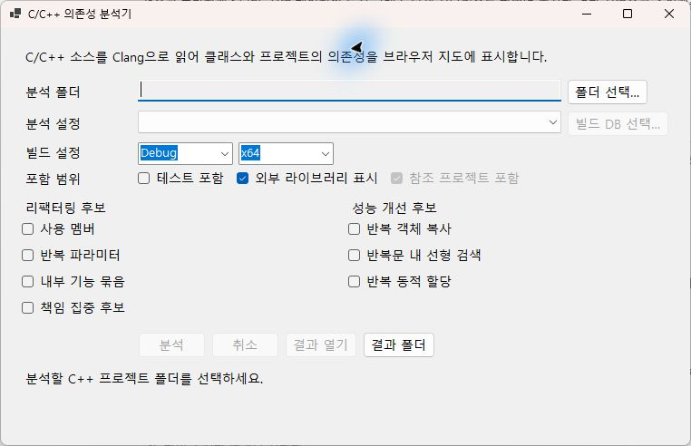

1. **폴더 선택**에서 소스 루트를 선택한다.
2. **분석 설정**에서 전체 Visual Studio 프로젝트, 개별 `.vcxproj`, 컴파일 데이터베이스 중 하나를 고른다. 별도 위치의 `compile_commands.json`은 **빌드 DB 선택**으로 지정한다.
3. Visual Studio 프로젝트는 **구성·플랫폼**을 지정한다. 기본값은 `Debug` / `x64`다.
4. 필요한 포함 범위와 검사를 선택하고 **분석**을 누른다. 완료되면 HTML 보고서를 기본 브라우저로 연다.

**취소**는 현재 파일의 Clang 분석이 반환된 뒤 반영된다. **결과 열기**는 최신 `report.html`을, **결과 폴더**는 날짜별 보고서를 보관한 `Reports` 폴더를 연다. 저장 위치는 실행파일이 있는 폴더 기준이다. 취소한 분석은 최신 결과를 바꾸지 않는다.

### 특정 라이브러리만 분석

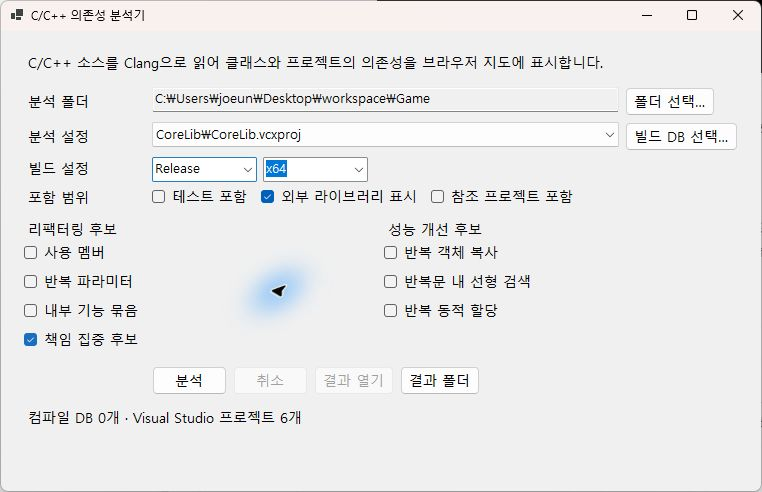

**분석 폴더**는 저장소 루트로 유지하고 **분석 설정**에서 원하는 라이브러리의 `.vcxproj`를 고른다. **참조 프로젝트 포함**을 끄면 선택한 프로젝트의 `ClCompile` 소스만 분석하고, 켜면 참조 프로젝트의 소스까지 따라간다. 기본값은 켜짐이다.

이 옵션은 개별 Visual Studio 프로젝트를 선택했을 때만 활성화된다. 전체 프로젝트 선택은 발견한 프로젝트 전체를, 컴파일 DB 선택은 DB에 등록된 소스를 분석한다. **외부 라이브러리 표시**는 외부 헤더의 라이브러리 노드 표시 여부이며, 참조 프로젝트의 소스 분석 여부와는 별개다.

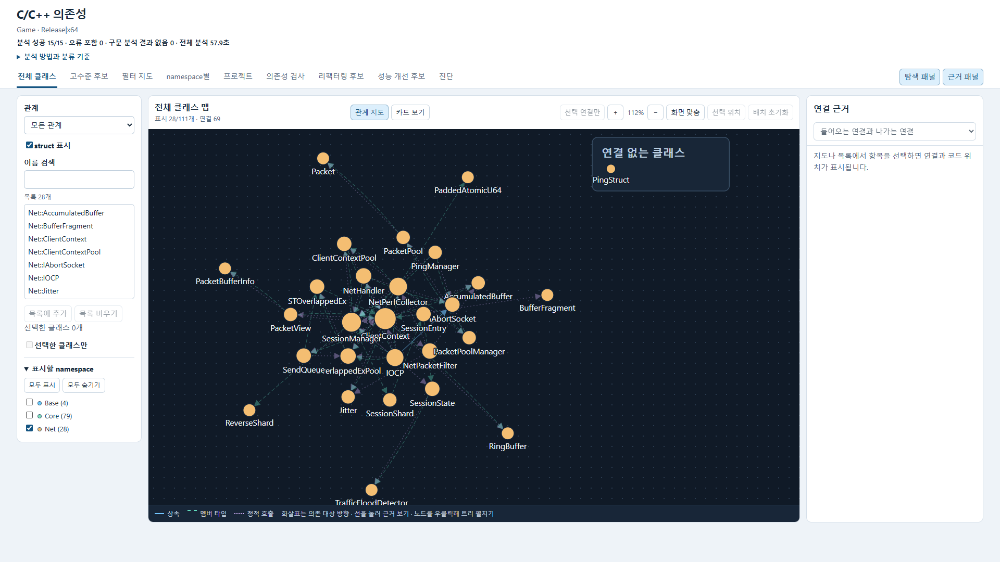

위 화면은 `NetLibrary` 소스 15개만 분석한 결과다. **분석 단위는 소스 파일**이므로 해당 소스가 포함한 헤더의 타입과 관계도 지도에 나타날 수 있다. 특정 라이브러리의 타입만 화면에 남기는 표시 필터와 구분한다.

명령줄에서는 `--entry NetLibrary/NetLibrary.vcxproj --include-project-references false`로 같은 범위를 지정한다. [전체 실행 예시](BUILD.md#빌드)를 참고한다.

### 선택 검사

리팩터링·성능 검사는 기본으로 꺼져 있다. 필요한 항목을 켜면 의존성 분석과 함께 검사 정보를 수집한다. 보고서는 **미분석 / 후보 없음 / 후보 발견**을 구분한다. Clang 오류가 있는 소스에서는 후보를 수집하지 않는다.

## 2. 보고서 보기

**화살표는 의존하는 쪽 → 의존 대상**이다. 공통으로 이름 검색, 관계 유형, namespace·프로젝트·필터, **struct 표시**를 사용할 수 있으며 현재 보기에 맞는 조작만 나타난다. 노드를 선택하면 오른쪽 **근거 패널**에 관계와 파일·행 번호가 나온다.

노드 드래그는 배치 변경, 빈 공간 드래그는 화면 이동, 휠은 확대·축소다. **화면 맞춤**, **선택 위치**, **배치 초기화**로 위치를 조정하고 **탐색 패널·근거 패널**은 각각 접을 수 있다.

### 카드 보기

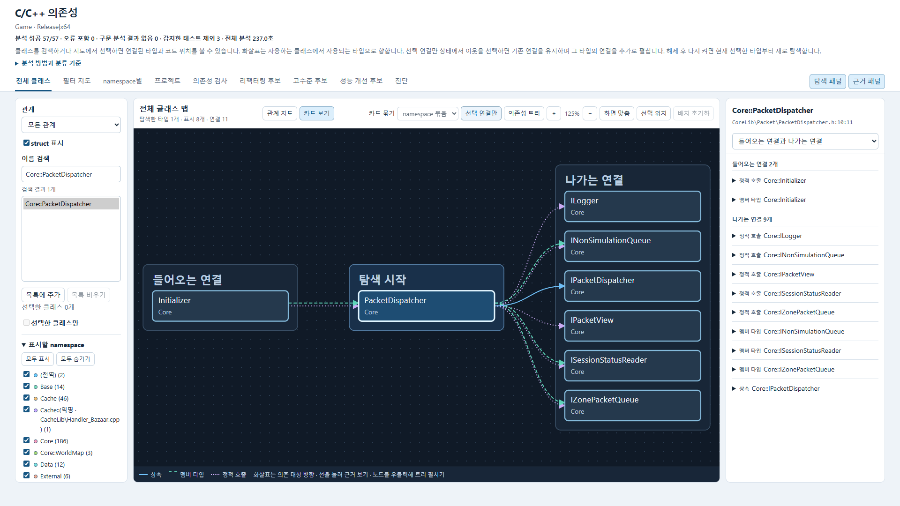

**전체 클래스 → 카드 보기**에서 클래스 이름과 연결을 카드로 표시한다. 검색 결과에서 타입을 선택하고 **선택 연결만**을 누르면 직접 연결을 펼친다. 근거 패널의 **들어오는 연결 / 나가는 연결**로 방향을 좁히고 관계를 펼쳐 코드 위치를 확인한다.

**선택 연결만** 상태에서 연결된 타입을 클릭하면 기존 타입과 연결선을 유지한 채 그 타입의 연결을 추가한다. 처음 선택한 타입은 **탐색 시작**에 남고, 새로 발견한 타입은 **확장한 연결**에 표시한다. 연결된 타입을 계속 선택해 관계를 이어서 살펴볼 수 있다. 새 기준으로 시작하려면 **선택 연결만**을 껐다 켠다. 관계·방향·표시 필터는 확장한 지도에도 적용한다.

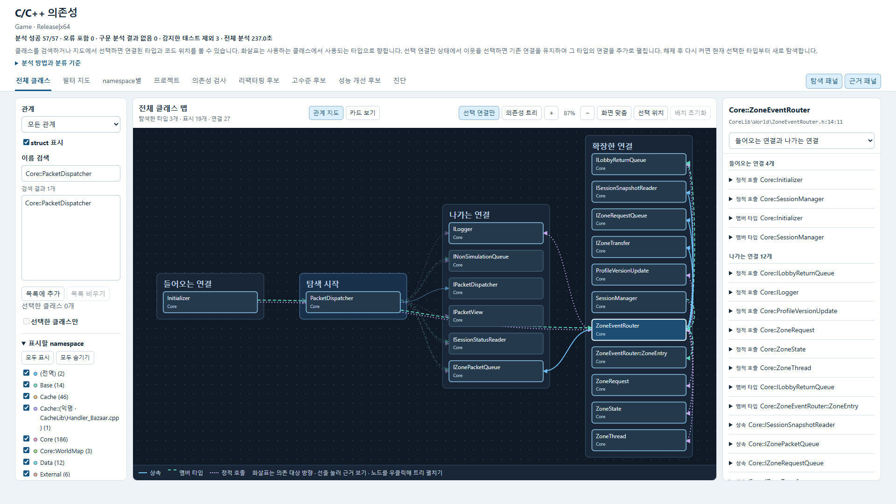

### 관계 지도

**관계 지도**는 연결이 많은 타입을 중심에, 말단 타입을 바깥에 배치한다. 노드의 색은 namespace, 크기는 연결된 클래스 수를 나타낸다. 노드를 선택하면 직접 연결이 강조되고 더블클릭하면 해당 연결을 펼친다.

### 클래스 선택 목록

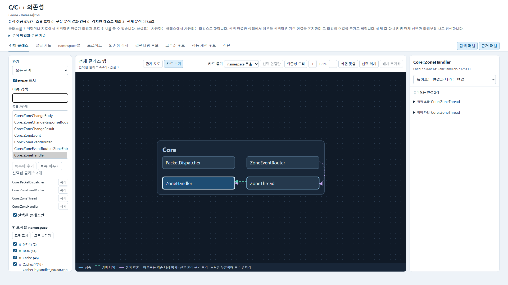

검색한 클래스를 선택하고 **목록에 추가**를 누른다. 여러 타입을 모은 뒤 **선택한 클래스만**을 켜면 목록 안의 타입 사이 관계만 표시한다. **제거**는 한 타입을, **목록 비우기**는 전체 목록을 지운다.

관계 지도와 카드 보기 모두 지원한다. 검색어와 탭을 바꿔도 목록은 현재 페이지에서 유지되고, 연결이 없는 선택 타입도 표시된다. 다른 관계·namespace·프로젝트·struct 필터도 함께 적용된다.

### 프로젝트 묶음과 인터페이스 경계

**전체 클래스 → 카드 보기 → 프로젝트 묶음**에서 프로젝트별로 카드를 묶고 색을 구분한다. 다른 프로젝트의 Interface 타입을 상속하는 선은 강조한다. **프로젝트 간 Interface 상속만**을 켜면 관련 타입과 상속 관계만 남긴다.

Visual Studio 필터 경로에 `Interface`가 포함되면 인터페이스 필터로 판별한다. 대소문자를 구분하지 않으며 `InternalInterface`, `WorldInterface`와 그 하위 필터도 포함한다.

### 필터 지도

**필터 지도**는 `.vcxproj.filters`에 등록된 선언 파일을 프로젝트·필터별로 묶는다. 선의 숫자는 연결된 클래스 쌍 수다. 선을 누르면 개별 관계와 코드 근거를 확인할 수 있다. **Interface 연결만**은 Interface 필터의 타입을 향하는 연결만 남긴다.

### namespace별 지도

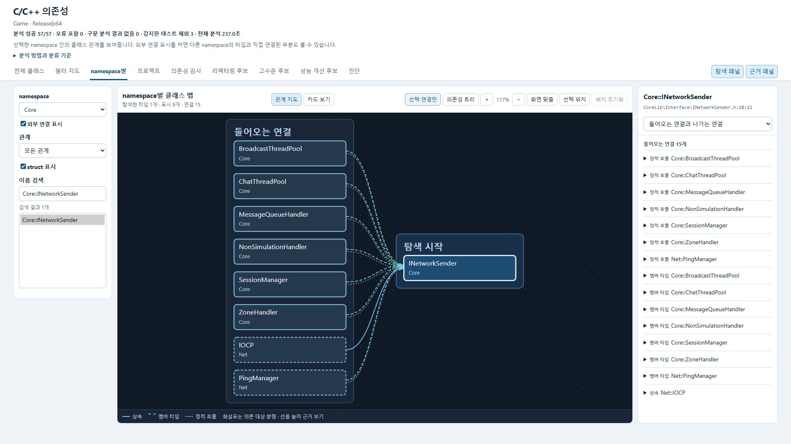

**namespace별**에서 namespace를 고르면 내부 클래스 관계를 표시한다. **외부 연결 표시**를 켜면 다른 namespace와의 직접 연결도 나타난다. 중첩 namespace, 전역 타입, 파일별 익명 namespace를 구분한다.

### 프로젝트와 외부 라이브러리

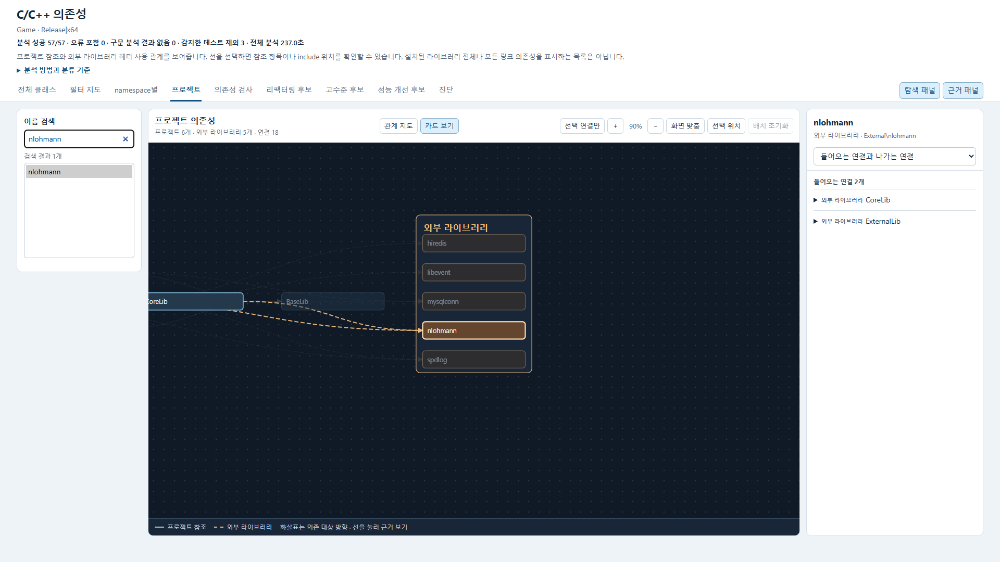

**프로젝트**는 `.vcxproj`의 `ProjectReference`와 외부 헤더 포함 관계를 표시한다. 외부 라이브러리는 주황색 노드로 표시한다. 노드나 선을 선택하면 프로젝트 참조 항목 또는 실제 include 위치를 확인할 수 있다. 시스템 SDK와 모든 링크 라이브러리의 목록을 의미하지는 않는다.

### 고수준 후보

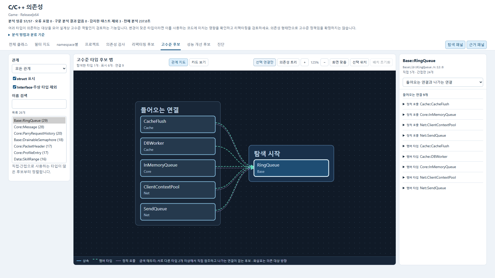

**고수준 후보**는 서로 다른 타입 2개 이상이 직접 참조하며, 다른 타입으로 나가는 연결이 없는 타입을 모은다. 직접·간접 사용 타입 수가 많은 순으로 정렬한다. **Interface·추상 타입 제외**는 기본으로 켜져 있다. 의존성 방향으로 모은 후보이며 설계상 고수준 정책인지 판단한 결과는 아니다.

### 순환 의존 검사

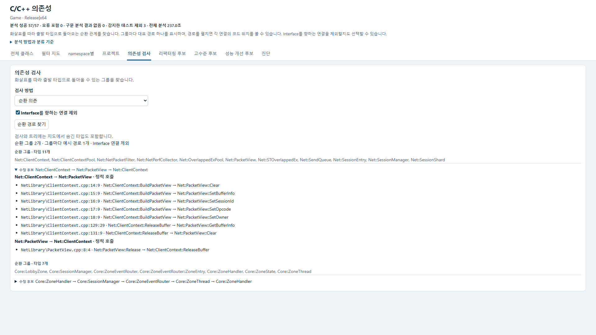

**의존성 검사 → 순환 의존 → 순환 경로 찾기**로 출발 타입으로 돌아오는 경로를 찾는다. 그룹마다 대표 경로 하나를 표시하며, 펼치면 각 연결의 관계 종류와 코드 위치가 나온다. **Interface를 향하는 연결 제외**는 기본으로 켜져 있다.

### 의존성 트리

**의존성 검사 → 의존성 트리**에서 기준 타입을 고르고 실행한다. 왼쪽은 그 타입의 사용처, 오른쪽은 그 타입의 의존 대상이다. 가지를 펼치면 코드 근거와 다음 단계가 나타난다. 전체 클래스의 타입을 우클릭해 **의존성 트리 펼치기**로 열 수도 있다.

### 리팩터링 후보

**리팩터링 후보 → 검사 항목**에서 검사를 고르고 후보를 펼치면 관련 코드와 위치가 나온다.

| 검사 | 수집·표시 기준 |
| --- | --- |
| 사용 멤버 | 공개 메서드 5개 이상인 대상에서 사용하는 멤버가 1~2개인 클래스 관계 |
| 반복 파라미터 | 이름·타입·순서가 같은 연속 인자 3개 이상이 서로 다른 함수 3개 이상에서 반복 |
| 내부 기능 묶음 | 자체 필드 사용과 내부 호출로 묶은 메서드 그룹이 둘 이상이고 각 그룹에 메서드 2개 이상 |
| 책임 집중 후보 | 멤버 타입과 정적으로 해석된 호출 대상의 묶음 수가 많은 클래스부터 정렬 |

내부 기능 묶음은 생성자·소멸자를 제외하고 메서드 본문을 모두 분석한 클래스에서 찾는다.

### 책임 집중 후보

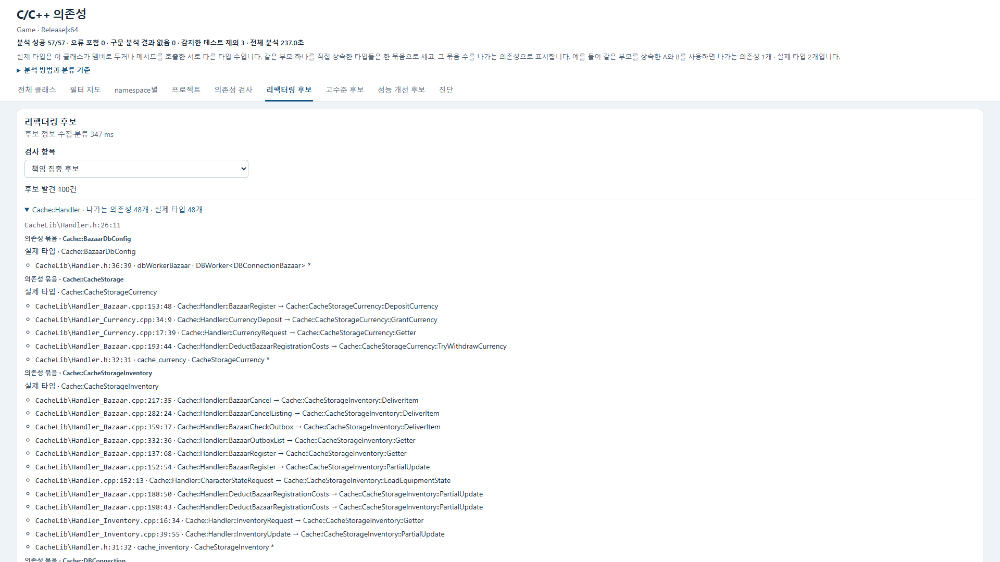

**실제 타입**은 해당 클래스가 멤버로 두거나 메서드를 호출한 서로 다른 타입 수다. 같은 부모 하나를 직접 상속한 타입들은 한 묶음으로 세고, 그 묶음 수를 **나가는 의존성**으로 표시한다. 예를 들어 같은 부모를 상속한 A와 B를 사용하면 **나가는 의존성 1개 · 실제 타입 2개**다. 부모가 없거나 여러 개여서 하나로 정할 수 없는 타입은 각각 센다.

후보를 펼치면 묶음별 타입과 멤버 선언·호출 위치가 나온다. 숫자는 클래스가 얼마나 다양한 대상에 의존하는지 살펴보는 근거이며, 책임이 많다는 판정이나 호출 횟수는 아니다.

### 성능 개선 후보

**성능 개선 후보**에서 검사 항목을 고르면 반복문과 관찰된 코드 위치를 함께 볼 수 있다.

| 검사 | 수집 기준 |
| --- | --- |
| 반복 객체 복사 | 범위 기반 반복문에서 `std::string` 계열·`std::vector`의 복사 생성자 호출 |
| 반복문 내 선형 검색 | 반복문 본문에서 `std::find`, `std::find_if`, `std::find_if_not` 호출 |
| 반복 동적 할당 | 반복문 본문에서 일반 `new` 또는 지원하는 표준 할당 함수 호출. placement new 제외 |

호출한 함수의 내부까지 추적하지 않는다. 같은 반복문에서 발견한 동일 유형은 한 후보로 묶는다. 실행 빈도와 측정 결과를 확인한 뒤 최적화 여부를 결정한다.

## 3. 동봉 보고서와 분석 범위

캡처와 동봉 보고서는 **2026-11-19 서버 소스**를 `MainServer/MainServer.vcxproj`, `Release / x64`, 참조 프로젝트 포함, 테스트 제외로 분석했다. 라이브러리 단독 분석 화면만 `NetLibrary` 소스로 범위를 좁혔다. 게시된 보고서는 배포 시점에 따라 다를 수 있다.

| 항목 | 동봉 보고서 결과 |
| --- | --- |
| 소스 | 57개 중 57개 오류 없이 파싱 |
| 수집 결과 | 클래스·구조체 299개, 프로젝트 6개, 외부 라이브러리 5개 |
| 선택 검사 | 리팩터링 4종·성능 3종 모두 실행 |

보고서는 생성 시점의 스냅샷이며 코드 수정만으로 갱신되지 않는다. 다시 분석하면 로컬 `report.html`이 갱신된다. `Reports/server-project-map.html`은 동봉·게시용 서버 보고서이므로 자동 교체하지 않으며, Pages 반영에는 보고서 갱신과 배포가 필요하다. **진단**에서 파일별 오류와 적용하지 못한 빌드 설정을 확인한다. 지도에서 숨긴 타입도 순환 검사와 의존성 트리에는 포함된다.

클래스 관계는 상속·멤버 타입·정적으로 해석한 호출을 수집한다. 여기서 정적 호출은 `static` 메서드만을 뜻하지 않는다. 런타임의 가상 호출 대상, 실제 실행 순서와 스레드 간 전달은 추적하지 않는다. 클래스 내부 호출은 지도에서 생략하고 같은 클래스 쌍·관계 유형의 근거는 최대 12개를 보관한다.

로컬 보고서의 파일 열기 지원은 브라우저·연결 프로그램에 따라 다르며 줄 이동을 보장하지 않는다. 웹 보고서는 코드 위치만 표시한다. 연결이 보이지 않는다는 이유만으로 의존성이 없다고 단정하지 않고, 진단과 원본 코드를 함께 확인한다.
