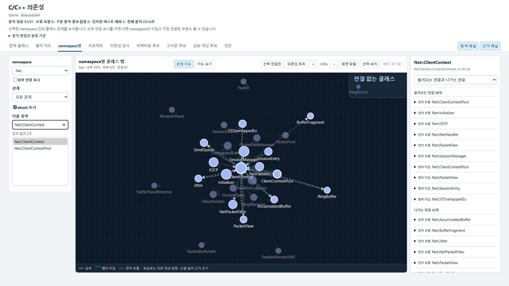
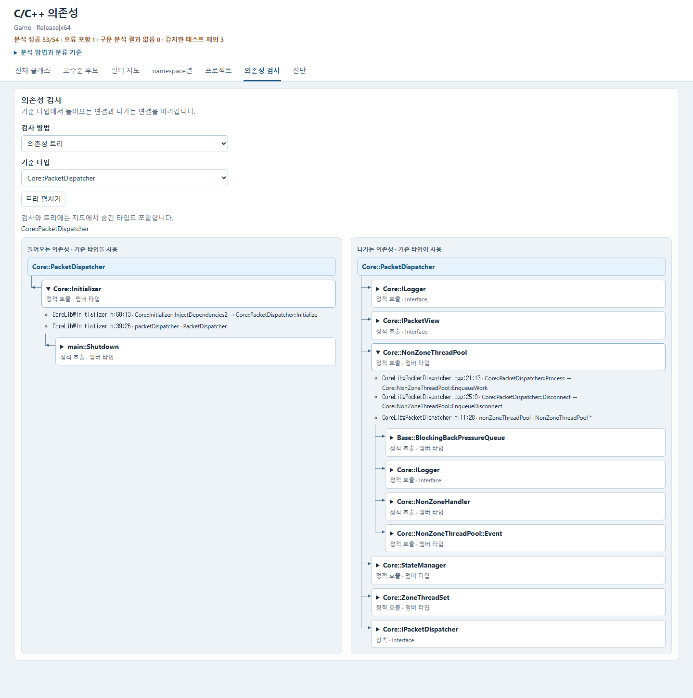
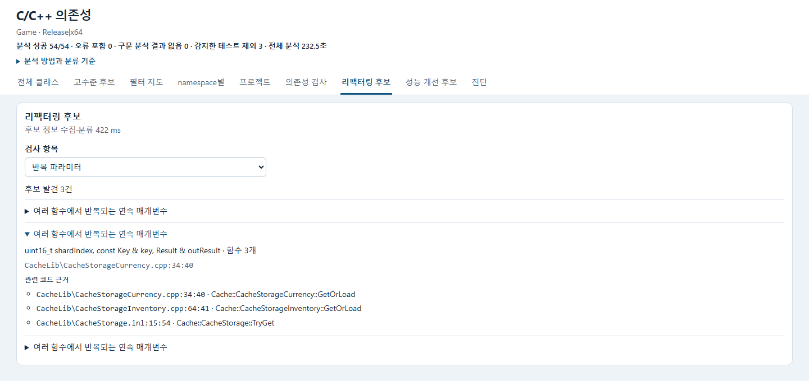
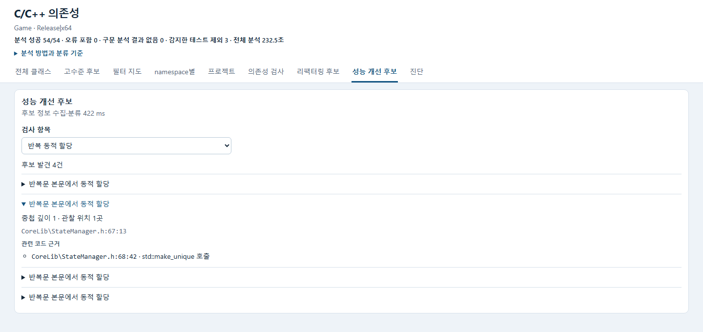

# 서버 의존성 지도 활용법

[MMORPG 서버 의존성 분석 보고서](https://joeunil.github.io/MMORPG/reports/server-project-map.html) · [분석기 소스](Source/) · [빌드 및 실행](BUILD.md) · [서버 설계 결정](../../DesignDecisions.md)

## 1. 도구의 목적

AI Agent로 만든 C/C++ 의존성 분석기다. Clang으로 분석한 클래스·프로젝트 간 연결과 코드 위치를 HTML로 보여준다.

사용 순서는 **클래스 검색 → 직접 연결 확인 → 코드 위치 확인**이다.

## 2. 보고서 열기

**직접 개발한 MMORPG 서버를 분석한 보고서다.** 위 링크에서 분석기 실행이나 파일 다운로드 없이 클래스 관계를 확인할 수 있다. [보고서 원본 HTML](Reports/server-project-map.html)을 내려받아 로컬에서도 열 수 있다.

| 항목 | 동봉 보고서의 분석 범위 (2026-11-17 생성) |
| --- | --- |
| 대상 | `Game` 서버, `Release\|x64`, 테스트 제외 |
| 소스 분석 | 54개 중 54개 파싱, Clang 오류가 포함된 파일 0개 |
| 수집 결과 | 클래스 282개, 프로젝트 6개, 외부 라이브러리 5개 |
| 선택 검사 | 리팩터링 후보 3종·성능 개선 후보 3종 모두 포함 |

보고서는 생성 시점의 스냅샷이다. 코드 변경이 자동 반영되지는 않는다. 최신 소스를 확인하려면 [빌드 방법](BUILD.md#빌드)에 따라 분석기를 준비한 뒤 다음 순서로 실행한다.

WinForms 분석기의 첫 실행 화면이다. 기본 빌드 설정은 `Debug` / `x64`다.

1. **폴더 선택**에서 `Game` 폴더를 고른다.
2. **분석 설정**은 **찾은 Visual Studio C++ 프로젝트**, **빌드 설정**은 `Release` / `x64`로 지정한다.
3. **테스트 포함**을 끄고 **외부 라이브러리 표시**를 켠다. 리팩터링·성능 후보도 보려면 필요한 검사에 체크한 뒤 **분석**을 누른다.
4. **결과 열기**로 보고서를 확인한다. 이전 보고서는 **결과 폴더**에서 찾는다.

## 3. 확인할 내용에 따라 보기 선택하기

| 확인할 내용 | 사용할 보기 | 예시 |
| --- | --- | --- |
| 클래스가 호출하는 대상 | 카드 보기 | `PacketDispatcher` → Zone / NonZone |
| 연결이 모이는 클래스 | 관계 지도 | `Net` namespace |
| 인터페이스 변경 영향 | 프로젝트 묶음 | `INetworkSender`와 `IOCP` |
| 기능 영역 사이의 의존성 | 필터 지도 | 헤더 필터 → Interface 필터 |
| namespace 밖의 연결 | namespace별 | `Core`와 `Net` |
| 외부 라이브러리 사용처 | 프로젝트 | `nlohmann` 헤더 포함 위치 |
| 여러 타입이 직접 참조하는 말단 타입 | 고수준 후보 | `ZoneState`와 `SkillPhase`가 참조하는 `SkillRange` |
| 같은 타입으로 돌아오는 의존 경로 | 의존성 검사 → 순환 의존 | `ClientContext` → `PacketView` → `ClientContext` |
| 한 타입의 직간접 의존 관계 | 의존성 검사 → 의존성 트리 | `PacketDispatcher`의 사용처와 의존 대상 |
| 인터페이스·구조체·클래스 분리 후보 | 리팩터링 후보 | 사용 멤버·반복 파라미터·내부 기능 묶음 |
| 반복문에서 발생하는 복사·검색·할당 | 성능 개선 후보 | 반복 동적 할당과 관련 코드 위치 |

### 3.1. 카드 보기: 패킷 처리 코드 찾기

1. **전체 클래스 → 카드 보기**에서 `PacketDispatcher`를 검색하고 `Core::PacketDispatcher`를 선택한다.
2. **관계 → 정적 호출**과 **나가는 연결**을 고르고 **선택 연결만**을 켠다.
3. `ZoneThreadSet`과 `NonZoneThreadPool`로 향하는 선을 누른다. 오른쪽 근거 패널에서 호출 함수와 파일·줄 번호를 확인한다.

[PacketDispatcher.cpp](../../CoreLib/PacketDispatcher.cpp#L8)

### 3.2. 관계 지도: 연결이 모이는 클래스 찾기

- **표시할 namespace**에서 `Net`만 켠다. 연결이 많은 클래스는 중심에, 이웃이 하나인 클래스는 바깥에 배치된다.
- 노드를 선택하면 직접 연결이 강조된다. **화면 맞춤**은 전체 지도를 보여준다.

Net namespace의 관계 지도

### 3.3. 프로젝트 묶음: 인터페이스 변경 영향 확인하기

`INetworkSender::SendDataChunks`를 바꿀 때는 `BroadcastThreadPool`의 호출부와 `IOCP`의 구현을 함께 검토한다.

1. **전체 클래스 → 카드 보기 → 프로젝트 묶음**에서 **프로젝트 간 Interface 상속만**을 켠다.
2. `NetLibrary`의 `IOCP`가 `CoreLib`의 `INetworkSender`를 상속하는 선을 확인한다.
3. 상속 필터를 풀고 `INetworkSender`를 선택한다. **들어오는 연결**에서 호출부를 확인한다.

[INetworkSender.h](../../CoreLib/INetworkSender.h#L10) · [IOCP.h](../../NetLibrary/IOCP.h#L34) · [BroadcastThreadPool.cpp](../../CoreLib/BroadcastThreadPool.cpp#L37)

### 3.4. 필터 지도: 영역 간 연결 살펴보기

- **Interface 연결만**을 켜면 Visual Studio의 Interface 필터에 속한 타입을 향하는 연결을 볼 수 있다.
- 선 위 숫자는 연결된 클래스 쌍 수다. 선을 누르고 근거를 펼치면 클래스와 코드 위치가 나온다.

프로젝트 필터 간 연결과 개별 상속 근거

### 3.5. namespace별: 외부 연결 따라가기

**namespace별**에서 `Core`를 고르면 그 안의 클래스 관계를 볼 수 있다. **외부 연결 표시**를 켜고 `INetworkSender`의 **선택 연결만**을 켜면, `Core` 안에서 이 타입을 쓰는 코드와 다른 namespace의 `Net::IOCP`를 함께 볼 수 있다.

Core와 Net 사이의 클래스 연결

### 3.6. 프로젝트: 외부 라이브러리 사용처 확인하기

- **프로젝트** 탭에서 `nlohmann`을 선택하면 `CoreLib`과 `ExternalLib`의 연결이 강조된다.
- `CoreLib` 쪽 선을 열면 JSON 헤더를 직접 포함하는 `ILogger.h`가 나온다. 의존성을 옮긴 뒤 같은 설정으로 다시 분석해 연결을 비교할 수 있다.

nlohmann 사용 프로젝트와 헤더 포함 근거

[ILogger.h](../../CoreLib/ILogger.h#L4) · [JsonUtility.h](../../ExternalLib/JsonUtility.h#L2)

아래 세 화면은 기능 추가 당시 캡처로, 소스 54개 중 53개가 정상 분석됐고 `PacketWriter.cpp` 1개는 부분 분석됐다. 동봉 HTML은 54개 모두 오류 없이 분석한 결과이며 고수준 후보·순환 의존 검사·의존성 트리를 포함한다.

### 3.7. 고수준 후보 찾기

**고수준 후보** 탭은 수집된 관계에서 **서로 다른 타입 2개 이상이 직접 참조하고, 다른 타입으로 나가는 연결이 없는 타입**을 보여준다. 한 타입에서 여러 종류의 연결이 들어와도 직접 참조는 한 번만 센다. 목록은 해당 타입을 직접 또는 간접으로 사용하는 타입 수가 많은 순으로 정렬된다. 의존성 방향으로 모은 후보이므로 설계상 고수준 정책인지 여부는 코드의 역할을 보고 판단한다.

**Interface·추상 타입 제외**는 기본으로 켜져 있다. Visual Studio의 `Interface` 필터에 속한 타입과 Clang이 순수 가상 함수로 인해 추상으로 판별한 타입을 후보 목록에서 제외한다. `SkillRange`를 선택하고 **선택 연결만**을 켜면 `ZoneState`와 `SkillPhase`가 각각 어떤 관계로 참조하는지 확인할 수 있다. 설계상 역할과 변경 영향은 연결 근거를 열어 판단한다.

### 3.8. 순환 의존 검사

**의존성 검사 → 순환 의존 → 순환 경로 찾기**를 누르면 화살표를 따라 출발 타입으로 돌아올 수 있는 그룹을 찾는다. 각 그룹의 예시 경로를 펼치면 화살표마다 관계 종류와 파일·줄 번호를 볼 수 있다.

**Interface를 향한 연결 제외**는 기본으로 켜져 있다. Visual Studio의 `Interface` 필터에 속한 타입으로 들어가는 연결을 검사에서 제외한다. 현재 서버에서는 순환 의존 그룹 2개가 검출됐다.

### 3.9. 타입의 의존성 트리 펼치기

**전체 클래스**에서 타입을 우클릭하고 **의존성 트리 펼치기**를 고르면 **의존성 검사** 탭에서 그 타입을 기준으로 트리를 연다. 왼쪽은 그 타입을 사용하는 쪽, 오른쪽은 그 타입이 사용하는 쪽이다. 가지를 펼치면 관계 근거와 다음 단계가 나온다. 예를 들어 `PacketDispatcher`를 기준으로 `Initializer`에서 들어오는 연결과 `NonZoneThreadPool`로 나가는 연결을 따라갈 수 있다.

### 3.10. 리팩터링 후보와 성능 개선 후보

- **검사 선택:** 분석기 체크박스에서 필요한 검사만 켠다. 기본값은 모두 꺼짐이며, 기존 Clang AST 순회에서 선택한 정보만 추가 수집한다.
- **결과 탐색:** 상단의 **리팩터링 후보**·**성능 개선 후보** 탭에서 검사 종류별로 후보와 코드 근거를 확인한다.
- **결과 구분:** 실행하지 않은 검사는 **미분석**으로 표시한다. 분석 오류가 있는 소스는 후보 수집에서 제외하므로 진단도 함께 확인한다.

| 검사 | 초기 검출 기준 |
| --- | --- |
| 사용 멤버 | 대상의 공개 메서드가 5개 이상이고, 사용하는 멤버가 1~2개인 클래스 관계 |
| 반복 파라미터 | 이름·타입·순서가 같은 연속 인자 3개 이상이 서로 다른 함수 3개 이상에서 반복 |
| 내부 기능 묶음 | 자체 필드 사용·내부 호출로 묶은 메서드 그룹이 둘 이상이며 각 그룹에 메서드가 2개 이상 |
| 반복 객체 복사 | 범위 기반 반복문에서 `std::string` 계열·`std::vector`의 복사 생성자 호출 |
| 반복문 내 선형 검색 | 반복문 본문에서 `std::find`, `std::find_if`, `std::find_if_not` 호출 |
| 반복 동적 할당 | 반복문 본문에서 일반 `new` 또는 지원하는 표준 할당 함수 호출. placement new 제외 |

기능 묶음은 생성자·소멸자를 제외하고, 분석된 메서드 본문이 모두 있는 클래스에서 찾는다. 성능 검사는 호출된 함수 내부까지 추적하지 않으며, 같은 반복문의 같은 종류 검출은 하나로 묶는다.

- **파일 열기:** 로컬 보고서의 코드 위치 옆 링크로 원본 파일을 연다. 브라우저 설정에 따라 열기가 제한될 수 있으며, Visual Studio 실행이나 특정 줄 이동은 지원하지 않는다. 웹 보고서는 코드 위치만 표시한다.
- **적용 판단:** 후보는 구조 분리나 성능 병목을 확정한 결과가 아니다. 실제 역할·호출 빈도·측정 결과를 보고 수정 여부를 결정한다.

동봉 HTML과 Pages 보고서에는 검사 6종의 결과가 포함돼 있다. 이번 분석에서는 사용 멤버 64건, 반복 파라미터 3건, 내부 기능 묶음 2건, 반복 동적 할당 4건이 검출됐다. 반복 객체 복사와 반복문 내 선형 검색 후보는 없었다. 다시 생성하려면 [선택 검사](BUILD.md#선택-검사)를 켜고 분석한다.

- **리팩터링 후보 → 반복 파라미터**에서 `shardIndex`, `key`, `outResult`를 함께 받는 함수 세 곳을 확인할 수 있다.

- **성능 개선 후보 → 반복 동적 할당**에서 `StateManager.h`의 반복문 위치와 본문의 `std::make_unique` 호출 위치를 확인할 수 있다.

## 4. 지도를 읽을 때의 기준

- **화살표는 의존하는 쪽 → 의존 대상**이다. 클래스 관계는 상속·멤버 타입·정적으로 해석한 호출을, 프로젝트 관계는 프로젝트 참조와 외부 헤더 포함을 보여준다.
- **정적 호출은 분석 시점에 확인된 선언을 가리킨다.** `static` 함수만을 뜻하지 않으며, 런타임의 가상 호출 대상이나 실제 실행 순서·스레드 간 전달을 추적하지 않는다.
- **struct 표시**를 끄면 지도에서 구조체를 숨길 수 있다. 순환 의존 검사와 트리에는 지도에서 숨긴 타입도 포함된다.
- **진단과 코드 근거를 함께 확인한다.** 선택한 빌드 설정과 해석 가능한 소스에 따른 결과다. 클래스 내부 호출은 생략하고, 같은 클래스 쌍·관계 유형의 코드 근거는 최대 12개만 보관한다. 연결이 없다는 것만으로 의존성이 없다고 단정하지 않는다.

전체 실행 흐름은 지도에서 찾은 코드와 [서버 설계 결정](../../DesignDecisions.md)을 함께 읽어 확인한다.
