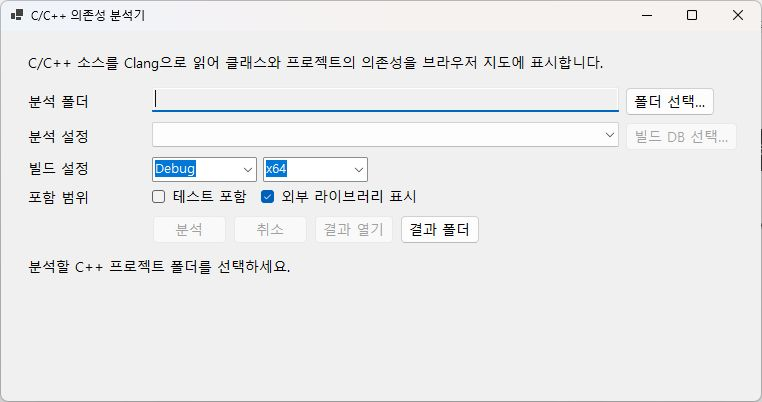
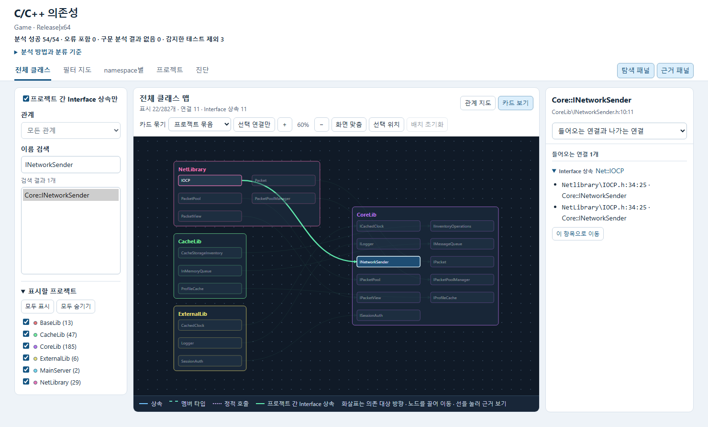
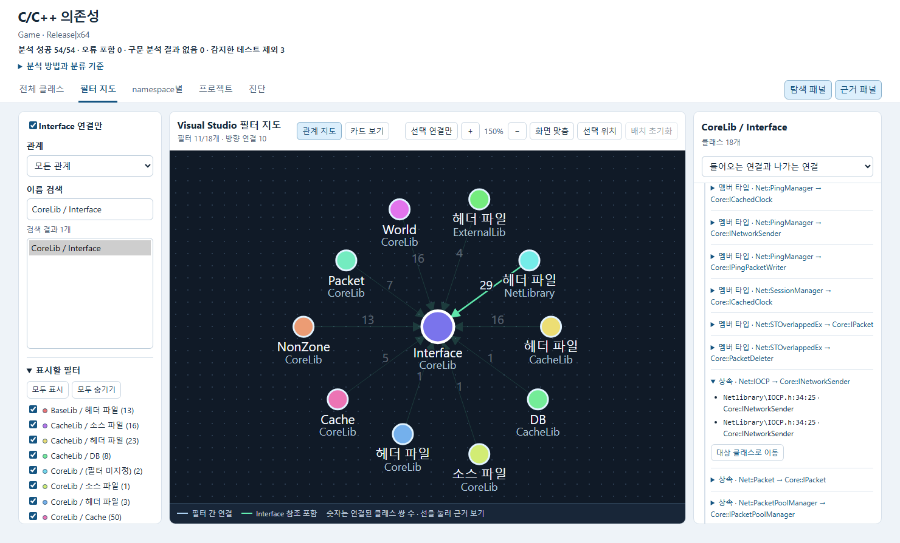

# 서버 의존성 지도 활용법

[예제 HTML 보고서](Reports/server-project-map.html) · [분석기 소스](Source/) · [빌드 및 실행](BUILD.md) · [서버 설계 결정](../../DesignDecisions.md)

## 1. 도구의 목적

서버 클래스가 늘어나면서 특정 클래스의 의존 대상과 호출부를 찾아보기 위해 **AI Agent를 활용해 만든 C/C++ 의존성 분석기**다. Clang으로 소스를 분석하고, 클래스·프로젝트 간 연결과 코드 위치를 HTML로 보여준다.

전체 지도로 영역을 파악한 뒤, **클래스 검색 → 직접 연결 확인 → 코드 근거 확인** 순서로 사용한다. 수백 개의 클래스를 한 화면에서 읽기보다 변경하려는 클래스 주변으로 범위를 좁히는 데 유용하다.

## 2. 보고서 열기

**예제 보고서는 분석기를 실행하지 않아도 볼 수 있다.** 위 HTML 파일을 내려받아 브라우저에서 연다. GitHub에서는 실행 화면 대신 HTML 소스가 표시된다.

| 항목 | 동봉 보고서의 분석 범위 |
| --- | --- |
| 대상 | `Game` 서버, `Release\|x64`, 테스트 제외 |
| 소스 분석 | 54개 중 54개 파싱, Clang 오류가 포함된 파일 0개 |
| 수집 결과 | 클래스 282개, 프로젝트 6개, 외부 라이브러리 5개 |

보고서는 생성 시점의 스냅샷이다. 코드 변경이 자동 반영되지는 않는다. 최신 소스를 확인하려면 [빌드 방법](BUILD.md#빌드)에 따라 분석기를 준비한 뒤 다음 순서로 실행한다.

WinForms 분석기의 첫 실행 화면이다. 기본 빌드 설정은 `Debug` / `x64`다.

1. **폴더 선택**에서 `Game` 폴더를 고른다.
2. **분석 설정**은 **찾은 Visual Studio C++ 프로젝트**, **빌드 설정**은 `Release` / `x64`로 지정한다.
3. **테스트 포함**을 끄고 **외부 라이브러리 표시**를 켠 뒤 **분석**을 누른다.
4. **결과 열기**로 보고서를 확인한다. 이전 보고서는 **결과 폴더**에서 찾는다.

## 3. 확인할 내용에 따라 보기 선택하기

| 확인할 내용 | 사용할 보기 | 예시 |
| --- | --- | --- |
| 클래스가 호출하는 대상 | 카드 보기 | `PacketDispatcher` → Zone / NonZone |
| 연결이 모이는 클래스 | 관계 지도 | `Net` namespace |
| 인터페이스 변경 영향 | 프로젝트 묶음 | `INetworkSender`와 `IOCP` |
| 기능 영역 사이의 의존성 | 필터 지도 | 헤더 필터 → Interface 필터 |
| namespace 밖의 연결 | namespace별 | `Core`와 `Net` |
| 외부 라이브러리 사용처 | 프로젝트 | `nlohmann` 헤더 포함 위치 |

### 3.1. 카드 보기: 패킷 처리 코드 찾기

1. **전체 클래스 → 카드 보기**에서 `PacketDispatcher`를 검색하고 `Core::PacketDispatcher`를 선택한다.
2. **관계 → 정적 호출**과 **나가는 연결**을 고르고 **선택 연결만**을 켠다.
3. `ZoneThreadSet`과 `NonZoneThreadPool`로 향하는 선을 누른다. 오른쪽 근거 패널에서 호출 함수와 파일·줄 번호를 확인한다.

[PacketDispatcher.cpp](../../CoreLib/PacketDispatcher.cpp#L8)

### 3.2. 관계 지도: 연결이 모이는 클래스 찾기

**관계 지도**는 연결이 많은 클래스를 중심에, 이웃이 하나인 클래스를 바깥에 배치한다. **표시할 namespace**에서 `Net`만 켜면 네트워크 코드 안에서 연결이 어디에 모이는지 볼 수 있다. 노드를 선택하면 직접 연결이 강조된다. 전체 위치를 다시 보고 싶을 때는 **화면 맞춤**을 누른다.

Net namespace의 관계 지도

### 3.3. 프로젝트 묶음: 인터페이스 변경 영향 확인하기

`INetworkSender::SendDataChunks`를 바꿀 때는 `BroadcastThreadPool`의 호출부와 `IOCP`의 구현을 함께 검토한다.

1. **전체 클래스 → 카드 보기 → 프로젝트 묶음**에서 **프로젝트 간 Interface 상속만**을 켠다.
2. `NetLibrary`의 `IOCP`가 `CoreLib`의 `INetworkSender`를 상속하는 선을 확인한다.
3. 상속 필터를 풀고 `INetworkSender`를 선택한다. **들어오는 연결**에서 호출부를 확인한다.

[INetworkSender.h](../../CoreLib/INetworkSender.h#L10) · [IOCP.h](../../NetLibrary/IOCP.h#L34) · [BroadcastThreadPool.cpp](../../CoreLib/BroadcastThreadPool.cpp#L37)

### 3.4. 필터 지도: 영역 간 연결 살펴보기

**필터 지도**는 Visual Studio의 프로젝트별 필터를 묶어서 보여준다. **Interface 연결만**을 켜면 Interface 필터의 타입을 향하는 연결을 좁혀 볼 수 있다. 선 위 숫자는 연결된 클래스 쌍 수다. 선을 누른 뒤 근거에서 관계를 펼치면, 집계에 포함된 클래스와 코드 위치가 나온다.

프로젝트 필터 간 연결과 개별 상속 근거

### 3.5. namespace별: 외부 연결 따라가기

**namespace별**에서 `Core`를 고르면 그 안의 클래스 관계를 볼 수 있다. **외부 연결 표시**를 켜고 `INetworkSender`의 **선택 연결만**을 켜면, `Core` 안에서 이 타입을 쓰는 코드와 다른 namespace의 `Net::IOCP`를 함께 볼 수 있다.

Core와 Net 사이의 클래스 연결

### 3.6. 프로젝트: 외부 라이브러리 사용처 확인하기

**프로젝트** 탭에서 주황색 `nlohmann` 노드를 누르면 `CoreLib`과 `ExternalLib`의 연결이 강조된다. `CoreLib` 쪽 선을 열면 JSON 헤더를 직접 포함하는 `ILogger.h`가 나온다. 이 의존성을 로깅 구현 쪽으로 옮긴다면, 변경 후 같은 설정으로 분석해 `CoreLib` 쪽 연결이 사라졌는지 확인할 수 있다.

nlohmann 사용 프로젝트와 헤더 포함 근거

[ILogger.h](../../CoreLib/ILogger.h#L4) · [JsonUtility.h](../../ExternalLib/JsonUtility.h#L2)

## 4. 지도를 읽을 때의 기준

- **화살표는 의존하는 쪽 → 의존 대상**이다. 클래스 관계는 상속·멤버 타입·정적으로 해석한 호출을, 프로젝트 관계는 프로젝트 참조와 외부 헤더 포함을 보여준다.
- **정적 호출은 분석 시점에 확인된 선언을 가리킨다.** `static` 함수만을 뜻하지 않으며, 런타임의 가상 호출 대상이나 실제 실행 순서·스레드 간 전달을 추적하지 않는다.
- **진단과 코드 근거를 함께 확인한다.** 선택한 빌드 설정과 해석 가능한 소스에 따른 결과다. 클래스 내부 호출은 생략하고, 같은 클래스 쌍·관계 유형의 코드 근거는 최대 12개만 보관한다. 연결이 없다는 것만으로 의존성이 없다고 단정하지 않는다.

전체 실행 흐름은 지도에서 찾은 코드와 [서버 설계 결정](../../DesignDecisions.md)을 함께 읽어 확인한다.
