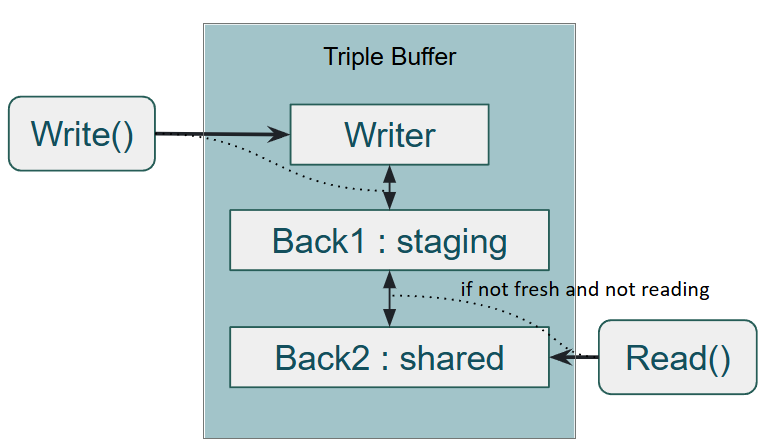

# SPMC Triple Buffer

## 1. 개요
이 문서는 Triple Buffer의 개념과 구현 과정을 기술한다.  
초기에는 여러 Broadcast 워커가 같은 Zone의 전송 대상 목록을 읽도록 SPMC로 설계했다. 현재는 패킷 순서를 보장하기 위해 같은 Zone의 작업을 같은 Broadcast 워커 큐로 보낸다. 워커 수는 Zone 수와 독립적이며, 한 워커가 여러 Zone을 처리할 수 있다.  
따라서 현재 서버 연결에서는 Zone별 단일 reader만 사용한다. 다중 reader를 위한 참조 카운트는 이 경로의 필수 조건이 아니지만, 기존 SPMC 구현은 아직 목록 스냅샷 교환에 사용한다. 아래 다중 reader 설명과 벤치마크는 자료구조 자체의 설계·검증 기록이다.  

## 2. Triple Buffer란?
Triple Buffer는 공유 자원에 대해 읽기(Reader)와 쓰기(Writer) 작업이 빈번하게 발생하는 멀티스레드 환경에서,     
Lock 경합을 최소화하고 데이터의 최신 상태(Snapshot)를 안전하고 빠르게 공유하기 위한 버퍼링 기법이다.  

Triple Buffer는 3개의 버퍼를 사용하여 다음을 보장한다:  
1. Writer는 현재 쓰고 있는 버퍼를 독점적으로 수정  
1. Reader는 최신 완료된 버퍼를 읽음  
1. 버퍼 교체(swap)는 단일 atomic 플래그로 조정 (뮤텍스 없이 CAS로 권한을 잡는다)

이를 통해 reader와 writer가 동시에 충돌 없이 데이터를 읽고 쓸 수 있음을 보장한다.

> 본래 그래픽 렌더링 파이프라인(GPU)에서 프레임 생성 속도와 모니터 출력 속도(V-Sync) 차이로 인한 티어링(Tearing) 및 지연(Lag) 현상을 방지하기 위해 고안된 기법이다.

## 3. 초기 도입 배경

### 시스템 요구사항
- 시나리오: Zone 스레드(Writer)가 브로드캐스트 패킷을 생성하여 ThreadPool(Reader)로 넘김.
- 제약 사항: 패킷에는 전송 대상 정보가 없으므로, Worker 스레드는 다시 Zone에서 '전송 대상 목록'을 받아와야 함.
- 구조: SPMC (Single Producer - Multiple Consumer)
	- Writer: 개별 Zone 스레드 (1개)
	- Reader: 브로드캐스트 ThreadPool (N개, 공유됨)

### 송신 순서 처리 계획과 변경

처음에는 여러 Zone의 전송 작업을 공유 워커 풀에서 처리하고, 같은 Zone의 전송 대상 목록도 여러 워커가 동시에 읽도록 설계했다. SPMC Triple Buffer는 이 읽기 구조를 지원하기 위해 구현했다.  
송신 순서가 바뀔 수 있다는 점은 인지하고 있었고, [DummyTest2](DummyTest2.md)에도 클라이언트가 seq로 오래된 패킷을 버리도록 계획해 두었다. 이후 클라이언트 구현에서 이 처리와 순서 역전 검증을 놓쳤다.  
다시 검토한 뒤 Delta의 변경 필드를 추가로 누락시키지 않도록 서버에서 송신 순서를 유지하기로 했다. 현재는 같은 Zone을 같은 워커 큐에서 처리하므로 Zone별 reader는 하나지만, 기존 SPMC 구현과 검증 기록은 유지했다. → [설계 결정](DesignDecisions.md#24-작업-큐와-triple-buffer)  

### 해결해야 할 Pain Point
1. 동기화 비용: writer가 zone 스레드이기 때문에 mutex를 적용하기에 부적합. 
1. 데이터 일관성: 전송 도중 데이터가 변경되면 안 되며, 항상 '특정 시점에 완성된' 스냅샷이 필요.
1.  메모리 효율성 (vs Object Pool):
	- Object Pool은 수천 개의 스냅샷 객체를 관리해야 하며 Pool 고갈 시 메모리 추가 할당을 해야함.
	- Triple Buffer는 고정된 3개의 버퍼만 재사용하므로 메모리가 안정적임.

## 4. 구현 히스토리
### 1차 구현
Rust 포럼의 [SPMC Triple Buffering](https://users.rust-lang.org/t/spmc-buffer-triple-buffering-for-multiple-consumers/10118) 
개념을 참고하여 구현.  

__구현 코드__
```cpp
template <typename T>
	class TripleBuffer {
		T* back;
		std::atomic<uint8_t> dirty; // 0: readable, 1: swap , 2: dirty
	public:
		void Init(T* b) {
			back = b;
		}
		void Write(T*& write) {
			while (true) {
				uint8_t exp = dirty.load(std::memory_order_relaxed);
				if (exp == 1) 
					continue;
				if (dirty.compare_exchange_weak(exp, 1, std::memory_order_acquire, std::memory_order_relaxed))
					break;
			}
			std::swap(back, write);
			dirty.store(0, std::memory_order_release);
		}
		bool Read(T*& read) {
			uint8_t exp = 0;
			if (!dirty.compare_exchange_strong(exp, 1,
				std::memory_order_acquire, std::memory_order_relaxed)) {
				return false; 
			}
			std::swap(back, read);
			dirty.store(2, std::memory_order_release);  
			return true;
		}

	};
```

__문제점__  

SPMC 환경에서 다수의 Worker 스레드가 공유된 Reader 풀로 동작할 때 치명적인 단점이 발견됨.
- 한번에 한 Reader만 소비 가능한 구조여서, 다음 write 전까지 다른 reader들은 작업을 처리하지 못한다. 
- 잘못된 데이터: Zone 객체는 여러 개인데 ThreadPool은 공유된다. Worker가 가진 로컬 버퍼가 현재 처리하려는 Zone의 것이 아닐 수 있어 논리적 오류를 유발한다.


### 2차 개선 버전



Double Back-Buffer 구조와 Ref-Counting을 도입하여 RCU(Read-Copy-Update) 스타일로 개선했다.

> 설계 대상은 SPMC다. CAS로 writer 권한을 직렬화하므로 여러 writer가 동시에 호출해도 data race는 발생하지 않지만, 다중 writer의 진행 보장이나 성능까지 설계 목표로 삼지는 않는다.

#### 진행 보장과 bounded spin

현재 스왑 경로는 CAS로 `0x8000` 비트를 획득한 뒤 일반 포인터인 `back1`과 `back2`를 교환한다. 이 임계구역에서 권한을 가진 스레드가 선점되면 다른 진입은 flag가 해제될 때까지 재시도하므로, 엄밀한 lock-free 진행 보장은 없다.  
Writer는 정상적인 짧은 경합에서는 CAS를 반복하되, 12회 연속 실패하면 `std::this_thread::yield()`로 다른 스레드에 실행 기회를 넘긴다. reader가 swap 권한을 가진 상태에서 선점됐을 때 writer가 CPU를 계속 소모하는 상황을 제한하기 위한 bounded spin이다. SPMC 벤치마크에서 측정한 contended spin p99의 최댓값 8에 50% 여유를 두어 12를 선택했다. 측정 조건과 throughput 영향은 [Triple Buffer 성능 벤치마크](Benchmark_TripleBuffer.md)에 정리했다.

#### 검토한 대안: 인덱스 패킹

고정된 세 버퍼를 배열로 관리하고 `back1`과 `back2`의 역할을 포인터 대신 슬롯 인덱스로 표현한 뒤, 두 인덱스와 reader count 등의 상태를 하나의 atomic 정수에 패킹하는 방법을 검토했다. 이 방식은 역할 교환을 CAS 한 번의 최종 상태 전이로 끝낼 수 있어, `0x8000`을 획득한 스레드가 포인터 교환 도중 선점되는 중간 상태를 제거할 수 있다.  
다만 이는 flag 표현만 바꾸는 국소 최적화가 아니라 버퍼 소유권 모델과 API를 함께 바꾸는 별도 설계다. 현재 API는 caller가 writer 포인터를 소유하고 `Write(T*& write)`를 통해 `back1`과 교환하지만, 인덱스 방식에서는 Triple Buffer가 세 슬롯을 모두 관리하고 caller도 포인터 대신 슬롯이나 전용 handle을 통해 접근해야 한다. Reader 역시 선택한 shared 슬롯이 모든 참조의 반납 전까지 writer에게 재사용되지 않도록 wrapper 수명과 reader count를 슬롯 역할에 정확히 묶어야 한다.  
이 계약을 지키면 안전하게 구현할 수 있지만 상태 전이와 소유권 규칙의 검증 부담이 커진다. 별도 SPMC 벤치마크에서는 정상 경합이 p99 8회 안에 끝났고, 드문 장기 stall의 CPU 소모는 bounded spin으로 제한했다. 이는 다중 reader 조건의 측정이며, 현재 Zone별 단일 reader인 Broadcast 경로에서 같은 경합이 발생한다는 의미는 아니다. 인덱스 방식은 별도 설계 대안으로 남긴다.


__핵심 아이디어__

- 버퍼 역할의 재정의 (3-Buffer System)
	- Writer (Local): producer 스레드가 독점적으로 작성 중인 버퍼.
	- Back1 (Staging Area): Writer가 작성을 완료하고 대기하는 Staging Area. 
	- Back2 (Shared Area): 모든 Reader가 참조하는 Shared Area.
- Reader 주도 업데이트: Reader가 접근할 때 Back1에 최신 데이터가 있다면 Back2로 Swap 시키고 읽는다.

__사용한 기술__   

BitPacking(최신 구조, uint16_t)
- 상위 2비트: 상태 표시
	1. 최상위 비트 (0x8000): Write와 back 포인터 swap 시 잠금
	2. 상위 2번째 비트 (0x4000): back2가 최신 상태인지 표시;
- 하위 14비트: Reader count


RAII 패턴을 통한 안전한 반납
- Reader가 사용을 완료한 후 참조 카운트 감소를 위해 ReadDone() 이라는 완료 메서드를 호출해야함.
- BufferReader라는 객체를 정의하여 스코프를 벗어날 때 반납이 이루어지도록 처리.

__동작__  
1. Write
	- CAS로 권한 획득하고 최상위 비트 마킹(0x8000)
	- back1과 write 포인터 스왑
	- 상위 2비트 0으로 하면서 unlock
		- 잠금해제, back2 포인터가 최신 상태가 아님을 표시
1. Read
	- flag ==0 
		- back1-back2 스왑
		- back2 포인터 최신상태 마킹 (0x4000)
		- read counter 1 표시
	- flag & 0x8000 - 재시도
	- 나머지 경우 - read counter 증가
	- Read 끝나면 RAII로 reader count 감소
	
	
__의사 코드__
```
flag (16bit)
┌───────┬───────┬───────────────┐
│ 8000  │ 4000  │ 3FFF (reader) │
│ write │ fresh │ read count    │
└───────┴───────┴───────────────┘

Write:
  CAS -> set 8000
  swap(back1, write)
  CAS -> unset 8000 + unset 4000

Read:
  CAS loop:
    0          -> swap(back1, back2), set 4000 + count=1
    &8000 != 0 -> block
    else       -> count++
```

[TripleBuffer.h](BaseLib/TripleBuffer.h)

## 5. 적용 조건 및 참고
이 자료구조는 actor 모델에서 actor 내부상태를 외부 reader에 동기화 할 때 유용하게 사용할 수 있다.   
- 짧은 읽기 참조 (패킷 생성, 포인터 복사 수준)
- 최신 스냅샷만 필요한 경우

- [Triple Buffer 성능 벤치마크](Benchmark_TripleBuffer.md) — spin 분포, `maxSpin = 12` 선택 근거 및 throughput 비교
- [TripleBuffer.h](BaseLib/TripleBuffer.h)


