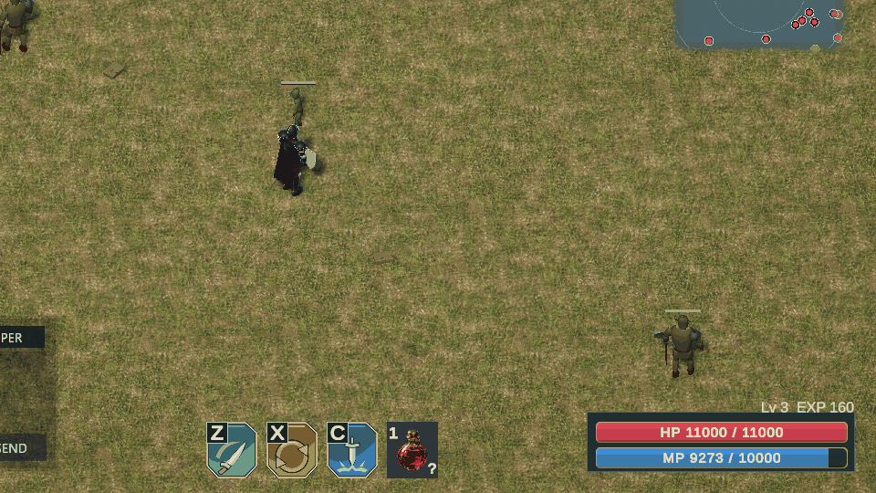
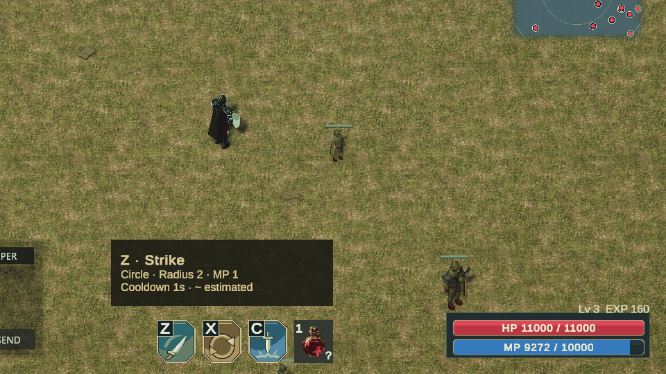
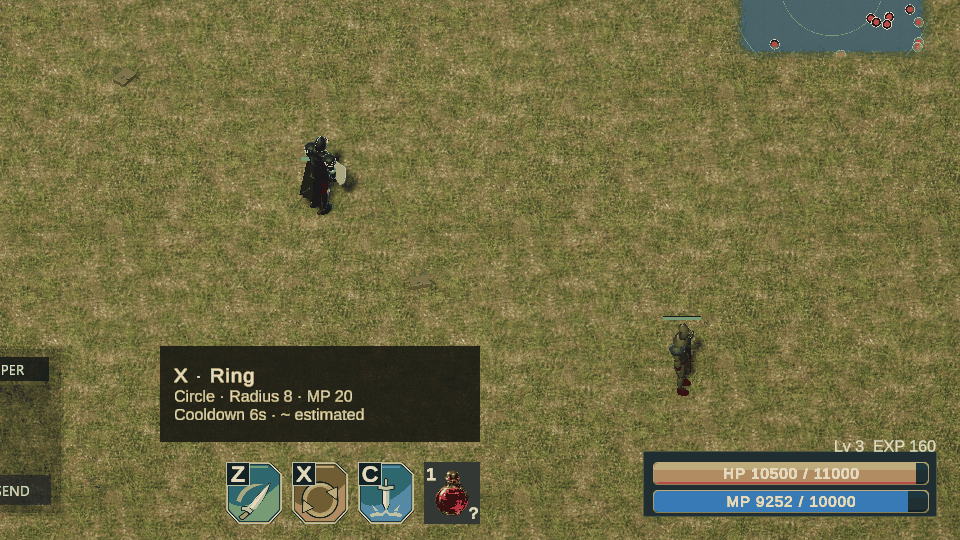
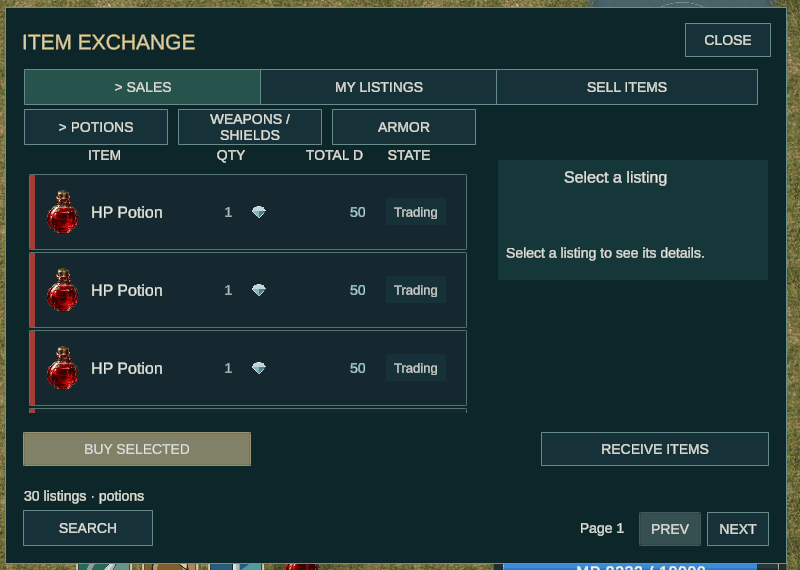
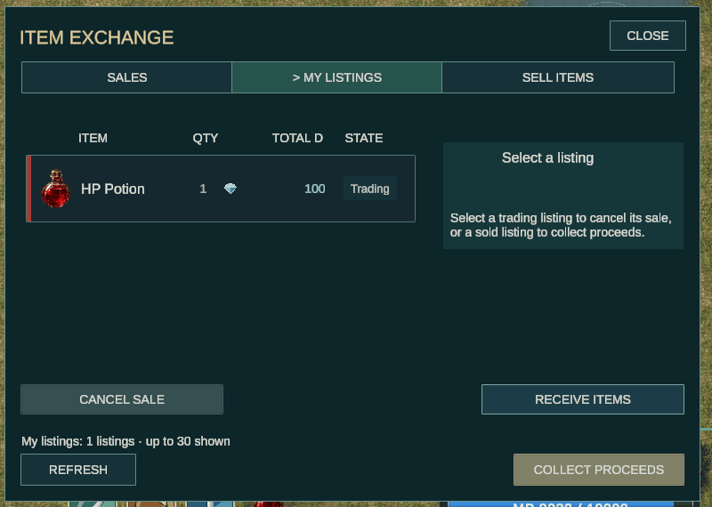
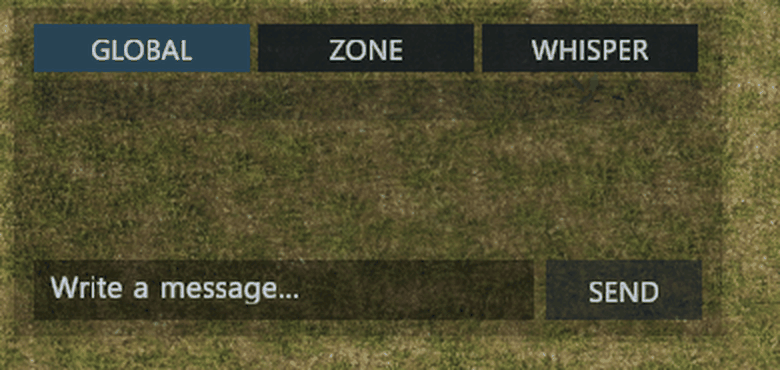
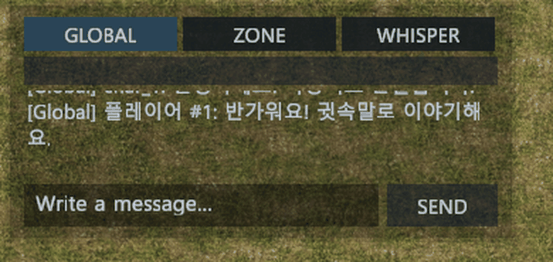
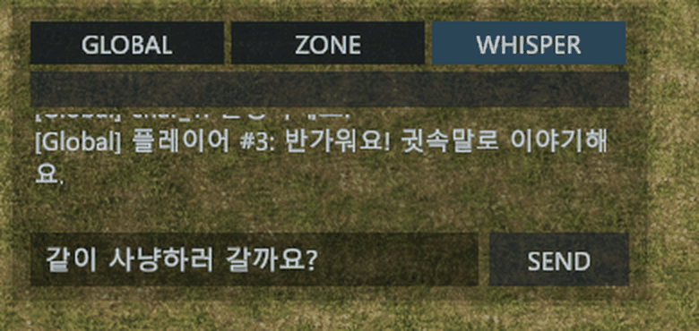

# 클라이언트 콘텐츠 둘러보기

실제 게임에서 스킬·거래소·채팅을 사용한 결과입니다.

## 세 가지 스킬

Z·X·C 버튼으로 베기·회전·전방 공격을 사용합니다.

### Z — 기본 베기

Z 스킬 버튼을 눌러 기본 베기를 사용하고 마나 감소를 확인했습니다.

영상: 

### X — 회전 베기

X 스킬 버튼을 눌러 원형 준비 영역과 회전 공격을 확인했습니다.

영상: 

### C — 전방 내려찍기

C 스킬 버튼을 눌러 전방 공격으로 몬스터를 쓰러뜨리고 경험치 증가를 확인했습니다.

영상: 

## 거래소 둘러보기와 판매 등록

거래소를 열어 매물을 조회하고 HP 포션 1개를 100다이아에 등록했습니다. 등록 매물이 내 매물에 표시됩니다.

영상: 

### 내 매물에서 등록 취소

내 매물을 선택해 취소를 요청하면 완료 안내가 나타납니다.

영상: 

취소 GIF는 완료 안내까지 담았으며, 아이템 회수는 별도로 확인했습니다.

## 전체·구역·귓속말 채팅

채널을 선택해 메시지를 보내고, 서버 응답을 대화창에서 확인합니다.

### 전체 채팅

전체 탭에서 메시지를 보내고 다른 캐릭터의 답장을 받았습니다.

영상: 

### 구역 채팅

구역 탭에서 메시지를 보내 구역 대화에 표시되는 것을 확인했습니다.

영상: 

### 귓속말

받는 캐릭터를 지정해 귓속말을 보내고 상대의 답장을 받았습니다.

영상: 

촬영일: 2026-11-02, 실제 로컬 서버 화면입니다.
