# 클라이언트 콘텐츠 둘러보기

실제 게임 영상으로 전투, 거래소, 채팅을 둘러봅니다.

## 전투 스킬

기본 베기 · 원형 회전 · 전방 내려찍기. 영상의 단축키는 촬영 당시 기준입니다.

### Z — 기본 베기

기본 베기 발동 · MP 감소

영상: 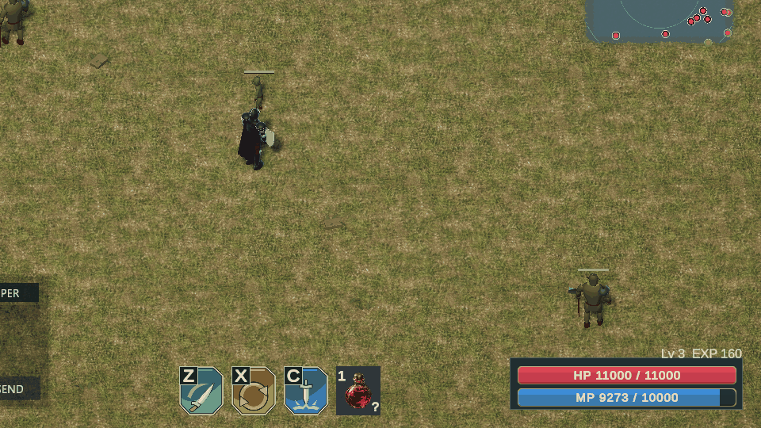

### X — 회전 베기

원형 예고 · 회전 공격

영상: 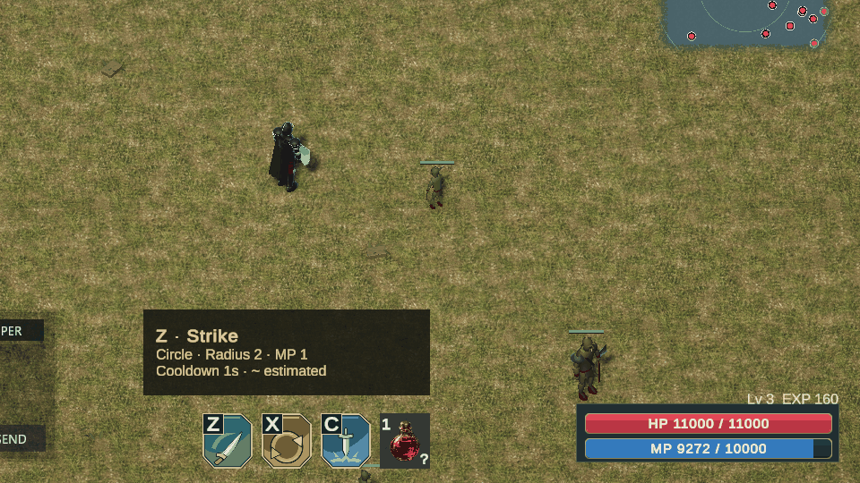

### C — 전방 내려찍기

전방 범위 공격 · 처치 후 경험치 증가

영상: 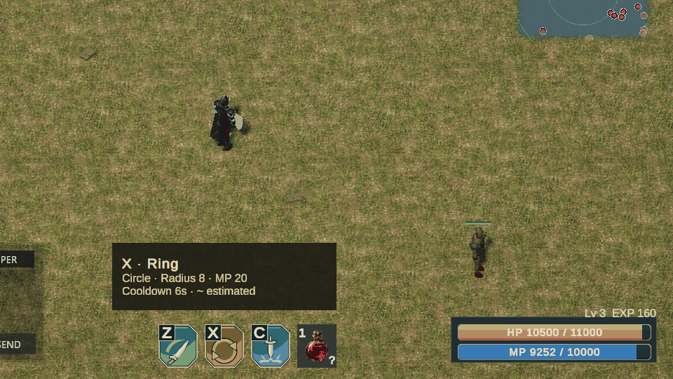

## 몬스터 정보창

몬스터 클릭 → 기본 공격력·패턴 확인 → 피격 후 HP 갱신

영상: 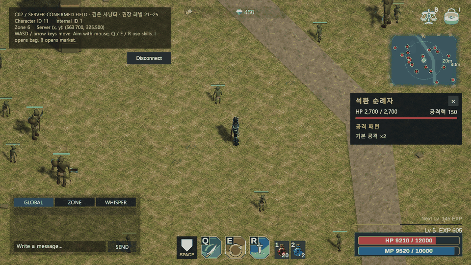

## 지도 길안내

목적지 선택 → 바닥 화살표 따라 이동 → 도착 시 화살표와 거리 안내 종료. 실서버 장면 3컷을 이어 붙였습니다.

영상: 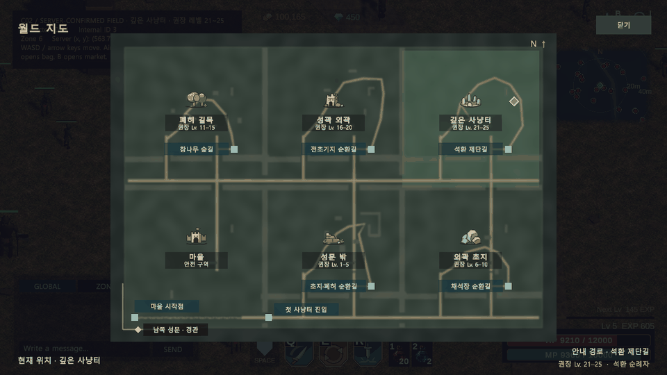

## 사냥 보상과 주변 몬스터

### 몬스터 접근과 교전

몬스터 접근 → 피격 → 내려찍기로 처치

영상: 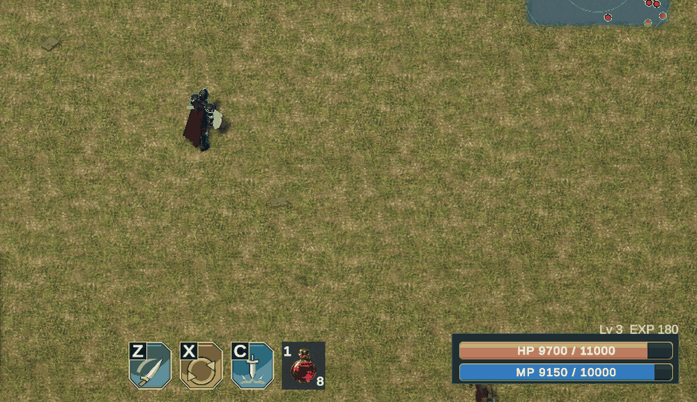

### 경험치 획득

처치 후 경험치 160 → 170. 영상 속 포션 지급은 과거 버전 동작입니다.

영상: 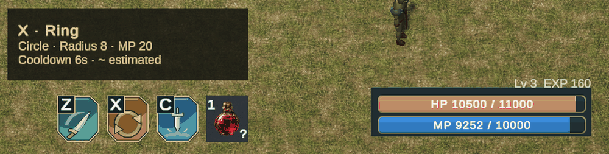

### HP 포션 사용

1번 슬롯으로 HP 회복 · 포션 1개 소비. 재사용 시간은 촬영 당시 기준입니다.

영상: 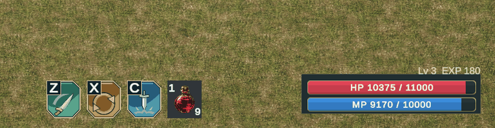

### 미니맵의 주변 몬스터

자신은 중앙의 초록 표식, 주변 몬스터는 움직이는 빨간 점.

영상: 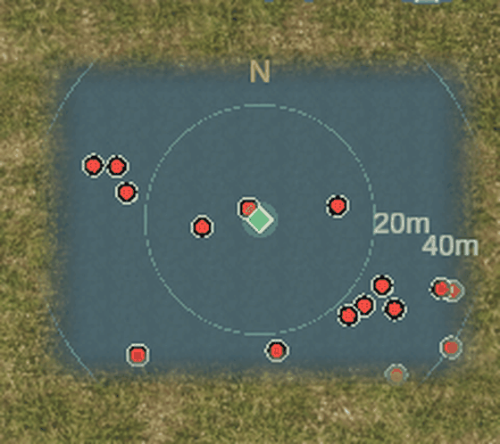

## 거래소 둘러보기와 판매 등록

매물 조회 → HP 포션 판매 등록 → 내 매물 확인

영상: 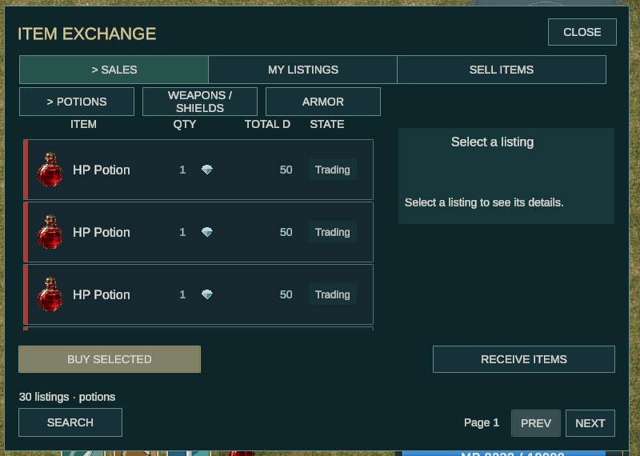

### 내 매물에서 등록 취소

내 매물 선택 → 판매 취소 → 완료 안내

영상: 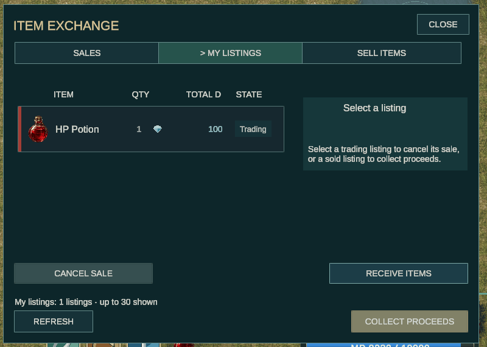

## 전체·구역·귓속말 채팅

### 전체 채팅

전체 채널 전송 · 다른 캐릭터의 답장

영상: 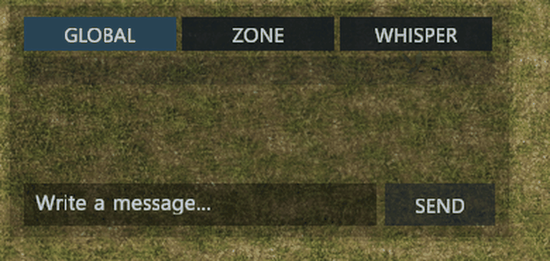

### 구역 채팅

현재 구역에 메시지 전송

영상: 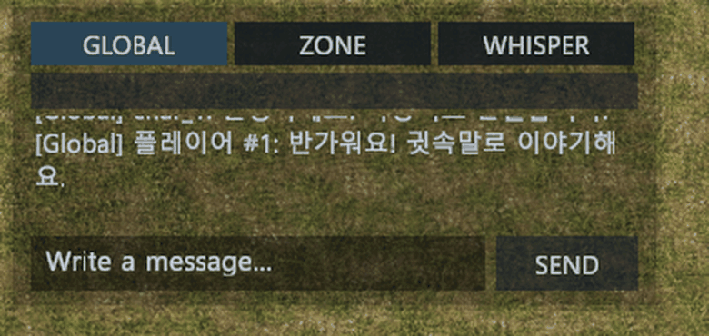

### 귓속말

캐릭터 지정 · 귓속말과 답장

영상: 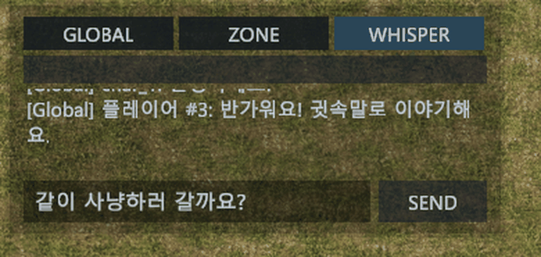

전투·거래소·채팅 일부 영상은 이전 버전에서 촬영했습니다.
