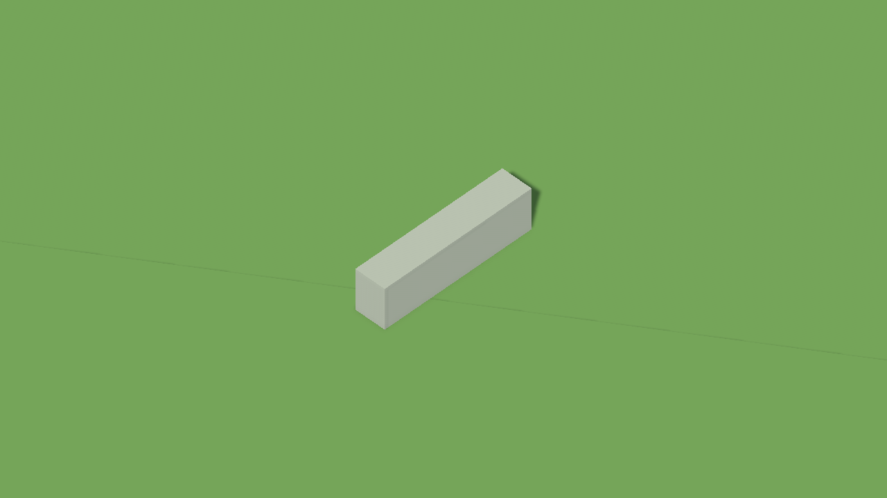
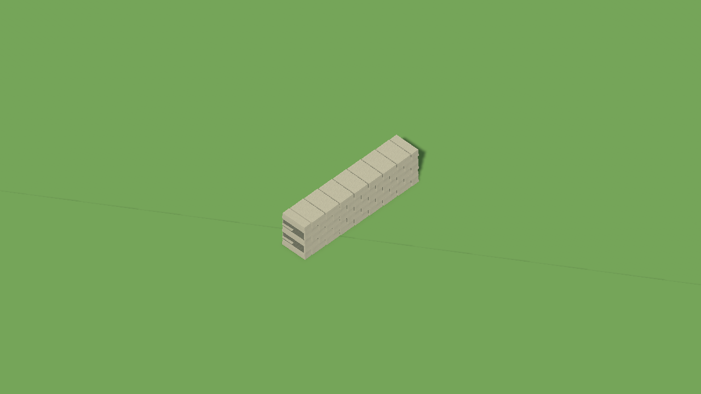

# 고정 필드 석축 외관 — 2026-10-21

## 끝면 후속 보강

같은 카메라·조명에서 끝면의 검은 가로 틈이 사라졌고 아트담당이 채택했다. 끝면은 측면보다 평평하고 균일해 보이며, 실제 플레이 조명·거리에서의 외관은 미확인이다. 아래 최초 비교와 이미지는 이력으로 유지한다.

기존 돌 템플릿으로 양끝 캡2개를 같은 submesh에 추가했다. 메시당1056→1104정점, 공유메시2/재질2/기존Collider18은 유지한다. ROOT와8e5cdbf 생성 자산의 정규화 원문 일치·백업을 확인한 뒤 EditorUtility.CopySerialized로 소유 메시2개만 갱신했다. 기존 GUID와 Scene 참조는 보존했고 생성 도구의 자동 덮어쓰기 금지 가드는 유지한다.

`ROOT UnityClient/Builds/Fixed-Field-Art/endcap-result.txt`: compile0/독립P1P2없음,1104정점·2submesh·정규화Collider안·GUID보존·SceneDirtyfalse·재적용no-op 확인. 별도 previewScene의 wall-endcap.png 시각 비교 채택. 새 게임입력·로그인·서버재시작0, 통행 자산 해시 불변. 이전 전체검증은 반복하지 않았다.

## 최초 석축 비교

단색 직육면체 벽을 기존 돌 메시와 재질로 5단 엇갈림 석축처럼 보완했다. 원래 충돌 박스와 서버 통행 데이터는 유지한다. **한 구간 Editor 정적 비교 채택**이며 실제 플레이·전체 필드 품질 검증은 아니다.

| 변경 전 | 변경 후 |
| --- | --- |
|  |  |

비교는 실제 `C20FixedWorldMap`의 복제본을 별도 Preview Scene으로 옮긴 뒤 카메라1280×720/orthographic12/target(64,1.35,44)/offset(12,16,-12), directional light1.5·rotation(45,-35,0)로 렌더했다. 양쪽이 같은 조건이며 원본 Scene을 활성화하거나 로그인하지 않았다. 기존 Meadow/PaleStone/WeatheredLimestone/FoundationStone/V02 돌·StoneGrain의 ROOT/CAND 원문이 줄바꿈 정규화 후 일치함을 확인했다.

## 변경과 확인

- 기존 `V02_WallStone-1_0_0.asset`과 `WeatheredLimestone`/`FoundationStone`을 재사용한다. 바위용 MeadowChamferedStone은 봉우리 형태 때문에 제외했다. 새 텍스처·외부 다운로드·구매·리깅·재질 원본 수정 없음.
- `C21FixedWallVisuals`가 장축X/Z 공유 Mesh2개를 만든다. 돌은5단으로 배치하고 코어는0.1단위 안쪽에 두며, MeshFilter/Renderer 참조만 바꾼다. 새 GameObject/Collider를 늘리지 않는다. 기존 자산이 다르면 덮어쓰지 않는다.
- `ROOT UnityClient/Builds/Fixed-Field-Art/structure-result.txt`: 벽18/공유메시2/벽당1056정점/2submesh, 정점이정규화Collider안, 유효normal, Collider행렬·center·size·trigger 및 통행바이트 보존, 재적용no-op PASS.
- 새 meta EOF개행이 없어 Unity가 무시한 최초 상태는 Editor.log로 확인했다. GUID를 유지하고 마지막LF를 추가한 뒤 실제타입/GUID·compile0 확인.
- 최초 적용 직후 즉시재적용은PASS였으나 다음프레임Undo지연기록으로dirty가되어후렌더clean가드에서중단했다. `Undo.FlushUndoRecordObjects`를저장앞에추가해보완하고다음프레임capture/최종dirtyfalse확인. 실패를실제플레이성공으로집계하지않는다.
- 독립최종코드상차단없음. 아트담당은같은구도에서단·줄눈·표면과연결된상단이개선되어채택했다. 가까운끝면의두꺼운어두운틈은남은문제다.
- ROOT Scene 전후오브젝트추가/삭제0,변경36블록은type23/33만. 후보의해당블록baseline일치후참조만반영하고나머지모든블록보존. 동기화도우미의느린반복파싱은중단후캐시1회검사로교체했다.

원본 통행 자산 SHA256 `322279FBB426C958A065F1D017FDAF11BB16C3C9CAA82C51222BCB35D08B5430` 전후동일. 후보 통행자산/서버생성격자 diff0. 실제입력0/로그인0/서버재시작0/DB수정0, 최종EditorPlayfalse/dirtyfalse/inputfalse/backgroundfalse.

## 전달과 남은 범위

편집후속과같은로컬브랜치에모으고 PR43에새범위를추가하지않는다. 이국소수정을별도작업카드나대표게임캡처로공개사이트에추가하지않으며 실제필드전체결과가확인될때함께갱신한다. 비교PNG는내부검토근거로만보존한다. 실제플레이조명/이동거리/전체배경과의조화는기존입력배치재개후관찰한다.
