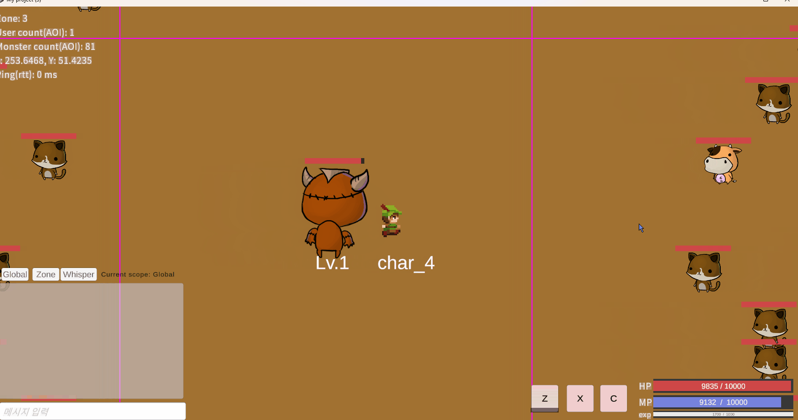
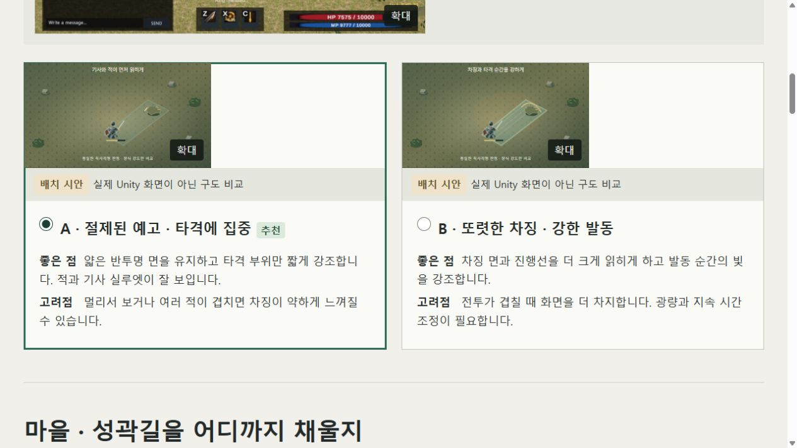
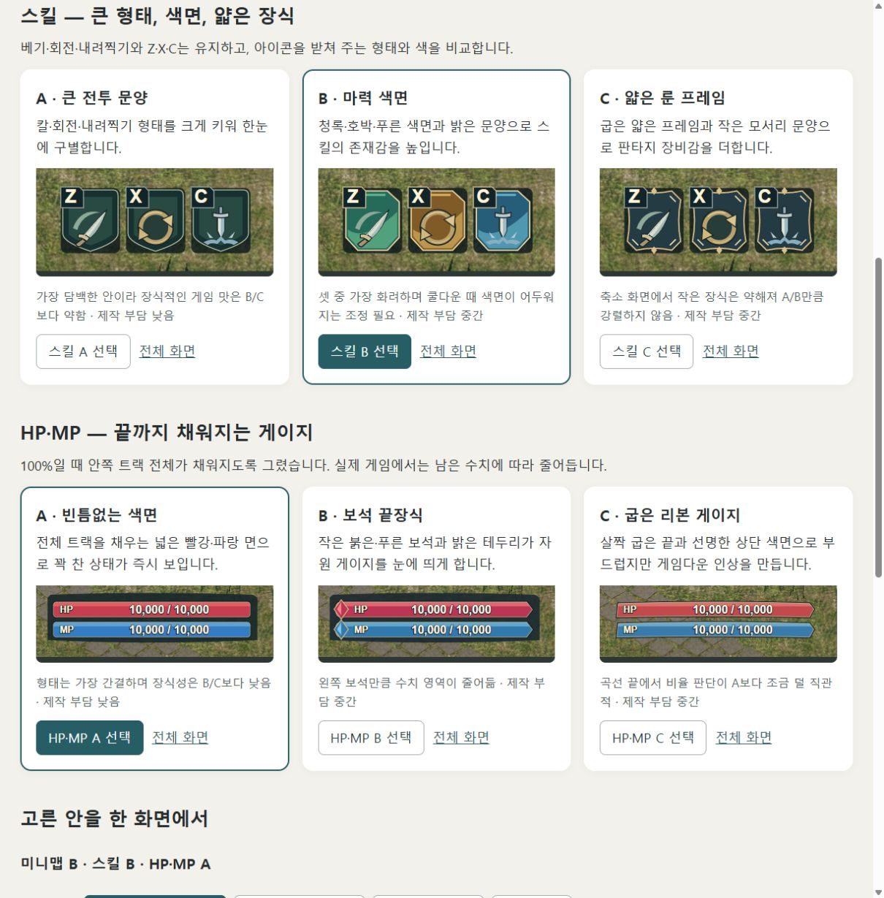
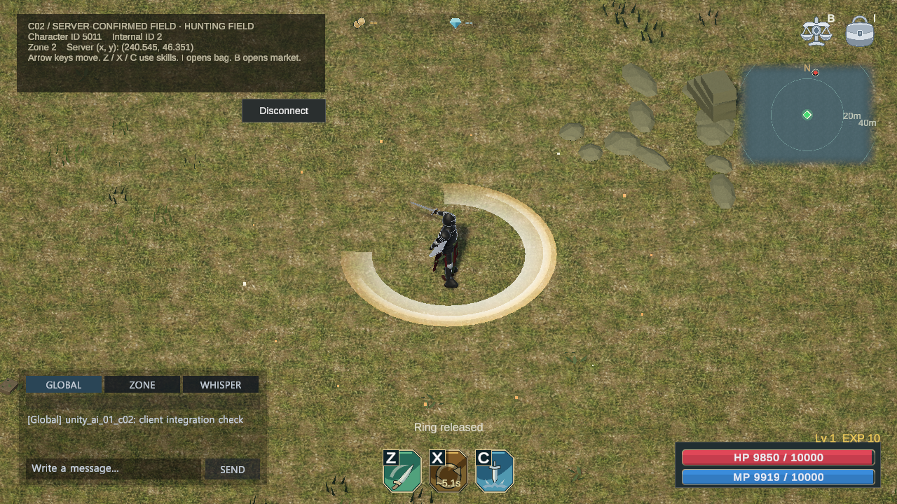

# AI-AGENT Unity 클라이언트 구현 작업

기존 2D 기능을 3D로 확장하고, Unity에 없던 인벤토리와 거래소를 서버에 연동했습니다.

## 이번 작업의 결과

사용자는 우선순위와 화면 방향을 정하고, 필요한 역할이 구현과 검토를 맡았습니다.

## 먼저 만든 기반: 기존 2D Unity

| Unity 클라이언트 기준 | 직접 만든 2D | Agent 3D |
| --- | --- | --- |
| 화면 표현 | 2D | 3D 쿼터뷰 |
| 기존 기능 | 이동·몬스터·스킬·채팅·월드 진입 | 기존 기능을 3D로 확장 |
| 새로 추가한 기능 | — | 인벤토리·거래소 |

## 선택한 방향을 결과로

기획·아트 방향은 비교 시안에서 선택했습니다. 아래는 선택 기록이며 실제 게임 화면이 아닙니다.

선택한 표현은 관련 작업에 반영했습니다.

## 작업 방식을 바꾼 이유

요구를 구체화하고, 조작과 화면을 실제 결과에서 확인하며 방향을 조정했습니다.

## AI Agent 워크플로우

필요한 역할에 작업을 나누고, 검수 피드백은 같은 담당자가 반영합니다.

### 에이전트 구성

- 사용자 — 목표·우선순위와 선택·결과 판단
- 총괄 Agent — 범위 정리·역할 배정·결과 통합
- 의사결정 지원 Agent — 비교안과 사용자 선택 연결
- 기획 Agent — 플레이 흐름·완료 조건 구체화
- 서버 분석 Agent — 서버 기능·통신 규칙 조사
- 구현 Agent — Unity 기능·서버 연결 구현
- 아트 Agent — 선택된 캐릭터·배경·UI 표현 구현
- 리뷰 Agent — 변경 내용 독립 검토
- 종합 검수 Agent — 기획·아트·UI·UX·조작 관점 검수
- 테스트 Agent — 정한 범위의 입력·응답 확인
- 기록 Agent — 확인된 결과와 화면 정리

## 하나의 기능이 만들어지는 흐름

요구를 확인 기준으로 구체화하고 필요한 역할이 구현·검토·검증합니다. 기획·아트 방향은 비교안을 거쳐 사용자가 고르며, 답변을 기다리는 동안 독립 작업을 이어갑니다.

### 작업 흐름

- 목표와 확인 기준 정리
- 방향 결정 — 기술은 승인 범위에서 총괄이 정하고, 기획·아트는 비교안을 검수해 사용자가 선택
- 구현과 독립 리뷰
- 변경된 동작 중심 검증
- 종합 검수와 결과 정리

### 피드백이 돌아오는 방식

- 리뷰·테스트 문제는 근거와 함께 원 구현 담당이 수정합니다.
- 종합 검수 피드백도 원담당이 반영하고 영향 구간을 다시 확인합니다.
- 사용자 선택과 플레이 피드백을 후속 작업 조건에 반영합니다.

## Agent 활용 지표

새 실행은 Agent 신규 생성, 후속 실행은 기존 Agent 재실행을 뜻합니다. 이 집계는 메시지나 테스트 횟수가 아닙니다.

## 지침 변경 이력

- 2026-10-31 — 종합 검수 피드백은 원담당이 반영하고 영향 구간을 다시 확인합니다.
- 2026-10-27 — 실제 게임 화면과 조작 경험을 중심으로 결과를 정리했습니다.
- 2026-10-25~26 — 기획·아트 시안을 비교하고 선택한 표현을 제작에 반영했습니다.
- 2026-10-21 — Unity에서 내보낸 맵 통행 데이터를 서버 판정에 연결했습니다.

## 작업 둘러보기

기능별 결과와 화면 이력을 작업 상세에 모았습니다.

## 참고 링크

- [게임 서버와 소스 저장소](https://github.com/JoEunil/MMORPG)
- [서버 설계 자료](https://docs.google.com/presentation/d/1Sz7WlzlE4qYqyXO43ad0i0CYAFvzJMR2/edit)

## README 대표 이미지

