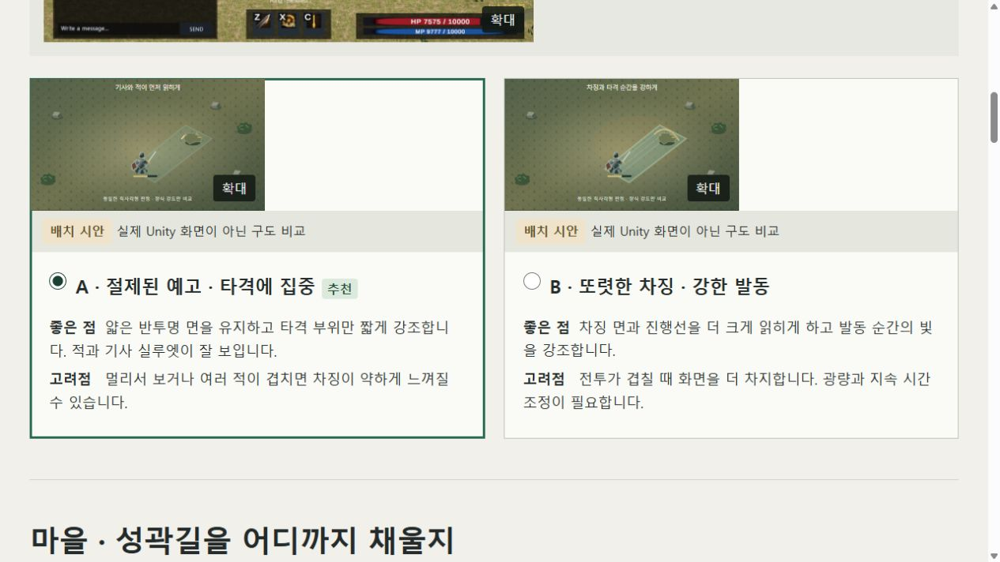
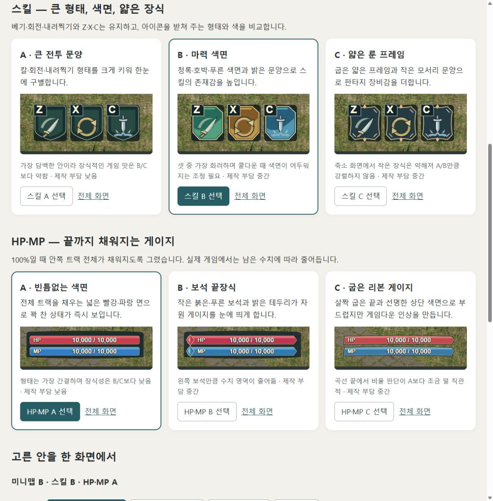
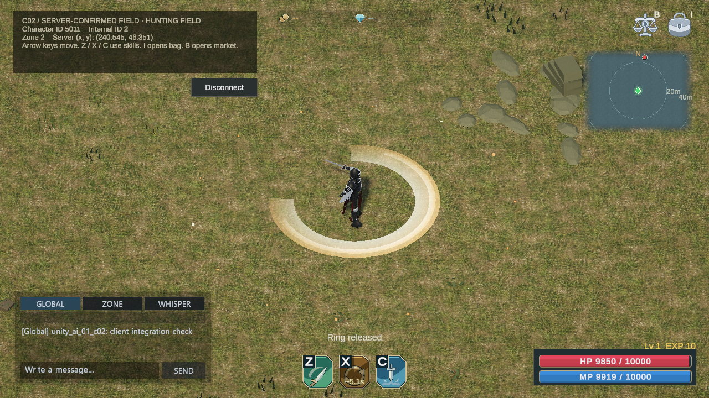

# AI-AGENT Unity 클라이언트 구현 작업

기존 MMORPG 서버와 직접 만든 2D 클라이언트에서 출발해, AI Agent를 활용해 3D 쿼터뷰 클라이언트를 구현한 기록입니다. 기능별 화면과 확인한 범위, 작업 중 바뀐 큰 기준을 모았습니다.

## AI Agent 워크플로우

사용자는 만들 기능과 우선순위를 정하고 결과를 판단합니다. 총괄 Agent가 목표를 정리한 뒤, 필요한 전문 역할을 골라 배정합니다. 모든 역할을 매번 실행하는 방식은 아닙니다.

### 에이전트 구성

- 사용자 — 목표와 우선순위를 정하고, 비교안에서 방향을 선택해 결과를 검토
- 총괄 Agent — 작업 범위를 정리하고 필요한 역할을 배정하며 결과를 통합
- 의사결정 지원 Agent — 기획·아트 비교안을 묶고 사용자 답변을 적용 범위에 연결
- 기획 Agent — 플레이 흐름의 비교안을 제안하고 선택한 방향을 구체화
- 서버 분석 Agent — 서버 기능과 통신 규칙을 조사
- 구현 Agent — Unity 화면과 기존 서버 연결을 구현
- 아트 Agent — 화면 비교안을 제안하고 선택한 표현을 구현
- 리뷰 Agent — 구현을 별도로 검토
- 종합 검수 Agent — 단계별 판단을 돕고 비교안과 완성 결과를 기획·아트·UI·UX 관점에서 검수
- 테스트 Agent — 정해진 동작을 입력·응답으로 확인
- 기록 Agent — 확인된 기능과 화면을 공개 자료로 정리

## 하나의 기능이 만들어지는 흐름

기능 요청부터 구현·검토·확인을 거쳐 결과를 기록합니다. 기획·아트는 여러 작업의 대표 샘플을 한 번에 비교하고 사용자가 고른 조합을 함께 제작합니다. 작은 수정은 정한 기준 안에서 진행하고, 결과와 피드백도 묶어서 확인합니다. 의사결정 지원 담당이 비교 자료와 답변을 정리하며, 선택을 기다리는 항목과 독립적인 작업은 병렬로 진행하는 방식으로 지침을 정비했습니다.

종합 검수 Agent는 비교안과 완성 결과를 기획·아트·UI·UX 관점에서 점검합니다. 각 기능에서 실제로 확인한 동작과 남은 범위는 작업 상세에 구분해 기록합니다.

### 작업 흐름

- 목표와 완료 조건 — 사용자가 원하는 기능을 정하고, 총괄이 확인 기준을 구체화
- 방향 비교와 역할 배정 — 종합 검수를 거친 기획·아트 비교안에서 사용자가 조합을 고르고 필요한 Agent를 배정
- 구현과 별도 검토 — 기존 구조에 기능을 연결하고 리뷰에서 변경을 다시 확인
- 필요한 범위 확인 — 변경된 동작을 중심으로 빌드·자동 검사·실제 입력 중 가능한 검증 수행
- 종합 검수와 결과 정리 — 화면·사용 흐름·검증 근거를 함께 검수하고 필요한 수정 후 결과를 기록

### 피드백

- 리뷰·검증 피드백 — 문제의 재현 근거를 전달하고 구현을 수정
- 종합 검수 피드백 — 중간 판단과 사용자에게 보여줄 선택안을 점검하고, 최종 묶음은 필수 수정 반영 후 게시
- 사용자 피드백 — 화면·조작 방향을 완료 조건에 반영하고 변경 범위를 확인

### 실제 비교·선택 예시

의사결정 지원 Agent가 기획 항목과 화면 근거를 나눠 정리하고, 아트 Agent가 전투·마을·사냥터·UI의 비교 보드를 만들었습니다. 사용자는 여러 항목을 한 번에 골랐고, 그 조합을 기존 게임 화면에 반영했습니다.

비교용 배치 시안이며 게임 실행 화면이 아닙니다. 선택 표시는 사용자가 채팅에서 확정한 조합을 기록용으로 반영해 촬영했습니다. [비교 페이지 첫 화면](/MMORPG/media/releases/2026-10-25/decision-support-overview.png)과 [선택 요약 화면](/MMORPG/media/releases/2026-10-25/decision-support-selection.png)을 함께 보관했습니다.

### HUD 비교에서 실제 적용까지

색 대비와 채움 표현이 약하다는 피드백을 받은 뒤 미니맵·스킬·HPMP를 각각 세 안으로 만들었습니다. 사용자가 추천 조합을 선택해 Unity에 함께 적용했습니다. 위 화면은 선택용 합성 시안이며, 적용된 모습은 [전투·스킬·상태 UI](/MMORPG/work/player-hud/)에서 볼 수 있습니다.

## Agent 활용 지표

새 Agent 실행은 에이전트를 새로 만들어 작업을 맡긴 횟수, 후속 작업 실행은 기존 에이전트에게 다시 작업을 맡겨 실행한 횟수입니다. 전체 실행은 두 횟수를 더한 값입니다.

기록 시작 이후 전체를 집계하며, 메시지·테스트 횟수나 토큰 사용량을 뜻하지 않습니다. 총괄이 직접 한 작업은 제외합니다.

## 지침 변경 이력

- 기능 검증에서 게임 화면 중심으로 — 정통 판타지 분위기, 키보드 조작, 아이템·상태 UI를 실제 플레이에 맞추는 방향으로 바꿨습니다.
- Unity 맵의 서버 공유 — 화면과 서버가 같은 통행·충돌 데이터를 사용하도록 작업 범위를 넓혔습니다.
- 지시 중심에서 비교·선택으로 — 기획·아트 샘플을 한 번에 비교하고 사용자가 고른 조합을 함께 제작합니다.
- 작은 단계에서 큰 기능 묶음으로 — 관련 구현을 모아 리뷰·검증하고 종합 검수를 거쳐 전달합니다. 비교안도 사용자에게 보여주기 전에 검수하며, 이미 통과한 검사는 반복하지 않습니다.

## 기존 Unity 구현

직접 구현한 기존 클라이언트는 2D입니다. 이동·몬스터·스킬·채팅·월드 진입이 들어 있었고, Unity 인벤토리와 거래소 화면은 없었습니다.

## 작업 둘러보기

이동·전투·거래소의 실제 게임 화면, 거래 뒤 아이템을 받은 인벤토리, 맵 편집 도구를 기능별로 모았습니다. 사진 아래에 촬영일과 화면 종류를 표시합니다. 기능 이름이나 사진을 누르면 구현 내용과 확인한 범위를 볼 수 있고, 이전 모습은 각 작업의 화면 이력에서 비교할 수 있습니다.

- [필드와 월드 이동](portfolio/field-travel.md) — 로그인·캐릭터 선택 뒤 필드에 진입하고, 키보드로 이동하며 구역과 맵을 살펴봅니다.
- [전투·스킬·상태 UI](portfolio/player-hud.md) — 캐릭터·몬스터 상태, 스킬 표현, 채팅과 전투 장면을 확인합니다.
- [인벤토리](portfolio/inventory.md) — AI Agent 작업에서 추가한 가방 UI와 실제 거래 뒤 아이템 수령 화면을 봅니다.
- [거래소](portfolio/market.md) — 매물 조회·판매 화면과 구매·취소·수령 흐름, 실제 확인 여부를 한곳에 모았습니다.
- [게임 콘텐츠와 맵 편집](portfolio/server-content.md) — Unity에서 스킬·몬스터 설정과 맵 통행 데이터를 편집해 서버에 연결합니다.

## 참고 링크

- [서버 프로젝트와 기술 자료](https://github.com/JoEunil/MMORPG)
- [서버 설계 자료](https://docs.google.com/presentation/d/1Sz7WlzlE4qYqyXO43ad0i0CYAFvzJMR2/edit)

## README 대표 이미지

