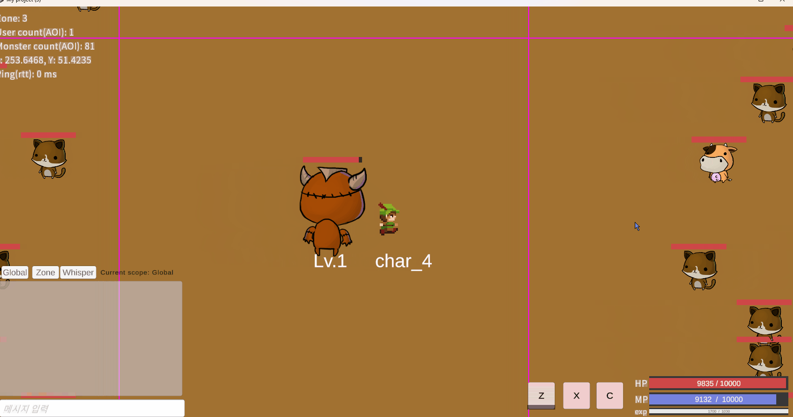
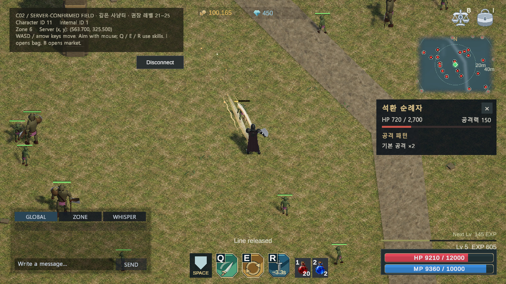
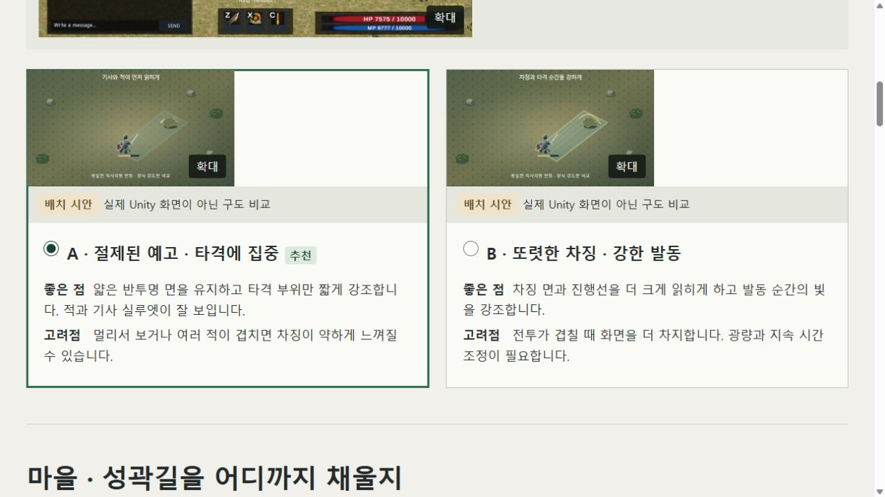
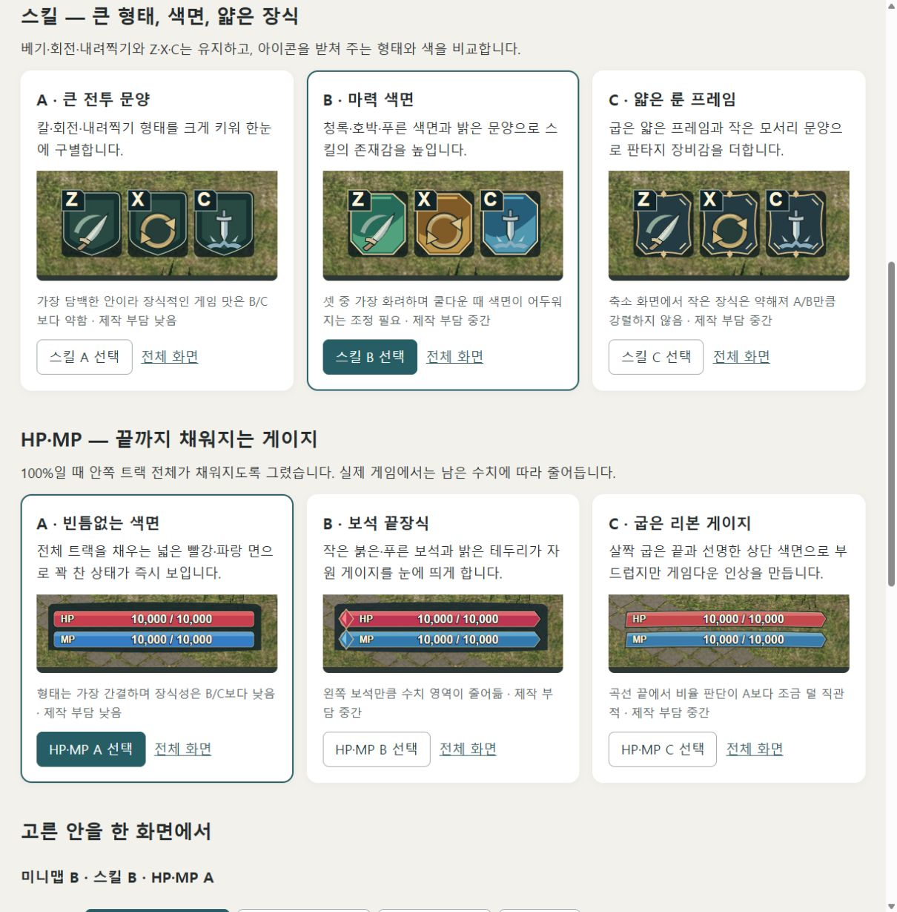
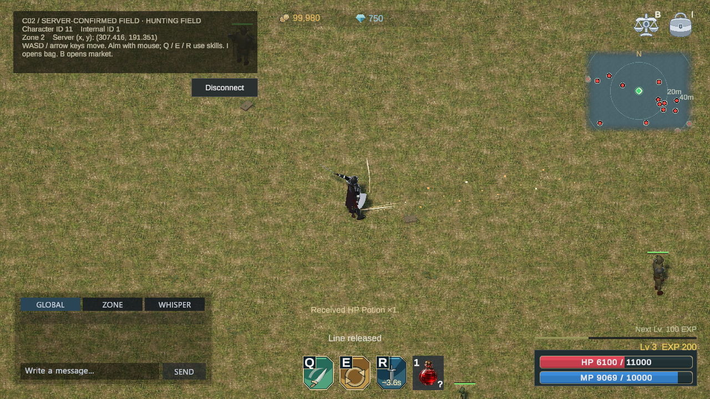

# AI-AGENT Unity 클라이언트 구현 작업

기존 2D MMORPG를 3D 쿼터뷰 클라이언트로 확장했습니다.

## AI Agent 워크플로우

사람이 목표와 우선순위를 정하고, 필요한 역할이 조사·구현·검토·기록을 맡습니다.

### 에이전트 구성

- 사용자 — 목표·우선순위·방향 선택
- 총괄 Agent — 범위 정리·배정·통합
- 의사결정 지원 Agent — 선택안 비교와 응답 연결
- 기획 Agent — 플레이 흐름·완료 조건
- 서버 분석 Agent — 서버 기능·통신 규칙
- 구현 Agent — Unity 기능·서버 연결
- 아트 Agent — 화면·재질·효과
- 리뷰 Agent — 코드와 계약 독립 검토
- 종합 검수 Agent — 기획·아트·UI·UX·조작 종합 검토
- 테스트 Agent — 변경 동작 검증
- 기록 Agent — 확인된 결과 정리

## 하나의 기능이 만들어지는 흐름

### 작업 흐름

- 목표와 확인 기준 정리
- 필요한 역할에 독립 작업 배정
- 구현과 별도 검토
- 영향받은 동작 중심 검증
- 종합 검수와 결과 기록

### 방향 선택과 피드백

- 기획·아트는 비교 시안을 검토하고 사용자가 방향 선택
- 선택 대기 중에도 독립 작업 진행
- 검수 지적은 원 구현 담당자가 수정하고 다시 확인

## Agent 활용 지표

새 실행은 Agent 신규 배정, 후속 실행은 같은 Agent 재실행입니다. 메시지·테스트 횟수와 구분해 누적 집계합니다.

## 지침 변경 이력

- 2026-10-31 — 검수 피드백은 원담당이 수정하고 영향 구간 재확인
- 2026-10-27 — 실제 게임 화면과 조작 확인을 결과에 기록
- 2026-10-25~26 — 기획·아트 비교안에서 고른 방향을 제작에 반영
- 2026-10-21 — Unity 맵 통행 데이터를 서버 이동 판정에 연결

## 기존 구현과 달라진 점

### 기존 기능

- 월드 진입
- 캐릭터 이동, 몬스터 전투, 스킬
- 채팅

### 추가·수정된 기능

추가된 기능

- 인벤토리·거래소, 아이템 사용
- 미니맵, 전체 지도에서 목적지 선택과 필드 길안내
- 패링, 몬스터 정보창

기존 기능 개선

- 2D 화면에서 3D 쿼터뷰로 전환
- 키보드 이동과 마우스 방향 조준

## 작업과 결과

### 전투와 필드

실제 플레이의 조작·전투·월드 이동을 기능별 화면으로 모았습니다.

### 가방과 거래

아이템 사용·장착과 거래소 흐름을 각각 한 결과로 정리했습니다.

### 월드와 콘텐츠

맵 편집·통행·서버 콘텐츠 공유를 묶었습니다.

## 선택한 방향을 결과로

기획·아트 비교 시안은 선택 기록입니다. 아래 이미지는 실제 게임 화면이 아닙니다.

## 참고 링크

- [게임 서버와 소스 저장소](https://github.com/JoEunil/MMORPG)
- [서버 설계 자료](https://docs.google.com/presentation/d/1Sz7WlzlE4qYqyXO43ad0i0CYAFvzJMR2/edit)

## README 대표 이미지

