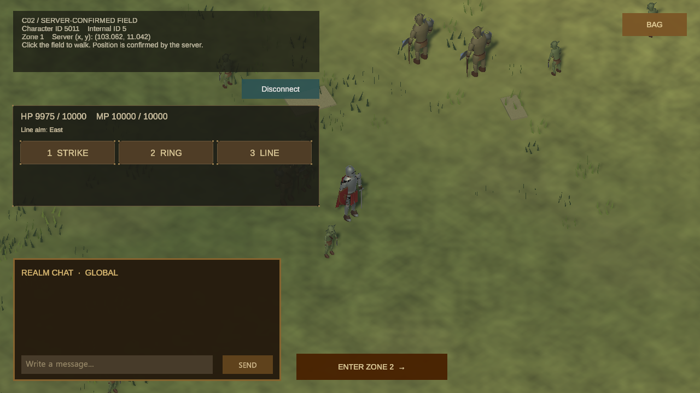
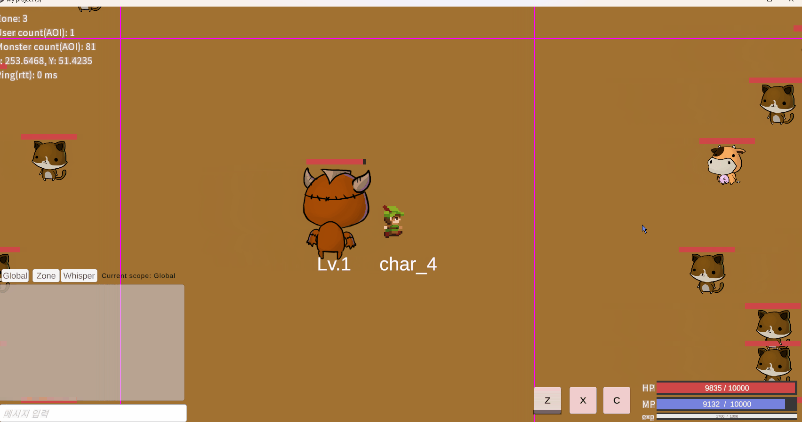

# AI-AGENT Unity 클라이언트 구현 작업

AI Agent 워크플로우로 기존 게임 서버에 연결하는 Unity 클라이언트를 구현하고, 작업 과정과 실제 결과를 기록합니다.

## 대표 화면

## 프로젝트

기존 게임 서버에 연결하는 3D 쿼터뷰 MMORPG 클라이언트를 만들고 있습니다. 사람이 목표와 방향을 정하고, AI 역할들이 서버 동작을 조사하고 구현·아트·리뷰를 나눠 맡습니다. 결과는 실제 화면과 서버 응답으로 확인합니다.

## 작업 둘러보기

- [캐릭터와 함께 필드를 오가는 과정](portfolio/field-travel.md) — 로그인부터 캐릭터 선택, 월드 진입과 구역 이동까지.
- [거래소 조회 화면의 첫 버전](portfolio/bazaar-search.md) — 서버 매물 조회를 연결하고 실제 응답을 화면에 표시한 작업.
- [내 매물 조회와 검색 전환](portfolio/my-listings.md) — 현재 캐릭터의 매물 조회, 새로고침과 판매 검색 복귀.
- [아이템과 거래소 화면](portfolio/item-market.md) — 아이템·매물 목록과 선택 상세, 내 매물 대금 수령 연결.
- [내 매물 대금 수령](portfolio/item-market.md#내-매물-대금-수령) — 선택한 내 매물의 서버 수령 결과를 표시합니다. 실서버 지급은 아직 확인되지 않았습니다.
- [사냥 상태와 전투 HUD](portfolio/player-hud.md) — 캐릭터의 성장 정보와 주변 몬스터 체력을 표시하는 화면.
- [스킬·몬스터 데이터 편집](portfolio/server-content.md) — 스킬·몬스터 수치와 스폰 배치를 편집하고 서버 데이터로 내보내는 도구.

## AI Agent 워크플로우

### 에이전트 구성

- 사용자 — 목표·범위·화면 방향 결정
- 총괄 Agent — 작업 배정·결과 확인·다음 작업 연결
- 기획 Agent — 기능 흐름·완료 조건
- 서버 분석 Agent — 기존 서버 계약·변경 영향 조사
- 구현 Agent — 클라이언트·연결 코드 구현
- 아트 Agent — 캐릭터·배경·UI 표현
- 리뷰 Agent — 구현과 분리해 결함 확인
- 테스트 Agent — 실제 입력·서버 결과·캡처 확인
- 기록 Agent — 검증 결과·공개 화면 정리

### 작업 흐름

- 목표 설정 — 사용자가 만들 기능과 방향 결정
- 작업 설계 — 총괄이 범위를 나누고 담당 Agent 배정
- 구현·아트 — 독립 작업은 병렬 진행
- 독립 리뷰 — 다른 Agent가 변경 확인
- 묶음 검증 — 실제 Unity 입력·서버 결과 확인
- 결과 반영 — 수정·재검증 후 기록하고 다음 작업 진행

### 피드백

- 리뷰·검증에서 문제 발견 → 구현으로 돌아가 수정
- 사용자 피드백 → 목표·화면 방향에 반영

## 기존 Unity 구현

2D 클라이언트 · 직접 구현

### 구현 범위

- 이동
- 몬스터
- 스킬
- 채팅
- 월드 진입

## 참고 링크

- [기존 서버 포트폴리오](https://github.com/JoEunil/MMORPG)
- [서버 설계 PPT](https://docs.google.com/presentation/d/1Sz7WlzlE4qYqyXO43ad0i0CYAFvzJMR2/edit)
