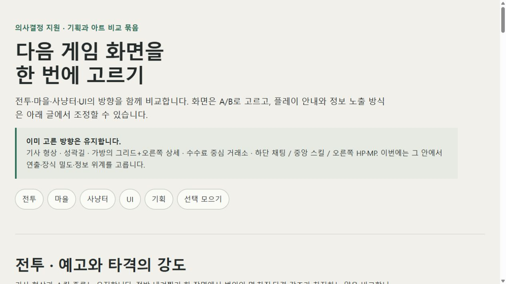

# 의사결정 지원 비교·선택 기록 — 2026-10-25

기획을 말로만 지시하기 어려운 상황에서 전투·마을·사냥터·UI 시안을 한 번에 비교하고, 텍스트로 조정할 기획 항목도 함께 선택한 사례다. 사용자가 아래 조합을 채팅으로 전달한 뒤 기존 Unity 장면에 반영했다. 선택 이유나 만족도는 별도로 말하지 않아 추측하지 않는다.

## 확인한 선택

| 구분 | 선택 |
| --- | --- |
| 전투 | A · 절제된 예고와 타격 집중 |
| 마을 | A · 길 가장자리 정돈 |
| 사냥터 | A · 가장자리 수풀과 돌 |
| UI | A · 얇은 선과 낮은 장식 |
| 전투 안내 | A · 스킬 줄 가까이 짧게 |
| 길 안내 | A · 포장길과 진입 랜드마크 |
| 가방 상세 | B · 아이템 그림과 이름 중심 |

선택의 근거는 사용자 채팅이며 [selection.json](selection.json)에 구조화했다. 선택 표시가 있는 캡처는 확정된 채팅 답변을 총괄이 기록용 브라우저에서 재현한 화면이다. 사용자가 직접 브라우저를 누른 장면이나 선택의 자동 수신 증거로 사용하지 않는다. 이 선택은 PR 게시 승인이 아니다.

## 실제 브라우저 캡처

- [마을 비교](captures/decision-support-town.png)
- [사냥터 비교](captures/decision-support-hunting.png)
- [UI 비교](captures/decision-support-ui.png)
- [텍스트 기획 비교](captures/decision-support-planning.png)
- [확정 선택 요약을 반영한 화면](captures/decision-support-selection.png)

모두 실제 로컬 페이지를 브라우저에서 촬영한 구간별 원본 PNG다. 이미지 합성·재구성은 하지 않았다. 화면 안의 A/B 그림은 배치 시안이며, 게임 실행 결과는 아니다. 선택 요약은 스크롤 영역이므로 전체 선택의 정본은 위 표와 JSON을 함께 확인한다.

## 재현 가능한 원본과 결과

- [보드 원본](board/index.html), [기획 옵션](board/planning-options.json), `board/media/`의 당시 기준 이미지 5장을 함께 보존했다. 기획 옵션을 불러오려면 HTTP 미리보기에서 연다.
- [manifest.json](manifest.json)은 캡처 해상도·파일 해시와 원본 파일 해시를 담는다. 이후 보드를 바꿔도 이 기록을 덮어쓰지 않는다.
- 적용한 제품 후보는 `c5d3bf4`이며, 현재 전달 상태는 [HANDOFF](../../HANDOFF.md)를 따른다. [가방 결과](../../portfolio/inventory.md), [길과 필드 결과](../../portfolio/field-travel.md), [전투 결과](../../portfolio/player-hud.md)에 에디터 예시와 확인 범위를 연결했다.
- 이번 기록은 Coordinator 직접 수행이다. 새 Agent 활성화·새 게임 테스트·실입력은 없으며, 기존 성공 검사를 반복하지 않았다.
