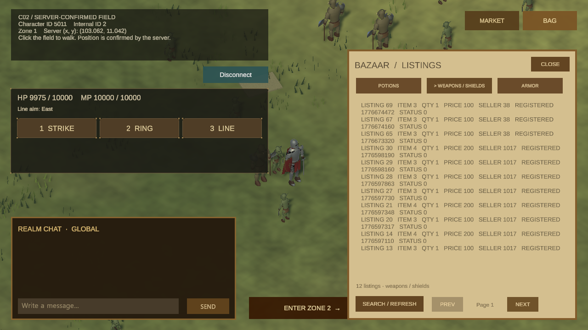
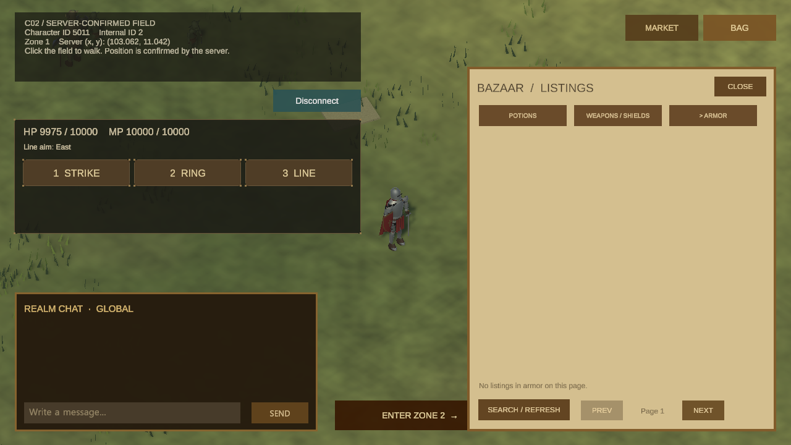

# 거래소 조회 화면의 첫 버전

요약: 실제 서버의 거래소 매물과 빈 결과를 조회하는 초기 UI입니다.

상태: 중간 결과

## 만든 것

기존 서버의 거래소 검색을 Unity 화면에 연결했습니다. 유형과 페이지를 골라 조회하고, 서버가 돌려준 매물 또는 빈 결과를 보여줍니다.

## 해결한 문제

처음에는 조회 요청과 실제 화면 사이에 연결이 없었습니다. 서버 응답을 화면까지 이어 새로고침, 페이지 이동, 창 닫기와 다시 열기에서도 요청 결과를 구분해 표시하도록 만들었습니다.

## 에이전트를 활용한 과정

사람은 실제 서버의 기존 매물을 조회하는 범위부터 연결하도록 정했습니다. 에이전트가 요청·응답과 창의 상태 정리를 구현하고, 별도 리뷰와 실제 화면 입력으로 확인했습니다. 자동 검증 뒤 실제 조작에서 하단 버튼이 겹치는 문제를 발견해 배치를 수정하고 다시 확인했습니다.

## 결과

실제 Unity 입력으로 서로 다른 유형과 페이지를 조회하고 새로고침·닫기·다시 열기를 확인했습니다. 화면에 보이는 숫자 목록은 연결을 검증하기 위한 초기 UI입니다. 거래소의 시각적 구성과 읽기 쉬운 매물 표현은 이후 작업에서 개선할 예정입니다. 등록·구매는 이 화면의 결과가 아니며 아직 다루지 않습니다.

## 화면 기록

### 2026-10-19 — 서버 응답을 표시한 첫 조회 화면

### 2026-10-19 — 결과가 없는 검색 화면

