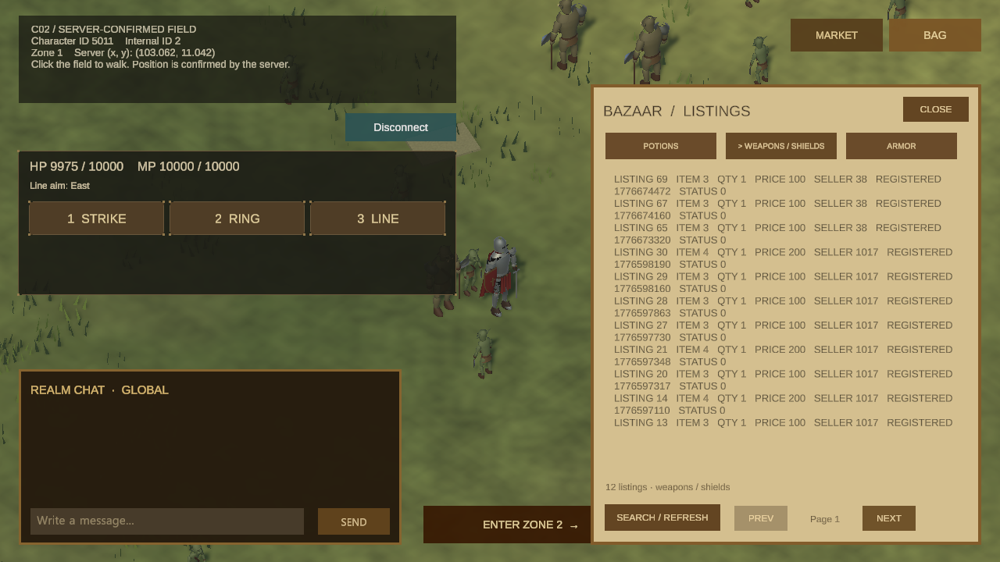
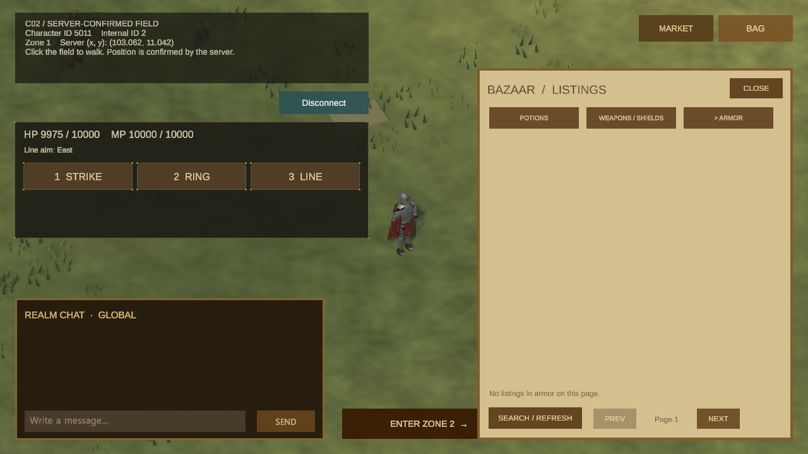

# 거래소 조회 화면의 첫 버전

요약: 실제 서버의 거래소 매물과 빈 결과를 조회하는 초기 UI입니다.

상태: 중간 결과

## 구현한 기능

- 포션·무기/방패·방어구 종류별 서버 매물 조회
- 이전·다음 페이지 이동과 새로고침
- 매물 번호·수량·가격과 빈 검색 결과 표시
- 이전 요청의 늦은 응답이 새 조회를 덮지 않도록 보호

## 현재 확인한 범위

실제 서버 매물 조회와 유형·페이지 변경, 빈 검색 결과를 확인했습니다.

## 화면 기록

### 2026-10-19 — 서버 응답을 표시한 첫 조회 화면

### 2026-10-19 — 결과가 없는 검색 화면

