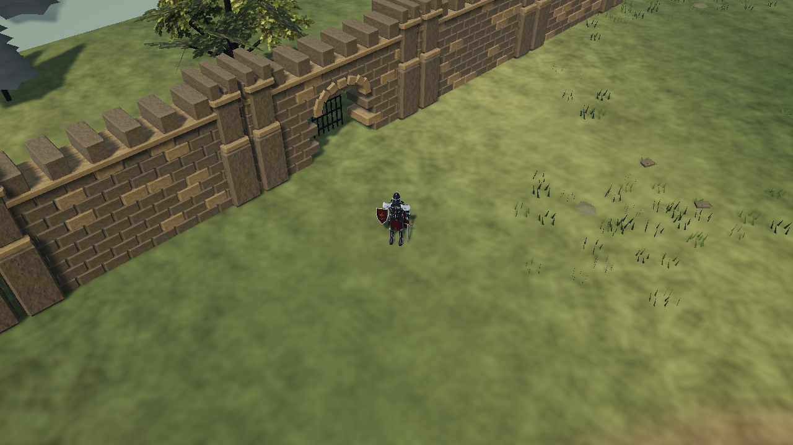
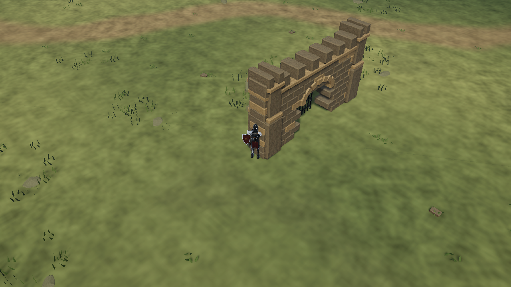
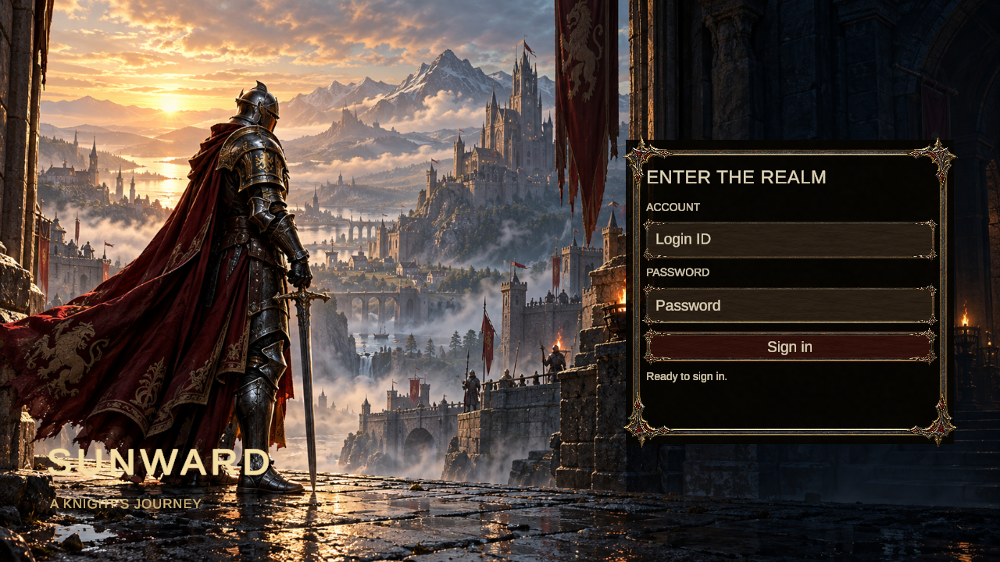
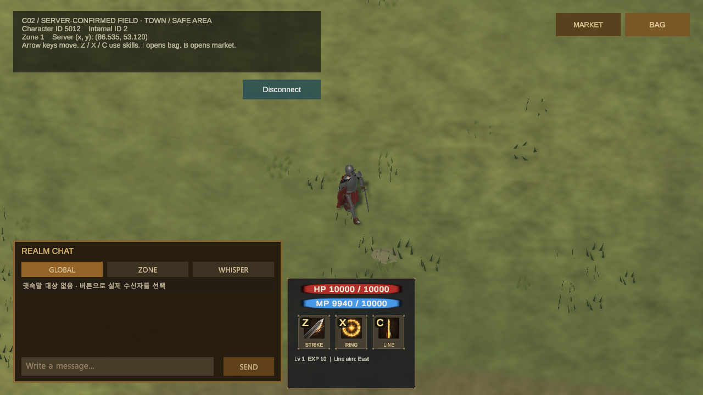
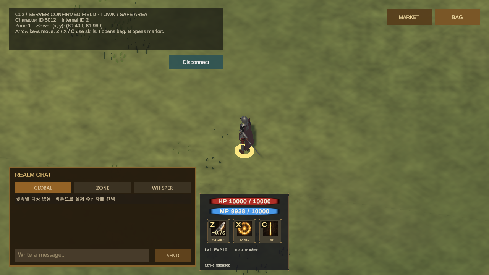
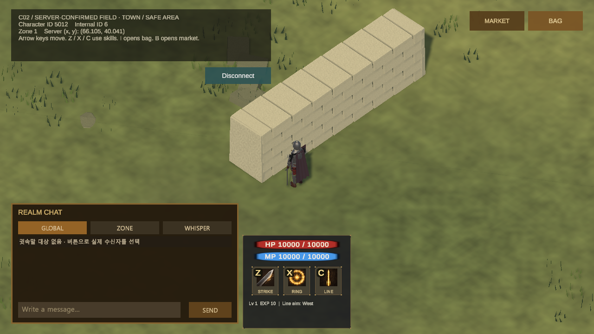
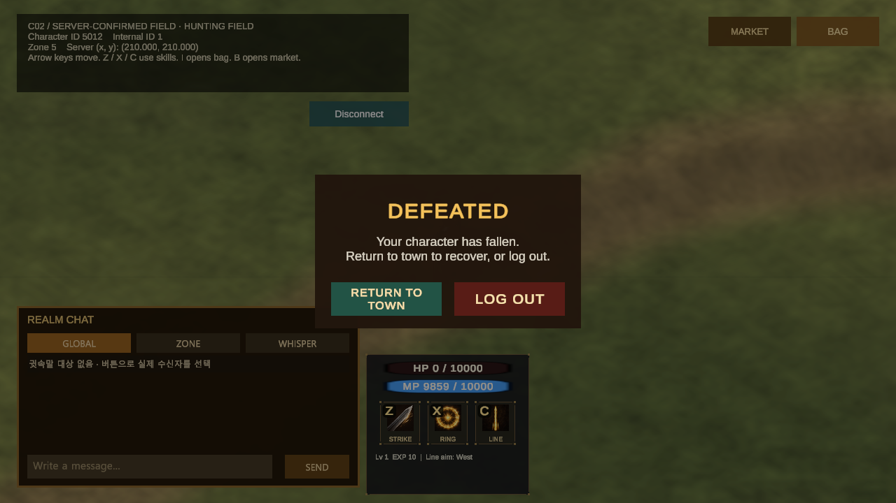
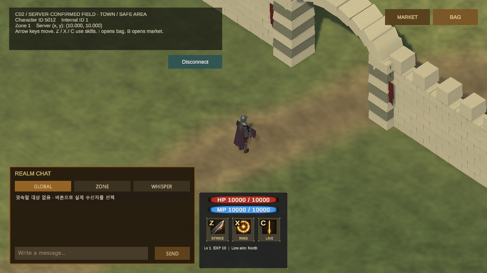

# 필드와 월드 이동

요약: 로그인과 캐릭터 선택을 거쳐 월드에 들어가고, 방향키로 쿼터뷰 필드를 이동합니다.
상태: 중간 결과

## 구현한 기능

- 계정 로그인, 캐릭터 선택, 월드 불러오기를 별도 화면으로 나눴습니다.
- 방향키 이동과 Z·X·C 스킬 입력을 연결하고 이동·공격 동작을 다듬었습니다.
- 필드를 여섯 구역으로 확장하고, Unity에서 편집한 통행·충돌 데이터를 서버가 사용하도록 연결했습니다.
- 서버가 구역 이동을 확정하며, 새 구역의 플레이어와 몬스터 상태를 받은 뒤 조작을 이어갑니다.
- 몬스터가 없는 마을과 쓰러진 캐릭터의 명시적 귀환 흐름을 추가했습니다.

## 이동과 모션

이동 속도와 방향 전환을 조정하고 화면 보정으로 위치가 되돌아가는 현상을 줄였습니다. 보행과 공격의 준비·베기·회수 동작도 손봤습니다. 다양한 네트워크 지연에서의 조작감과 사냥 난이도는 더 확인해야 합니다. 필드에는 길과 낮은 식생, 기존 장애물 주변의 수목을 배치했습니다.

## 현재 확인한 범위

실제 로그인·캐릭터 선택 뒤 방향키 이동과 정지, 세 스킬의 서버 응답, 필드와 인접 구역 사이 이동을 확인했습니다. 서버가 Unity에서 내보낸 충돌 데이터를 사용해 벽 통과를 막고, 구역 이동 뒤에도 캐릭터 위치와 화면이 이어지는 것을 확인했습니다. 실제 방향키 입력으로 마을과 인접 사냥터를 왕복했고, 벽 앞 정지와 가방·거래소를 열었을 때 이동 차단도 확인했습니다. 여섯 구역 전체 왕복과 사냥 난이도·처치 보상 확인은 남아 있습니다.

사망 귀환에서는 서버가 마을 이동과 체력·마나 회복을 확정하고 경험치를 유지하는 것을 확인했습니다. HP가 0인 상태로 접속했을 때 이동·공격을 막고 안내를 표시하는 동작도 확인했습니다. 마을의 새 건물이나 NPC를 만든 결과는 아닙니다.

## 화면 기록

### 2026-10-23 — 성벽과 필드 재질

진입 삽화의 석재·금속·차분한 조명을 방향으로 삼아 실제 필드에 성벽, 닫힌 철문, 깃발과 나무를 배치했습니다. 지면과 수목의 재질도 바꿨습니다. 게임 맵을 촬영한 에디터 미리보기이며 메뉴 배경 삽화와는 구분합니다.

기존 장애물의 통행 범위 안에 벽을 다듬고, 월드 바깥에는 성벽 실루엣을 추가했습니다. 장식 때문에 새 통로가 막히지 않도록 원래 충돌·맵 데이터는 유지했습니다.

### 2026-10-23 — 진입 화면 아트

성채와 기사의 배경 삽화, 가죽 바탕과 금속 프레임으로 진입 화면을 바꿨습니다. 기존 로그인·캐릭터 선택·월드 불러오기 흐름은 유지합니다. 배경 기사는 메뉴용 삽화이며, 게임에서 움직이는 3D 모델은 전투 화면 기록에서 따로 볼 수 있습니다. 이번 화면은 Play 모드의 무입력 확인으로 촬영했습니다.

### 2026-10-22 — 이동과 공격 모션 보완

방향키를 누르면 이동하며, 방향을 바꾸면 입력한 방향을 바라봅니다. 이번 화면은 이동 속도와 정지 동작을 확인한 중간 결과입니다.

공격 입력 후 준비·베기·회수 모션을 재생하고, 스킬 아이콘에 재사용 대기 시간을 표시합니다.

### 2026-10-22 — 맵 장애물과 이동 입력

Unity에서 만든 벽의 통행 정보를 서버와 공유합니다. 방향키를 누른 채 벽에 접근해도 통과하지 않으며, 마을과 인접 사냥터를 왕복한 뒤에도 이동과 화면 조작을 이어갈 수 있는 것을 확인했습니다.

### 2026-10-22 — 사냥터에서 마을로 귀환

쓰러진 상태로 사냥터에 접속한 뒤 마을 귀환 버튼을 눌렀습니다. 다시 접속하는 것만으로는 회복되지 않습니다.

서버가 마을 이동을 확정한 뒤 체력과 마나가 모두 회복됐고 경험치는 유지됐습니다. 마을에는 몬스터가 나타나지 않으며, 화면의 성문은 기존 배경을 사용했습니다. 새 마을 건물이나 NPC를 추가한 결과는 아닙니다.

### 2026-10-22 — 쓰러진 캐릭터의 필드 진입과 로그아웃

체력이 0인 상태로 접속하면 이동·스킬 입력을 막고 패배 안내를 표시합니다. 로그아웃 버튼을 누르면 연결을 정리하고 로그인 화면으로 돌아갑니다. 이 화면은 생존 이동이나 자동 구역 전환을 확인한 기록은 아닙니다.

### 2026-10-20 — 확장 필드로 이동

방향키로 두 구역 경계를 이동한 뒤의 실제 화면입니다. 하단 HUD 위에 이동 버튼을 배치했고, 체력·마나는 서버에서 받은 값입니다.

### 2026-10-20 — 방향키·스킬 HUD와 사냥 상태

실제 접속에서 이동과 스킬을 사용한 뒤 사냥으로 HP가 0이 된 화면입니다. 방향키와 스킬 입력이 멈추고, 퇴장 안내가 표시되는 것을 확인했습니다. 이후 확대된 체력·마나와 스킬 키 표기는 [전투와 상태 표시](/MMORPG/work/player-hud/)에서 볼 수 있습니다.

### 2026-10-20 — 장비 표면 개선 중

기존 캐릭터에 철과 가죽 질감을 적용했습니다. 에디터의 같은 카메라로 표면을 확인한 중간 결과이며, 새 모델이나 애니메이션을 제작한 화면은 아닙니다.

### 2026-10-20 — 로그인 화면 분리

로그인과 캐릭터 선택을 동시에 나열하던 구성을 나눴습니다. 이 화면은 계정을 입력하기 전의 실제 Unity 화면입니다. 캐릭터와 배경의 외형은 기존 버전이며 개편 중입니다.

### 2026-10-19 — 구역 이동을 확인한 필드 화면

인접 구역으로 이동한 뒤에도 캐릭터와 서버 위치가 이어지는지 확인한 화면입니다.

### 2026-10-19 — 인접 구역으로 이동한 화면

캐릭터가 인접 구역으로 이동한 직후의 화면입니다.
