# 필드와 월드 이동

요약: 로그인과 캐릭터 선택을 거쳐 월드에 들어가고, WASD·방향키로 쿼터뷰 필드를 이동합니다.
상태: 중간 결과

## 대표 화면

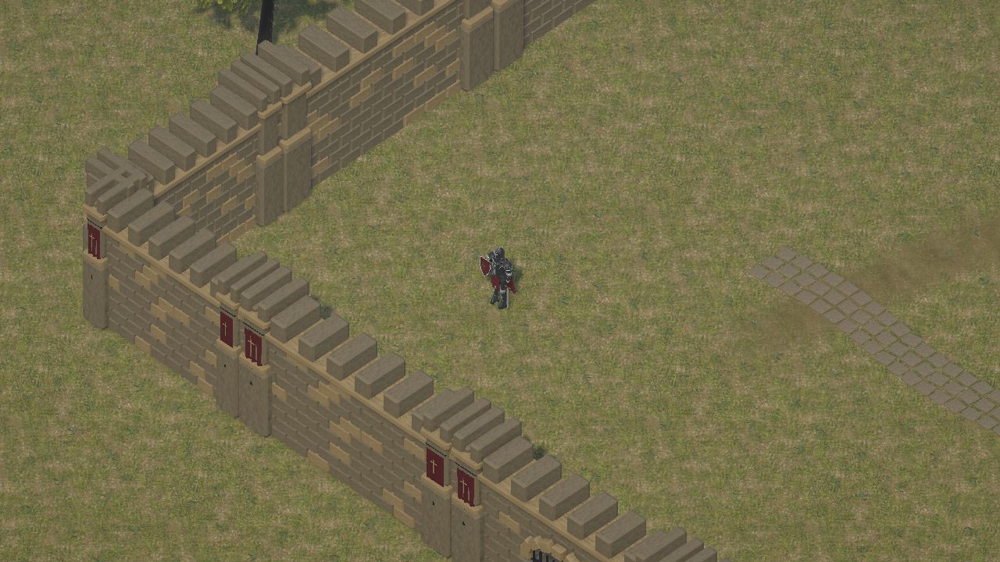

외곽 성벽의 틈·모서리 연결과 벽 주변 잔디 보완. 실제 맵의 에디터 미리보기입니다.

## 구현한 기능

- 계정 로그인·캐릭터 선택·월드 진입 흐름
- WASD·방향키 이동과 Q·E·R 스킬 입력
- 여섯 구역과 서버 공유 통행·충돌 데이터
- 서버 확정 구역 이동과 새 구역 상태 수신
- 몬스터 없는 마을과 사망 후 귀환 흐름
- 사냥터별 권장 레벨·몬스터 능력치·경험치·골드 보상
- 일반·강화 몬스터 차등 배치와 두 사냥터의 보스
- 자신 중앙 고정·카메라 방향 정렬 미니맵과 개체·북쪽 표시
- 미니맵 클릭으로 여는 전체 월드 지도와 현재 위치·사냥터 권장 레벨 표시

## 이동과 모션

- 이동 속도·방향 전환 보정과 보행·공격 모션
- 길·낮은 식생·기존 장애물 주변의 수목 배치

## 현재 확인한 범위

실제 서버에서 로그인·여섯 구역 왕복과 마을 복귀, 재접속 상태 유지, 벽 충돌·UI 개방 중 이동 차단·사망 귀환을 확인했습니다. 자동 방향키 입력으로 확인했으며, 다양한 네트워크 지연의 조작감과 성장 균형은 미확인입니다.

최신 Windows 빌드에서는 마을에 접속해 미니맵 클릭, 현재 위치 표시, 전체 지도 닫기와 다시 열기를 확인했습니다.

## 화면 기록

### 2026-11-08 — 미니맵 방향 정렬·성벽과 잔디 연결

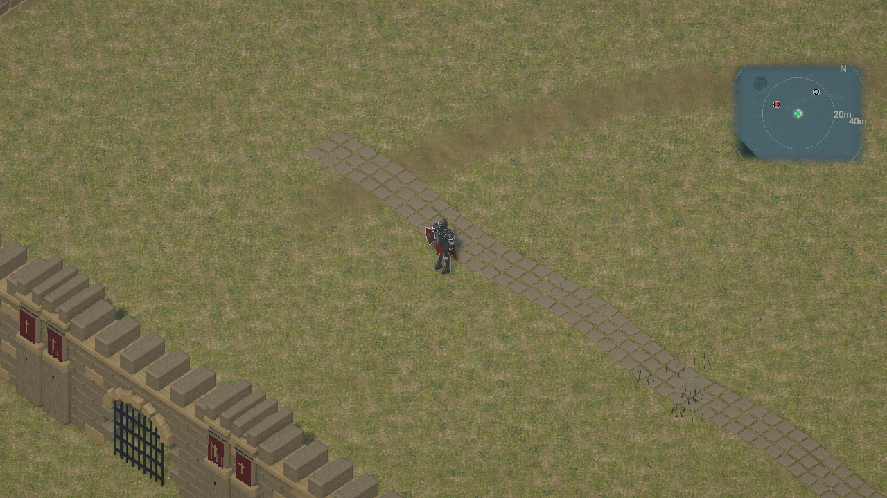

배경·개체 점·북쪽을 같은 방향으로 정렬하고 자기 중앙 고정·거리 눈금을 유지했습니다. 예시 위치를 넣은 에디터 화면이며, 새 빌드의 실서버 이동 검증은 아닙니다.

### 2026-10-27 — 여섯 구역 순회와 마을 복귀

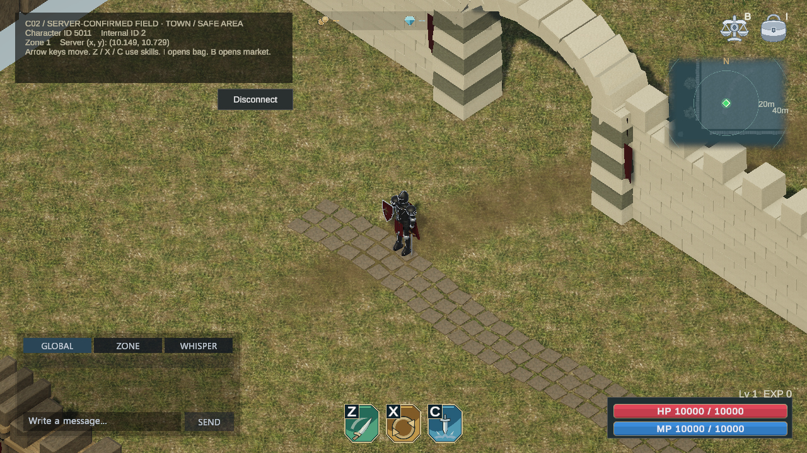

실제 서버에서 자동 방향키 입력으로 여섯 구역을 순회하고 마을로 돌아왔습니다.

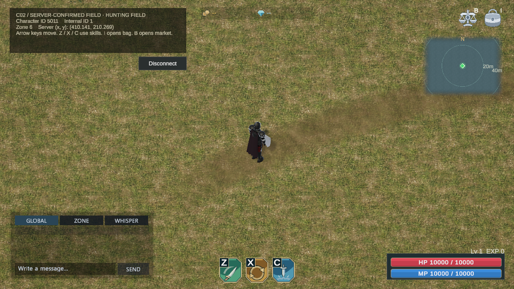

같은 세션의 사냥터 화면이며, 몬스터 처치나 보상은 이 기록에서 확인하지 않았습니다.

### 2026-10-27 — 차분한 로그인 배경

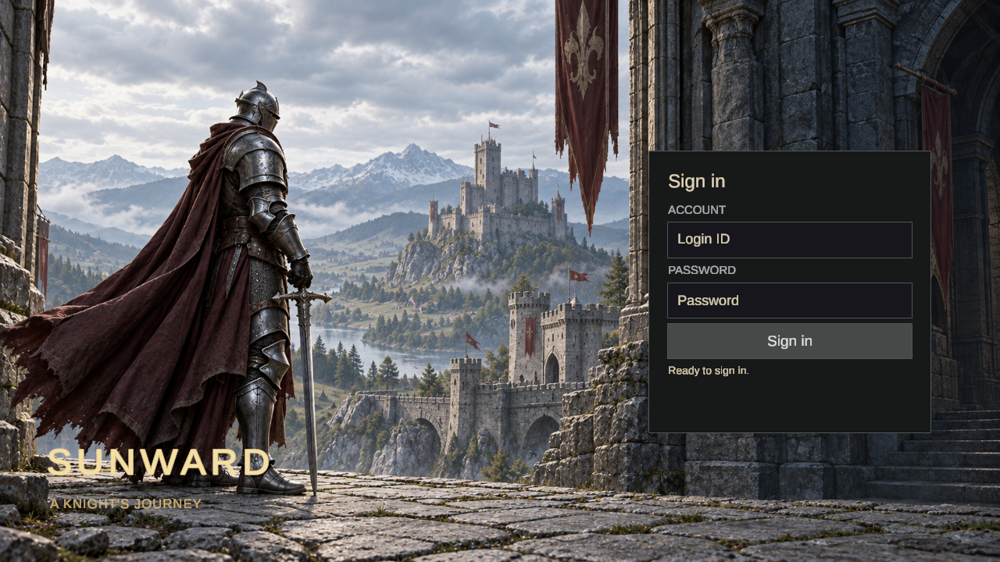

기사와 성곽 구도, 오른쪽 로그인 폼은 유지하고 석양·금빛 반사·불빛을 덜어냈습니다. 생성 일러스트를 실제 로그인 UI에 연결한 에디터 미리보기이며, 게임 안의 3D 에셋이나 새 로그인 성공을 보여주는 화면은 아닙니다.

### 2026-10-26 — 바닥과 기사 재질 정돈

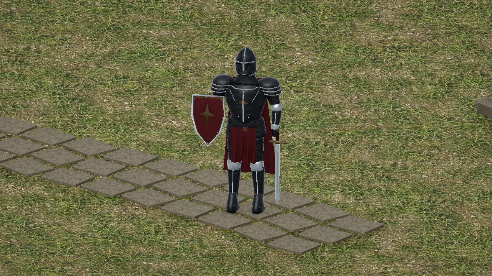

기존 텍스처로 잔디 반복 주기와 세부 강도를 조정하고, 갑옷·모서리·천·가죽의 명암과 거칠기를 구분했습니다. 같은 모델을 촬영한 에디터 재질 확인 화면으로 촬영용 조명을 사용했습니다.

### 2026-10-26 — 장식을 줄인 로그인 화면

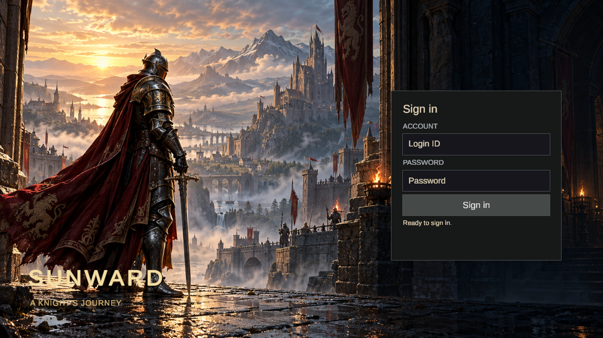

배경과 오른쪽 폼 배치를 유지하고 반복되는 금색 프레임·가죽 질감을 덜어냈습니다. 입력창·버튼과 간격을 단순하게 정리한 에디터 미리보기이며 새 로그인 성공 검증 화면은 아닙니다.

### 2026-10-25 — 길 가장자리와 사냥터 진입

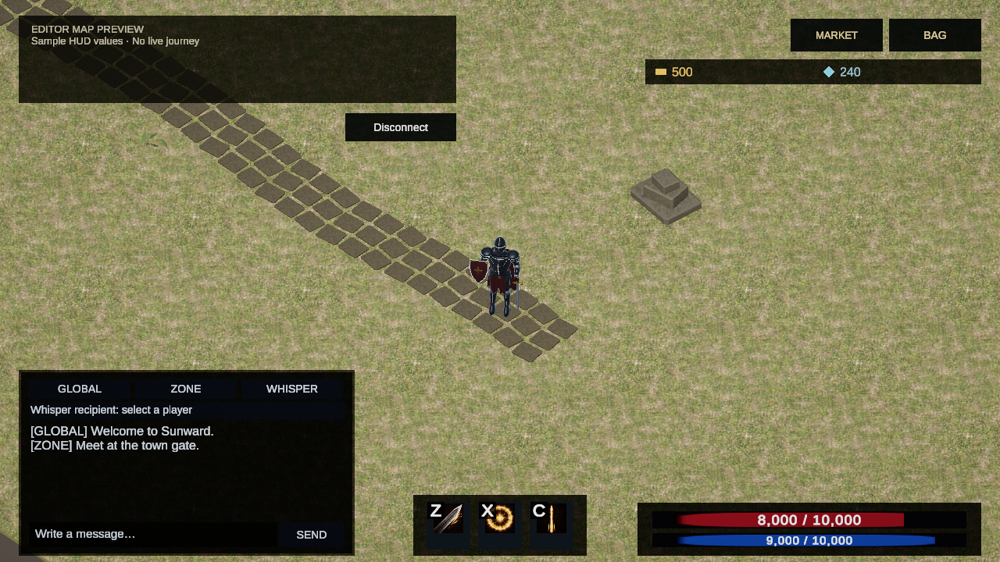

포장길 가장자리와 첫 사냥터 외곽에 낮은 돌·수풀을 배치하고 진입부에 작은 랜드마크를 두었습니다. 기존 장면과 카메라로 촬영한 에디터 예시이며, HUD 값은 샘플입니다.

### 2026-10-25 — 연장 길을 따라 마을과 사냥터 왕복

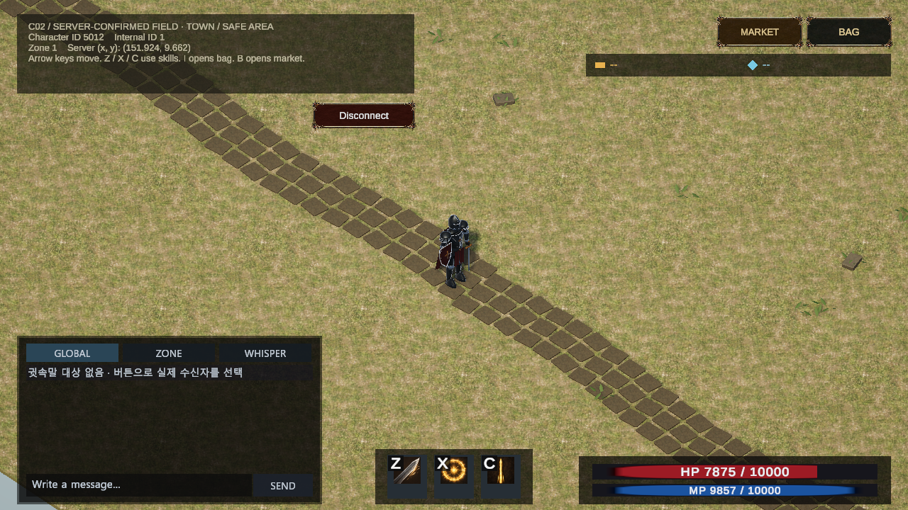

마을에서 연장 길과 사냥터 경계를 지나 기존 사냥 구간까지 이동한 뒤 같은 길로 돌아왔습니다. 실제 서버 세션에서 Unity 입력 시스템에 방향키 상태를 넣어 확인한 자동 조작이며, 물리 키를 누른 왕복 기록은 아닙니다.

### 2026-10-25 — 마을에서 사냥터로 이어지는 길

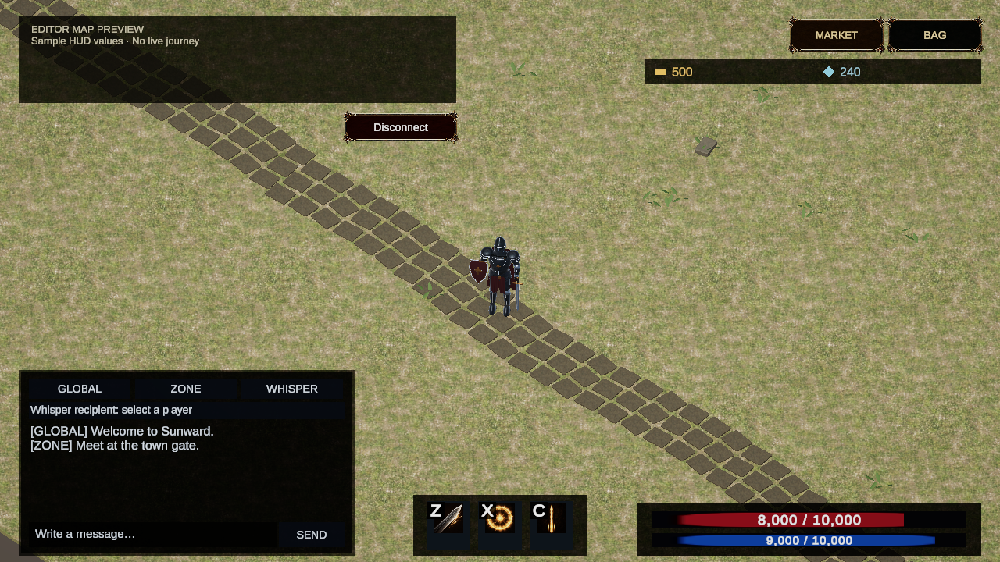

마을 포장길을 인접 사냥터 진입 경계까지 연결하고, 길과 식생의 재질을 조금 밝게 조정했습니다.

실제 Scene을 복제해 촬영한 에디터 예시입니다.

### 2026-10-25 — 마을 포장길과 가장자리 정돈

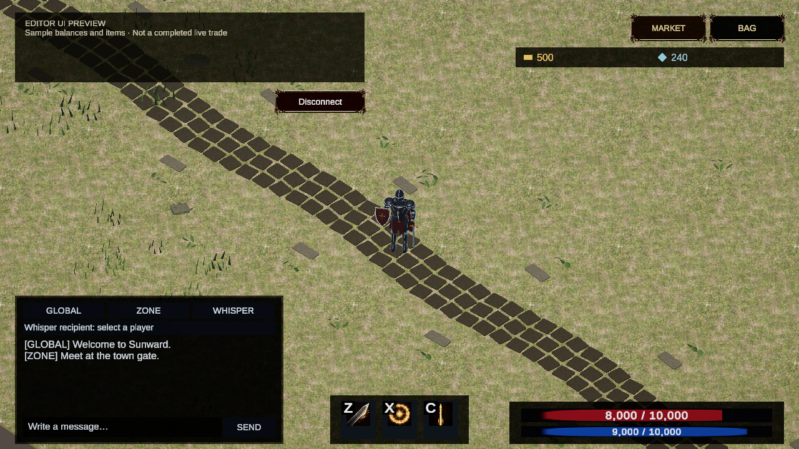

선택한 성곽길 방향에 맞춰 기존 포장 재질을 이어 놓고 길가에는 낮은 돌과 식생을 배치했습니다. 실제 맵의 에디터 미리보기이며, 월드 바깥 장식 성문으로 새 통로를 만든 것은 아닙니다.

### 2026-10-23 — 성벽과 필드 재질

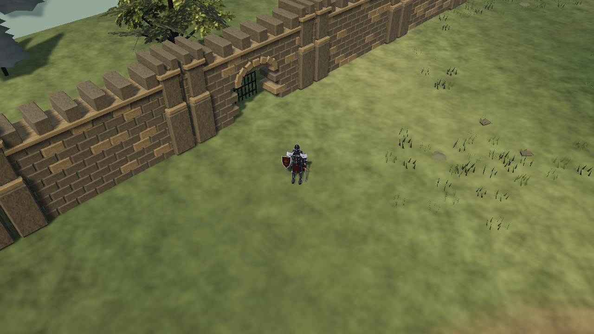

진입 삽화의 석재·금속·차분한 조명을 방향으로 삼아 실제 필드에 성벽, 닫힌 철문, 깃발과 나무를 배치했습니다.

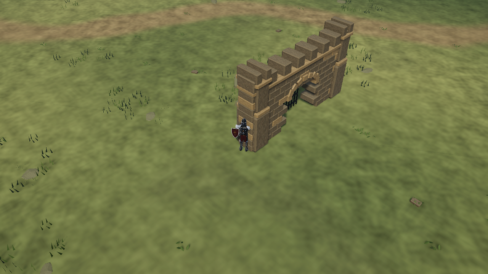

기존 장애물의 통행 범위 안에 벽을 다듬고, 월드 바깥에는 성벽 실루엣을 추가했습니다.

### 2026-10-23 — 진입 화면 아트

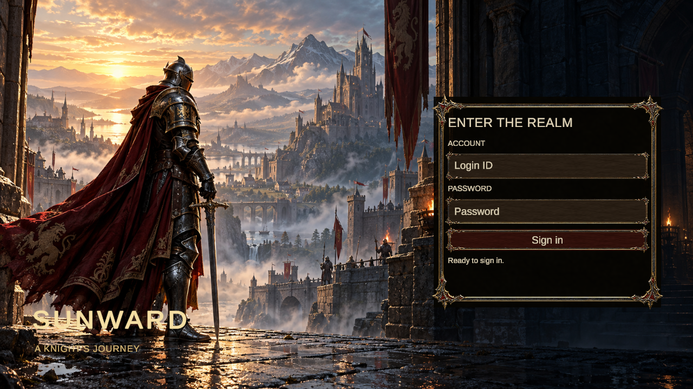

성채와 기사의 배경 삽화, 가죽 바탕과 금속 프레임으로 진입 화면을 바꿨습니다.

### 2026-10-22 — 이동과 공격 모션 보완

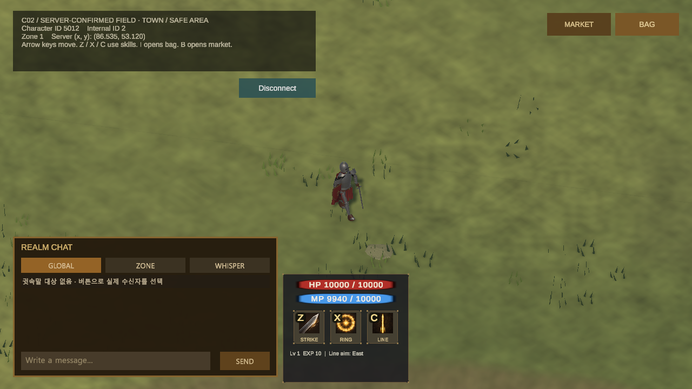

방향키를 누르면 이동하며, 방향을 바꾸면 입력한 방향을 바라봅니다.

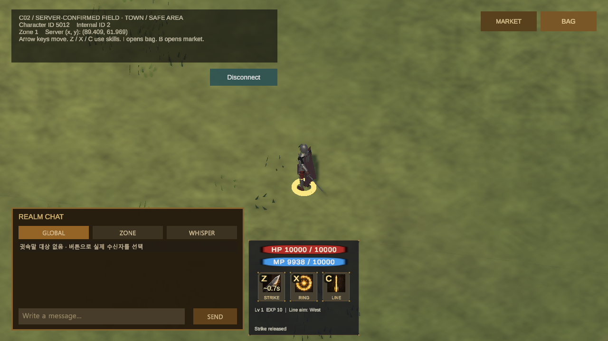

공격 입력 후 준비·베기·회수 모션을 재생하고, 스킬 아이콘에 재사용 대기 시간을 표시합니다.

### 2026-10-22 — 맵 장애물과 이동 입력

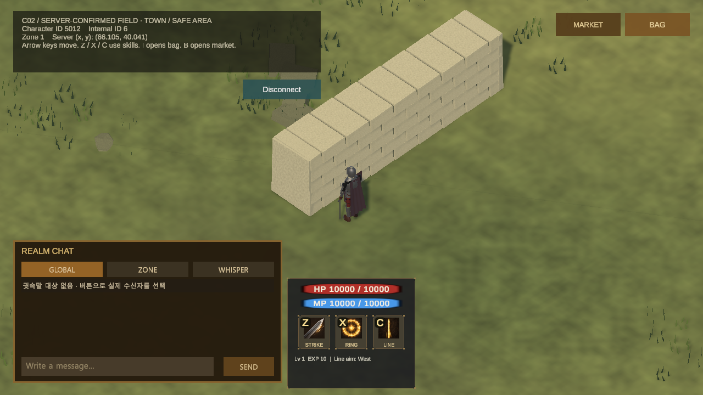

Unity에서 만든 벽의 통행 정보를 서버와 공유합니다.

### 2026-10-22 — 사냥터에서 마을로 귀환

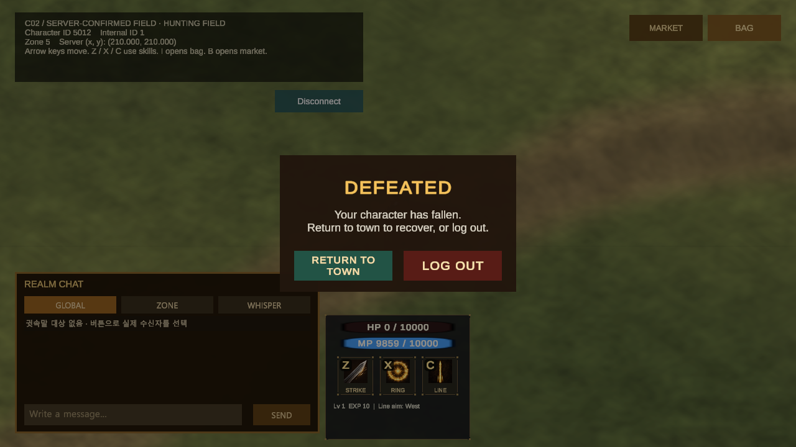

쓰러진 상태로 사냥터에 접속한 뒤 마을 귀환 버튼을 눌렀습니다.

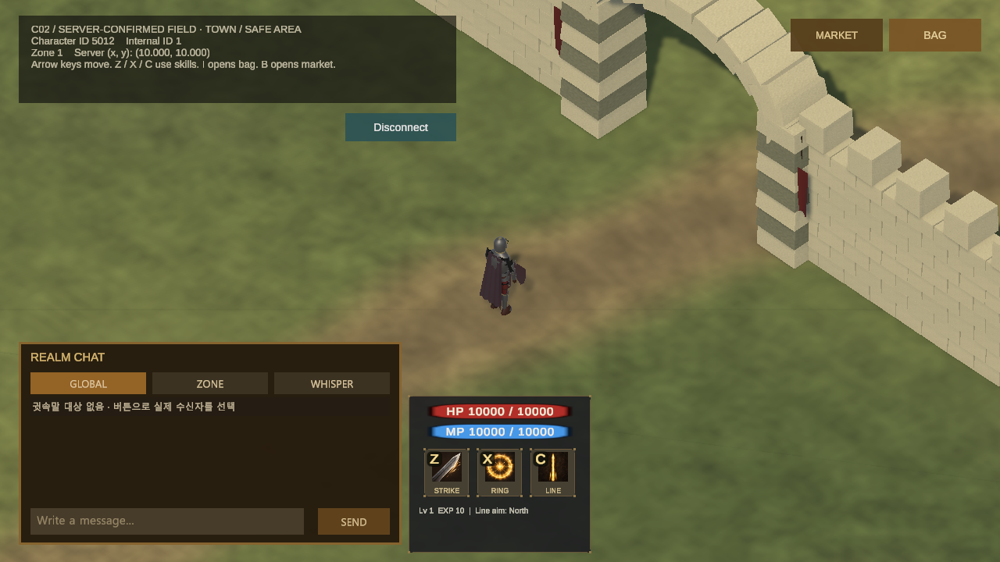

서버가 마을 이동을 확정한 뒤 체력과 마나가 모두 회복됐고 경험치는 유지됐습니다. 새 마을 건물이나 NPC를 추가한 결과는 아닙니다.

### 2026-10-22 — 쓰러진 캐릭터의 필드 진입과 로그아웃

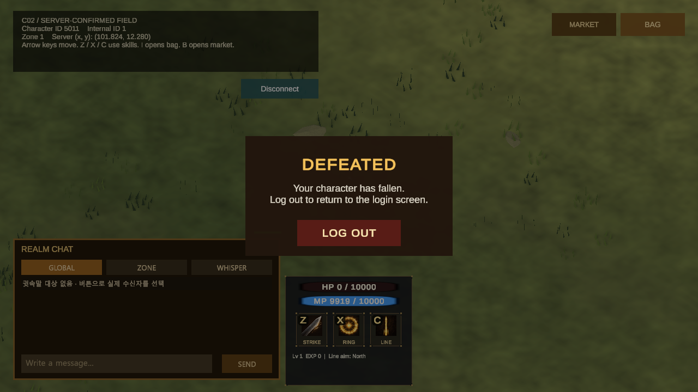

체력이 0인 상태로 접속하면 이동·스킬 입력을 막고 패배 안내를 표시합니다. 이 화면은 생존 이동이나 자동 구역 전환을 확인한 기록은 아닙니다.

### 2026-10-20 — 확장 필드로 이동

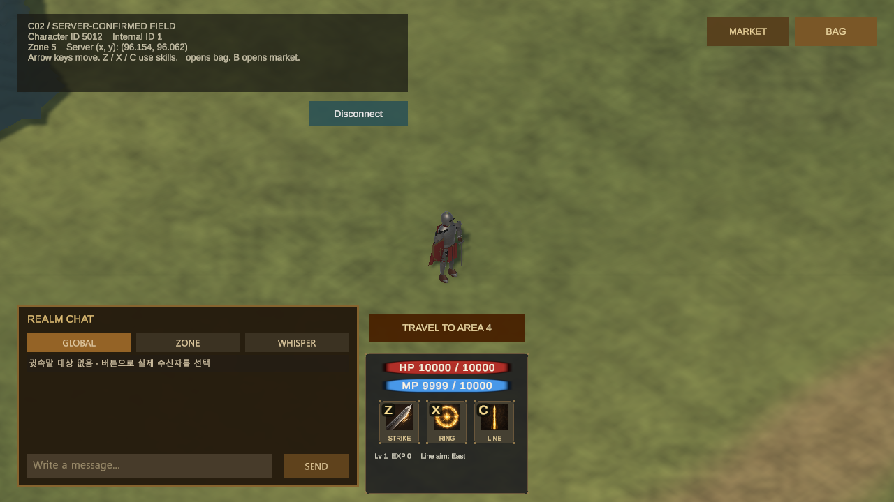

방향키로 두 구역 경계를 이동한 뒤의 실제 화면입니다.

### 2026-10-20 — 방향키·스킬 HUD와 사냥 상태

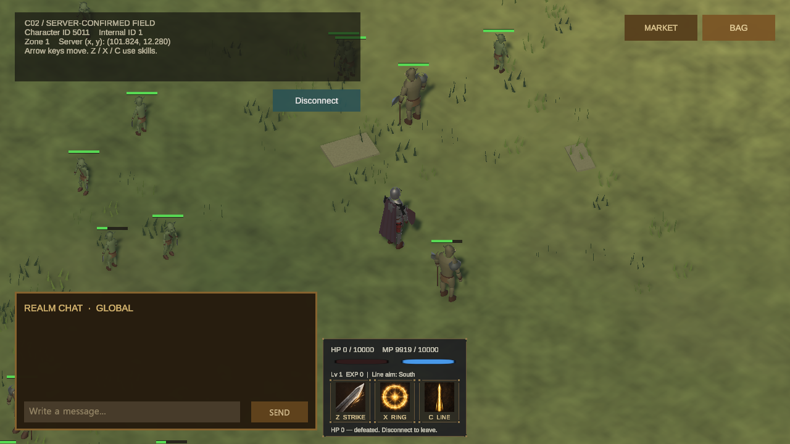

실제 접속에서 이동과 스킬 사용 후 HP가 0이 된 화면입니다.

### 2026-10-20 — 장비 표면 개선 중

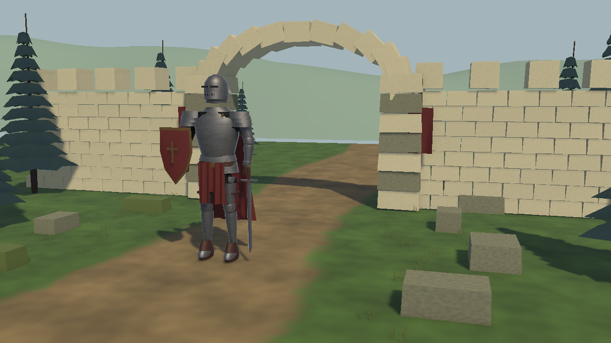

기존 캐릭터에 철과 가죽 질감을 적용했습니다. 에디터의 같은 카메라로 표면을 확인한 중간 결과이며, 새 모델이나 애니메이션을 제작한 화면은 아닙니다.

### 2026-10-20 — 로그인 화면 분리

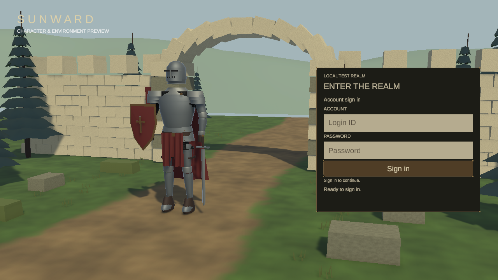

로그인과 캐릭터 선택을 동시에 나열하던 구성을 나눴습니다.

### 2026-10-19 — 구역 이동을 확인한 필드 화면

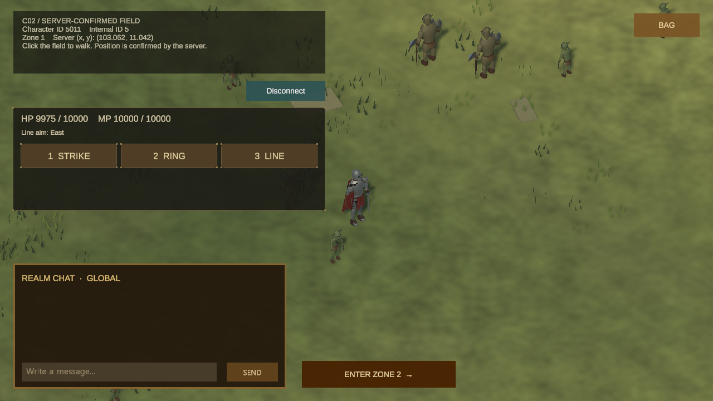

인접 구역으로 이동한 뒤에도 캐릭터와 서버 위치가 이어지는지 확인한 화면입니다.

### 2026-10-19 — 인접 구역으로 이동한 화면

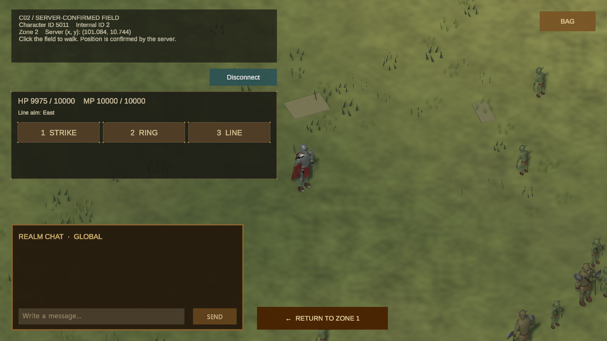

캐릭터가 인접 구역으로 이동한 직후의 화면입니다.
