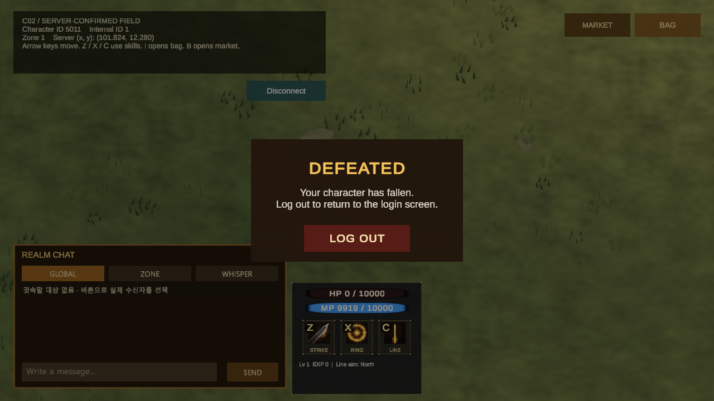
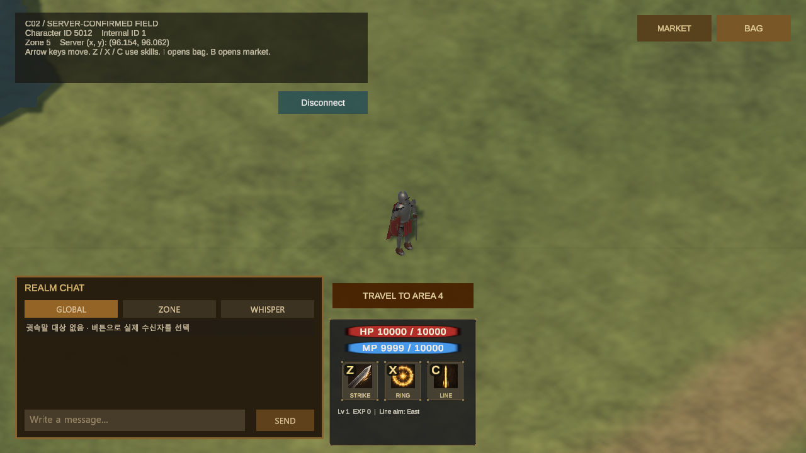
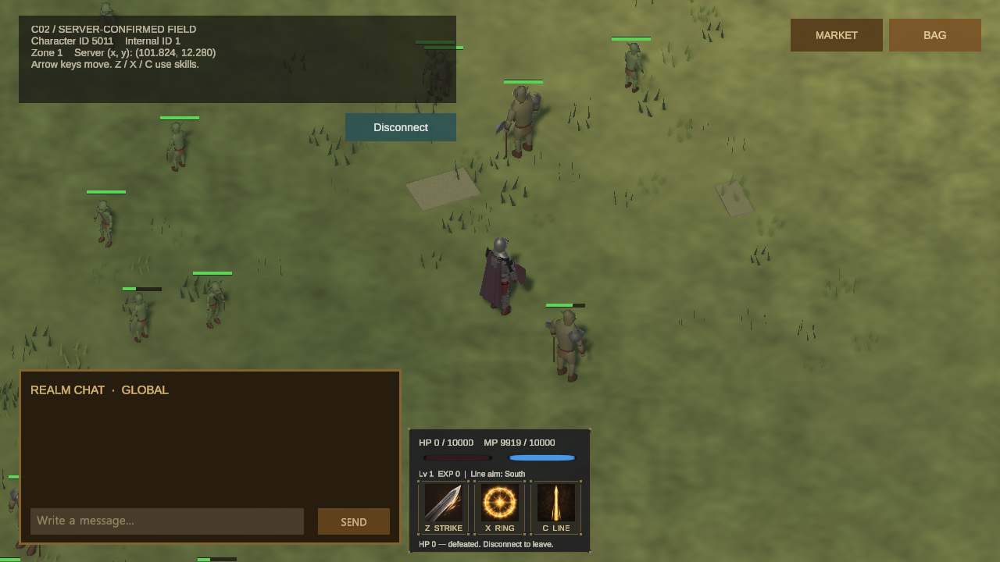
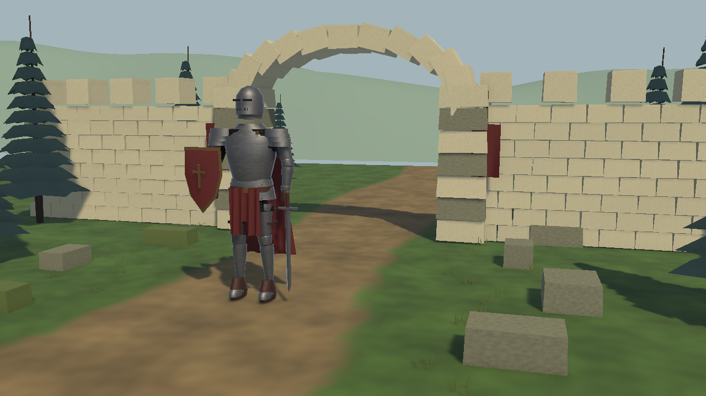
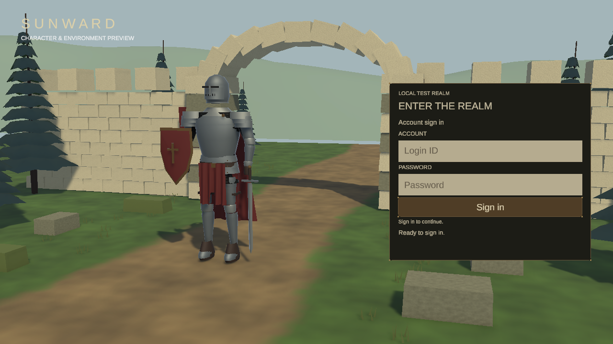
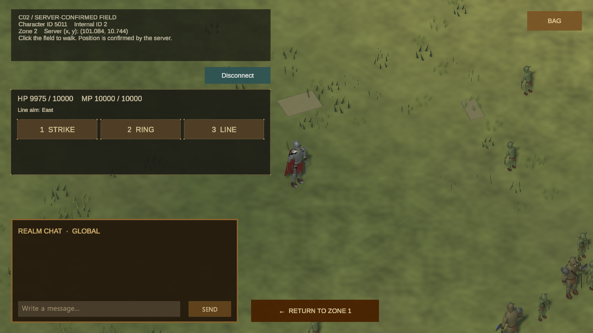

# 로그인과 필드 이동

요약: 로그인·캐릭터 선택·월드 불러오기를 구분하고, 방향키로 쿼터뷰 필드를 탐험하는 화면을 만들고 있습니다.

상태: 중간 결과

## 구현한 기능

- 계정 로그인, 캐릭터 선택, 월드 불러오기 화면을 각각 나눴습니다.
- 서버에서 받은 캐릭터만 선택하며, 입장을 취소하면 로그인 화면으로 돌아갑니다.
- 방향키 이동과 Z·X·C 스킬 입력을 연결하고, 캐릭터 움직임을 부드럽게 이어 표시합니다.
- 기존 좌표를 유지하며 필드를 여섯 구역으로 넓히고, 방향키 이동 중 서버가 구역 전환을 결정하도록 바꿨습니다. 새 구역의 플레이어·몬스터 상태가 모두 준비되면 조작을 다시 엽니다.
- 맵의 장애물과 통로를 Unity에서 편집하고, 서버에도 같은 통행 데이터를 내보낼 수 있게 했습니다.

## 이동 표시 보완 중

위치 보정으로 캐릭터가 반대로 돌아보지 않도록 입력 방향과 보정 이동을 분리하고, 화면이 서버보다 앞서 가는 폭을 줄였습니다. 자동 검증은 마쳤으며 실제 조작감은 아직 확인하지 않았습니다.

## 현재 확인한 범위

실제 로그인과 캐릭터 선택을 거쳐 방향키 이동·정지, 세 스킬의 서버 시전 응답을 확인했습니다. 생존 상태에서 기존 필드에서 북쪽 필드를 거쳐 확장 필드까지 이동했고, 구역을 바꿔도 서버 좌표와 배경이 이어지는 것을 확인했습니다. HUD 위에 마우스를 두어도 방향키로 이동하며, 가방·거래소를 열면 이동을 멈춥니다. 여섯 구역 전체를 왕복한 결과는 아니며 사냥 난이도와 처치 보상 확인은 남아 있습니다. 이전 실행에서는 HP가 0이 되면 이동·공격을 막고 안내와 게이지를 유지하는 것도 확인했습니다.

새 서버 주도 전환과 맵 내보내기는 자동 검증을 마쳤습니다. 새 서버에 접속해 필드 진입과 쓰러진 캐릭터의 조작 차단·로그아웃을 확인했습니다. 생존 상태에서 경계를 넘어 자동으로 구역을 전환하는 확인은 남아 있습니다.

## 화면 기록

### 2026-10-22 — 쓰러진 캐릭터의 필드 진입과 로그아웃

체력이 0인 상태로 접속하면 이동·스킬 입력을 막고 패배 안내를 표시합니다. 로그아웃 버튼을 누르면 연결을 정리하고 로그인 화면으로 돌아갑니다. 이 화면은 생존 이동이나 자동 구역 전환을 확인한 기록은 아닙니다.

### 2026-10-20 — 확장 필드로 이동

방향키로 두 구역 경계를 이동한 뒤의 실제 화면입니다. 하단 HUD 위에 이동 버튼을 배치했고, 체력·마나는 서버에서 받은 값입니다.

### 2026-10-20 — 방향키·스킬 HUD와 사냥 상태

실제 접속에서 이동과 스킬을 사용한 뒤 사냥으로 HP가 0이 된 화면입니다. 방향키와 스킬 입력이 멈추고, 퇴장 안내가 표시되는 것을 확인했습니다. 이후 확대된 체력·마나와 스킬 키 표기는 [전투와 상태 표시](/MMORPG/work/player-hud/)에서 볼 수 있습니다.

### 2026-10-20 — 장비 표면 개선 중

기존 캐릭터에 철과 가죽 질감을 적용했습니다. 에디터의 같은 카메라로 표면을 확인한 중간 결과이며, 새 모델이나 애니메이션을 제작한 화면은 아닙니다.

### 2026-10-20 — 로그인 화면 분리

로그인과 캐릭터 선택을 동시에 나열하던 구성을 나눴습니다. 이 화면은 계정을 입력하기 전의 실제 Unity 화면입니다. 캐릭터와 배경의 외형은 기존 버전이며 개편 중입니다.

### 2026-10-19 — 구역 이동을 확인한 필드 화면

인접 구역으로 이동한 뒤에도 캐릭터와 서버 위치가 이어지는지 확인한 화면입니다.

### 2026-10-19 — 인접 구역으로 이동한 화면

캐릭터가 인접 구역으로 이동한 직후의 화면입니다.
