# 인벤토리

요약: 아이템 확인·포션 사용·장비 장착.
상태: 중간 결과

## 대표 화면

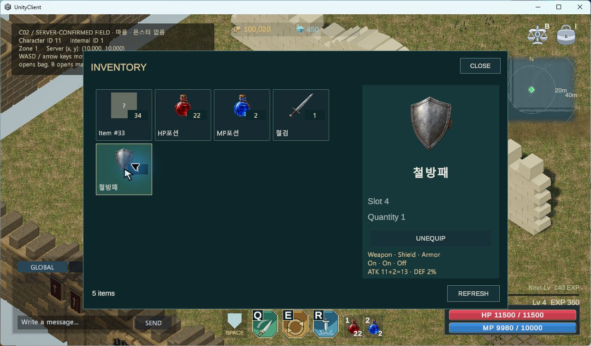

철검·방패 동시 장착 · 서버 재시작 후 유지.

## 구현한 기능

- 서버 데이터의 아이템 이름·분류·효과와 기존 아이콘
- 무기·방패·갑옷 각 1슬롯, 장착·해제와 공격·방어 합계 표시
- 방패 2%·갑옷 3%의 피해 감소, 합산 5%
- 장착품 판매 차단, 가방 수량 보존, 재접속·서버 정상 재시작 후 유지
- 아이템 그림·이름·수량 카드와 선택 항목 상세 정보
- 장착 배지·아이템별 ATK/DEF 효과·두 포션 슬롯의 공용 남은 시간
- 새로고침 뒤 같은 아이템 선택 유지, 수량 갱신, 항목 변경 시 선택 해제
- 월드 진입·귀환 후 HP·MP 포션 바로가기 수량 자동 조회
- I 키로 열고 닫기, Esc로 닫기, 거래소와 패널 상호 배타
- HP 1,500·MP 500 회복, 숫자 1·2로 사용, 공용 쿨타임 6초
- 사망·해당 자원 최대 상태에서 포션 소비 차단
- 빈 가방과 조회 오류 구분, 실패 시 재조회와 새로고침 안내
- 거래소 전환 중 조회 재사용, 늦은 수령·취소 결과 뒤 열린 가방 갱신

## 포션 종류

| 등급 | HP 회복 | MP 회복 | 사용 |
| --- | ---: | ---: | --- |
| 초급 | 1,500 | 500 | 가방·1/2키 |
| 중급 | 3,000 | 1,000 | 가방 |
| 상급 | 4,500 | 1,500 | 가방 |

공용 쿨타임 6초. 중·상급의 상점·획득 경로는 추가하지 않았습니다.

## 현재 확인한 범위

철검·방패의 구매·수령·장착·판매 차단·서버 재시작 복원·해제를 실제 게임에서 확인했습니다. 포션 사용·수량 표시도 기존 구현을 유지합니다.

갑옷과 합산 방어·피해 판정은 자동 검사로 확인했습니다. 갑옷 실전 장착과 실제 전투 피해 측정은 이번 확인에 포함하지 않았습니다.

등급 포션은 서버 사용·콘텐츠 공유·가방 사용을 자동 검사로 확인했습니다. 새 포션의 실제 보유·소비 검증은 하지 않았습니다.

## 화면 기록

### 2026-11-07 — 등급 포션과 장착 상태 미리보기

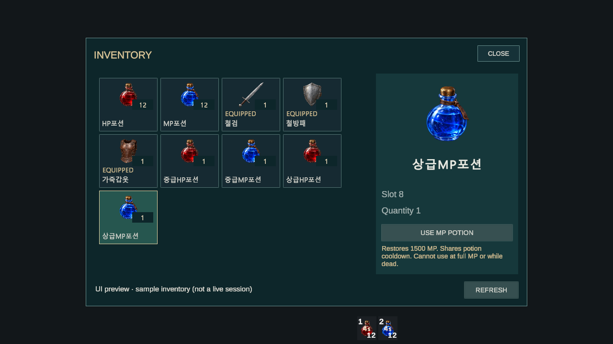

샘플 UI 미리보기 · 실제 보유·거래·소비 화면 아님.

### 2026-11-06 — 방패 장착과 저장 복원

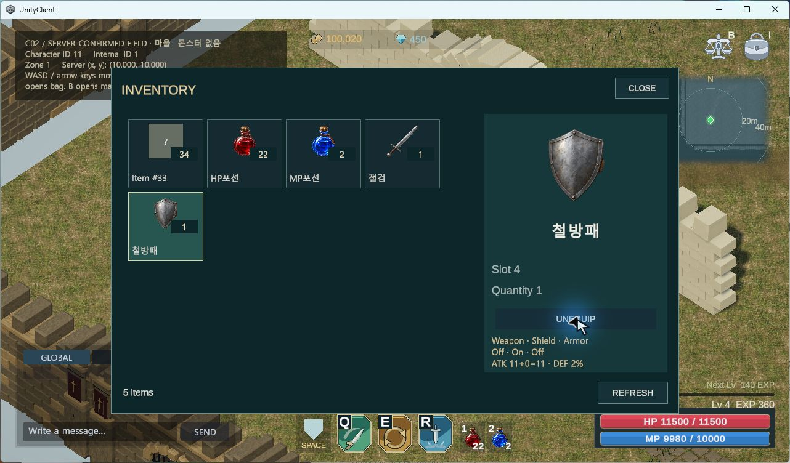

수량1 유지, 해제하면 방어0%로 복귀.

### 2026-11-06 — 철검 장착·재접속 유지

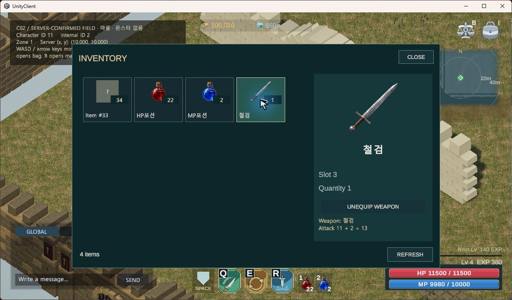

수량1 유지, 해제하면 기본 공격력11로 복귀.

### 2026-11-04 — 가방을 열지 않고 포션 수량 확인

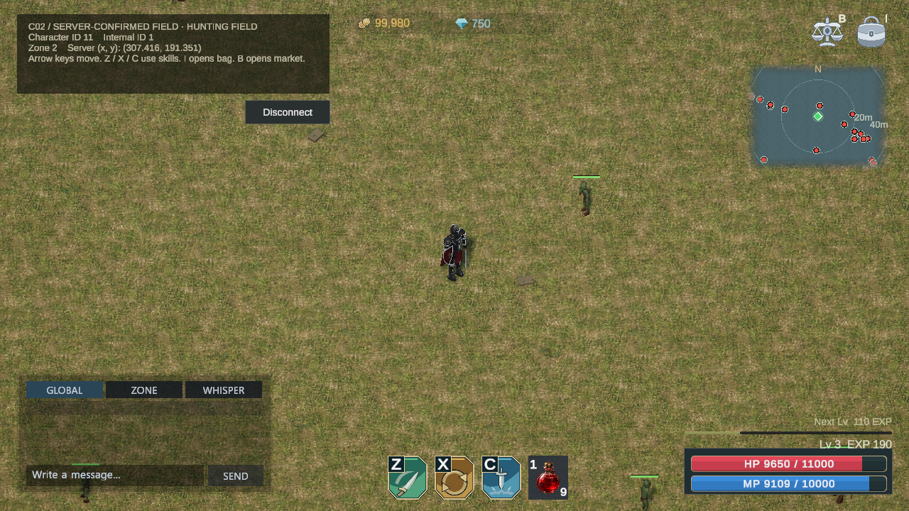

초기 조회 실패 뒤 한 번 재조회해 확정 수량 표시.

### 2026-11-04 — 아이템 사용 안내

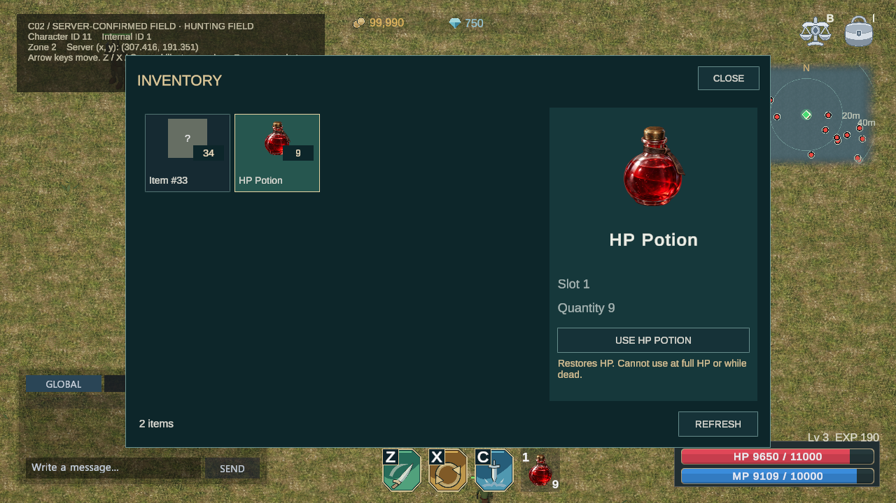

HP 포션 사용 안내, 미지원 아이템 구분.

### 2026-10-29 — 사냥 보상과 포션 사용

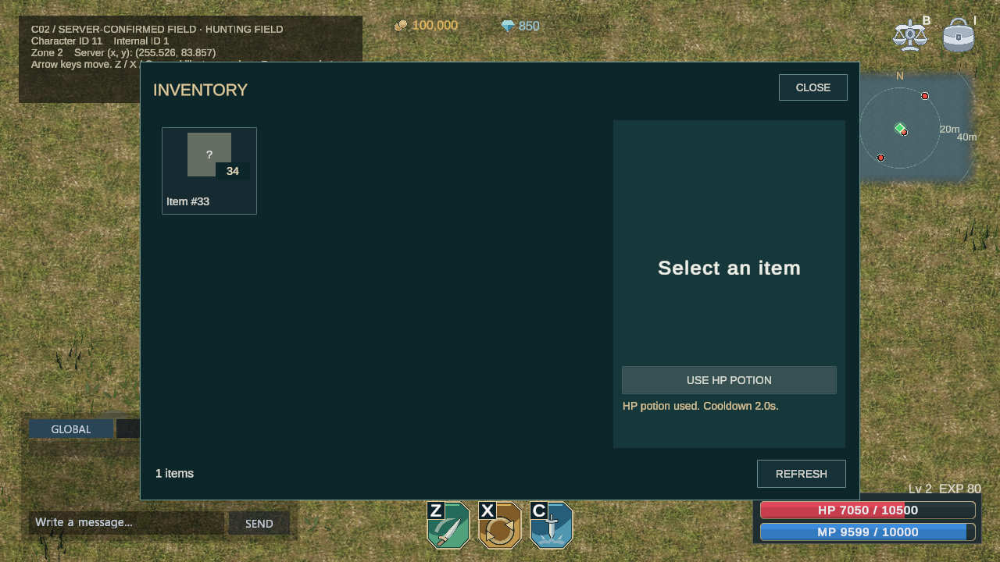

일반 몬스터를 처치해 레벨 1에서 2로 성장하고 포션 1개를 얻었습니다.

### 2026-10-27 — 거래 뒤 실제 포션 수령

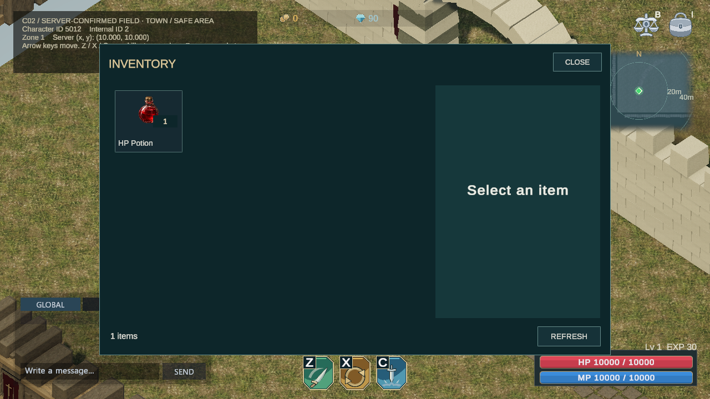

전용 테스트 캐릭터 간 거래로 포션 1개를 구매했습니다.

### 2026-10-27 — 실제 서버의 빈 가방 재조회

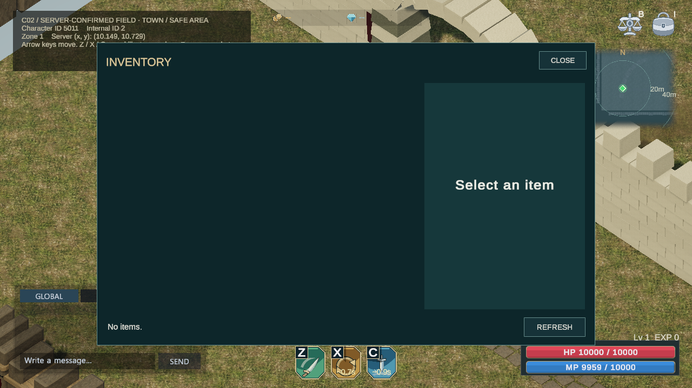

첫 조회가 실패한 뒤 다시 조회해 빈 목록을 받았습니다. 아래의 아이템이 든 디자인 예시와 달리 실제 계정의 응답을 그대로 표시한 화면입니다.

### 2026-10-26 — 청록 선택 면과 밝은 아이템

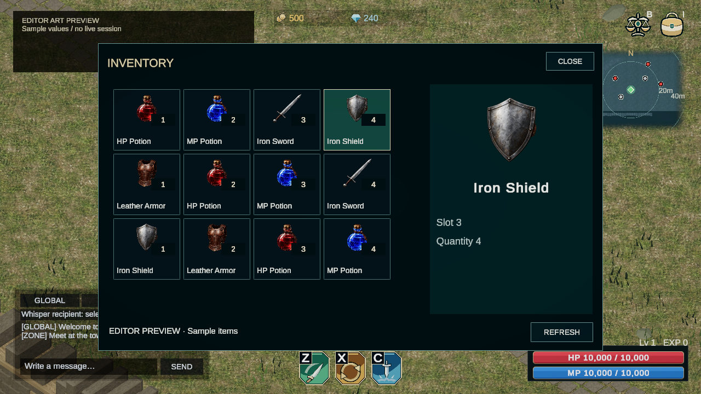

비교 후 고른 청록색 스타일을 적용했습니다. 아이템 그림·이름·수량은 현재 UI로 렌더한 샘플이며 실제 계정의 가방 조회 결과는 아닙니다.

### 2026-10-25 — 그림과 이름 중심 상세

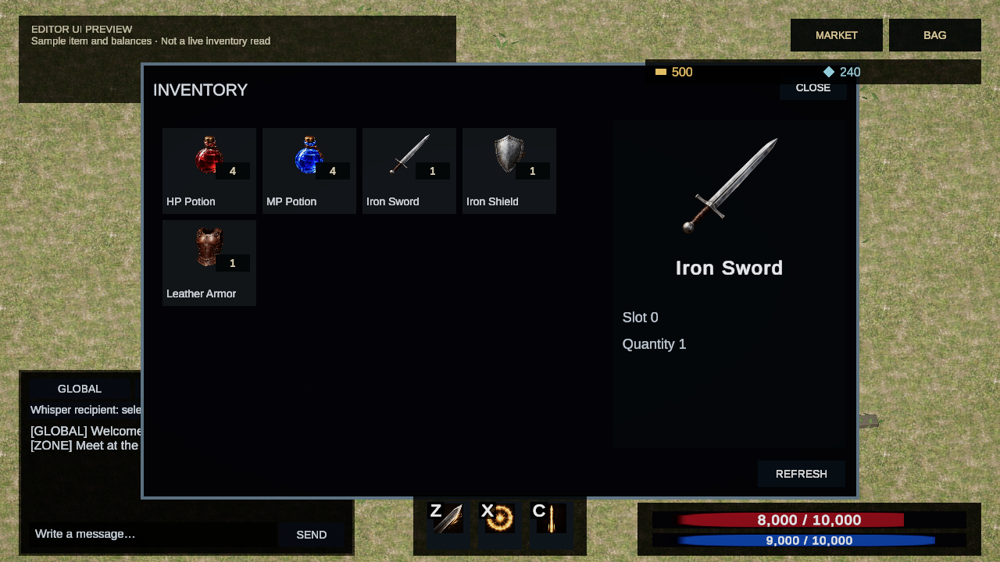

그리드와 오른쪽 상세 배치를 유지하고 그림·이름을 먼저 읽도록 정리했습니다. 기존 아이템 5종을 넣은 에디터 예시이며 수량·재화는 샘플입니다.

### 2026-10-25 — 가방 열기와 거래소 전환

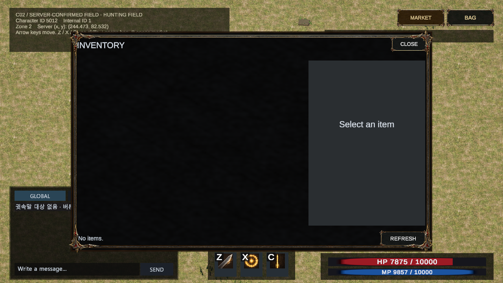

실제 서버 세션에서 I로 가방을 열고 B로 거래소에 전환한 뒤 Esc로 닫았습니다.

### 2026-10-25 — 그리드와 오른쪽 상세

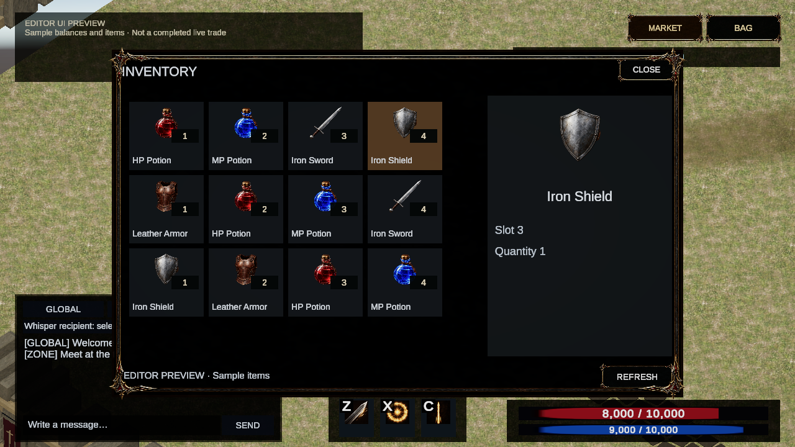

일괄 비교에서 고른 배치입니다. 실제 Scene을 촬영한 에디터 미리보기이며 아이템은 예시입니다.

### 2026-10-21 — 가방 배치와 거래소 전환

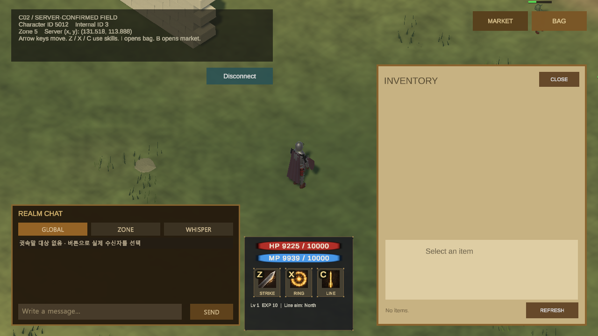

I 키로 가방을 조회하고 B 키로 거래소에 전환해 두 창이 겹치지 않는지 확인했습니다.

### 2026-10-20 — I 키로 연 현재 가방

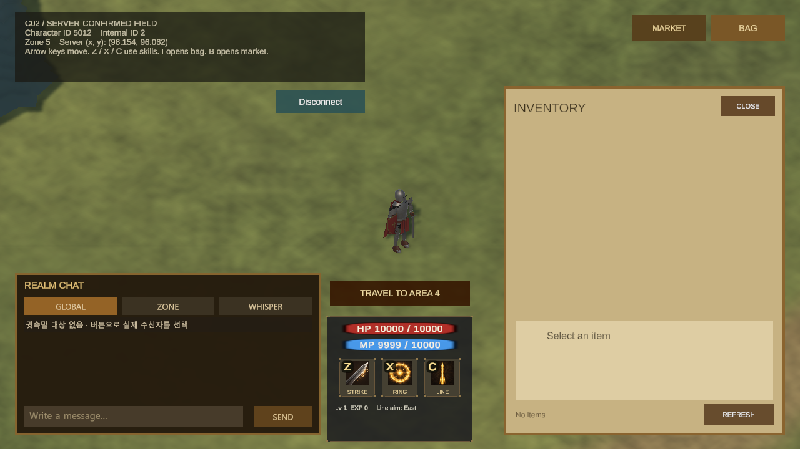

가방을 열어 첫 서버 응답으로 빈 목록을 확인했습니다. 조회 실패 후 한 번 다시 확인하는 동작은 자동 검증으로 확인했으며, 이 화면은 재조회가 발생한 장면은 아닙니다.

### 2026-10-19 — 서버가 반환한 빈 가방

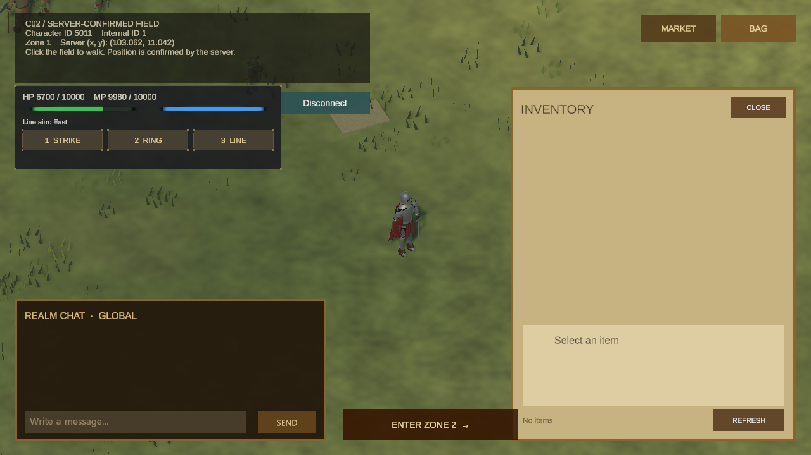

새로고침 후 서버의 빈 결과를 표시했습니다. 아이템이 든 가방의 실제 화면은 아닙니다.

### 이전 화면 — 조회 실패 안내

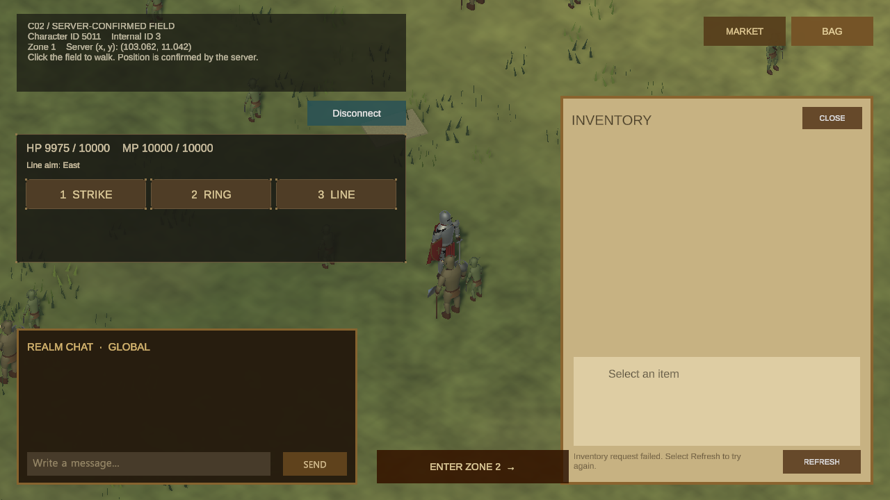

빈 목록을 확인하기 전의 응답 상태입니다.
