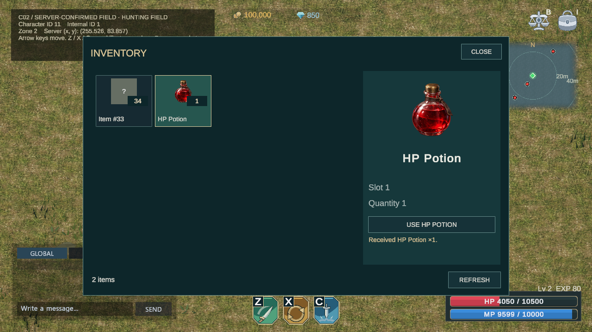

# 인벤토리

요약: 아이템을 살펴보고, 사냥으로 얻은 포션을 사용해 체력을 회복하는 가방 화면입니다.
상태: 중간 결과

## 대표 화면

몬스터를 처치해 레벨이 오른 뒤 HP 포션을 선택한 실제 게임 화면입니다. 포션 그림·이름·수량과 사용 버튼을 함께 확인할 수 있습니다.

## 구현한 기능

- 아이템 그림·이름·수량 카드와 선택 항목 상세 정보
- 새로고침 뒤 같은 아이템 선택 유지, 수량 갱신, 항목 변경 시 선택 해제
- 월드 진입 후 HP·MP 포션 바로가기 수량 확인
- I 키로 열고 닫기, Esc로 닫기, 거래소와 패널 상호 배타
- HP·MP 포션: 각각 3,000 회복, 숫자 1·2로 사용, 공용 쿨타임 2초
- 사망·해당 자원 최대 상태에서 포션 소비 차단
- 빈 가방과 조회 오류 구분, 실패 시 재조회와 새로고침 안내
- 거래소 전환 중 조회 재사용, 늦은 수령·취소 결과 뒤 열린 가방 갱신

## 현재 확인한 범위

실제 거래 포션 수령과 사냥 보상 포션 사용 뒤 HP 회복·수량 감소를 확인하고, 재접속 후 상태 보존도 확인했습니다. I/B/Esc 전환과 선택·갱신·오류 복구는 각각 실제 입력 또는 자동 검사로 확인했습니다.
MP 포션과 두 슬롯·공유 쿨타임은 자동 검사로 확인했으며, 최신 묶음의 실제 게임 확인은 진행 중입니다.
아이템 장착은 제공하지 않습니다.

## 화면 기록

### 2026-11-04 — 가방을 열지 않고 포션 수량 확인

초기 조회 실패 뒤 한 번 재조회해 확정 수량 표시.

### 2026-11-04 — 아이템 사용 안내

HP 포션 사용 안내, 미지원 아이템 구분.

### 2026-10-29 — 사냥 보상과 포션 사용

일반 몬스터를 처치해 레벨 1에서 2로 성장하고 포션 1개를 얻었습니다.

### 2026-10-27 — 거래 뒤 실제 포션 수령

전용 테스트 캐릭터 간 거래로 포션 1개를 구매했습니다.

### 2026-10-27 — 실제 서버의 빈 가방 재조회

첫 조회가 실패한 뒤 다시 조회해 빈 목록을 받았습니다. 아래의 아이템이 든 디자인 예시와 달리 실제 계정의 응답을 그대로 표시한 화면입니다.

### 2026-10-26 — 청록 선택 면과 밝은 아이템

비교 후 고른 청록색 스타일을 적용했습니다. 아이템 그림·이름·수량은 현재 UI로 렌더한 샘플이며 실제 계정의 가방 조회 결과는 아닙니다.

### 2026-10-25 — 그림과 이름 중심 상세

그리드와 오른쪽 상세 배치를 유지하고 그림·이름을 먼저 읽도록 정리했습니다. 기존 아이템 5종을 넣은 에디터 예시이며 수량·재화는 샘플입니다.

### 2026-10-25 — 가방 열기와 거래소 전환

실제 서버 세션에서 I로 가방을 열고 B로 거래소에 전환한 뒤 Esc로 닫았습니다.

### 2026-10-25 — 그리드와 오른쪽 상세

일괄 비교에서 고른 배치입니다. 실제 Scene을 촬영한 에디터 미리보기이며 아이템은 예시입니다.

### 2026-10-21 — 가방 배치와 거래소 전환

I 키로 가방을 조회하고 B 키로 거래소에 전환해 두 창이 겹치지 않는지 확인했습니다.

### 2026-10-20 — I 키로 연 현재 가방

가방을 열어 첫 서버 응답으로 빈 목록을 확인했습니다. 조회 실패 후 한 번 다시 확인하는 동작은 자동 검증으로 확인했으며, 이 화면은 재조회가 발생한 장면은 아닙니다.

### 2026-10-19 — 서버가 반환한 빈 가방

새로고침 후 서버의 빈 결과를 표시했습니다. 아이템이 든 가방의 실제 화면은 아닙니다.

### 이전 화면 — 조회 실패 안내

빈 목록을 확인하기 전의 응답 상태입니다.
