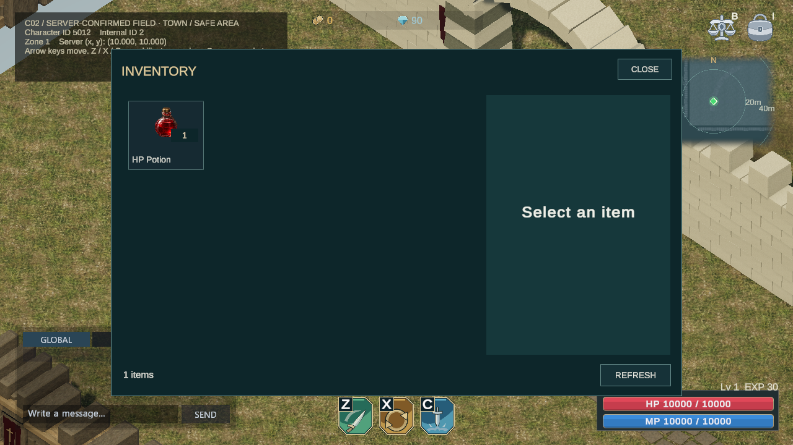
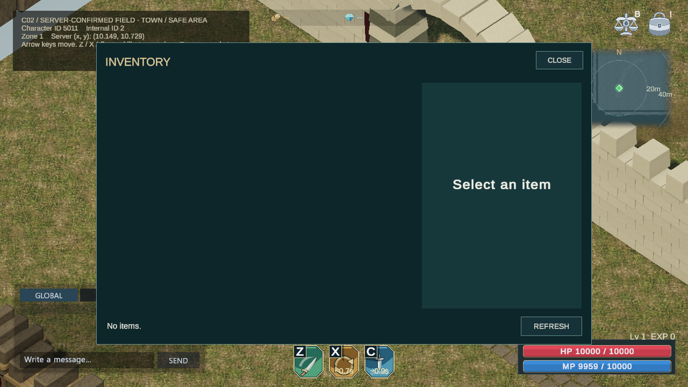
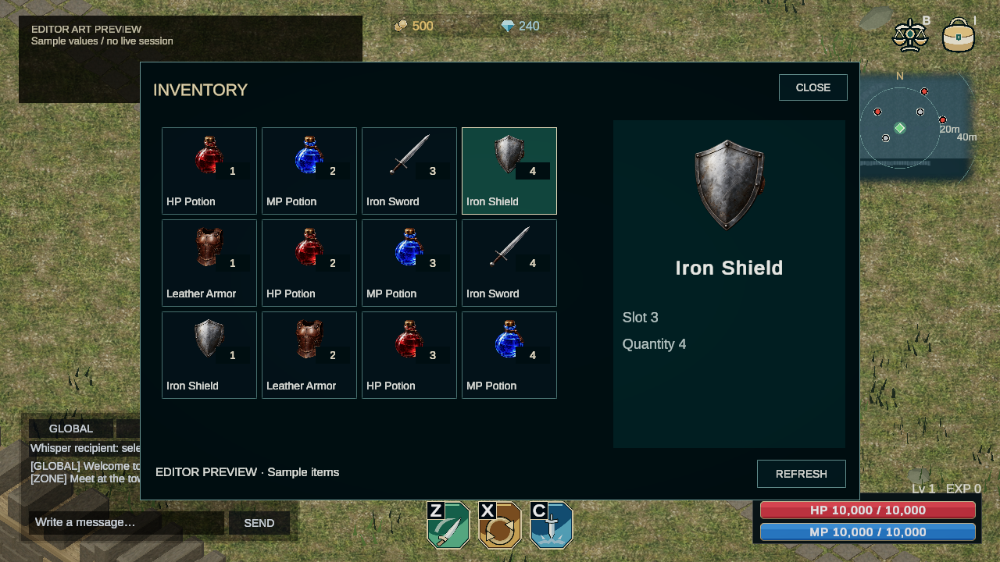
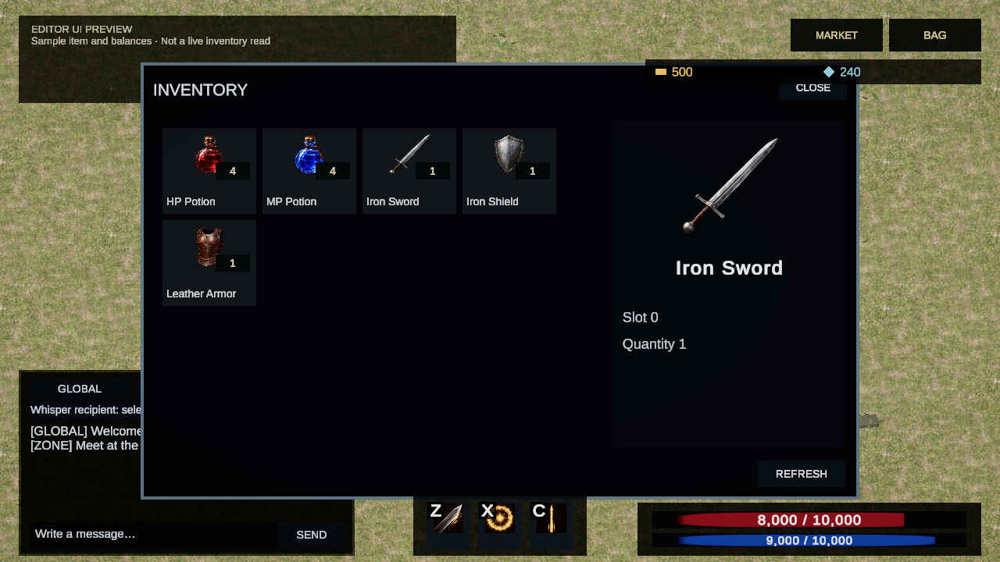
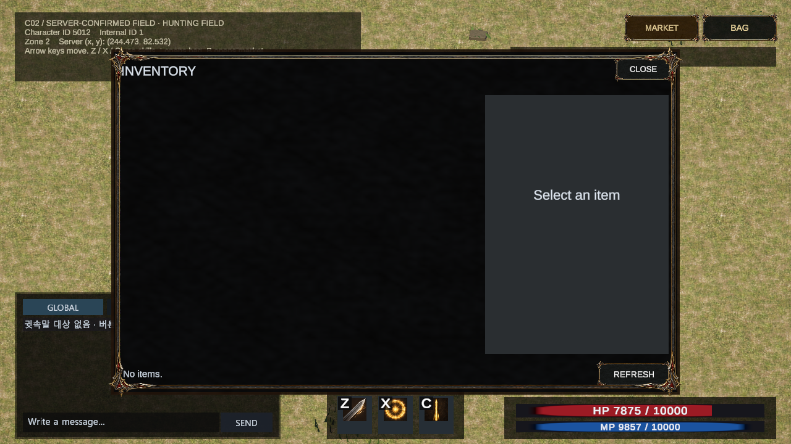
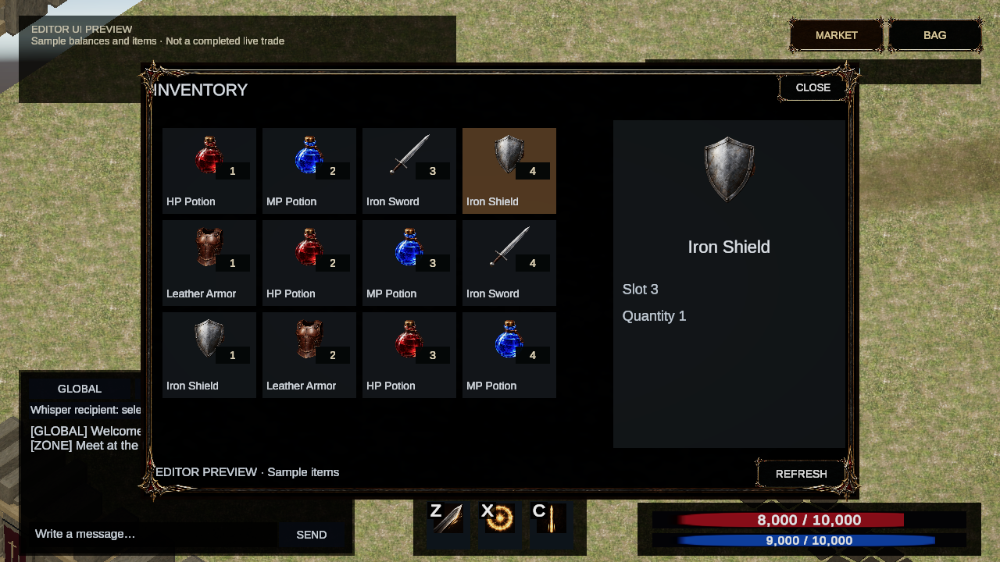
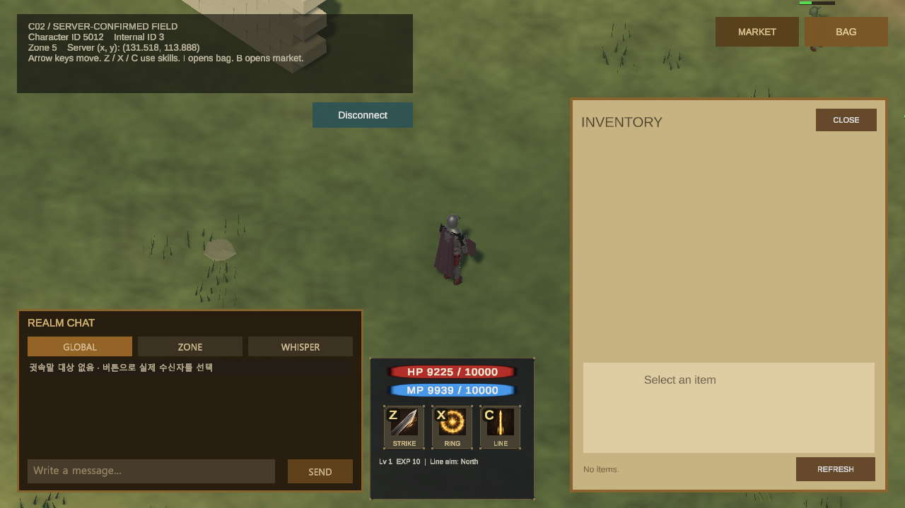
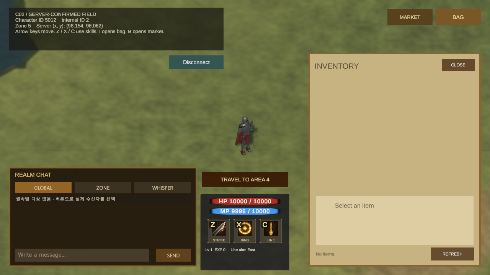
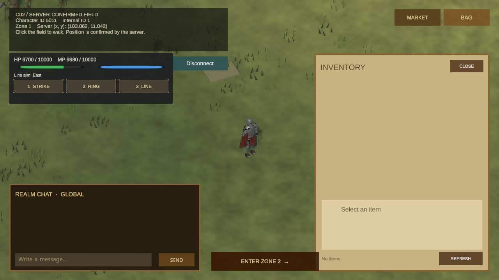
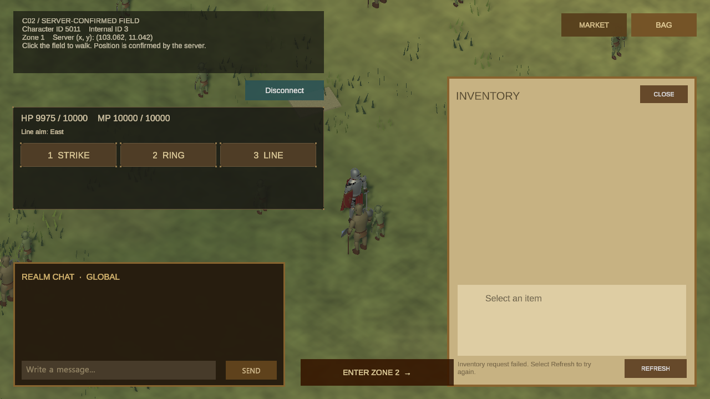

# 인벤토리

요약: 아이템 그림과 수량을 살펴보고, 선택한 항목의 정보를 확인하는 가방 화면입니다.
상태: 중간 결과

## 대표 화면

전용 테스트 캐릭터 간 거래로 포션 1개를 구매·수령한 실제 화면입니다. 검증 뒤 테스트 데이터는 원래 상태로 복원했습니다.

## 구현한 기능

AI Agent 작업에서 Unity 인벤토리 화면과 서버 조회를 새로 연결했습니다. 직접 구현한 기존 2D 클라이언트에는 인벤토리 화면이 없었습니다.

- 아이템 그림·이름·수량을 카드로 보여주고, 선택 항목은 오른쪽 상세 영역에서 확인합니다.
- 새로고침 후 같은 아이템의 선택을 유지하고 최신 수량을 보여줍니다. 아이템이 사라지거나 바뀌면 선택을 해제합니다.
- I 키로 열고 닫으며 Esc로 닫을 수 있습니다. 거래소와 동시에 띄우지 않습니다.
- 서버의 빈 가방 결과와 조회 오류를 구분합니다. 오류 뒤 한 번 다시 조회하고, 계속 실패하면 새로고침을 안내합니다.

가방과 거래소 판매 화면을 빠르게 전환해도 같은 조회를 재사용합니다. 아이템 수령·판매 취소가 뒤늦게 완료되면 열린 가방에 최신 목록을 반영합니다.

## 현재 확인한 범위

실제 거래로 받은 포션 1개가 가방에 표시되고, I·B·Esc로 가방·거래소 전환과 닫기가 동작하는 것을 확인했습니다. 선택 유지·수량 갱신·조회 오류 복구와 패널 전환 중 목록 갱신은 자동 검사로 확인했습니다.

다섯 아이템의 그림과 표시 정보를 연결했습니다. 아이템 사용·장착은 아직 제공하지 않습니다. 이전 빈 가방과 조회 오류, 후속 거래의 수령 결과는 화면 이력에 보존했습니다.

## 화면 기록

### 2026-10-27 — 거래 뒤 실제 포션 수령

전용 테스트 캐릭터 간 거래로 포션 1개를 구매했습니다. 첫 배송이 준비 중으로 끝나 수령을 다시 요청한 뒤 실제 가방에 도착한 것을 확인했습니다. 이 검증은 앞선 빈 가방 결과 이후 진행됐습니다.

### 2026-10-27 — 실제 서버의 빈 가방 재조회

첫 조회가 실패한 뒤 다시 조회해 빈 목록을 받았습니다. 아래의 아이템이 든 디자인 예시와 달리 실제 계정의 응답을 그대로 표시한 화면입니다.

### 2026-10-26 — 청록 선택 면과 밝은 아이템

비교 후 고른 청록색 스타일을 적용했습니다. 4열 그리드와 오른쪽 상세를 유지하고, 선택한 아이템의 면과 외곽을 강조합니다. 아이템 그림·이름·수량은 현재 UI로 렌더한 샘플이며 실제 계정의 가방 조회 결과는 아닙니다.

### 2026-10-25 — 그림과 이름 중심 상세

그리드와 오른쪽 상세 배치를 유지하고 그림·이름을 먼저 읽도록 정리했습니다. 기존 아이템 5종을 넣은 에디터 예시이며 수량·재화는 샘플입니다. 실서버 보유 목록이나 거래 성공 화면은 아닙니다.

### 2026-10-25 — 가방 열기와 거래소 전환

실제 서버 세션에서 I로 가방을 열고 B로 거래소에 전환한 뒤 Esc로 닫았습니다. 창이 겹치지 않았고 캐릭터 위치도 유지됐습니다. 키 입력은 Unity 입력 시스템을 통한 자동 조작입니다. 가방은 실제 빈 목록이며 아이템 보유 화면의 검증을 대신하지 않습니다.

### 2026-10-25 — 그리드와 오른쪽 상세

일괄 비교에서 고른 배치입니다. 선택 카드는 색으로 구분하고 아이템 그림·이름·슬롯·수량은 오른쪽에 모았습니다. 실제 Scene을 촬영한 에디터 미리보기이며 아이템은 예시입니다. 아이템이 든 가방의 실서버 검증을 대신하지 않습니다.

### 2026-10-21 — 가방 배치와 거래소 전환

I 키로 가방을 조회하고 B 키로 거래소에 전환해 두 창이 겹치지 않는지 확인했습니다. 아이템 그림·수량·선택 상세의 배치는 별도 UI 검증으로 확인했으며, 실제 계정의 가방은 비어 있어 이 화면에 보유 아이템을 추가하지 않았습니다.

### 2026-10-20 — I 키로 연 현재 가방

가방을 열어 첫 서버 응답으로 빈 목록을 확인했습니다. 조회 실패 후 한 번 다시 확인하는 동작은 자동 검증으로 확인했으며, 이 화면은 재조회가 발생한 장면은 아닙니다.

### 2026-10-19 — 서버가 반환한 빈 가방

새로고침 후 서버의 빈 결과를 표시했습니다. 아이템이 든 가방의 실제 화면은 아닙니다.

### 이전 화면 — 조회 실패 안내

빈 목록을 확인하기 전의 응답 상태입니다. 거래소 화면에서 분리해 인벤토리 조회 이력으로 보존합니다.
