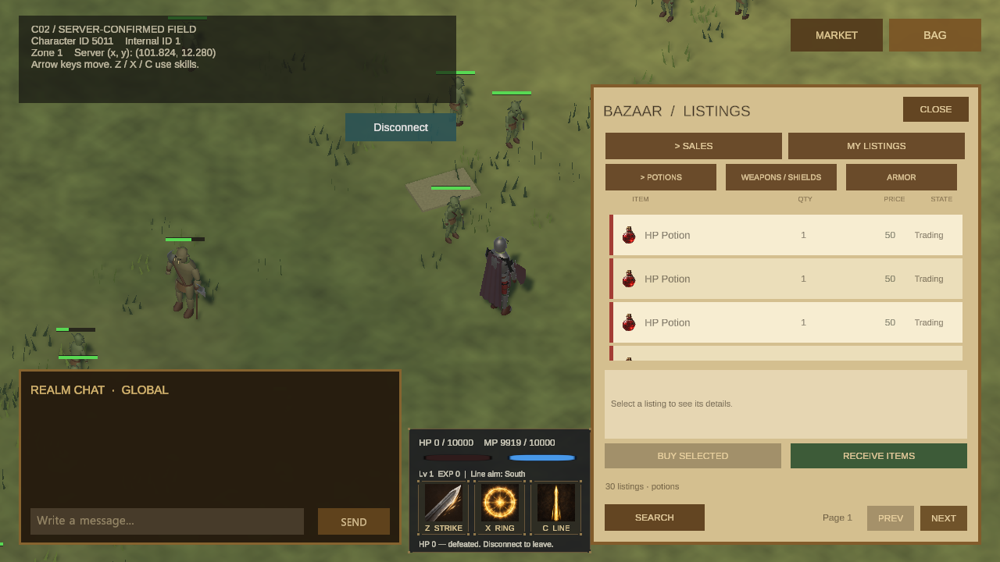
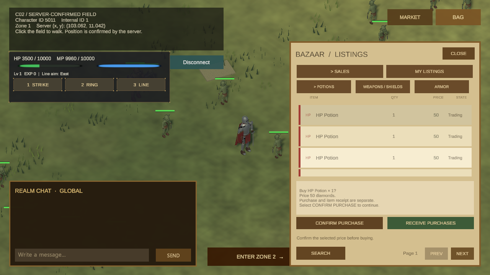
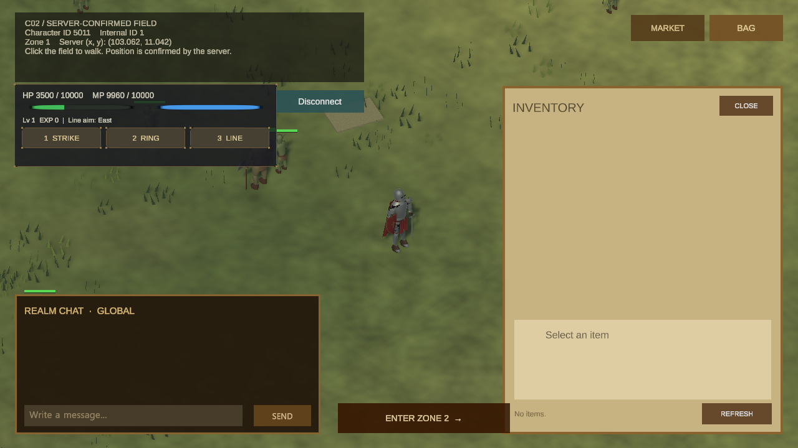
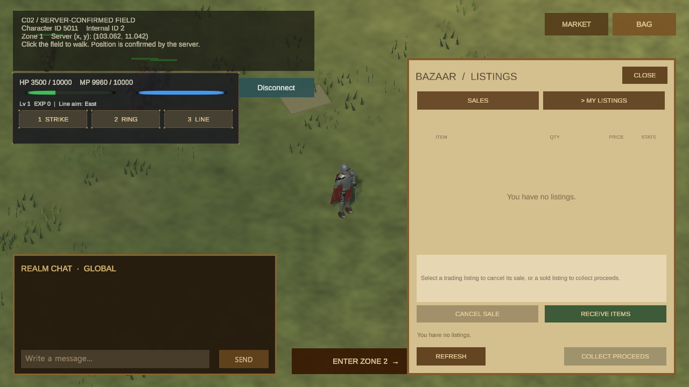
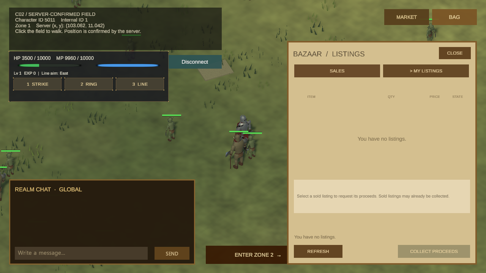
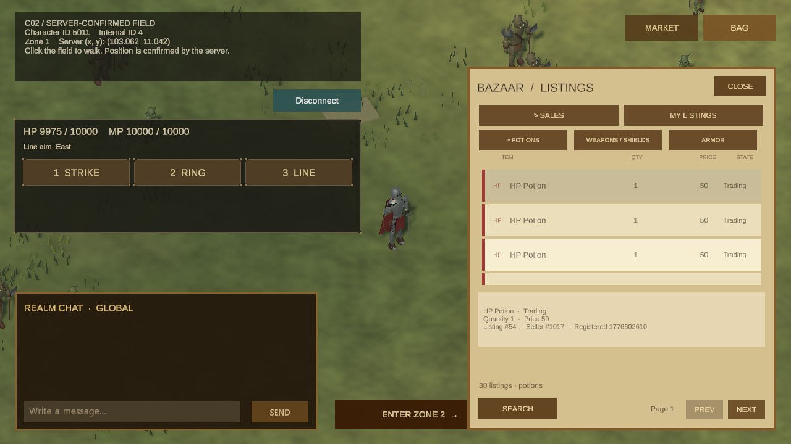
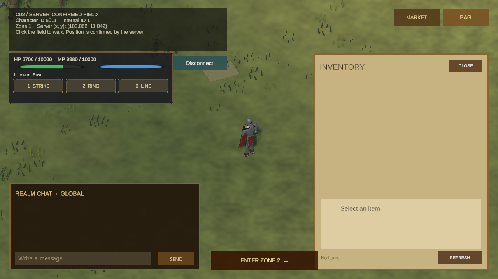
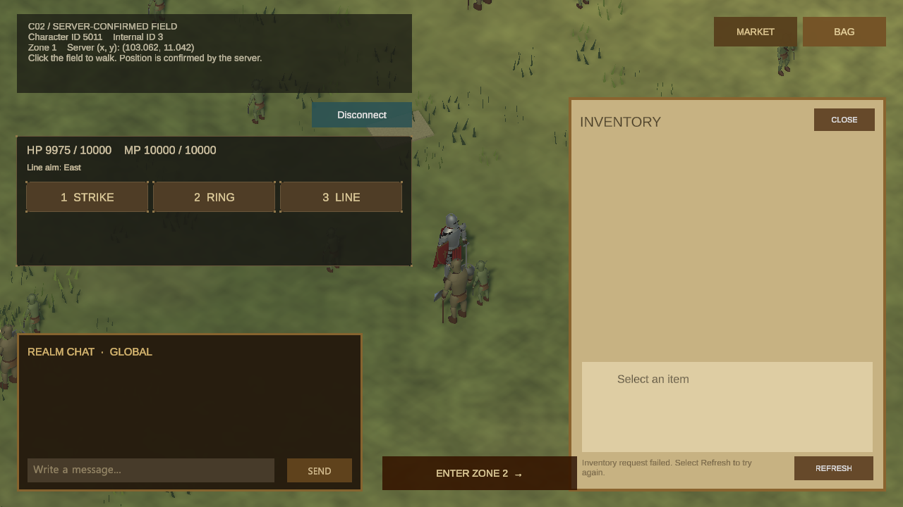
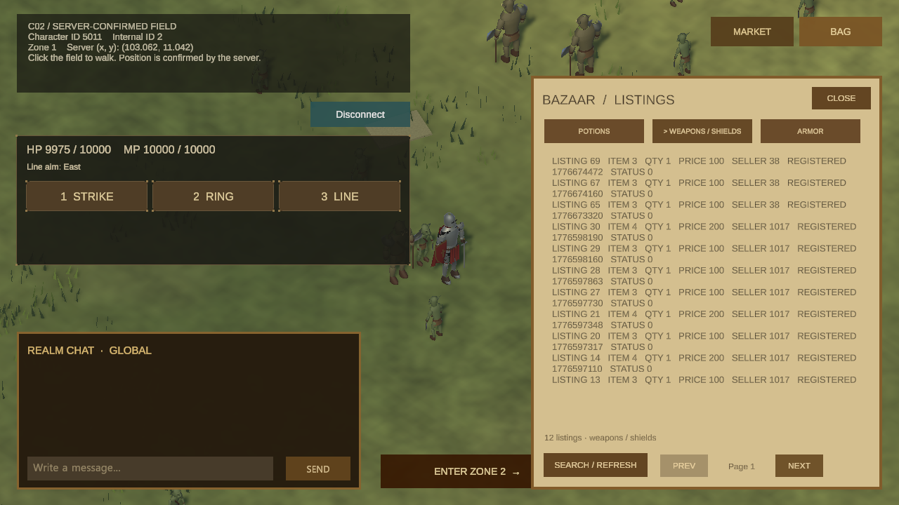

# 아이템과 거래소 화면

요약: 인벤토리와 거래소 매물을 살펴보고, 가격을 확인해 구매를 요청한 뒤 구매품을 별도로 수령하는 흐름을 연결했습니다.
상태: 중간 결과

## 구현한 기능

- 인벤토리 — 5종 아이템 카드·상세 정보·I 키 열기와 닫기
- 거래소 — 종류·페이지별 매물과 판매자·등록 정보
- 내 매물 — 현재 캐릭터 매물·새로고침·판매 검색 복귀
- 구매 — 가격 확인, 서버 완료와 가방 반영 구분
- 판매 취소·아이템 반환·대금 수령 — 요청별 서버 결과, 등록비 미환급
- 불명확한 거래 결과 보존과 자동 구매·취소 재요청 방지
- 화면 전환 — B 키 열기와 닫기, 가방·거래소 중 하나만 표시

## 현재 확인한 범위

실제 서버의 매물·내 매물·가격·재화 부족·빈 수령함을 확인했고, 성공 거래·취소·아이템 반환은 자동 검사로 확인했습니다. 아이템 사용·장착과 거래 등록은 지원하지 않습니다.

## 화면 기록

### 2026-10-20 — 아이템 그림과 게임 HUD

서버에서 받은 매물에 아이템 그림을 붙였습니다.

### 2026-10-20 — 매물 가격 확인과 구매 요청

선택한 매물의 가격을 확인하는 단계입니다. 실제 구매 요청은 재화 부족으로 거절되어 구매 완료 화면이 아닙니다.

### 2026-10-20 — 구매품 수령 뒤 가방 재조회

이번 수령 응답은 0건이었고 가방을 다시 조회해 빈 결과를 확인했습니다. 실제 구매품을 받은 장면은 아닙니다.

### 2026-10-20 — 내 매물 판매 취소와 아이템 수령

판매 취소와 아이템 수령을 나누어 표시합니다. 이 계정에는 본인 매물이 없어 취소 성공·아이템 반환 장면은 아직 확인하지 못했습니다.

### 2026-10-20 — 내 매물 대금 수령 결과

실제 서버가 빈 내 매물 결과를 반환해 수령 버튼이 비활성화된 화면입니다.

### 2026-10-19 — 거래소 매물 선택 상세

실제 서버 매물 목록에서 항목을 선택해 상세 정보를 확인한 화면입니다.

### 2026-10-19 — 서버에서 확인한 빈 인벤토리

첫 조회를 새로고침한 뒤 서버의 빈 결과가 화면에 표시됐습니다.

### 이전 화면 — 인벤토리 첫 조회 실패

새로고침으로 빈 목록을 확인하기 전의 응답 상태입니다.

### 이전 화면 — 거래소 조회 첫 버전

초기 숫자 목록 화면은 이전 이력으로 보존합니다.
