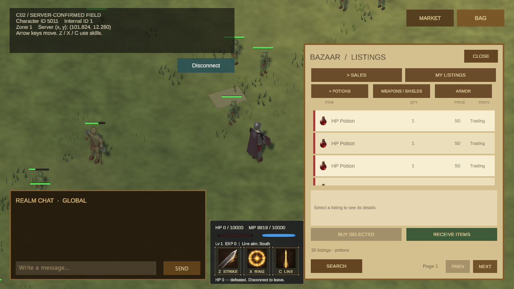
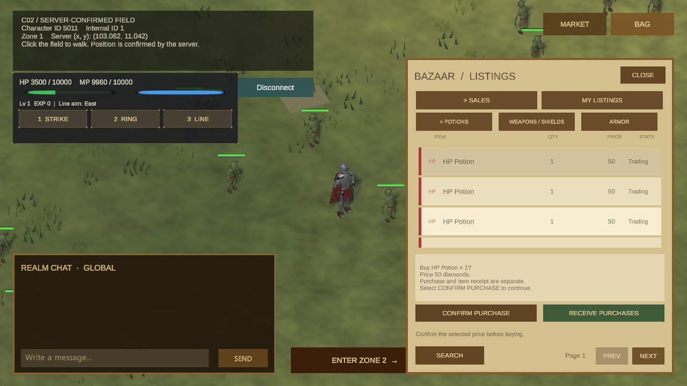
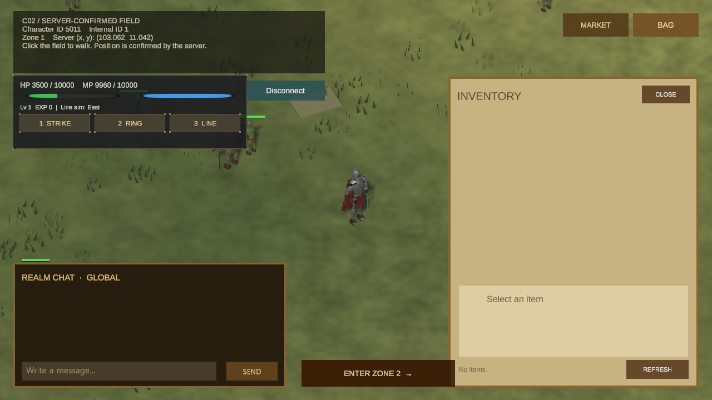
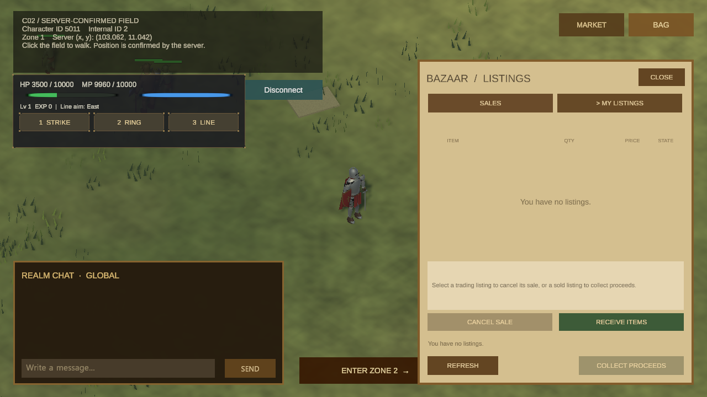
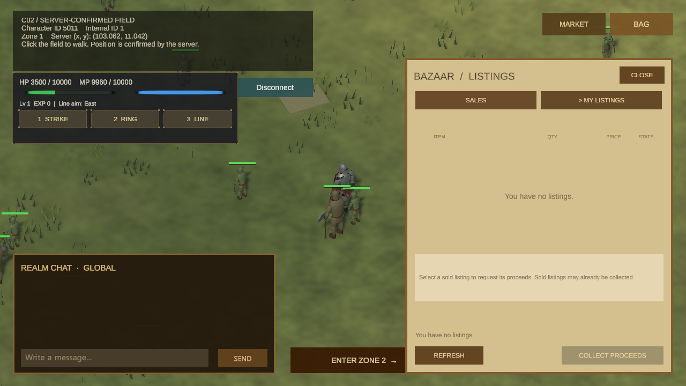
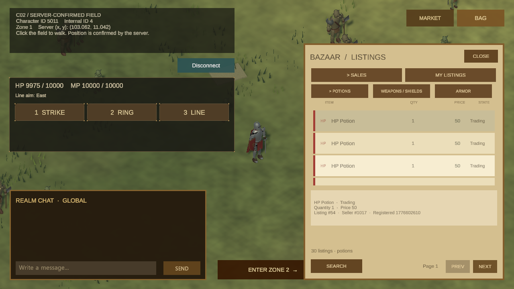

# 아이템과 거래소 화면

요약: 인벤토리와 거래소 매물을 살펴보고, 가격을 확인해 구매를 요청한 뒤 구매품을 별도로 수령하는 흐름을 연결했습니다.
상태: 중간 결과

## 구현한 기능

- 인벤토리: 기존 다섯 아이템의 그림·이름·수량을 카드로 표시하고, 선택하면 상세 영역에 표시합니다. I 키로 열고 닫습니다.
- 거래소: 아이템 종류와 페이지로 매물을 조회하고, 목록에서 수량·가격·판매 상태를 확인합니다. 매물을 선택하면 판매자와 등록 정보를 보여줍니다.
- 내 매물: 현재 캐릭터의 매물만 따로 조회하고 새로고침하거나 판매 검색으로 돌아갑니다.
- 대금 수령: 판매된 내 매물을 선택해 수령 요청을 보내고 서버 결과를 표시합니다. 응답이 확인되지 않으면 완료 처리나 자동 재요청을 하지 않습니다.
- 구매와 구매품 수령: 선택 매물의 가격을 확인한 뒤 구매를 요청하고, 구매 완료와 가방 반영을 따로 확인합니다. 결과가 불명확할 때 자동 구매하지 않습니다.
- 판매 취소와 반환: 판매 중인 내 매물을 확인 후 취소하고, 아이템 반환은 수령과 가방 조회로 따로 확인합니다. 등록비는 환급하지 않으며 결과가 불명확하면 자동으로 다시 취소하지 않습니다.
- 화면 전환: B 키로 거래소를 열며 가방과 거래소 중 하나만 표시합니다. 채팅 입력 중에는 I/B로 창이 바뀌지 않습니다.

## 현재 확인한 범위

거래소 목록·내 매물·가격 확인과 재화 부족 결과, 빈 수령함·가방을 실제 서버에서 확인했습니다. 본인 매물이 없을 때 판매 취소 버튼이 비활성화되는 것도 확인했으며, 성공 거래·취소·아이템 반환은 자동 검증으로 확인했습니다. 아이템 사용·장착과 거래 등록은 지원하지 않습니다.

## 화면 기록

### 2026-10-20 — 아이템 그림과 게임 HUD

서버에서 받은 매물에 아이템 그림을 붙였습니다. 가방은 빈 목록으로 확인했으며, 아이템이 들어 있는 가방의 실제 화면 확인은 남아 있습니다.

### 2026-10-20 — 매물 가격 확인과 구매 요청

선택한 매물의 가격을 확인하는 단계입니다. 실제 구매 요청은 재화 부족으로 거절되어 구매 완료 화면이 아닙니다.

### 2026-10-20 — 구매품 수령 뒤 가방 재조회

이번 수령 응답은 0건이었고 가방을 다시 조회해 빈 결과를 확인했습니다. 실제 구매품을 받은 장면은 아닙니다.

### 2026-10-20 — 내 매물 판매 취소와 아이템 수령

판매 취소와 아이템 수령을 나누어 표시합니다. 이 계정에는 본인 매물이 없어 취소 성공·아이템 반환 장면은 아직 확인하지 못했습니다.

### 2026-10-20 — 내 매물 대금 수령 결과

실제 서버가 빈 내 매물 결과를 반환해 수령 버튼이 비활성화된 화면입니다. 지급 성공 장면은 아니며, 실서버 지급 경로는 아직 확인되지 않았습니다.

### 2026-10-19 — 거래소 매물 선택 상세

실제 서버 매물 목록에서 항목을 선택해 상세 정보를 확인한 화면입니다.

### 2026-10-19 — 서버에서 확인한 빈 인벤토리

첫 조회를 새로고침한 뒤 서버의 빈 결과가 화면에 표시됐습니다. 실제 아이템이 있는 목록은 확인하지 않았습니다.

### 이전 화면 — 인벤토리 첫 조회 실패

새로고침으로 빈 목록을 확인하기 전의 응답 상태입니다. 이전 화면 기록으로 보존합니다.

### 이전 화면 — 거래소 조회 첫 버전

초기 숫자 목록 화면은 이전 이력으로 보존합니다.
