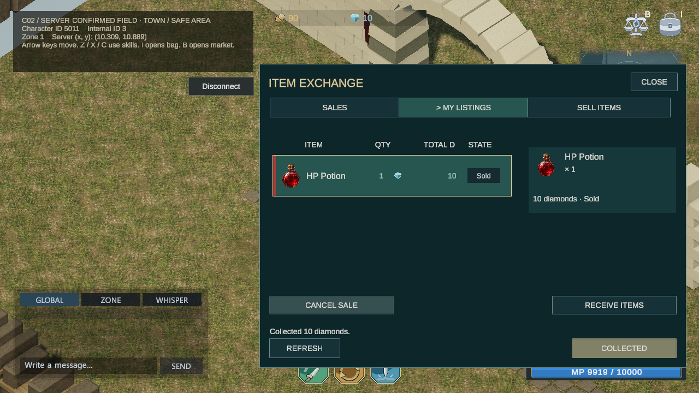
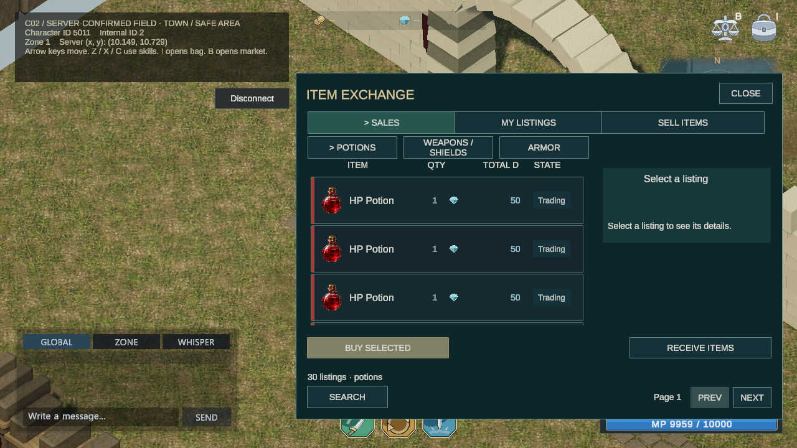
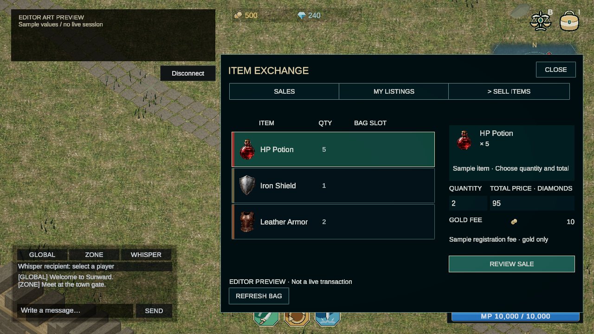
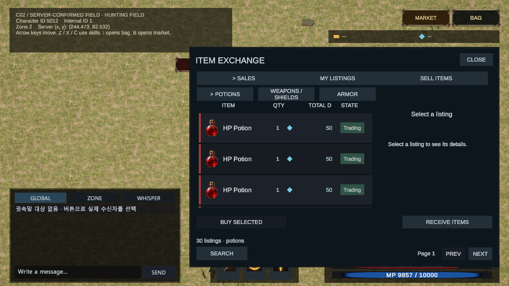
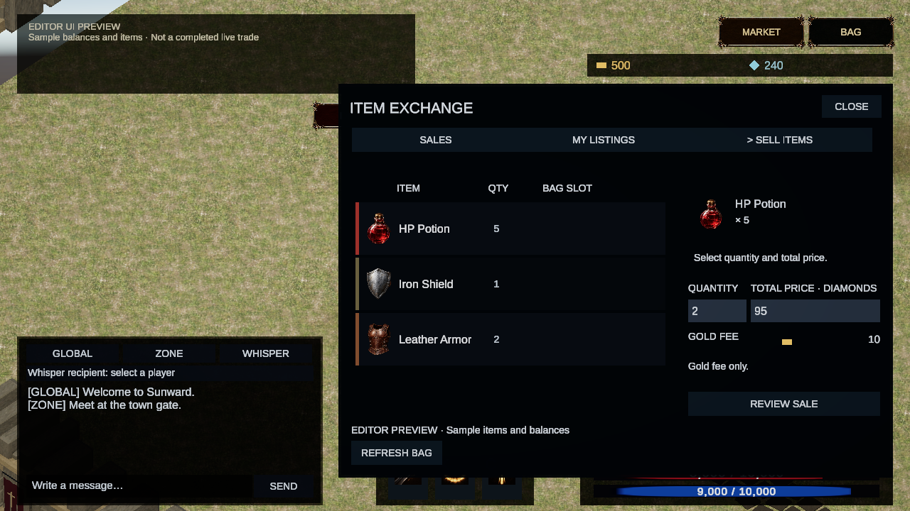
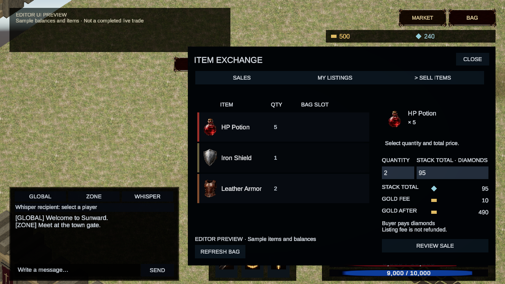
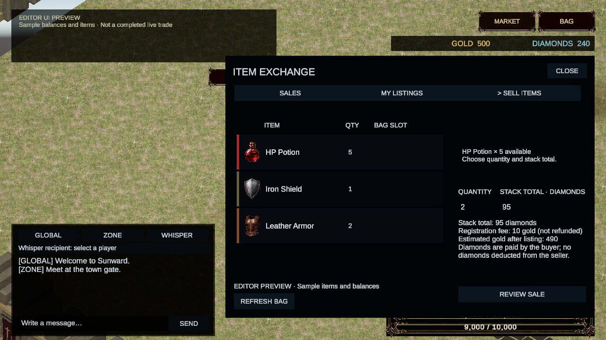
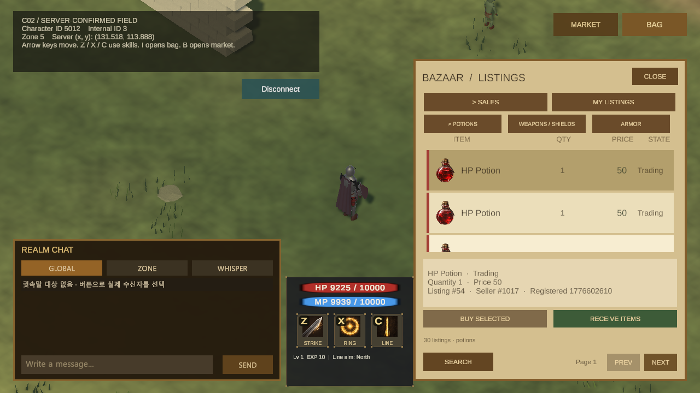
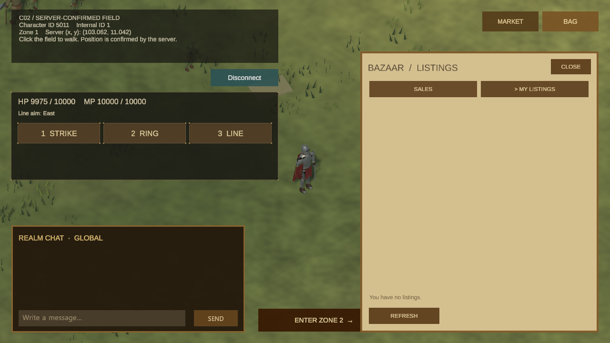
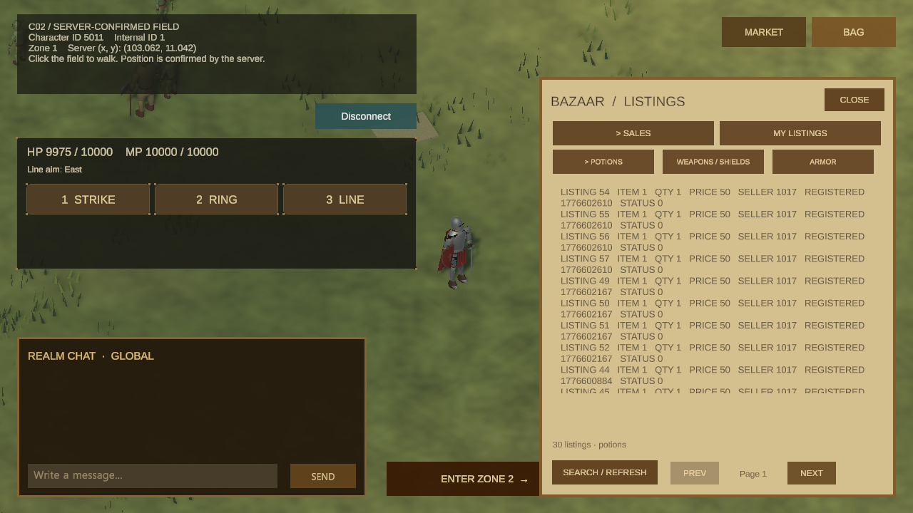

# 거래소

요약: 매물을 조회하고, 판매·구매와 내 매물 관리를 확인하는 거래소 화면입니다.
상태: 중간 결과

## 대표 화면

전용 테스트 캐릭터 간 실제 거래 화면입니다. 포션 등록·구매·수령과 판매 대금 수령을 확인했고, 검증 뒤 테스트 데이터는 원래 상태로 복원했습니다.

## 구현한 기능

AI Agent 작업에서 Unity 거래소 화면과 기존 서버 연결을 새로 구현했습니다. 직접 만든 기존 2D 클라이언트에는 거래소 화면이 없었습니다.

- 종류별 매물 조회, 페이지 이동, 아이템 그림·수량·가격과 선택 상세를 표시합니다.
- 판매 검색과 내 매물, 수령함을 전환합니다.
- 구매, 판매 취소, 반환 아이템·판매 대금 수령을 각각 요청하고 서버 응답을 표시합니다.
- 가방에서 아이템과 수량을 골라 묶음 가격을 입력하고, 등록 전 골드 수수료를 확인합니다.
- 골드·다이아 잔액을 표시하고 거래 뒤 다시 조회합니다. 불확실한 결과는 성공으로 처리하거나 자동 재요청하지 않습니다.
- B 키로 열고 닫으며 가방과 거래소는 한 번에 하나만 표시합니다.

거래 결과를 받은 뒤 잔액과 가방을 갱신합니다. 확인되지 않은 결과는 미확인으로 남기고 거래를 자동으로 다시 실행하지 않습니다. Esc로 창을 닫아도 진행 중인 거래가 취소된 것으로 처리하지 않습니다.

## 현재 확인한 범위

전용 테스트 데이터로 포션 1개를 10다이아에 거래했습니다.

- 판매 등록: 수수료 10골드를 차감하고 매물에 표시했습니다.
- 구매·배송: 구매자 다이아가 100에서 90으로 줄고 가방에 포션 1개가 도착했습니다.
- 판매 대금 수령: 판매자에게 10다이아가 반영됐습니다.

첫 배송은 준비 중 응답 뒤 수령을 다시 요청해 완료했습니다. 판매 등록·구매·대금 수령은 각각 한 번 실행했고, 화면과 서버 저장 결과를 대조했습니다. 검증 후 테스트 데이터는 원래 상태로 복원했습니다. 패널 전환 중 조회 공유와 늦은 응답 뒤 갱신은 자동 검사로 확인했습니다.

## 화면 기록

### 2026-10-27 — 실제 거래와 아이템 수령

전용 테스트 캐릭터 간 실제 거래입니다. [구매 확인 화면](/MMORPG/media/releases/2026-10-27/live-purchase-confirm.png)에서 10다이아 차감을 확인했고, 가방의 포션 1개와 판매자의 [대금 수령 화면](/MMORPG/media/releases/2026-10-27/live-proceeds-collected.png)을 촬영했습니다. 첫 배송이 준비 중으로 끝나 수령을 다시 요청한 뒤 가방에서 아이템을 확인했습니다.

### 2026-10-27 — 현재 거래소의 실제 매물 조회

Unity 입력 시스템을 통한 B 키 자동 조작으로 거래소를 열었습니다. 매물 목록은 실제 응답이며 골드·다이아 잔액은 미확인 상태입니다. 성공 구매·판매나 실제 재화 차감을 보여주는 화면은 아닙니다.

### 2026-10-26 — 선택 매물과 판매 확인을 구분한 화면

목록·상세·확인 버튼을 같은 청록색 계열로 정리하고 선택한 행을 강조했습니다. 수수료 아이콘이 이전 작은 크기로 돌아가던 저작 설정도 수정했습니다. 수량 2개·총액 95다이아·수수료 10골드는 현 클라이언트 표시 규칙에 맞춘 촬영용 샘플이며 실제 판매·차감 결과가 아닙니다. 거래 요청과 실패·결과 미확인 처리는 유지합니다.

### 2026-10-25 — 가방에서 거래소로 전환

가방을 연 상태에서 B로 거래소에 전환하고 실제 매물을 조회한 뒤 Esc로 닫았습니다. Unity 입력 시스템을 통한 자동 조작이며, 정상 거래 차감은 아직 확인하지 못했습니다. 미확인 잔액은 숫자로 채우지 않고 그대로 표시합니다.

### 2026-10-25 — 판매 비용 확인 간소화

판매 전 골드 수수료만 보여주고 예상 잔액과 중복 합계는 뺐습니다. 구매 확인에는 차감될 다이아 금액을 표시합니다. 수수료와 거래 방식은 기존 서버 규칙을 유지했습니다. 이 화면은 예시 아이템·잔액을 넣은 에디터 미리보기이며 실거래 완료 장면은 아닙니다.

### 2026-10-24 — 아이템 카드와 판매 금액 표시

아이템 그림·수량과 가격·수수료·예상 잔액을 각각 배치했습니다. 재화 아이콘과 판매 상태 표시로 긴 설명을 줄였습니다. 에디터 배치 미리보기이며 수치는 예시입니다. 실제 판매 완료 화면은 아닙니다.

### 2026-10-24 — 판매할 아이템과 수수료 확인

가방의 아이템을 고르고 수량과 묶음 전체 가격을 입력하는 화면을 추가했습니다. 등록 전에 골드 수수료와 예상 잔액을 확인하고, 판매자가 다이아를 지불하는 것으로 혼동하지 않도록 안내합니다. 아이템과 재화 수치는 배치 확인용 예시이며, 실제 판매 완료 화면은 아닙니다.

### 2026-10-21 — 매물 그림과 가격 표시 개선

실제 서버의 포션 매물을 조회하고 선택했습니다. 그림과 이름이 겹치지 않도록 배치를 다듬고, 수량·가격과 선택 상세를 읽기 쉽게 키웠습니다. 이 화면은 조회·선택 결과이며 구매를 실행한 장면은 아닙니다.

### 2026-10-20 — 아이콘이 있는 매물 목록

실제 매물 응답에 아이템 그림을 연결한 화면입니다. 거래소 목록이며 가방 화면은 아닙니다.

### 2026-10-20 — 구매 전 가격 확인

구매 전 확인 단계입니다. 이어진 구매 요청은 재화 부족으로 거절되어 구매 완료 화면이 아닙니다.

### 2026-10-20 — 구매품 수령 뒤 가방 재조회

수령 응답은 0건이었고 가방을 다시 조회해 빈 결과를 확인했습니다. 구매품을 실제로 받은 장면은 아닙니다.

### 2026-10-20 — 본인 매물이 없을 때 취소·수령

이 계정에는 본인 매물이 없어 취소 성공이나 아이템 반환 장면은 확인하지 못했습니다.

서버가 빈 내 매물 결과를 반환해 수령 버튼이 비활성화됐습니다. 지급 성공 장면은 아닙니다.

### 2026-10-19 — 매물 선택과 상세

목록에서 매물을 골라 상세 정보를 확인했습니다.

### 2026-10-19 — 첫 조회와 내 매물 전환

실제 서버 매물 조회를 처음 연결한 화면입니다.

검색 결과가 없을 때의 실제 화면입니다.

현재 캐릭터의 내 매물 결과를 확인한 화면입니다.

내 매물에서 판매 검색으로 돌아온 뒤 목록을 다시 조회했습니다.
