# 전투와 상태 표시

요약: 전투 중 캐릭터와 몬스터의 상태, 스킬·채팅 정보를 한 화면에서 확인합니다.
상태: 중간 결과

## 구현한 기능

HP·MP·레벨·경험치와 주변 플레이어·몬스터 체력을 표시합니다. 채팅은 전체·구역·귓속말을 나누고 최근 메시지를 확인할 수 있습니다. 오른쪽 위 미니맵에는 자신·관찰 중인 플레이어·몬스터를 색으로 구분합니다. 세 스킬의 키와 재사용 대기 시간, 서버가 알린 공격 범위와 준비 단계를 화면에 표시합니다.

## 스킬 모션과 효과

기본 공격은 횡베기, 주변 공격은 회전 베기, 전방 공격은 내려찍기로 동작을 구분했습니다. 준비·타격·회수 동작에 검흔과 지면 효과를 연결하고 공격 범위와 차징은 반투명 면으로 표시합니다. 표시 위치와 방향은 서버 시전 단계의 값을 사용합니다. 몬스터 피격 시 체력 막대를 잠시 강조하고, 특수 공격은 원형·부채꼴·사각 고리 영역을 단계별로 보여줍니다. 기본 공격에는 바닥 범위 표시를 두지 않습니다.

이전 대화를 읽으려고 위로 스크롤한 동안에는 다른 메시지가 도착해도 최신 위치로 강제로 이동하지 않습니다. 최신 대화를 보고 있거나 자기 메시지의 서버 응답이 도착하면 아래쪽을 따라갑니다.

## 현재 확인한 범위

실제 접속에서 HP·MP와 Z·X·C 표기, 전체·구역·귓속말 송수신 및 메시지가 쌓인 뒤의 표시를 확인했습니다. 별도 캐릭터로 HUD 위 방향키 이동과 가방·거래소를 연 동안의 이동 차단도 확인했습니다.

실제 사냥에서는 X 스킬로 일반 몬스터 한 마리를 처치했습니다. 서버 HP가 1500에서 500, 다시 0으로 바뀌고 몬스터가 사라졌으며 경험치는 0에서 10으로 올랐습니다. 다른 몬스터는 HP 500까지 줄였지만 처치하지 않았고 레벨은 1을 유지했습니다. 모든 몬스터 특수 공격의 실제 교전은 확인하지 않았습니다. 쿼터뷰 거리에서 몬스터 장비는 구분되지만 작은 화면에서는 세부 질감이 제한적으로 보입니다.

아래에는 실제 게임 화면과 에디터 미리보기를 함께 보존했습니다. 에디터의 수치·채팅은 예시이며 실제 서버 거래나 전투 결과를 뜻하지 않습니다.

## 화면 기록

### 2026-10-26 — 바닥과 구분되는 은빛 메뉴

노랑·초록 계열 바닥과 겹쳐 보이던 가방·저울을 차가운 회색·은빛으로 바꿨습니다. 외곽도 밝은 회색으로 얇게 줄여 부드럽게 정리했습니다. 형태·크기·위치와 I·B는 유지했습니다. 두 해상도의 활성 메뉴 샘플 렌더이며 실제 입력·접속 검증은 아닙니다.

### 2026-10-26 — 필드 위에서 또렷한 가방·거래소 메뉴

필드 위에서 메뉴가 눈에 잘 띄지 않는다는 피드백을 반영했습니다. 가방과 저울의 밝은 색 면을 넓히고 짙은 외곽으로 풀밭과 구분합니다. 큰 배경판과 이름 문구는 두지 않고, I·B와 기존 클릭 영역을 유지했습니다. 활성 메뉴 상태를 연출한 에디터 예시이며 실제 입력·접속 검증 화면은 아닙니다.

### 2026-10-26 — 비교해 고른 HUD 적용

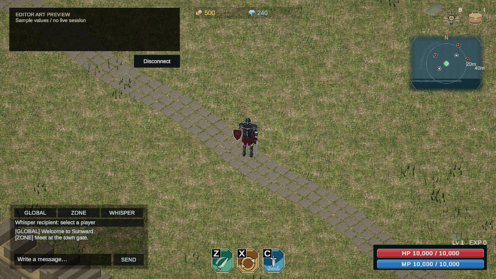

미니맵·스킬·HPMP의 세 가지 비교안 중 사용자가 고른 조합을 Unity에 적용했습니다. 미니맵은 청록색 배경과 밝은 표식으로 지형과 구분하고, 스킬은 베기·회전·내려찍기를 서로 다른 색면으로 표현합니다. HPMP는 배경과 채우는 이미지의 외곽을 맞춰 100%일 때 빈틈없이 채워집니다.

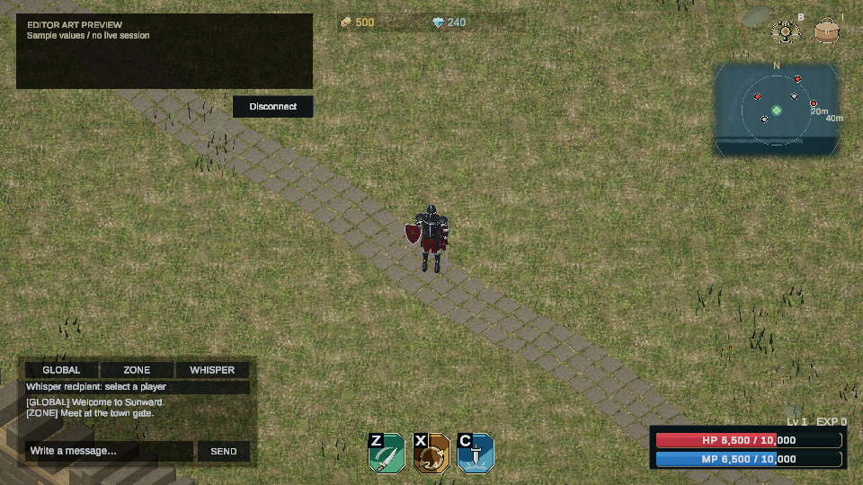

두 해상도에서 100%·65% 채움과 기존 쿨타임 표시를 확인했습니다. 캡처의 자원·주변 개체·채팅·쿨타임은 촬영용 예시이며 실제 접속·시전 시간 경과 검증은 아닙니다. 게임에서는 기존 현재값/최대값 비율을 그대로 사용합니다. 위치·단축키·스킬 기능과 재화 규칙은 유지했습니다.

### 2026-10-26 — 부드럽게 이어지는 미니맵 가장자리

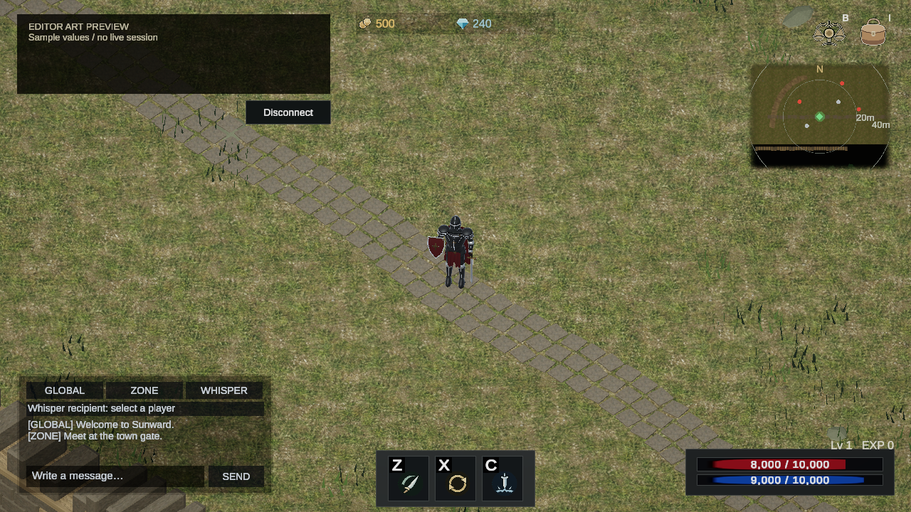

테두리를 추가하는 대신 지도와 거리 원·주변 점이 가장자리에서 서서히 사라지도록 했습니다. 가운데 지형과 자기 표식은 선명하게 유지합니다. 1280×720과 960×540 에디터 렌더로 확인했으며 수치·채팅·주변 개체 위치는 샘플입니다. 아래 이전 화면과 비교할 수 있습니다.

### 2026-10-26 — 재화와 스킬 아이콘

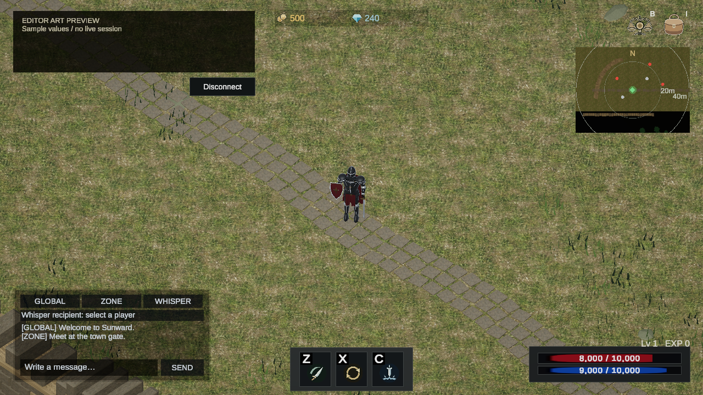

골드와 다이아는 동전·보석 모양으로, 세 스킬은 베기·회전·내려찍기 형태로 구분했습니다. 작은 화면에서 그림의 세부 묘사보다 형태가 먼저 보이도록 색 면과 곡선을 사용합니다. Z·X·C는 아이콘 위쪽에 분리하고 거래소의 재화 표시에도 같은 아이콘을 연결했습니다.

두 해상도로 배치를 확인했습니다. 두 번째 화면은 기존 쿨타임 표시를 샘플 값으로 겹쳐 본 예시이며 실제 시전이나 시간 경과 검증은 아닙니다. HUD·채팅·주변 개체 값도 샘플입니다. 매물 행의 다이아 아이콘 연결과 선택 동작은 집중 자동 검사로 확인했으며 거래 금액·수수료·스킬 동작은 바꾸지 않았습니다.

### 2026-10-26 — 곡선과 색 면을 조합한 메뉴

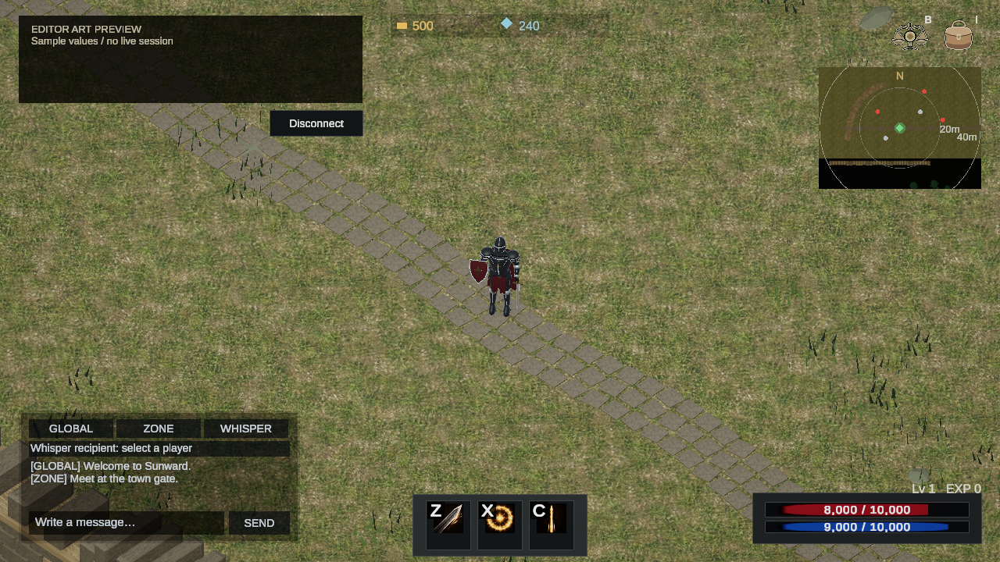

곡선 형태는 유지하고 내부의 빈 면을 줄여 지형 위에서도 형태가 이어져 보이도록 했습니다. 가방은 색 대비를 높이고 저울은 중앙과 양쪽 면을 채웠습니다. 재질 질감과 큰 배경판 없이 가방·저울을 구분하며 기존 크기·위치·I/B 표시는 유지합니다. 두 해상도 에디터 렌더이며 HUD·주변 개체 값은 촬영용 샘플입니다. 실제 입력·거래를 이번에 다시 검증하지는 않았습니다.

### 2026-10-26 — 둥근 선으로 정리한 메뉴

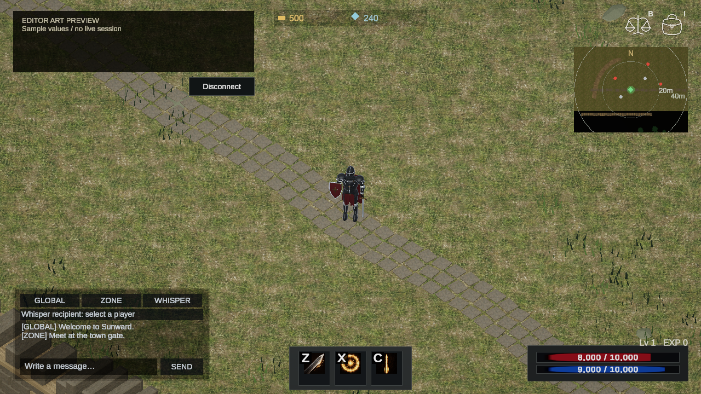

재질을 그린 그림 대신 가벼운 곡선 아이콘으로 정리했습니다. 가방과 저울의 형태만 남기고 배경판·입체 명암·재질 표현을 없앴습니다. 크기·위치·I/B 표시는 유지합니다. 두 해상도 에디터 렌더이며 HUD와 관찰 개체 값은 샘플입니다. 실제 입력과 서버 거래를 이번에 다시 검증하지는 않았습니다.

### 2026-10-26 — 손그림풍 메뉴 아이콘

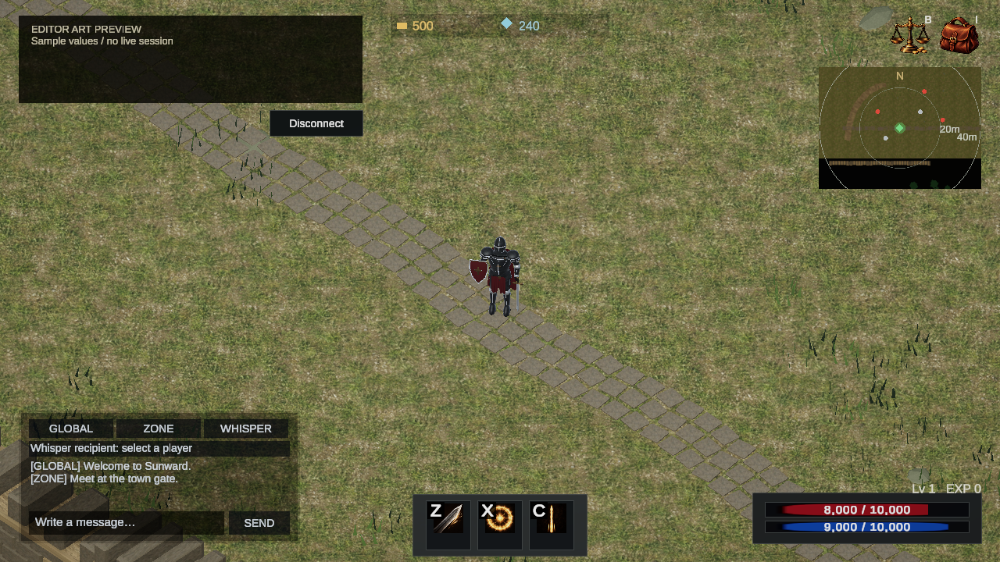

가죽과 금속의 미세한 질감을 줄이고 윤곽과 큰 명암면을 강조한 손그림풍으로 바꿨습니다. 기존 크기·배치·I/B 표시는 유지했습니다. 아래 이전 아이콘과 함께 변화 과정을 보존합니다. 두 해상도 에디터 렌더이며 HUD와 주변 개체 값은 샘플입니다. 이번 교체는 실제 입력·거래를 다시 검증한 결과가 아닙니다.

### 2026-10-26 — 그림 중심의 가방·거래소 메뉴

가방은 가죽 가방, 거래소는 저울 그림으로 구분합니다. 딱딱한 선 아이콘과 큰 배경판을 그림 아이콘으로 바꾸고 이름 문구를 없앴습니다. I·B 키 표시는 유지하고 클릭 영역은 54×54로 정리했습니다. 내장 이미지 생성으로 제작한 투명 atlas를 기존 버튼에 연결했습니다.

실제 UI를 두 해상도로 렌더해 배치와 키 표시를 확인했습니다. HUD·주변 개체 값은 촬영용 샘플이며 이번 작업에서 실제 입력이나 서버 거래를 다시 검증하지는 않았습니다.

### 2026-10-26 — 직사각형 미니맵

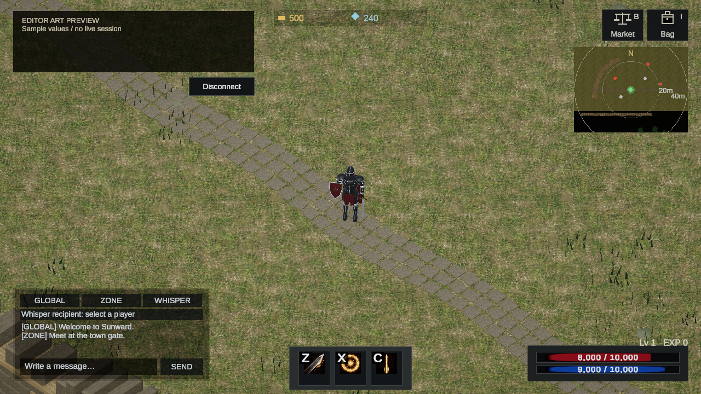

자신은 중앙에 고정하고 지형과 주변 점이 움직입니다. 미니맵을 직사각형으로 바꾸고 제목과 아래 범례를 제거했습니다. 초록은 자신, 회색은 다른 플레이어, 빨강은 몬스터이며 북쪽과 20m·40m 거리 원은 유지합니다. 가로 ±40m·세로 ±30m를 같은 축척으로 보여줍니다.

실제 정적 맵을 촬영한 배경과 촬영용 개체·HUD 값을 사용한 에디터 예시입니다. 변경한 좌표 검사 1개와 두 해상도 렌더로 확인했으며 실입력·다중접속을 추가 검증한 화면은 아닙니다.

### 2026-10-26 — 실제 지형 배경과 원형 레이더

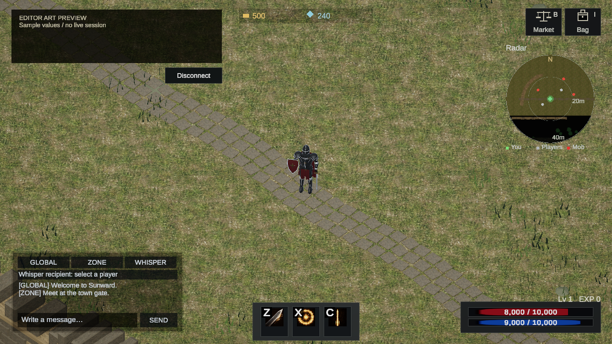

초록 표식은 정중앙에 고정하고 이동에 따라 지형과 주변 점이 움직입니다. 북쪽을 위로 유지하며 20m·40m 거리 원으로 가까운 정도를 구분합니다. 회색·빨강 점은 더 큰 원으로 표시합니다. 배경은 현재 Unity 맵의 정적 길·성벽·수목을 위에서 촬영한 이미지입니다. 맵이 바뀌면 다시 촬영하며, 지도 그림 자체가 통행 가능 여부를 판정하지는 않습니다.

개체 위치·HUD 값은 촬영용 샘플입니다. 중앙 유지·원형 범위·배경 좌표는 변경한 자동 검사 1개로 확인했고, 이 캡처는 실입력·실서버 다중접속 화면이 아닙니다.

### 2026-10-26 — 주변 개체를 표시하는 미니맵

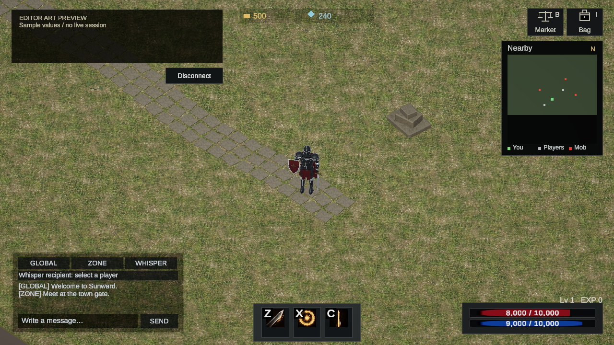

기존 통행 맵과 수신한 관찰 정보로 주변을 표시합니다. 북쪽을 위로 고정하고 자신을 중앙에 두며, 범위 밖 개체는 표시하지 않습니다. 구역 이동·로그아웃 때 이전 점을 숨깁니다. 이 화면의 플레이어·몬스터 위치와 수치는 촬영용 샘플이며 실제 다중접속 화면은 아닙니다. 색상·좌표와 개체 정리는 별도 자동 검사로 확인했습니다.

### 2026-10-26 — 작은 상태창과 아이콘 메뉴

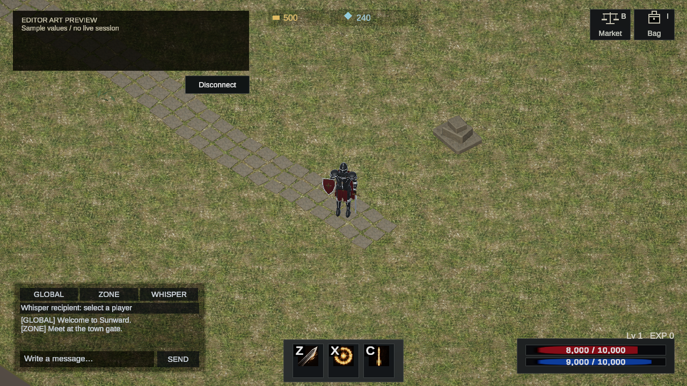

선택한 오른쪽 아래 배치를 유지하면서 상태창과 채팅을 작게 정돈했습니다. 가방·거래소는 그림과 I·B 키를 함께 표시하고 재화는 위쪽에 모았습니다. 현재 장면을 복제한 에디터 미리보기이며 값과 채팅은 예시입니다. 실제 조작감 검증을 뜻하지 않습니다.

### 2026-10-25 — 절제된 타격과 하단 UI

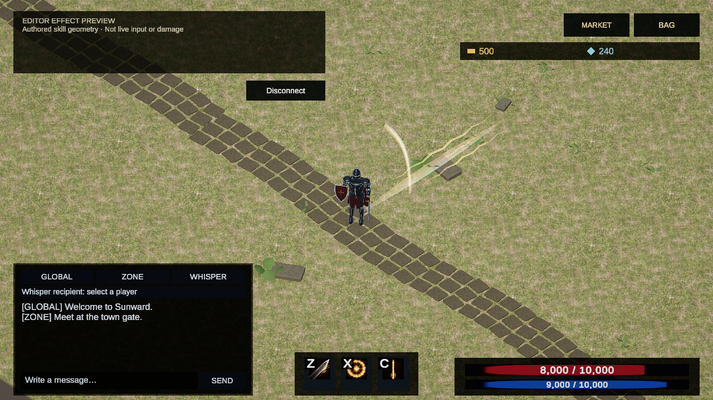

반투명 예고와 보조 잔상을 줄이고 타격 순간을 강조했습니다. 기존 스킬 데이터와 메시를 렌더한 에디터 예시입니다. 실입력·서버 피해 판정 검증을 뜻하지 않으며 HP·MP와 재화는 샘플입니다.

### 2026-10-25 — 주변 플레이어의 전투 상태

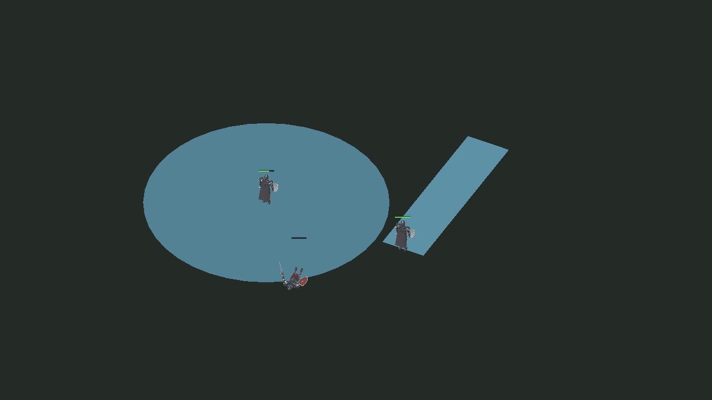

다른 플레이어의 체력 감소를 짧게 강조하고, 체력이 0이면 쓰러진 자세를 유지합니다. 회복한 상태를 받으면 다시 일어납니다. 원형·전방 스킬은 전달받은 시전 위치와 방향을 따라 준비 영역과 짧은 발동 표시를 보여줍니다.

기존 기사 에셋과 예시 패킷을 사용한 Play 모드 배치 화면입니다. 상태 변화·잘못된 응답 제외·관찰 종료 후 정리는 자동 검증했으며, 이 변경의 실제 다중 접속 시점과 가시성은 아직 확인하지 않았습니다. 이름·아군 관계·새 서버 기능을 추정해 추가하지 않았습니다.

### 2026-10-25 — 체력 변화와 성장 정보

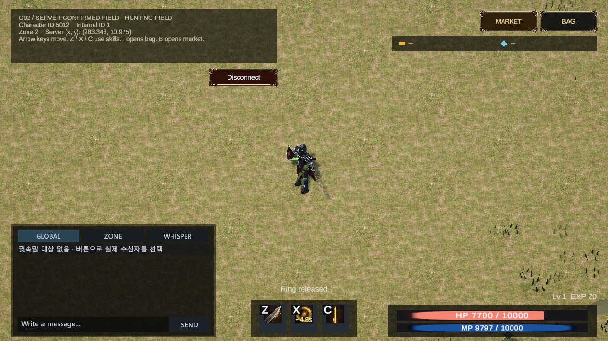

체력이 줄면 오른쪽 아래 HP 게이지를 짧게 강조합니다. 레벨과 현재 경험치는 HP·MP 위에서 확인합니다.

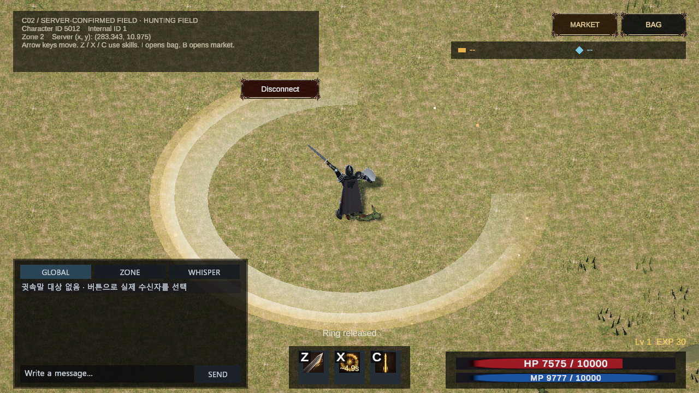

실제 서버에서 합성 방향키·X 입력으로 교전하며 HP 감소와 경험치 20→30 표시를 확인했습니다. 바뀐 경험치는 잠시 금색으로 강조되고 원래 색으로 돌아옵니다. 다음 레벨까지의 비율이나 예상 보상을 만들어 표시하지 않습니다.

### 2026-10-25 — 시전 안내와 몬스터 쓰러짐

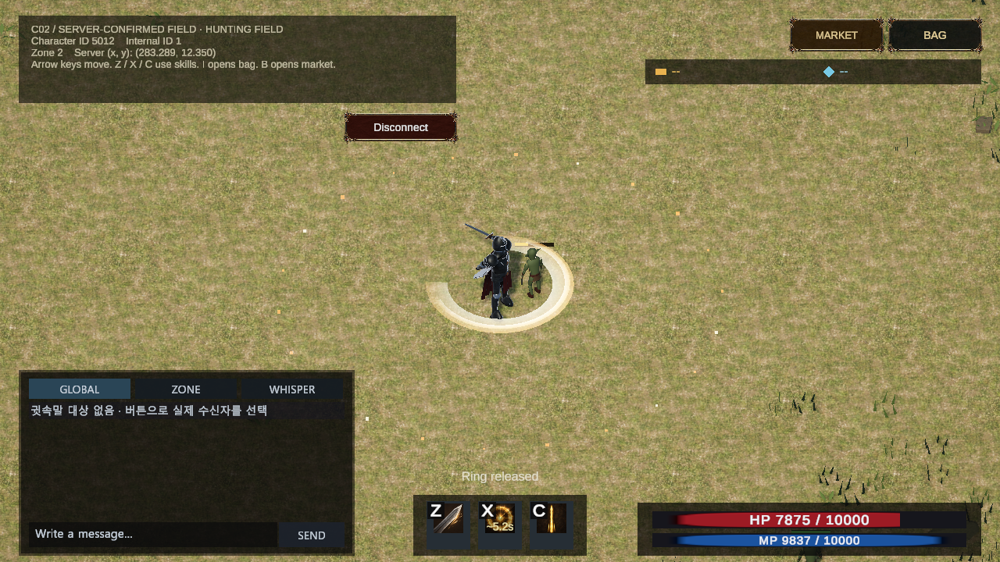

스킬바 위에서 요청과 서버가 확인한 시전을 구분하고, 재사용 시간은 추정값으로 표시합니다. 안내는 잠깐 나타난 뒤 사라집니다.

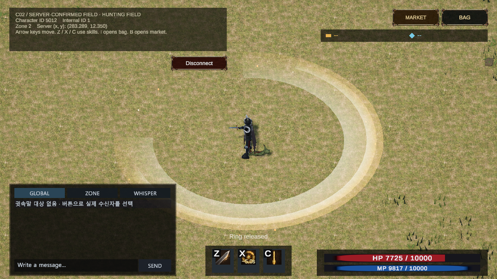

실제 서버에 접속해 합성 방향키와 X 키 입력으로 몬스터의 체력 감소와 쓰러짐을 확인했습니다. 체력이 0이 된 대상은 공격 대상 목록에서 즉시 제외되고, 짧은 사망 표현만 남습니다. 서버 판정이나 몬스터 AI는 변경하지 않았습니다. 모든 스킬·지연 환경을 검증한 결과는 아닙니다.

### 2026-10-25 — 이동 중 전방 스킬

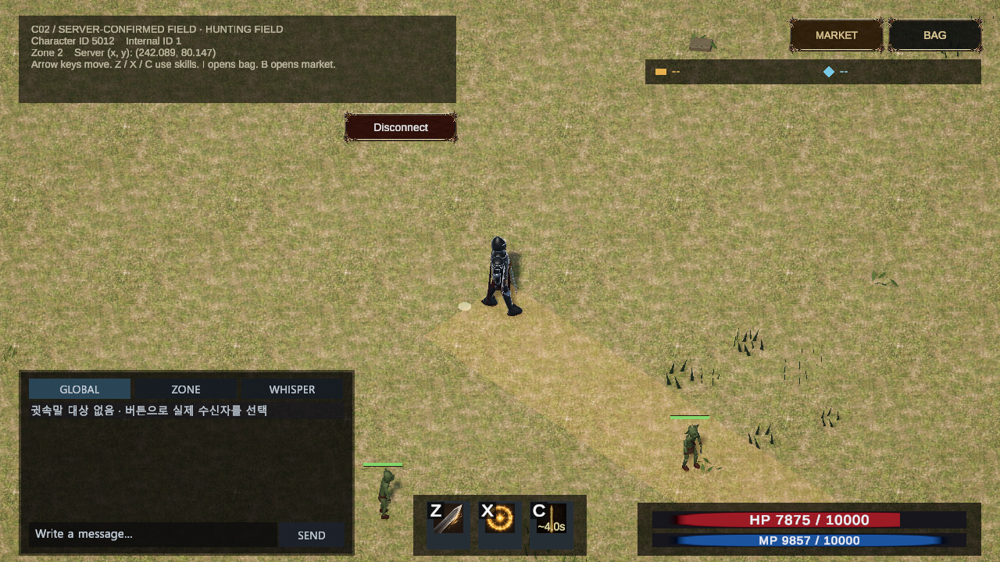

실제 로그인 뒤 Unity 입력 시스템에 방향키와 C 키 이벤트를 넣어 이동 중 시전을 확인했습니다. 서버가 준비·타격 단계를 알렸고 마나는 20 줄었습니다. 이동 키를 뗀 뒤 위치가 안정되는 것도 확인했습니다. 다양한 지연 환경이나 모든 스킬의 조작감을 확인한 결과는 아닙니다.

### 2026-10-25 — 몸의 움직임을 나눈 세 가지 공격

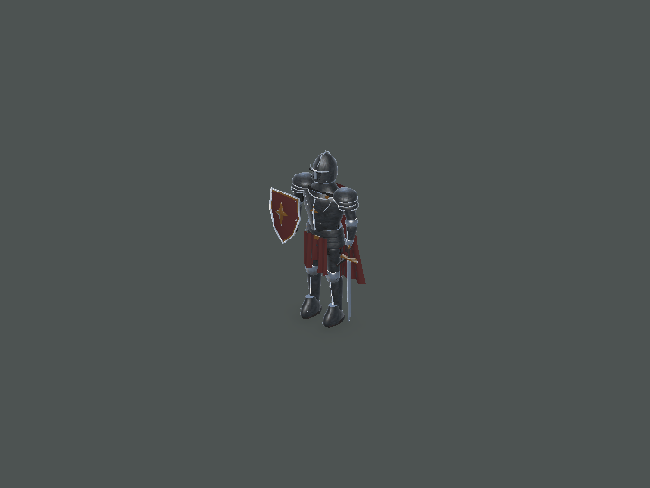

기본 베기는 발을 지지한 채 상체와 팔이 함께 움직입니다. 칼을 휘두른 뒤 자세를 회복합니다.

회전 베기는 몸 전체가 한 바퀴를 돌고 원래 방향으로 돌아옵니다. 상체의 작은 반동과 전신 회전을 나누고, 회전이 끝나면 일반 이동의 방향 전환으로 이어집니다.

위 비교 영상은 같은 기사 형상을 사용한 수정 전 동작입니다.

내려찍기는 기존 차징·참격 효과를 유지하면서 상체가 작게 뒤로 준비하고 앞으로 힘을 싣도록 했습니다.

현재 기사 모델과 기존 스킬 효과를 Play 모드에서 촬영했습니다. 촬영용으로 시전 단계를 지정했으며 실제 프레임 시간으로 움직입니다. 근접 촬영이어서 넓은 범위 일부는 화면 밖으로 잘립니다. 실제 입력·서버 피해 검증 영상과는 구분합니다.

### 2026-10-24 — 기사 형태와 갑옷 연결부

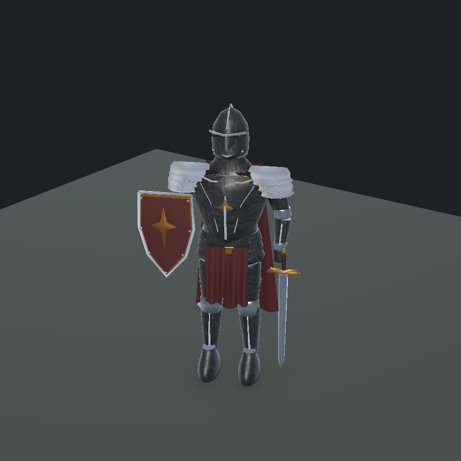

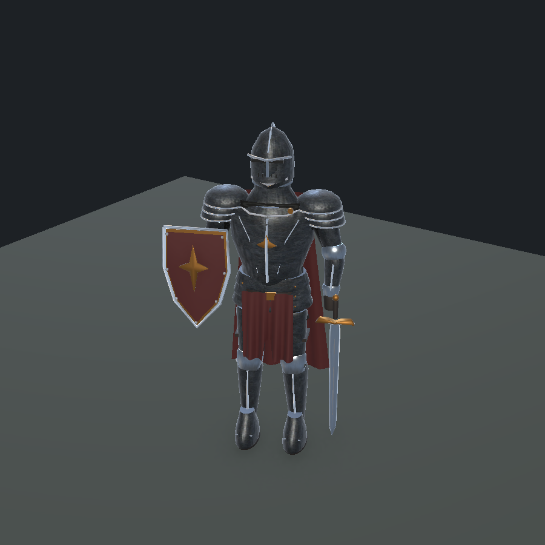

같은 카메라·조명·재질에서 비교한 수정 전과 대표 후보입니다. 열린 판처럼 보이던 어깨를 둥근 형태로 닫고, 가슴·팔·다리의 갑옷 비례와 겹침을 다듬었습니다. 기존 파츠와 모션 연결을 유지한 에디터 렌더이며 실제 전투 장면은 아닙니다. 대표 형상을 확인한 뒤 추가 개선 범위를 정합니다.

### 2026-10-24 — 간결한 게이지와 중앙 스킬 바

HP·MP의 오른쪽 하단 위치는 유지하고 금속 장식과 광택을 줄였습니다. Z·X·C 스킬은 채팅과 게이지 사이 하단 중앙으로 옮겼습니다. 에디터 미리보기이며 체력·재화·메시지는 배치 확인용 예시입니다.

### 2026-10-24 — 간결한 채팅과 재화 표시

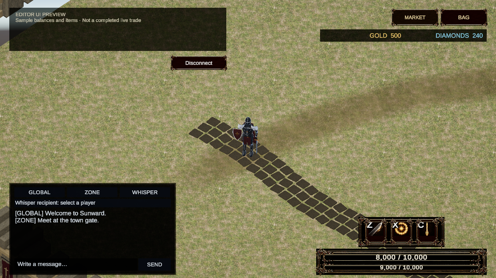

채팅 장식을 덜고 전체·구역·귓속말 탭과 메시지 입력을 정리했습니다. 상단에는 골드·다이아 잔액을, 오른쪽 하단에는 기존 체력·마나와 스킬을 유지했습니다. 화면의 재화·체력·메시지는 배치 확인용 예시입니다. 지면은 잔디와 흙의 세부 텍스처·노멀맵을 적용했고, 기존 충돌과 맵 데이터는 유지했습니다.

### 2026-10-23 — 하단 UI 배치 조정

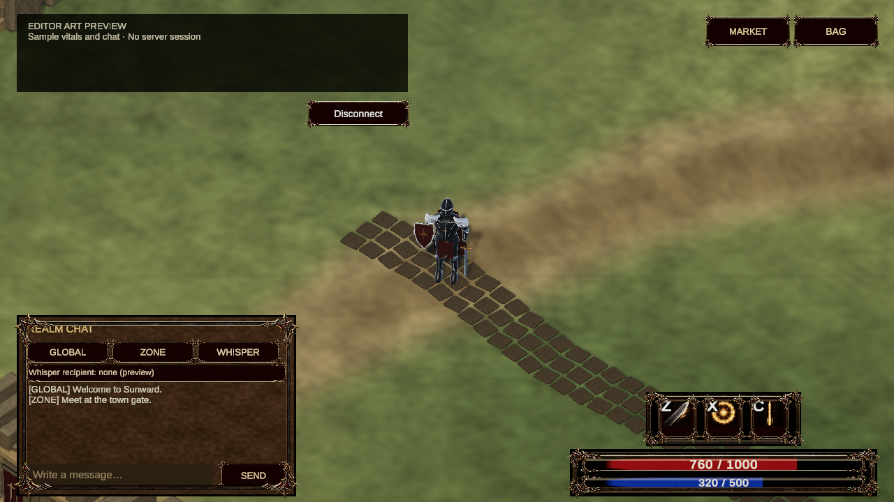

체력·마나 게이지를 이전 시안의 약 3분의 2 크기로 줄여 오른쪽 하단에 두고, 채팅을 왼쪽 하단으로 내렸습니다. 스킬 아이콘은 게이지 위에 모았습니다. 실제 uGUI를 렌더한 에디터 미리보기이며 수치는 배치 확인용 예시입니다.

### 2026-10-23 — 스킬별 동작과 몬스터 공격 영역

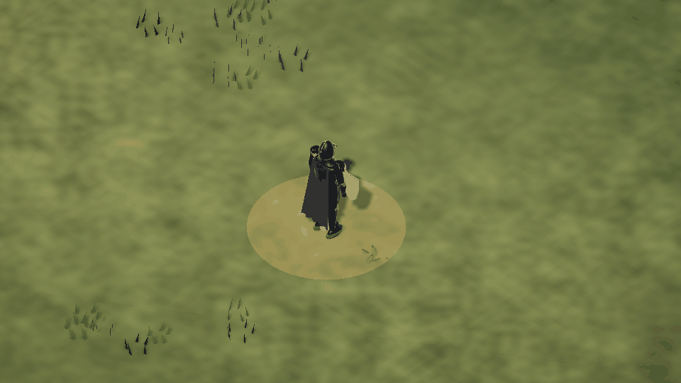

기본 공격은 짧은 횡베기입니다. 칼을 휘두르는 쪽으로 상체와 발이 힘을 싣고 방패로 균형을 잡습니다.

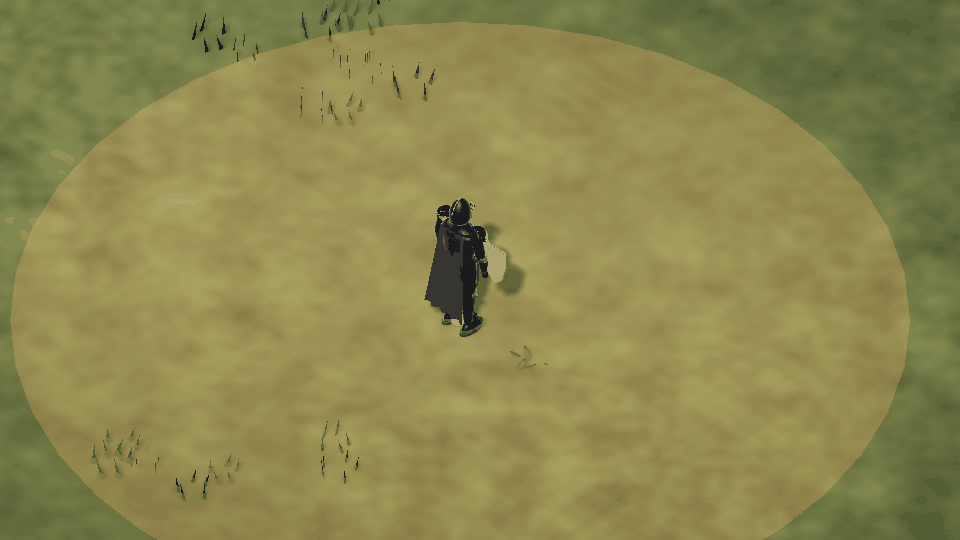

주변 공격은 몸을 돌리는 베기로 구분했습니다. 넓은 검흔과 함께 회전하고, 제자리에서 자세를 회복합니다.

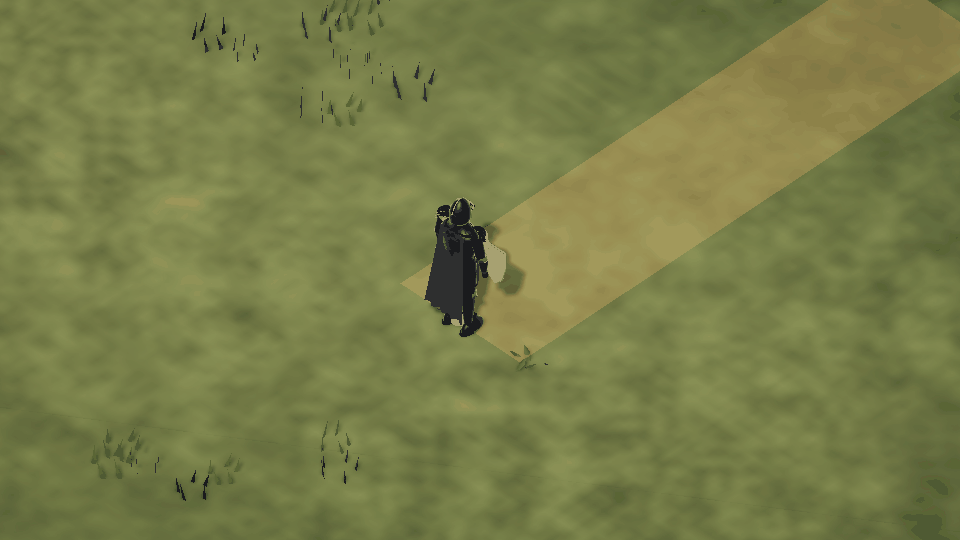

전방 공격은 검을 들어 준비한 뒤 체중을 실어 내려찍습니다. 기존 차징 영역과 참격 효과를 유지하고, 어깨와 하체가 함께 움직이도록 다듬었습니다. 세 영상은 실제 모델을 가까이서 렌더한 에디터 연출이며, 시전 단계와 시간은 촬영용으로 지정했습니다. 전체 타격 범위와 실제 서버 교전 기록은 다른 화면과 구분합니다.

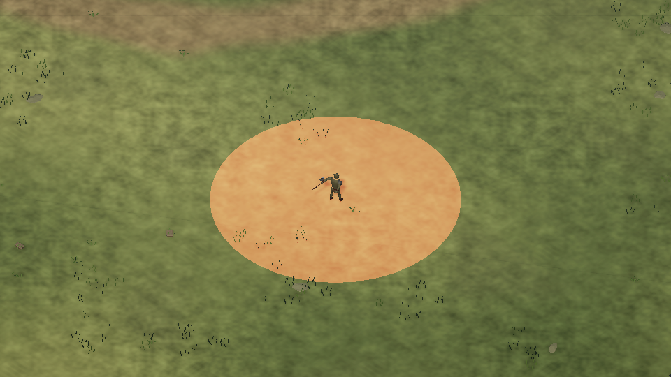

몬스터의 특수 공격은 준비 중 영역 전체가 점점 밝아집니다. 기본 공격은 영역을 표시하지 않고 동작으로 보여줍니다.

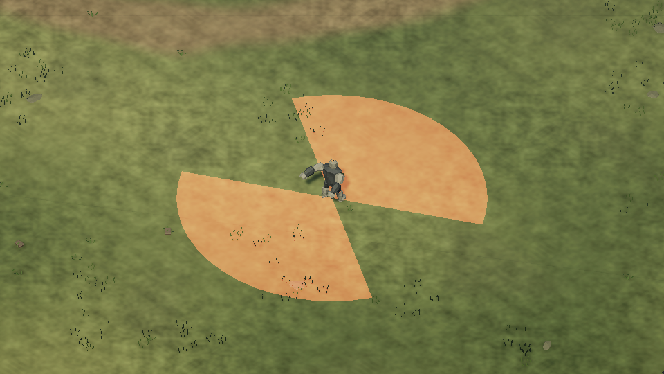

부채꼴은 실제 공격하는 부분만 채워 보여줍니다.

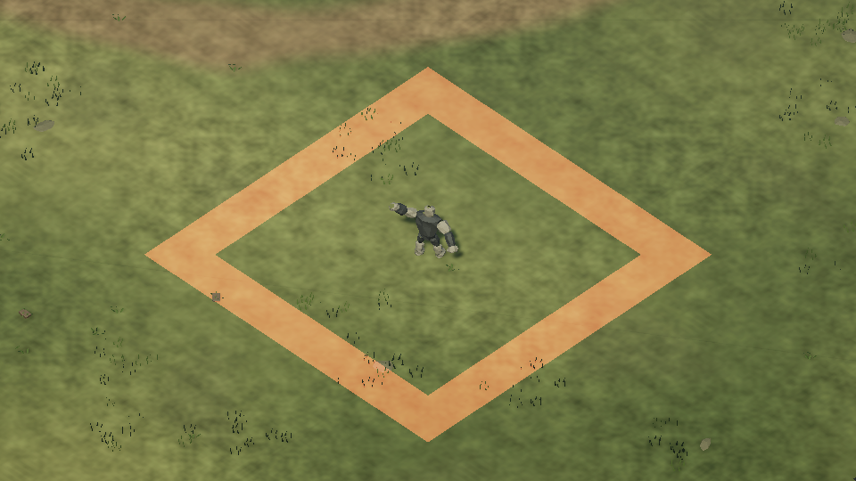

사각 고리는 가운데 빈 공간을 남기고, 단계별 영역을 따로 유지합니다. 위 몬스터 화면은 실제 모델과 범위 메시를 사용한 에디터 미리보기입니다. 패킷 처리와 표시 해제는 자동 검사로 확인했으며, 이번 변경의 실제 접속 전투는 아직 확인하지 않았습니다.

### 2026-10-23 — 하단 상태창과 차징 영역

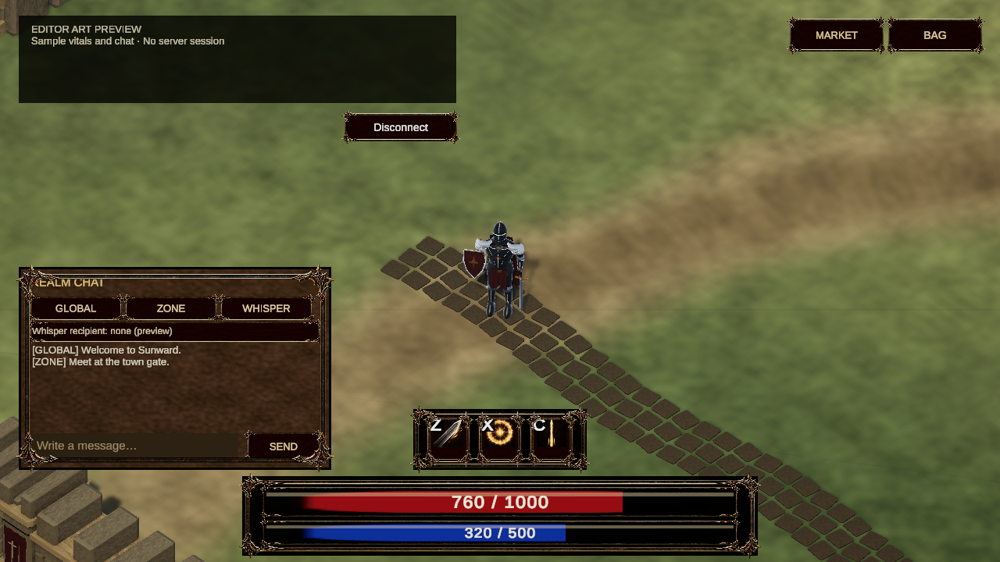

HP·MP를 하단의 긴 게이지로 분리하고 스킬 단축키를 그 위에 모았습니다. 새 금속 재질의 실제 기사 모델과 필드를 렌더한 에디터 미리보기이며, 체력·마나·채팅은 배치 확인용 예시입니다.

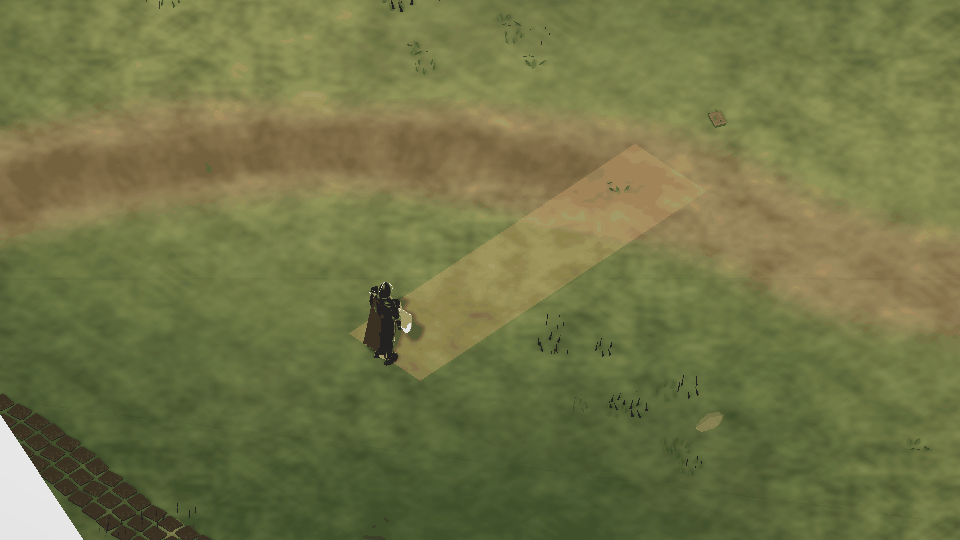

준비할 때 공격 영역 전체를 반투명하게 표시하고, 진행에 따라 밝은 면이 차오릅니다. 발동하면 영역을 지우고 내려찍기와 참격을 표시합니다. 실제 게임 모델과 효과를 단계별로 촬영한 에디터 연출이며, 서버 교전이나 입력 검증 영상은 아닙니다.

### 2026-10-23 — 기사 아트와 스킬 연출

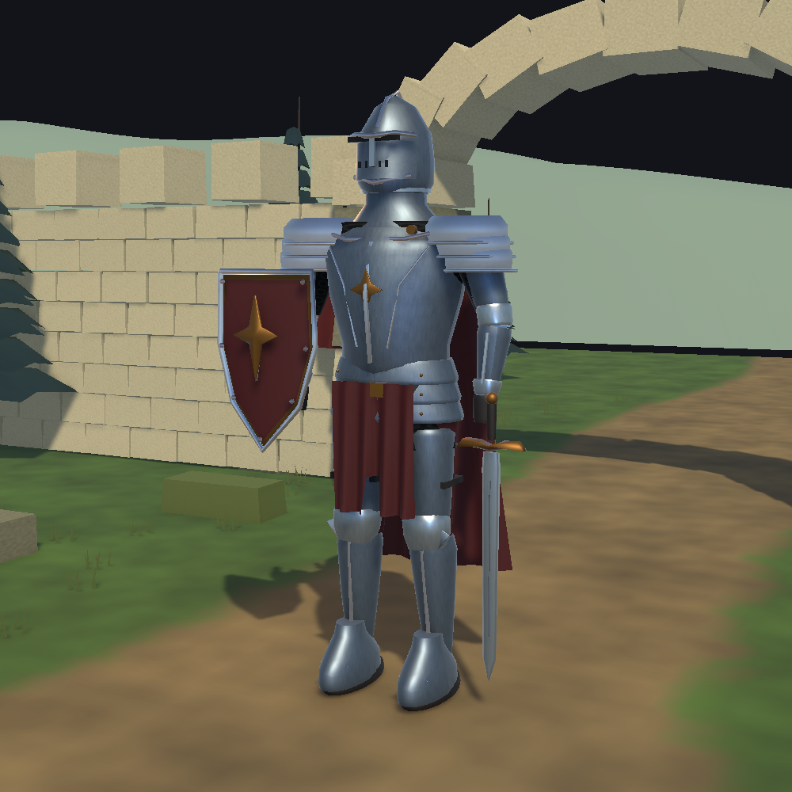

흉갑의 능선, 겹쳐진 보호판, 방패 문장과 검의 홈을 보완했습니다. 금속의 결·광택과 붉은 천을 구분하고 목·무릎·발목의 빈틈을 줄였습니다. 이 화면은 실제 모델의 에디터 렌더입니다.

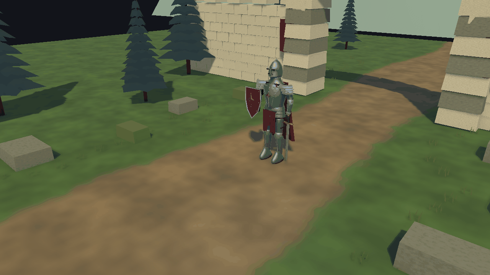

기본 공격은 횡베기, 회전 스킬은 넓은 검흔, 전방 스킬은 검을 들어 내려찍는 동작과 수직 참격·지면 파쇄로 구분했습니다. GIF는 실제 모델과 코드로 렌더한 에디터 미리보기이며, 이번 연출로 서버 전투를 실행한 기록은 아닙니다.

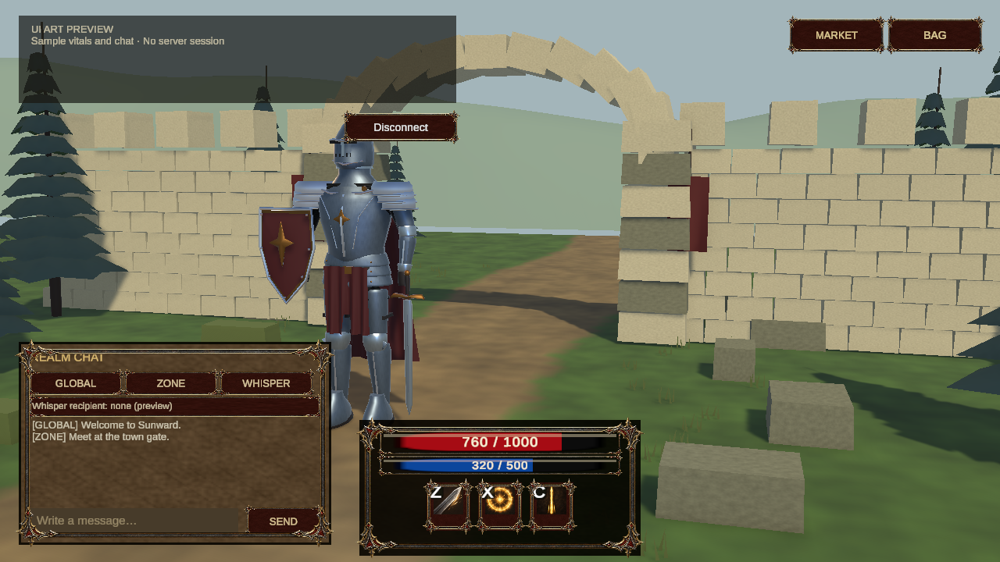

금속 테두리와 가죽 바탕을 HUD·채팅·가방·거래소에 맞췄습니다. HP·MP와 Z/X/C를 크게 읽을 수 있게 배치했습니다. 이 미리보기의 체력·마나·채팅은 배치 확인용 예시 값입니다.

### 2026-10-22 — C 스킬의 범위·발동·쿨타임

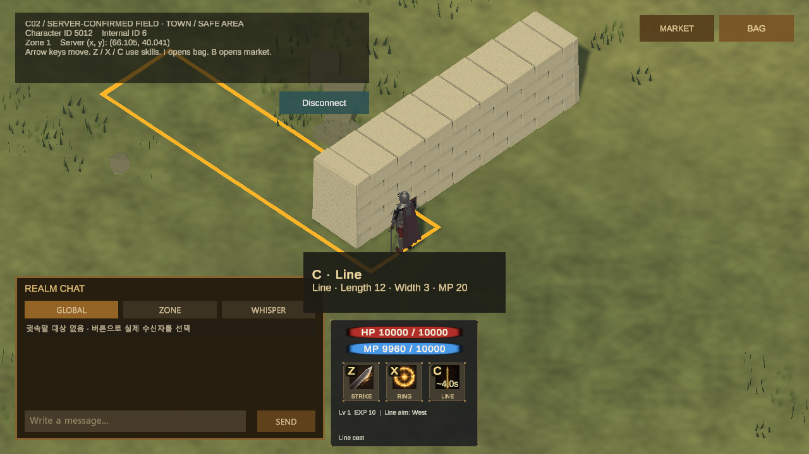

C 키로 시전하면 서버 응답에 맞춰 직선 범위를 표시하고 아이콘에 남은 대기 시간을 보여줍니다.

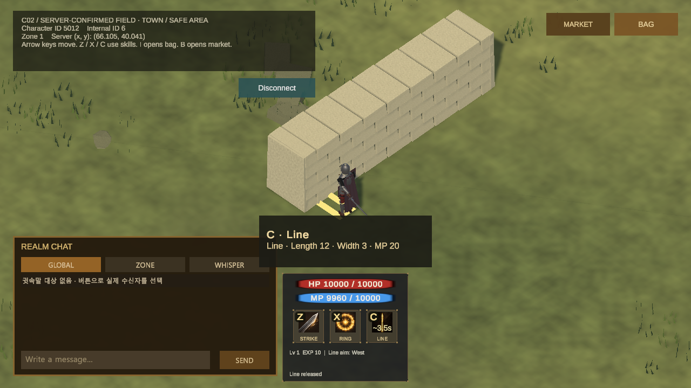

발동 단계에서는 범위 예고를 지우고 짧은 효과를 표시합니다. 마나 소모와 대기 시간도 함께 확인했으며, 이 화면은 몬스터에게 피해를 준 기록은 아닙니다.

### 2026-10-21 — 보스의 단계별 공격 예고

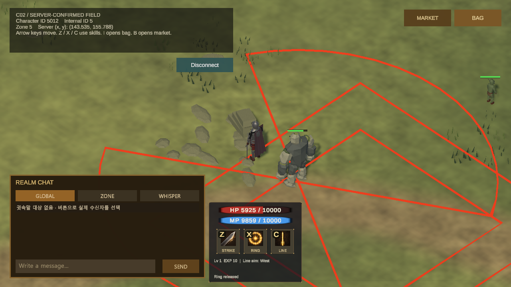

보스를 공격한 뒤 서로 다른 패턴이 겹쳐 나타난 장면입니다. 각 공격의 윤곽은 해당 시전 위치에 남고, 타격 단계가 오면 따로 사라집니다.

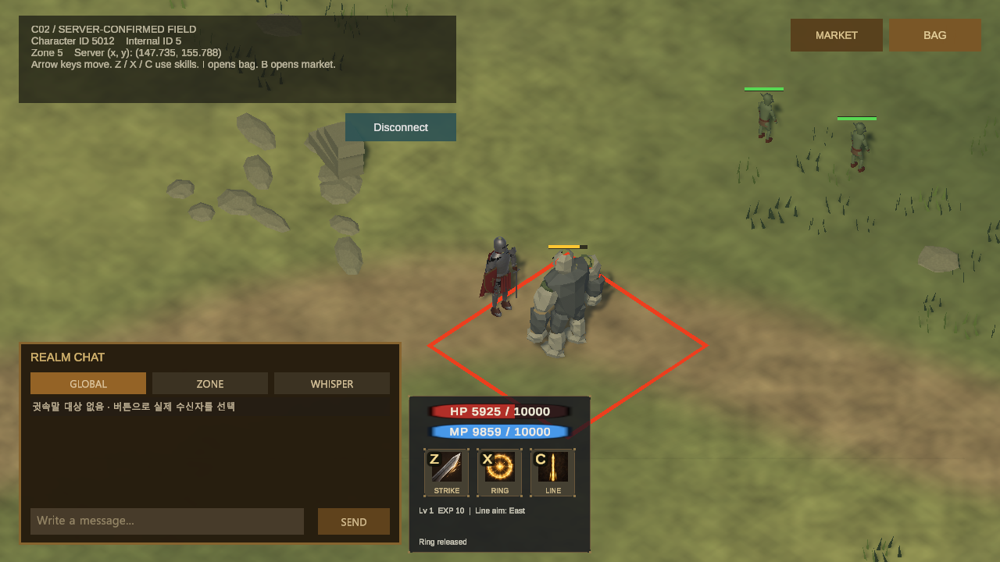

첫 사각형 예고입니다. 뒤의 고리 단계는 바깥 경계와 안쪽 빈 공간을 구분합니다. 실제 교전에서 부채꼴 두 단계와 사각 고리의 처음·두 번째·마지막 단계의 표시와 해제를 확인했습니다. 캐릭터가 쓰러진 결과도 있어 생존 플레이와 난이도를 모두 검증한 장면은 아닙니다.

### 2026-10-21 — 몬스터 피격과 공격 예고

같은 접속에서 X 키를 한 번 사용한 뒤, 일반 몬스터가 공격을 준비하는 모습을 확인했습니다. 붉은 원은 서버 시전 위치를 중심으로 반경 2에 표시되며, 공격 단계가 끝나면 사라집니다. 강한 몬스터의 더 넓은 원형 표시는 자동 검증으로 확인했으며 실제 교전 화면은 아직 확인하지 않았습니다.

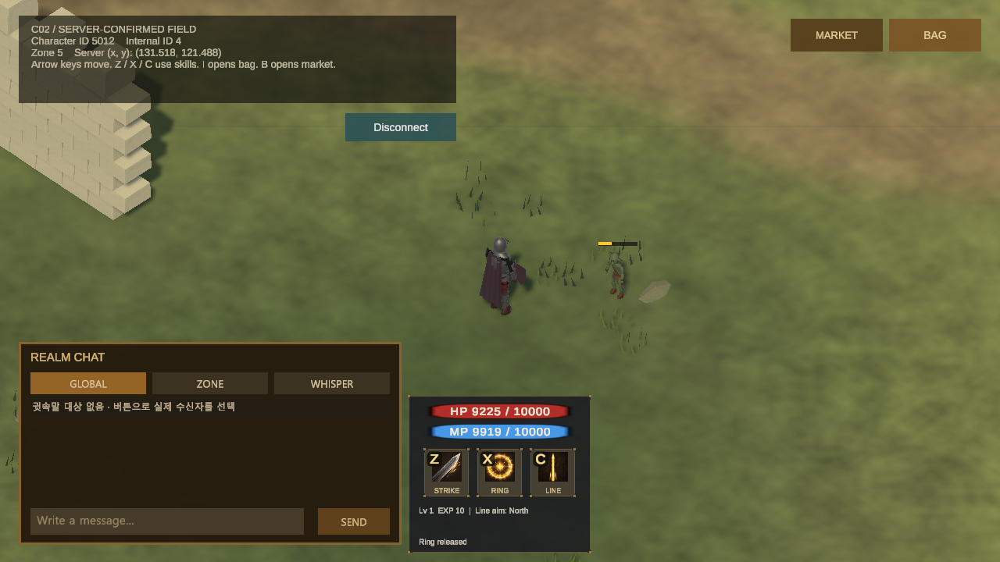

서버에서 몬스터 체력이 1500에서 500으로 감소한 응답을 받은 직후입니다. 남은 체력은 즉시 반영하고, HP바 색만 약 0.2초 동안 강조한 뒤 초록색으로 돌아갑니다. 시전 요청만으로 피격을 표시하지 않습니다.

### 2026-10-21 — 스킬 아이콘 설명

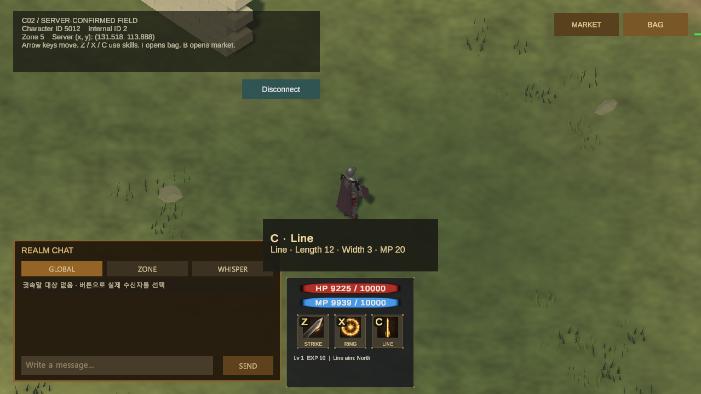

세 아이콘의 설명을 실제 마우스 조작으로 확인했습니다. C는 길이 12·폭 3의 직선 공격이며 MP 20을 소모합니다. 설명을 보는 것만으로 스킬이 시전되지 않습니다.

### 2026-10-21 — 직선 스킬 방향과 범위

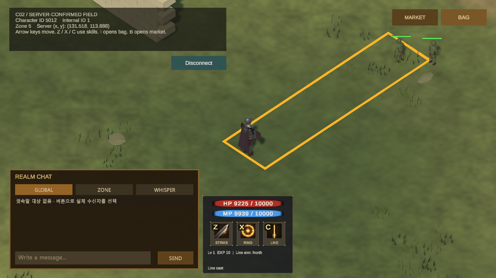

방향키로 정면을 맞추고 C 키를 한 번 눌렀습니다. 서버가 보낸 방향과 같은 쪽에 범위가 나타났고, 범위 안 몬스터의 HP가 1500에서 500으로 줄었습니다. 윤곽은 시전 중 캡처이며 타격 뒤 해제됩니다. 이 화면은 현재 구현 모습으로, 이후 효과와 재질을 개선하면서 이전 기록도 보존합니다.

### 2026-10-20 — 실제 사냥 전후

방향키로 접근해 X 스킬을 사용하기 전, 실제 쿼터뷰에서 본 몬스터 장비입니다.

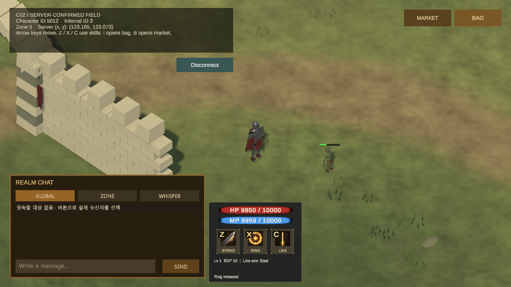

서버 HP 0 판정 뒤 몬스터가 사라지고 경험치가 10 증가한 화면입니다. 이 비교는 사냥 결과를 보여주며, 확대된 정적 재질 비교와는 별도입니다.

### 2026-10-20 — 하단 상태와 채팅

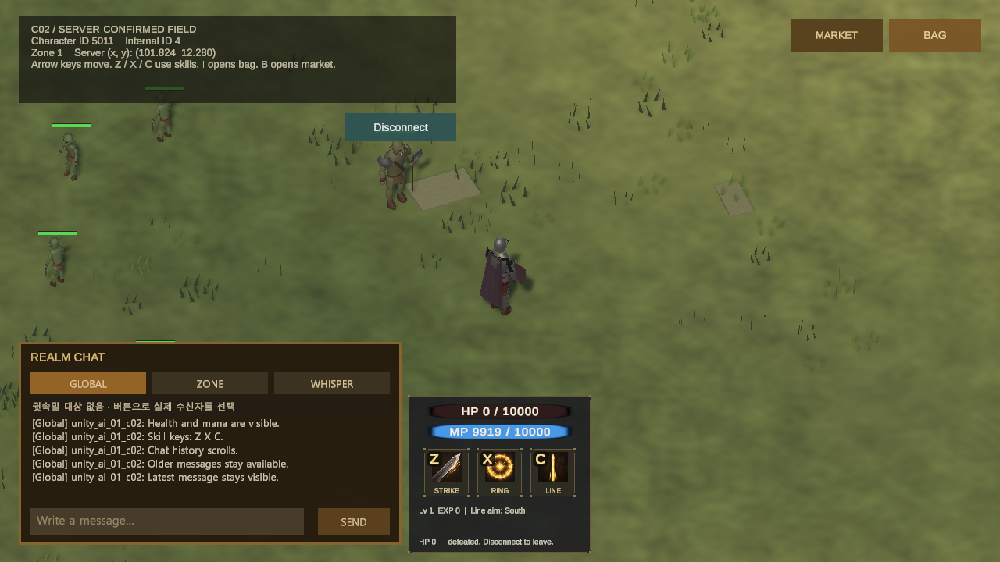

실제 접속 화면입니다. 체력·마나는 서버 값이며, 메시지가 쌓여도 최근 내용을 볼 수 있습니다.

### 2026-10-19 — 사냥 중 상태와 몬스터 게이지

실제 필드에서 스킬을 사용한 뒤 캐릭터의 상태와 주변 몬스터 게이지를 확인한 화면입니다.

### 2026-10-19 — 몬스터 공격 뒤 HUD

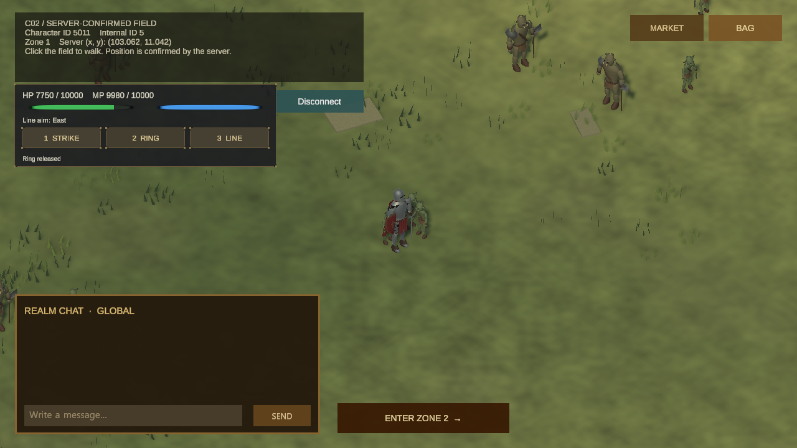

이전 전투 화면 기록입니다.

### 2026-10-19 — 전투 전 HUD

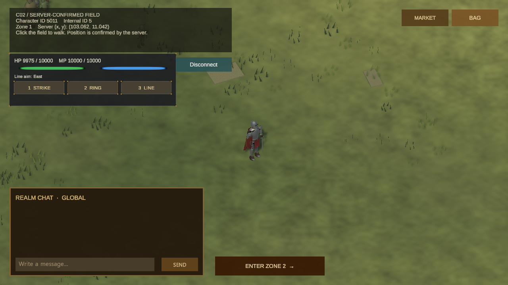
