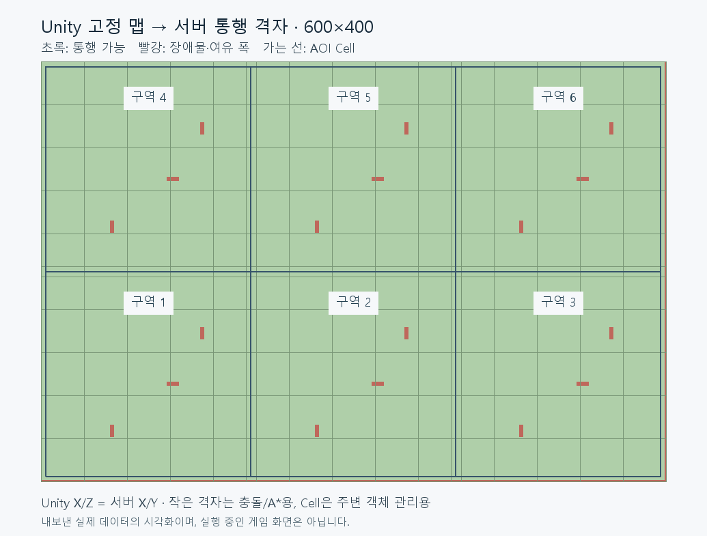
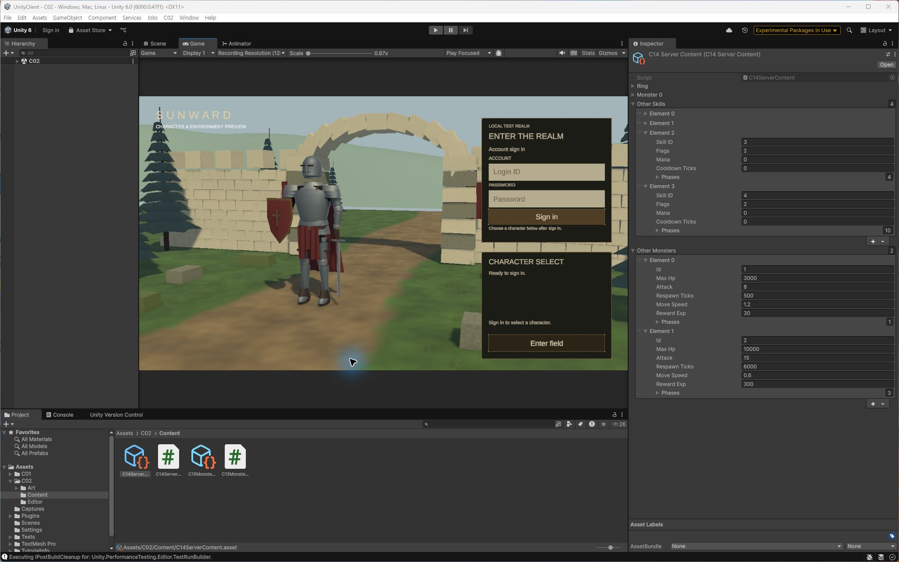
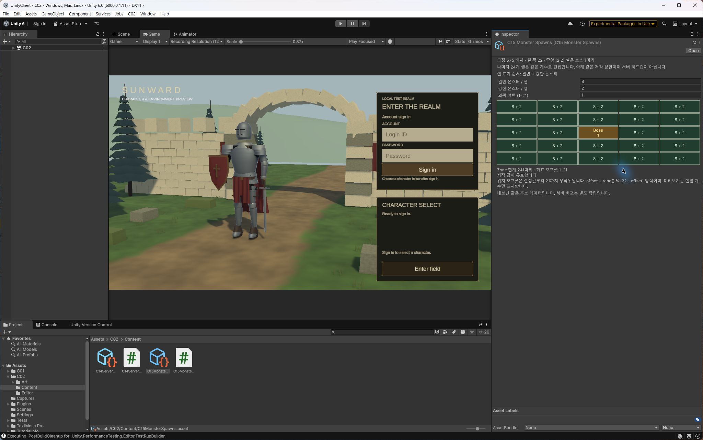
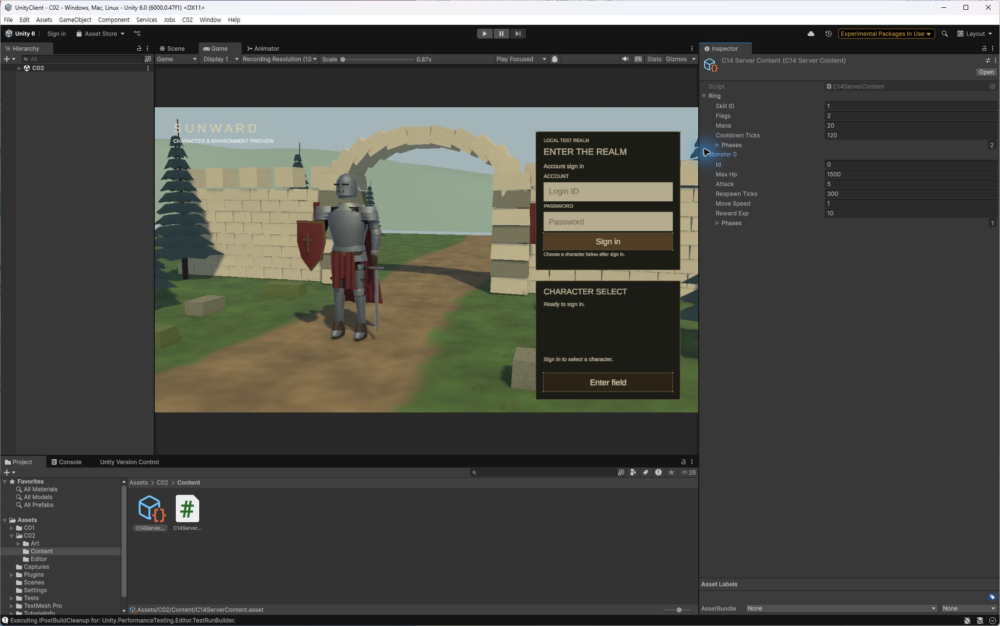

# 게임 콘텐츠와 맵 편집

요약: 서버·클라이언트 공용 CSV와 Unity 맵 통행 데이터.
상태: 검증된 결과

## 대표 화면

실제 내보낸 맵 데이터를 그린 도구 출력입니다. 게임 실행 화면과 구분하며, 스킬·몬스터 설정 화면은 화면 이력에서 볼 수 있습니다.

## 구현한 기능

- 스킬·몬스터·성장·아이템의 공용 CSV 직접 로드
- CSV의 종류·단계·참조 검사와 전체 데이터 일괄 반영
- 게임 빌드에 서버와 동일한 CSV 원본 포함

## 몬스터 배치 편집

- 셀별 몬스터 수·가장자리 간격 조정과 구역 합계 미리보기
- 배치·초기화 뒤 기존 수량·종류·순서 대조
- 무작위 배치 위치를 보장하지 않는 규칙 미리보기

## 맵의 통행·충돌 편집

- 고정 지면·장애물 기반 통행 데이터 내보내기와 서버·클라이언트 공유
- 벽·대각 모서리 충돌과 편집기 내 통행 영역 확인
- 주변 객체 관리 Cell과 통행 격자 분리, 실패 시 직전 데이터 보존

- 통행 격자는 충돌·이동 판정용이며 A* 경로 탐색이나 몬스터 AI 변경은 포함하지 않음

## 현재 확인한 범위

이전 설정 화면과 맵 공유 기록은 아래 화면 이력에 보존했습니다. 현재 스킬·몬스터·성장·아이템은 공용 CSV를 읽습니다.
게임 수치 변경은 같은 CSV를 배포하고 서버와 클라이언트를 다시 시작해 반영합니다.

## 화면 기록

### 2026-10-21 — Unity 맵의 통행 데이터

실제 내보낸 맵 데이터를 시각화한 그림입니다.

### 2026-10-19 — 기존 스킬·몬스터 전체로 편집 범위 확장

기존 수치를 유지하면서 보스 공격 패턴과 나머지 몬스터까지 편집 범위를 넓힌 화면입니다.

### 2026-10-19 — 몬스터 배치 편집과 미리보기

기본 배치 규칙과 구역 합계를 보여주는 편집 화면입니다.

### 2026-10-19 — Unity에서 스킬·몬스터 수치 편집

기본 게임 수치를 유지한 이전 편집 화면입니다.
