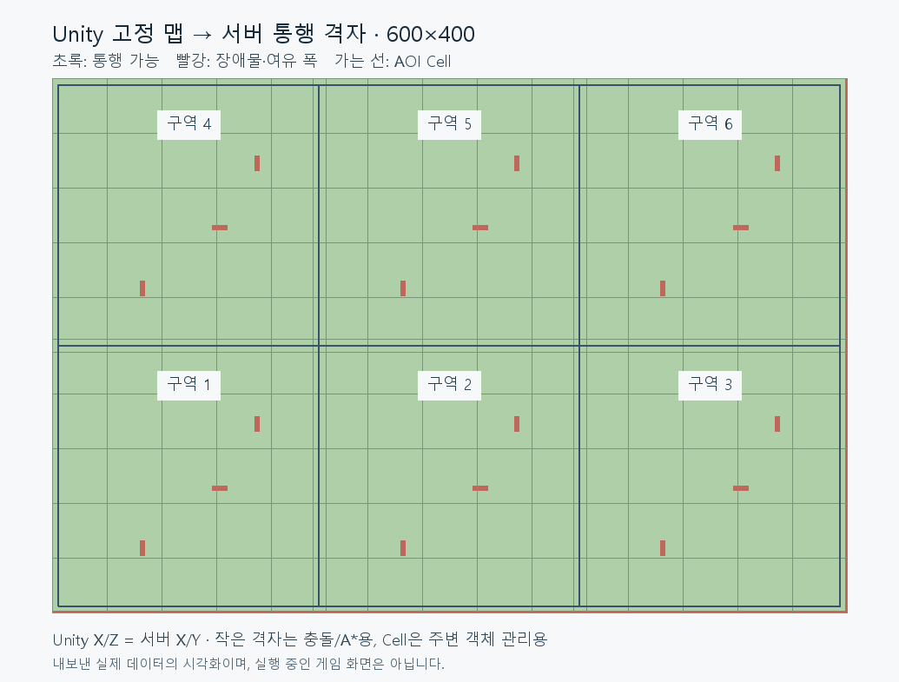
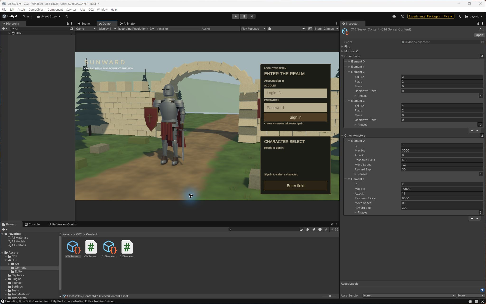
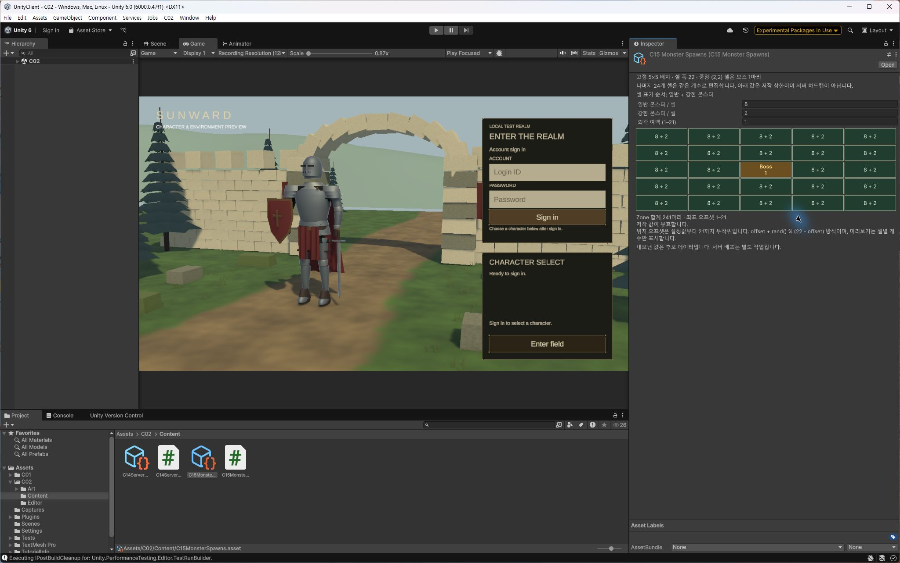
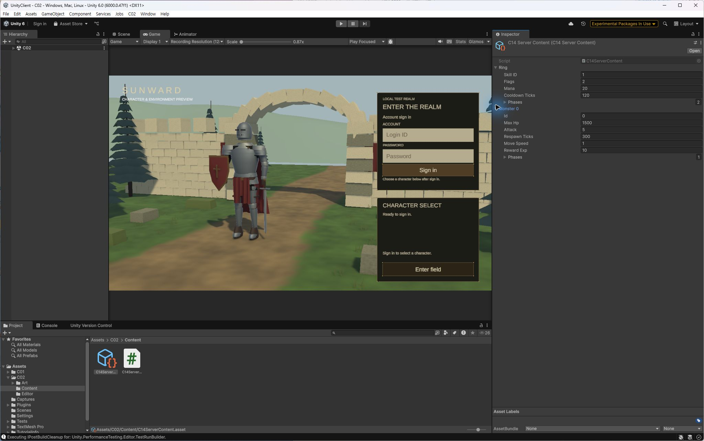

# 게임 콘텐츠와 맵 편집

요약: Unity에서 게임 수치와 맵 통행 정보를 편집하고, 서버가 같은 콘텐츠를 사용하도록 연결합니다.
상태: 검증된 결과

## 대표 화면

실제 내보낸 맵 데이터를 그린 도구 출력입니다. 게임 실행 화면과 구분하며, 스킬·몬스터 설정 화면은 화면 이력에서 볼 수 있습니다.

## 구현한 기능

- Unity Inspector의 기존 스킬·몬스터 능력·공격 범위·보스 단계 편집
- 기존 서버 콘텐츠 데이터 내보내기와 파일 변경 전 값 검사

## 몬스터 배치 편집

- 셀별 몬스터 수·가장자리 간격 조정과 구역 합계 미리보기
- 배치·초기화 뒤 기존 수량·종류·순서 대조
- 무작위 배치 위치를 보장하지 않는 규칙 미리보기

## 맵의 통행·충돌 편집

- 고정 지면·장애물 기반 통행 데이터 내보내기와 서버·클라이언트 공유
- 벽·대각 모서리 충돌과 편집기 내 통행 영역 확인
- 주변 객체 관리 Cell과 통행 격자 분리, 실패 시 직전 데이터 보존

- 통행 격자는 충돌·이동 판정용이며 A* 경로 탐색이나 몬스터 AI 변경은 포함하지 않음

## 현재 확인한 범위

기존 스킬·몬스터 설정 내보내기와 서버 적용 데이터 대조, 몬스터 배치 초기화, 맵 통행 데이터 내보내기·벽 충돌·구역 이동을 확인했습니다. 도구 출력·자동 검사와 실제 이동 입력의 결과를 구분했습니다.
콘텐츠 변경은 서버 빌드에 포함되어야 적용되며 편집 즉시 실행 서버에 반영되지는 않습니다.

## 화면 기록

### 2026-10-21 — Unity 맵의 통행 데이터

실제 내보낸 맵 데이터를 시각화한 그림입니다.

### 2026-10-19 — 기존 스킬·몬스터 전체로 편집 범위 확장

기존 수치를 유지하면서 보스 공격 패턴과 나머지 몬스터까지 편집 범위를 넓힌 화면입니다.

### 2026-10-19 — 몬스터 배치 편집과 미리보기

기본 배치 규칙과 구역 합계를 보여주는 편집 화면입니다.

### 2026-10-19 — Unity에서 스킬·몬스터 수치 편집

기본 게임 수치를 유지한 이전 편집 화면입니다.
