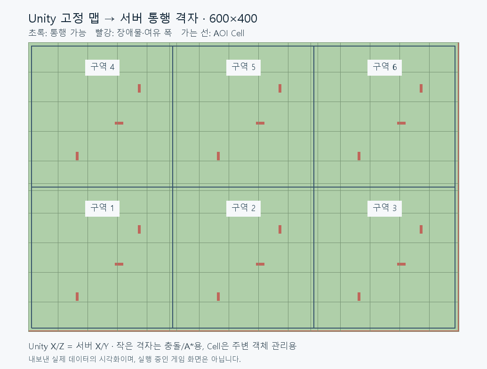
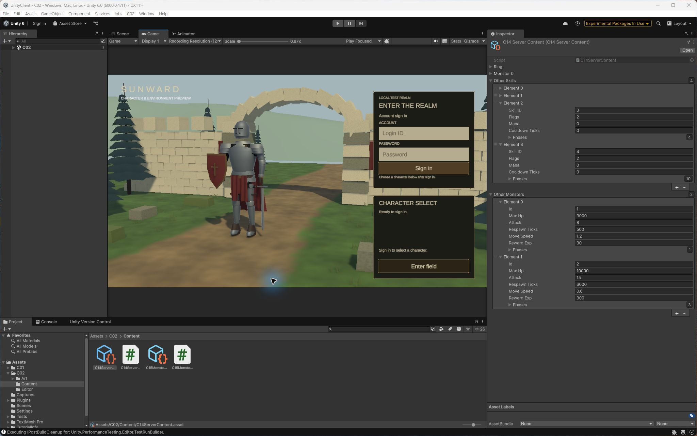
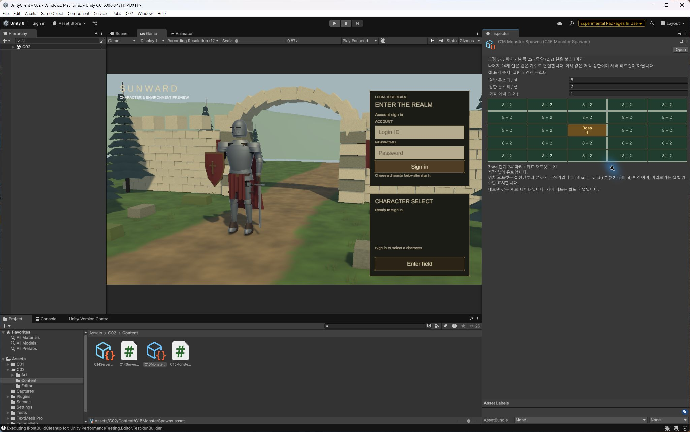
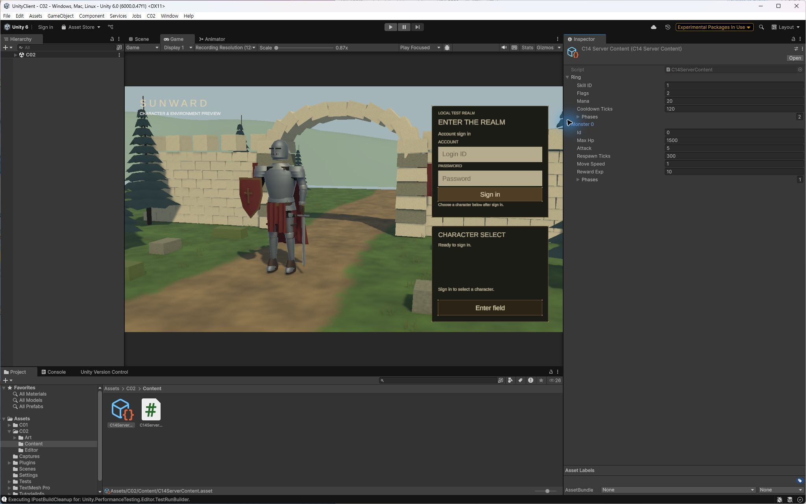

# 게임 콘텐츠와 맵 편집

요약: Unity에서 게임 수치와 맵 통행 정보를 편집하고, 서버가 같은 콘텐츠를 사용하도록 연결합니다.
상태: 검증된 결과

## 구현한 기능

Unity Inspector에서 기존 스킬·몬스터의 능력과 공격 범위, 보스의 기존 단계 설정을 편집하고 서버용 데이터를 내보냅니다. 잘못된 값은 파일을 바꾸기 전에 검사합니다. 지원 범위는 서버의 기존 콘텐츠에 한정됩니다.

## 몬스터 배치 편집

셀별 몬스터 수와 가장자리 간격을 조정하고 구역 합계를 미리 볼 수 있습니다. 미리보기는 배치 규칙이며 무작위 생성 위치를 보여주지는 않습니다. 배치와 초기화 검사는 기존 수량·종류·순서를 대조했습니다. 새 구역별 밀도 설정은 현재 후보에서 기존 수를 유지하며 실행 서버에 적용하지 않았습니다.

## 맵의 통행·충돌 편집

Unity에서 고정 지면과 장애물을 지정해 통행 데이터를 내보냅니다. 서버와 클라이언트가 같은 데이터를 사용하며 벽과 대각선 모서리를 통한 이동을 막습니다. 주변 객체 관리에 쓰는 Cell과 통행 격자는 별도입니다. 내보내기 실패 때는 직전 데이터를 보존하고, 편집기에서 통행 가능·차단 영역을 확인할 수 있습니다.

이 통행 격자는 충돌·이동 판정용입니다. A* 경로 탐색은 이 작업 범위에 포함하지 않았으며, 몬스터 배회·전투 로직의 변경 결과로 설명하지 않습니다.

## 현재 확인한 범위

스킬·몬스터 수치를 서버 코드로 내보내 컴파일하고 기존 테이블과 대조했습니다. 서버 초기화의 몬스터 배치와 내보내기 오류 시 기존 파일 보존도 확인했습니다. 맵 데이터 생성·서버 빌드·자동 충돌 검사와 실제 이동 입력에 의한 벽 충돌·인접 구역 전환을 확인했습니다. 변경한 콘텐츠는 서버 빌드에 포함되어야 적용되며, 실행 서버가 편집 즉시 바뀌지는 않습니다.

화면 기록에는 실제 게임 화면과 Unity 편집기·내보낸 격자 그림이 있습니다. 이미지 설명에서 실행 화면과 도구 화면을 구분합니다.

## 화면 기록

### 2026-10-21 — Unity 맵의 통행 데이터

실제 내보낸 맵 데이터를 시각화한 그림입니다. 초록은 통행 가능 영역, 빨강은 장애물과 여유 폭입니다. 가는 선은 주변 객체 관리용 Cell이며, 실행 중인 게임 화면은 아닙니다.

### 2026-10-19 — 기존 스킬·몬스터 전체로 편집 범위 확장

기존 수치를 유지하면서 보스 공격 패턴과 나머지 몬스터까지 편집 범위를 넓힌 화면입니다.

### 2026-10-19 — 몬스터 배치 편집과 미리보기

기본 배치 규칙과 구역 합계를 보여주는 편집 화면입니다. 변경한 값은 검증·내보내기와 서버 빌드를 거쳐 적용합니다.

### 2026-10-19 — Unity에서 스킬·몬스터 수치 편집

기본 게임 수치를 유지한 이전 편집 화면입니다.
